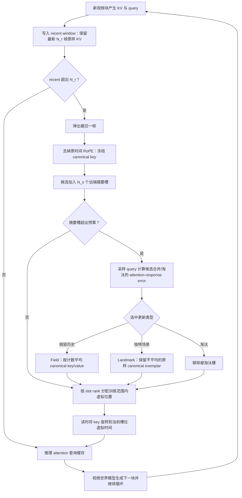

# WorldTrace：让视频世界模型找回旧场景 / Addressable Memory for Video World Models

## 一句话定义

**WorldTrace（arXiv:2608.07408v2）**是无需重训生成器的长程视频世界模型 KV-cache 记忆框架：使用**槽位排名对应的训练范围内虚拟位置**让远景记忆能被查询，并组合 **Field 压缩**与 **Landmark 冻结帧**让重要场景可回忆。

## 英文缩写速查

| 缩写 | 英文全称 | 简要说明 |
|------|----------|----------|
| KV | Key–Value | Transformer 注意力的历史 key/value 缓存 |
| RoPE | Rotary Positional Embedding | 时间旋转位置编码；过长相对时间差会超出训练范围 |
| AR | Autoregressive | 按视频 chunk 自回归生成 |
| OOD | Out-of-Distribution | 训练窗口外的相对时间编码 |
| DINOv2 | DINO version 2 | 用视觉特征余弦相似度衡量回到原地的场景一致性 |
| LPIPS | Learned Perceptual Image Patch Similarity | 感知差异指标，越低越好 |
| MG2 | Matrix-Game-2 | 主实验的 1.3B 交互视频世界模型 |

## 核心信息

| 字段 | 已核实信息 |
|------|------------|
| 论文 | [arXiv:2608.07408v2](https://arxiv.org/html/2608.07408v2)，NeurIPS 2026；2026-11-11 v2 |
| 作者 | Xindi Wu、Sven Elflein、James Lucas、Olga Russakovsky、Laura Leal-Taixé、Despoina Paschalidou、Jonathan Lorraine、Aljosa Osep |
| 机构 | 英伟达（NVIDIA）、普林斯顿大学（Princeton University）、多伦多大学（University of Toronto）、向量研究所（Vector Institute） |
| 官方项目 | [WorldTrace 项目页](https://research.nvidia.com/labs/sil/projects/WorldTrace/) |
| 数据/骨干 | LoopBench（4 类 × 3 条配置）；主实验 Matrix-Game-2 1.3B，附录 LingBot-World 14B |
| 代码状态 | 截至 2026-11-23，项目页未列可核实的官方 WorldTrace 可运行代码入口 |
| 类型与边界 | 推理期视频生成记忆管理；**不是**机器人真机控制策略或建图系统 |

## 为什么重要

交互世界模型在转头或绕行后回到同一位置时，必须重现**先前自己生成过的**视觉内容。常规滑动窗口丢弃远帧；即使保留远帧，时间 RoPE 的 query–key 相对距离也可能跑到训练范围以外，使旧记录“存着但查不到”。直接平均带不同 RoPE 旋转的 key 又会相互抵消，形成信息压缩损坏。

这项工作将长期记忆拆成两条工程验收线：**可寻址**（旧信息是否还会被注意力读到）与**有信息量**（缓存内容能否区分具体场景）。其作用在 [生成式世界模型](../methods/generative-world-models.md) 的视频持续性，不等于验证其 [视频即仿真](../concepts/video-as-simulation.md) 的物理忠实度。

## 流程总览

依据论文 §2–3、Algorithm 1（Appendix H）整理的推理期**数据与决策流**；此图为论文算法说明，不是源码验证的调用时序。

## 核心原理

### 1. Slot-rank virtual positions：缓存必须能被“找到”

- 近端真实帧窗口为 `N_r`，远端摘要槽为 `N_s`，合计 `L_attn = N_s + N_r`。
- 在当前查询位置 `q`，槽编号 `s=0..N_s-1` 的虚拟时间 `t_v(s) = q - (L_attn - 1 - s)`；相对时间差只由槽号决定，而不是由生成总长度决定。
- 若 `L_attn - 1 <= Δt_train`，摘要槽都在训练时见过的最大相对时间距离内，且互相占不同位置。**不是**把每个远帧的真实时间永久改写，也不是无限扩展可无损保存的记忆数。

### 2. 两种 writer：压缩重复帧，保留独特帧

| Writer | 输入与操作 | 保留信息 | 易失信息 |
|--------|------------|----------|----------|
| WorldTrace-Field | 原时间 key 去 RoPE，在 canonical 空间对连续历史分组/计数平均；value 平均；读时重新旋转 | 长程平滑背景及冗余统计 | 单个场景的细粒度区分 |
| WorldTrace-Landmark | 对场景进入时刻的帧保存**一次冻结**的 canonical key 与 value，不作平均 | 独特场景的 episodic 视觉回忆 | 未选为 landmark 的历史 |
| WorldTrace（组合） | 以 attention-response error 衡量合并/淘汰影响，相容观测归入 Field，不相容保留 exemplar | 更好平衡重复历史与独特场景 | 仍受缓存槽数及外部 exemplar bank 预算约束 |

Landmark 指保留的视觉场景帧，**不是** SLAM 的三维几何路标。冻结 canonical key 可避免 bfloat16 反复去旋/加旋导致误差积累。组合方法关注“未来 query 还能否恢复旧画面”，并非显式做位姿回环优化。

## 实验与评测

**协议**：Matrix-Game-2（1.3B、3D-RoPE），17 场景 × 3 随机种子 = 51 rollouts；LoopBench 12 条配置，划为 waypoint topology、回路长度、相机朝向、重复到访四类。指标是**第一次生成的视角与返程再生成画面**之间的 DINOv2 特征相似和 Return LPIPS，而非真实环境外部 GT。

| 方法 | 12 配置平均 DINOv2 ↑ | 含义 |
|------|--------------------:|------|
| Sliding window | 0.587 | 只留最近帧 |
| WorldTrace-Field | 0.576 | 仅平均历史，易丢辨识信息 |
| WorldTrace-Landmark | 0.715 | 保留场景进入帧 |
| **WorldTrace（组合）** | **0.778** | 相对滑窗 **+32.6%** |

- **12 项最高的准确边界**：对 Table 1 的滑窗和 MemRoPE，组合方法 12/12 项平均 DINOv2 更高；纳入 Field/Landmark 消融则为 **11/12**，Pan 90° 是单独 Landmark 0.917 优于组合 0.911。
- **不是所有指标都胜出**：Pan 180° 的组合 LPIPS 0.649（差于滑窗 0.634）；Pan 360° 的 DINOv2 仅从 0.406 提至 0.423，且差距接近标准误差。
- **长时记忆**：ABA 回路扩至 128 个 chunks 时，组合 DINOv2 0.698 / LPIPS 0.572，滑窗为 0.251 / 0.751。
- **跨骨干限制**：LingBot-World 14B 也显示部分回忆改进，但在 ABCA、长 ABA 和 360° 转动等配置 MemRoPE 胜出，主表 12/12 不能当跨架构定律。
- **额外开销**：虽然所有方法 **attended-cache 都是六帧**，完整版的额外 verbatim bank 仍多用 **3.1 GB 显存**；L40 48 GB / N=8 测得每块 **1.10→1.40 s（+27%）**，不能宣称“免费提速”。

## 与其他工作对比

| 相关路线 | 本文的区别 |
|----------|------------|
| Sliding window | 有固定速度/显存边界，但远景直接丢弃，回环一致性容易恶化 |
| MemRoPE | 同类免重训 KV 记忆，但使用双摘要流/在线索引；WorldTrace 支持多个可区分的 slot-rank 位置与可选择的 verbatim frame |
| Infinity-RoPE | 重分配时间相对位置，着重无限生成；WorldTrace 同时解决**压缩槽位置**与内容选择 |
| [生成式世界模型](../methods/generative-world-models.md) | 本方法是推理阶段的记忆模块，不改变预训练模型的动作条件或视频生成主干 |
| [Model-Based RL](../methods/model-based-rl.md) | 真实机器人规划需要动作动力学与任务回报；本文只有视频回访一致性指标 |
| [HarnessEval-W](./paper-harnesseval-w.md) | HarnessEval-W 关注交互式世界模型的干预/证据链评测；LoopBench 专测生成内容回访一致性 |

## 结论

**世界模型“记住一帧”不等于“能在以后找到它”：虚拟时间可寻址性与场景辨识信息应一起设计。**

1. 先检查 temporal RoPE 查询相对距离是否超训练窗口；不是所有长期失忆都应归因于 KV 内容被丢。
2. 聚合 key 时应先去掉不同时间的 RoPE 相位，再按槽位重旋；直接平均旋转后 key 会损坏检索分数。
3. 区分 Field 的冗余压缩与 Landmark 的独特场景记忆；仅靠 Field 在主实验没有提高平均回访分数。
4. 报告结果时写明 DINOv2 **相对+32.6%** 及 LoopBench/模型限定，不把它解释为生成速度、画质或者真机任务成功率提升。
5. 相同 attended-cache 长度**不等于**相同总显存或延迟；工程部署需实测多出来的 3.1 GB 和 +27% 时间。
6. 若要用于机器人闭环仿真，另行评估动作忠实、几何一致与真实场景对齐；论文没有证明这些能力。

## 工程实践

- **接入位置（原文算法）**：在自回归生成每个 chunk 的 KV cache 读写位置维护 `recent`、`summary` 与 canonical key，按虚拟槽位执行读时 RoPE；保留 `Ns/Nr` 和 attention-output mismatch 指标。
- **配置基准**：MG2 原实验 `N_s=4`、`N_r=2`、`Δt_train=5`；使用相同 held-out LoopBench 场景、轨迹、随机种子和总显存口径横评。
- **验收建议**：同时报告 DINOv2、Return LPIPS、每块 latency、GPU peak memory 和不同 revisit 次数/视角；不要把生成视频中的“地标”当真机地图。
- **源码运行时序图：不适用**。截至 2026-11-23 官方项目页未列可核实的 WorldTrace 运行代码/CLI；本页 Mermaid 仅依据 Algorithm 1 表达论文推理流程，未冒充实际源码调用。
- **原始记录**：论文与官方开放核查见下方 `sources/` 两份档案。

## 局限与风险

- 只针对带时间 RoPE 与已知本地 attention window 的 AR video world model，不能直接套用到任意视频生成器或非 RoPE 网络。
- `N_s` 有限：进入超过其数量的独立场景时旧 Landmark 会被淘汰；Field 压缩随时间有损，场景进入检测漏掉重要状态时仍会忘。
- 当前是**生成世界的自一致性**，不包含外部场景真值、接触物理、安全或机器人真机策略的成败。
- 跨骨干结果不均一；增加的 memory bank/排序过程和 27% 运行时间必须一同考虑。
- NeurIPS v2 的 DINOv2/LPIPS 与早期 Workshop 版 PAC/TempSSIM 口径不同，旧数字不可混用。

## 关联页面

- [Generative World Models](../methods/generative-world-models.md) — 本文作为视频自回归推理期的 KV 记忆模块
- [Video-as-Simulation](../concepts/video-as-simulation.md) — 区分“回访视觉一致”与真实物理模拟
- [世界模型功能分类](../concepts/functional-taxonomy-world-models.md) — 将其归为可交互的 Renderer 记忆增强而非可验证的物理 Simulator
- [Model-Based RL](../methods/model-based-rl.md) — 对照动作模型及规划要求
- [HarnessEval-W](./paper-harnesseval-w.md) 与 [WorldScore](./paper-worldscore.md) — 不同维度的世界模型评测
- [Matrix-Game-2](./paper-sa-2508-13009-matrix-game-2-0-an-open-source-real-time-and-str.md) — 主实验模型
- [具身模型测评纵深 Stage 2](../../roadmap/depth-embodied-eval.md) — 长程场景守恒评测入口

## 参考来源

- [WorldTrace v2 原文逐节归档](../../sources/papers/worldtrace_addressable_memory_arxiv_2608_07408.md)
- [NVIDIA 官方项目页与开放状态核查](../../sources/sites/worldtrace-nvidia-project.md)
- [原始论文 HTML v2](https://arxiv.org/html/2608.07408v2)

## 推荐继续阅读

- [WorldTrace NVIDIA 项目页、方法图与演示](https://research.nvidia.com/labs/sil/projects/WorldTrace/)
- [论文 PDF（v2）](https://arxiv.org/pdf/2608.07408)
