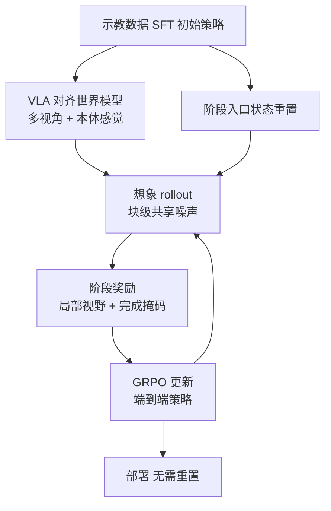

# WoVR+：把世界模型当作可靠模拟器优化 VLA

**WoVR+ 用动作条件视频世界模型替代真机交互，在想象里对 π0.5 这类流式 VLA 做 GRPO；靠 VLA 对齐的多视角 / 本体感觉接口、动作块级噪声、阶段局部训练，抑制幻觉与长程误差累积。**

论文 *WoVR+: World Model as Reliable Simulator for Versatile VLA Policy Optimization with RL*（[arXiv:2610.17922](https://arxiv.org/abs/2610.17922)，[项目页](https://youmo445.github.io/WoVR_Plus.github.io/)）。前作索引见 [WoVR 清单页](paper-rcl-2602-13977-wovr-world-models-as-reliable-simulators-for-pos.md)。

## 英文缩写速查

| 缩写 | 英文全称 | 简要说明 |
|------|----------|----------|
| WM | World Model | 以动作为条件预测多视角未来帧的视频模型，充当想象环境 |
| GRPO | Group Relative Policy Optimization | 在想象 rollout 上做的 clipped RL 更新，见 [GRPO](../methods/grpo.md) |
| SDE | Stochastic Differential Equation | Flow-SDE 为流式策略注入探索噪声（取自 πRL） |
| DMD2 | Distribution Matching Distillation 2 | 将多步生成蒸馏为单步，WoVR+ 约 15 FPS |

## 为什么重要

- 真机 RL 昂贵，世界模型幻觉又会误导优化；该文用「世界模型与真机成功率高度相关」作为可靠性证据（Pearson 0.97）。
- 把想象训练推广到多视角、含本体感觉的 VLA 接口与长程任务，而不仅是单视角短任务。
- 阶段局部训练给长程稀疏奖励提供了可操作的拆法。

## 核心信息

| 项 | 内容 |
|----|------|
| **机构** | 中国科学院自动化研究所；中国科学院大学人工智能学院；中关村学院；西交利物浦大学；清华大学；Anyverse Dynamics（通讯 Haoran Li），依据 arXiv HTML |
| **世界模型** | Wan2.2-TI2V-5B 视频骨干 + VACE 式 DiT 控制分支；射线 / 末端位姿动作图条件 |
| **策略与 RL** | π0.5 真机策略；clipped GRPO + Flow-SDE，基于 RLinf |
| **平台** | RoboTwin（Adjust Bottle、Click Bell）；真机六任务 + 四阶段手机包装 |
| **开源** | **未列链接**（2026-10-17 核查）：项目页仅视频与方法说明，无 Code 区；论文附录后部未读，代码声明未核实 |

## 核心原理

### 流程总览

- **接口对齐：** 绝对关节目标经正运动学转末端位姿，投影为各视角动作图；本体感觉由命令目标平移一步近似，无学习状态模型。
- **块级噪声：** 一个高斯向量覆盖整个动作块，只改变时间相关性；训练时每块仅采样一步 SDE，其余用 ODE。
- **阶段局部训练：** 从有数据支持的入口状态起算，各阶段均匀加权，有阶段奖励与局部视野。

## 源码运行时序图

**不适用**：截至 2026-10-17 项目页与论文可见内容均无官方仓库。训练基础设施提及 RLinf（见 [RLinf-VLA](paper-rlinf-vla.md)），但 WoVR+ 本身代码未发布。

## 与其他工作对比

| 维度 | WoVR+（本文） | [WoVR](./paper-rcl-2602-13977-wovr-world-models-as-reliable-simulators-for-pos.md)（前作） | [Ctrl-World](./paper-ctrl-world.md) | [RLinf-VLA](./paper-rlinf-vla.md) |
|------|------|------|------|------|
| 角色 | 世界模型当模拟器，对 π0.5 做 GRPO | 世界模型当模拟器做策略后训练 | 多视角动作条件 WM，用于策略评估与合成轨迹 SFT | 统一 VLA + RL 训练平台（仿真环境） |
| 视角 / 接口 | 多视角 + 本体感觉对齐，动作图条件 | 3 视角（本文对照设置） | 第三人称 + 腕部视角，帧级动作条件 + 位姿记忆 | 依接入的仿真器 |
| 策略改进方式 | 想象中 RL（GRPO + 块级 Flow-SDE），阶段局部训练 | 想象中 RL | 想象中搜成功轨迹后 SFT | 仿真中直接 RL |
| 本文对照的 FVD | 62.16 | 109.33 | 229.83 | 不适用 |

- **相对 WoVR：** WoVR+ 把接口扩展到多视角 + 本体感觉并加入阶段局部训练，面向长程任务；同一设置下 FVD 由 109.33 降到 62.16。
- **相对 Ctrl-World：** 同为多视角动作条件 WM，Ctrl-World 侧重 policy-in-the-loop 评估与合成数据 SFT，WoVR+ 直接在想象 rollout 上做 RL 更新；FVD 对比为 WoVR+ 论文自报。
- **相对 RLinf-VLA：** WoVR+ 的 RL 基础设施基于 RLinf，差别在于把仿真器换成世界模型；本文 RoboTwin 上收敛的直接 RL 仍高于想象训练，世界模型的价值在于节省真机交互。
- 除 FVD 外各文任务与评测不同，成功率不可横比。

## 工程实践

| 项 | 建议 |
|----|------|
| 先验证世界模型 | 先看世界模型与真机成功率排序是否一致（论文 6 个任务-策略对 r=0.97） |
| 推理速度 | 5 步约 9.41 FPS，DMD 单步约 15.03 FPS，决定想象吞吐 |
| 阶段划分 | 需人工标注阶段边界与入口状态；采样用均匀而非到达匹配 |
| 想象训练信息量 | 阶段奖励下 GRPO 有信息组约 94%，二值奖励约 51%；吞吐 47.6 对 30.1 组 / 小时 |
| 开源状态 | 2026-10-17 未列代码，复现需自建世界模型与 RLinf 流程 |

## 实验与评测

- **RoboTwin 多视角（固定 / 随机初始）：** Adjust Bottle SFT 79.00 / 70.70 → WoVR+ 93.00 / 91.80；Click Bell 71.00 / 72.66 → 92.00 / 93.75。直接 RL（收敛）更高（95.00 / 99.00，固定初始），说明想象训练是省真机交互而非超越。
- **视频预测：** WoVR+ LPIPS 0.148、FVD 62.16、PSNR 22.28；Ctrl-World FVD 229.83，WoVR（3 视角）109.33。
- **真机：** 六任务各 20 次，平均 39.2% → 55.8%（50 次 WM-RL 更新）。
- **手机包装（四阶段）：** SFT 30%，全程起点 + 阶段奖励 55%，阶段重置均匀采样 75%，到达匹配采样仅 20%。
- 摘要口径：RoboTwin +21.09%，真机 +16.7%。

## 结论

**WoVR+ 的价值在于把世界模型 RL 推到多视角、长程场景，但可靠性仍靠阶段标注与小样本真机验证支撑。**

1. **多视角接口有效** — 同一设置下相对前作 WoVR（3 视角）FVD 109.33 → 62.16。
2. **阶段采样是关键** — 同为阶段重置，均匀采样 75%，到达匹配采样 20%。
3. **不是超越真 RL** — RoboTwin 上收敛的直接 RL 仍更高。
4. **有人工成本** — 阶段边界、入口状态需人工标注。
5. **验证样本小** — 真机每任务 20 次；论文承认块级噪声下代理比率不是精确联合似然。

## 局限与风险

- 论文自述：依赖预定义阶段；块级 Flow-SDE 引入跨 token 相关，GRPO 用逐 token 代理比率；真机试验数少；后续要做自动阶段发现。
- 世界模型幻觉仍可能在分布外状态出现（推测，论文以相关性间接验证）。
- 开源缺口：截至 2026-10-17 无仓库。

## 关联页面

- [VLA](../methods/vla.md) — 被优化的策略族
- [GRPO](../methods/grpo.md) — 想象 rollout 上的更新算法
- [生成式世界模型](../methods/generative-world-models.md)
- [Video as Simulation](../concepts/video-as-simulation.md) — 视频模型当模拟器的思路
- [Flow Matching 具身策略](../concepts/flow-matching-embodied-policy.md)
- [WoVR 前作清单页](paper-rcl-2602-13977-wovr-world-models-as-reliable-simulators-for-pos.md)

## 参考来源

- [wovr_plus_arxiv_2610_17922.md](../../sources/papers/wovr_plus_arxiv_2610_17922.md) — 论文摘录与开源核查
- [wovr-plus-project.md](../../sources/sites/wovr-plus-project.md) — 项目页归档
- [arXiv:2610.17922](https://arxiv.org/abs/2610.17922)

## 推荐继续阅读

- [WoVR+ 项目页](https://youmo445.github.io/WoVR_Plus.github.io/)
- [WoVR+ 论文 HTML](https://arxiv.org/html/2610.17922v1)
