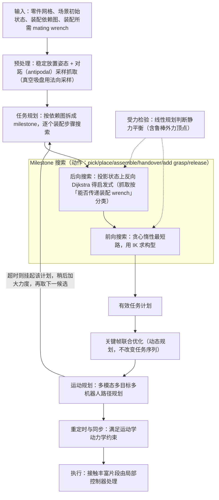

# Wrap

**Wrap**（*Fixtureless Wrench-aware Multi-Robot Assembly Planning*，[arXiv:2609.29407](https://arxiv.org/abs/2609.29407)，[项目页](https://www.vhartmann.com/wrap)）收录自 [具身智能小站 12 篇清单](../../sources/blogs/wechat_embodied_station_12_papers_research_checklist_2026-09-26.md)。

## 一句话定义

**多机器人协同托稳并装配时，把受力、抓取与运动规划放在同一 wrench-aware 搜索里，避免只靠专用夹具。**

## 英文缩写速查

| 缩写 | 英文全称 | 简要说明 |
|------|----------|----------|
| VLA | Vision-Language-Action | 视觉-语言-动作策略 |
| IL | Imitation Learning | 模仿学习 |
| SR | Success Rate | 任务成功率 |
| WM | World Model | 世界模型 |

## 为什么重要

- 纳入 [12 篇具身研究清单](../../wiki/overview/embodied-research-12-papers-technology-map.md) 主线，与同期 VLA / 接触 / 规划 / 安全论文可横向对照。
- 公众号强调的可操作读法：先看 **任务信息需求**（如 PolyUMI 旋灯泡仍以视觉最优）与 **评测口径**（如 Self-Adaptive 多 trial、BeyondRetarget 仿真片段非真机 SR）。
- 开源状态（步骤 2.5）：**待发布**。

## 流程总览

图依据：论文 §IV-A~E、Algorithm 1/2 / Fig.2

## 核心信息

| 项 | 内容 |
|----|------|
| **arXiv** | [2609.29407](https://arxiv.org/abs/2609.29407) |
| **项目页** | https://www.vhartmann.com/wrap |
| **代码** | 截至入库日未列 |
| **开源** | **待发布** |

## 实验与评测（公众号口径）

- 指标与消融以 [公众号盘点](../../sources/blogs/wechat_embodied_station_12_papers_research_checklist_2026-09-26.md) 与 **原文 PDF** 为准；本页不复制整表。
- 读复现前先核对：样本规模、是否仿真/真机、是否允许多次 attempt。

## 源码运行时序图

**不适用**（截至 2026-09-26 项目页未提供可运行官方代码仓库；见 [sources/papers/wrap-wrench-aware-assembly_arxiv_2609_29407.md](../../sources/papers/wrap-wrench-aware-assembly_arxiv_2609_29407.md)）。

## 结论

**总判：Wrap 适合作为「多机器人协同托稳并装配时，把受力、抓取与运动规划放在同一 wrench-awar…」方向的入口页；细节以 arXiv 与项目页为准。**

1. 与 [12 篇技术地图](../overview/embodied-research-12-papers-technology-map.md) 对照选型，避免与同名不同 arXiv 的工作混淆（如 RAPID vs RAPID-VLM-RL）。
2. 开源为 **待发布** 时优先从项目页 Code 区核实，再写复现计划。
3. 长程 / 部署类条目（AdaHVLA、HarnessPAI、Self-Adaptive VLA）同时记录 **成功率定义** 与 **失败恢复预算**。

## 与其他工作对比

| 对照 | 差异读法 |
|------|----------|
| 专用夹具 / 仅自上而下装配 | 传统做法；Wrap 用 **多机器人互相托持** 替代夹具，并允许利用桌面等外部支撑 |
| [PEEL](./paper-peel-disassembly.md) | 求解拆解/装配 **顺序**（MAB-RRT 窄缝逃逸）；Wrap 以部件顺序依赖为输入，重点在 **多机任务分配 + 线性规划校核受力支撑抓取** |
| [VT-Refine](./paper-sa-2510-14930-vt-refine-learning-bimanual-assembly-with-visuo.md) | 学习式双臂装配（扩散策略 + 触觉仿真 RL 精修）；Wrap 是 **规划式**，执行时再拆成接触丰富装配技能与自由空间运动 |
| [Isaac Lab UR10e 装配](./nvidia-isaac-lab-ur10e-industrial-assembly-sim2real.md) | 单臂 RL 插入 + 阻抗环；Wrap 面向尺寸、运动学各异的 **机器人群组** 与多部件装配 |

## 关联页面

- [具身研究 12 篇技术地图](../overview/embodied-research-12-papers-technology-map.md)
- [Manipulation](../tasks/manipulation.md)
- [VLA](../methods/vla.md)

## 参考来源

- [wrap-wrench-aware-assembly 论文归档](../../sources/papers/wrap-wrench-aware-assembly_arxiv_2609_29407.md)
- [公众号 12 篇清单](../../sources/blogs/wechat_embodied_station_12_papers_research_checklist_2026-09-26.md)
- [arXiv PDF](https://arxiv.org/pdf/2609.29407)：已通读方法部分（实验与附录以略读为准）：§III 问题表述、§IV 多机器人装配规划（A 受力约束至 E 重定时与执行）

## 推荐继续阅读

- [arXiv:2609.29407](https://arxiv.org/abs/2609.29407)
- [项目页](https://www.vhartmann.com/wrap)
