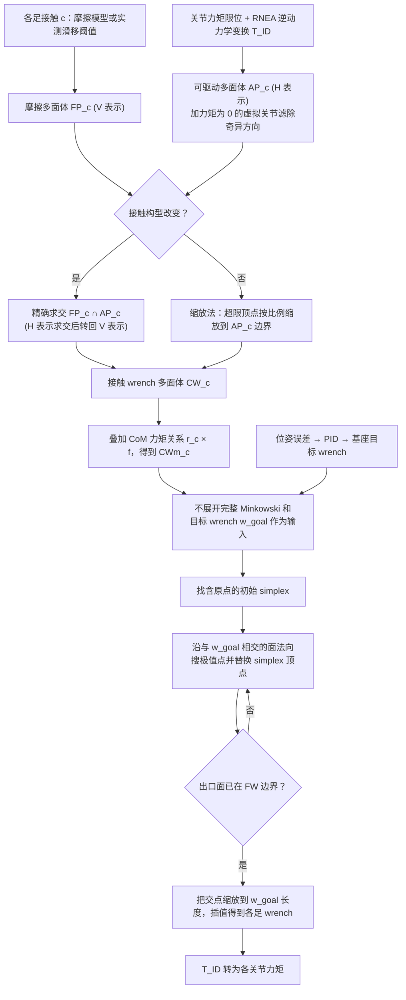

# 力旋多面体稳定（arXiv:2609.17405）

**力旋多面体稳定**（*Optimized Wrench Polytope Analysis for Real-Time Stability Control of Legged Robots in Complex Multi-Contact Configurations*，[arXiv:2609.17405](https://arxiv.org/abs/2609.17405)）来自 [senlanke 具身运控lab 周更盘点](../../sources/blogs/wechat_senlanke_weekly_humanoid_quadruped_2026-09-14_18.md)（2026-09-14–18）。

## 一句话定义

**高效六维多面体交集与原点单纯形扩展；~49 Hz 计算各关节可实现力矩；LAURON VI 斜墙多接触稳定。**

## 英文缩写速查

| 缩写 | 英文全称 | 简要说明 |
|------|----------|----------|
| Wrench | Wrench Polytope | 力旋多面体 |
| MPC | Model Predictive Control | 模型预测控制 |
| CoM | Center of Mass | 质心 |

## 为什么重要

- 复杂多接触下实时力旋分析是稳定控制瓶颈。

## 流程总览

图依据：论文 §III–V（Fig. 2–5）与 §VI 控制器架构（Fig. 6）

## 核心机制

| 项 | 内容 |
|----|------|
| **arXiv** | [2609.17405](https://arxiv.org/abs/2609.17405) |
| **开源** | **待发布**（步骤 2.5，2026-09-20） |
| **方法摘要** | Optimized wrench polytope intersection + feasible torque computation at ~49 Hz. |

## 源码运行时序图

**不适用**（截至 2026-09-20 未发布可运行官方代码或待核实）。

## 实验与评测

- LAURON VI multi-contact incl. inclined wall support（作者报告）。
- 读法：先对齐任务设定、传感器与成功定义，再解读 headline 数字。

## 与其他工作对比

| 维度 | 读法 |
|------|------|
| **同周对照** | 见对应 [周更盘点](../../sources/blogs/wechat_senlanke_weekly_humanoid_quadruped_2026-09-14_18.md) 映射表，勿跨任务直接比 SR |
| **开源状态** | **待发布** — 部署前以项目页/arXiv 为准 |

## 结论

**本文把力旋多面体分析推到复杂多接触场景的实时稳定控制。**

1. 开源：**待发布**；勿凭公众号摘要臆断可复现性。
2. 指标须连同实验条件解读（仿真/真机、平台、成功阈值）。
3. 关注 arXiv 版本更新与代码发布。

## 关联页面

- [contact-dynamics](../concepts/contact-dynamics.md)
- [locomotion](../tasks/locomotion.md)
- [model-predictive-control](../methods/model-predictive-control.md)

## 参考来源

- [wrench-polytope-stability_arxiv_2609_17405.md](../../sources/papers/wrench-polytope-stability_arxiv_2609_17405.md)
- [wechat_senlanke_weekly_humanoid_quadruped_2026-09-14_18.md](../../sources/blogs/wechat_senlanke_weekly_humanoid_quadruped_2026-09-14_18.md)
- [arXiv:2609.17405](https://arxiv.org/abs/2609.17405)
- [arXiv PDF](https://arxiv.org/pdf/2609.17405)：已通读方法部分（实验与附录以略读为准）：§I–V（稳定判据、CW_c 构造、FW 迭代分析），§VI 控制器架构与实验设定

## 推荐继续阅读

- [arXiv PDF](https://arxiv.org/pdf/2609.17405)
