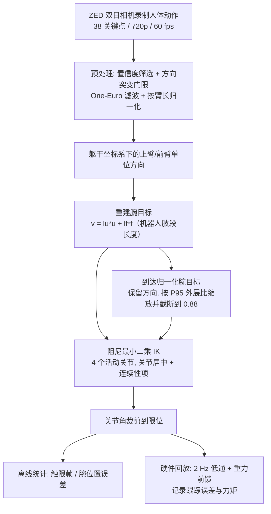

# 腕目标与关节限位实证：人形手臂重定向中腕部目标构造与关节限位的实证研究

**腕目标与关节限位实证**（*An Empirical Study of Wrist-Target Construction and Joint-Angle Limits in Humanoid Arm Retargeting*，[arXiv:2610.37801](https://arxiv.org/abs/2610.37801)）收录于 senlanke「具身运控lab」10-26–10-30 前沿论文动态（人形/四足）。本页依据**周报条目 + arXiv 摘要页**整理，流程图依据论文方法部分（见参考来源），未逐页核对实验数字；指标与结论以论文为准。

## 一句话定义

**腕目标与关节限位实证：人形手臂重定向中腕部目标构造与关节限位的实证研究——对比按人体肢段方向重建的腕部目标与按机器人可达距离归一化的目标；实验证明距离归一化能显著降低 Unitree H1-2 关节触限次数。**

## 英文缩写速查

| 缩写 | 英文全称 | 简要说明 |
|------|----------|----------|
| RL | Reinforcement Learning | 强化学习 |
| WBC | Whole-Body Control | 全身控制 |

## 为什么重要

- 周报所述待解决的问题：人体腕部目标直接映射到机器人时，可能频繁把手臂关节推到限位，并增加跟踪误差和执行力矩。

## 流程总览

图依据：论文 §III-B/C、§IV-A/B、§V-C、Fig.1

## 核心机制

| 项 | 内容 |
|----|------|
| **arXiv** | [2610.37801](https://arxiv.org/abs/2610.37801) · [PDF](https://arxiv.org/pdf/2610.37801) |
| **作者（arXiv）** | Chang, MinJun |
| **机构（周报所述，未逐条核实）** | 佐治亚理工学院 |
| **arXiv 评论栏** | （无） |
| **开源** | arXiv 摘要页与评论未见代码或项目页链接（仅核对 arXiv 摘要页，不代表未发布）（2026-11-02） |
| **周报所述创新点** | 对比按人体肢段方向重建的腕部目标与按机器人可达距离归一化的目标；实验证明距离归一化能显著降低 Unitree H1-2 关节触限次数。 |

### arXiv 摘要节选（英文原文）

> Motion retargeting maps a demonstrated human movement onto a robot to compute its joint motion. This study examines how the construction of the desired wrist position affects whether computed arm joint angles reach their permitted limits on a Unitree H1-2.

## 源码运行时序图

**不适用**：arXiv 摘要页与评论未见代码或项目页链接（仅核对 arXiv 摘要页，不代表未发布），无可对齐的官方代码流程。

## 实验与评测

- 周报与摘要给出的数字/场景已写入上表「创新点」与摘要节选；其余实验细节、基线与成功率定义请回到论文正文。
- 读法：先对齐任务设定、传感器与成功定义（仿真/真机），再解读 headline 数字，勿跨论文直接比较。

## 与其他工作对比

| 维度 | 读法 |
|------|------|
| **同周对照** | 见 [人形/四足周报技术地图](../overview/senlanke-weekly-2026-10-26-30-humanoid-quadruped-technology-map.md)，按方向浏览同期论文 |
| **开源状态** | arXiv 摘要页与评论未见代码或项目页链接（仅核对 arXiv 摘要页，不代表未发布） |

## 结论

**腕目标与关节限位实证：人形手臂重定向中腕部目标构造与关节限位的实证研究。**

1. 本页是入库级摘要，复现前请核对论文正文、附录与代码仓库。
2. 指标须连同实验条件解读。
3. 关注 arXiv 版本更新与代码发布。

## 关联页面

- [senlanke-weekly-2026-10-26-30-humanoid-quadruped-technology-map](../overview/senlanke-weekly-2026-10-26-30-humanoid-quadruped-technology-map.md)
- [humanoid-locomotion](../tasks/humanoid-locomotion.md)
- [reinforcement-learning](../methods/reinforcement-learning.md)

## 参考来源

- [wrist-target-joint-limit-humanoid-arm-retargeting_arxiv_2610_37801.md](../../sources/papers/wrist-target-joint-limit-humanoid-arm-retargeting_arxiv_2610_37801.md)
- [wechat_senlanke_weekly_humanoid_quadruped_2026-10-26_30.md](../../sources/blogs/wechat_senlanke_weekly_humanoid_quadruped_2026-10-26_30.md)
- [arXiv:2610.37801](https://arxiv.org/abs/2610.37801)
- [arXiv PDF](https://arxiv.org/pdf/2610.37801)：已通读方法部分（实验与附录以略读为准）：方法（§III 问题形式化、§IV-A 动作捕捉与预处理、§IV-B 关节角计算）与实验设定（硬件回放协议）

## 推荐继续阅读

- [arXiv PDF](https://arxiv.org/pdf/2610.37801)
