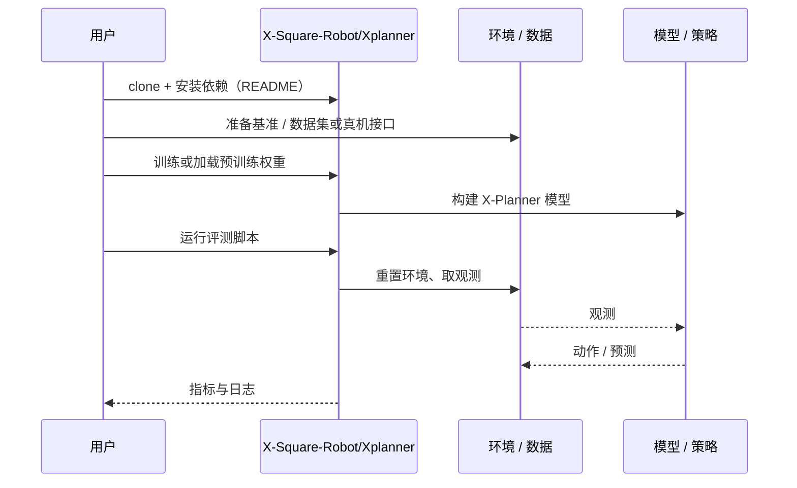

# X-Planner（arXiv:2609.25187）

**X-Planner**（*X-Planner: Event-Structured Task Planning for Embodied Intelligence*，[arXiv:2609.25187](https://arxiv.org/abs/2609.25187)，[代码](https://github.com/X-Square-Robot/Xplanner)）来自 [具身智能小站 2026-10-18 盘点](../../sources/blogs/wechat_embodied_station_26_papers_embodiedswe_2026-10-18.md)，属「策略与规划」组。

## 一句话定义

**用事件状态衔接高层指令与下游动作模型，把长任务计划写成可执行事件，并探索连续潜在推理接口。**

## 英文缩写速查

| 缩写 | 英文全称 | 简要说明 |
|------|----------|----------|
| VLA | Vision-Language-Action | 视觉–语言–动作策略 |

## 为什么重要

- 长任务计划需要可检查的中间状态；事件结构让规划与动作模型之间的接口显式化。
- 开源结论：**已开源**（步骤 2.5，2026-10-18）。仓库可达（git ls-remote）。
- 同期同组工作见 [编程智能体造数据与 VLA 闭环评测：具身智能小站 10-18 期 26 篇阅读坐标](../overview/embodied-station-2026-10-18-26-papers-technology-map.md)。

## 核心机制

| 项 | 内容 |
|----|------|
| **arXiv** | [2609.25187](https://arxiv.org/abs/2609.25187) |
| **开源** | **已开源** |
| **要点** | 事件状态作为计划与动作模型的接口；另探索连续潜在推理接口。 |
| **文内指标** | 公众号提示：真机结果来自事件模式的完整系统，离线文本评分和任务进度不能直接当作成功率。 |

## 源码运行时序图

以下为按仓库入口（`X-Square-Robot/Xplanner`）推断的通用运行链路；入库日仅核实仓库可达，未逐文件阅读，具体脚本名以 README 为准。

## 实验与评测

- 公众号提示：真机结果来自事件模式的完整系统，离线文本评分和任务进度不能直接当作成功率。
- **读法：** 本页为索引级摘要，依据公众号转述的官方摘要与仓库信息整理；逐项数字与 baseline 以原文 PDF 为准。

## 与其他工作对比

- 横向索引见 [编程智能体造数据与 VLA 闭环评测：具身智能小站 10-18 期 26 篇阅读坐标](../overview/embodied-station-2026-10-18-26-papers-technology-map.md)；同 arXiv 不重复造页。

## 结论

**评价规划器要区分离线文本评分、任务进度与真机成功率，三者不可互换。**

1. 开源边界：**已开源** — 仓库可达（git ls-remote）。
2. 核心机制：事件状态作为计划与动作模型的接口；另探索连续潜在推理接口。
3. 复现与选型前核对任务协议、硬件与基准口径，勿直接横比公众号摘录数字。

## 关联页面

- [vla](../methods/vla.md)
- [manipulation](../tasks/manipulation.md)
- [loco-manipulation](../tasks/loco-manipulation.md)
- [embodied-station-2026-10-18-26-papers-technology-map](../overview/embodied-station-2026-10-18-26-papers-technology-map.md)

## 参考来源

- [x_planner_event_structured_task_planning_arxiv_2609_25187.md](../../sources/papers/x_planner_event_structured_task_planning_arxiv_2609_25187.md)
- [wechat_embodied_station_26_papers_embodiedswe_2026-10-18.md](../../sources/blogs/wechat_embodied_station_26_papers_embodiedswe_2026-10-18.md)
- [arXiv:2609.25187](https://arxiv.org/abs/2609.25187)

## 推荐继续阅读

- [arXiv PDF](https://arxiv.org/pdf/2609.25187)
- [https://github.com/X-Square-Robot/Xplanner](https://github.com/X-Square-Robot/Xplanner)
