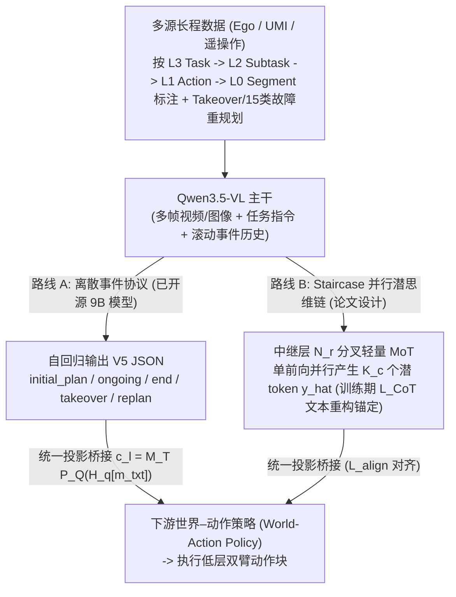
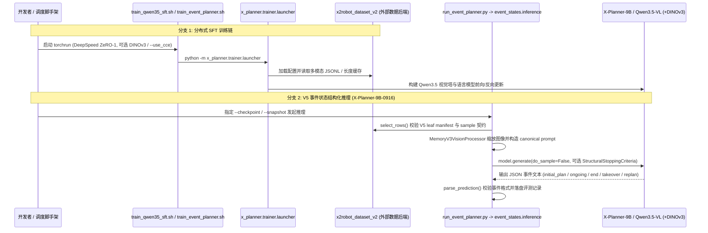

# X-Planner（arXiv:2609.25187）

**X-Planner**（*X-Planner: Event-Structured Task Planning for Embodied Intelligence*，[arXiv:2609.25187v2](https://arxiv.org/abs/2609.25187)，[项目页](https://x-square-robot.github.io/Xplanner/)，[代码](https://github.com/X-Square-Robot/Xplanner)）由自变量机器人团队提出，把长程具身操作转化为可校验的**事件状态序列**，兼顾显式子任务监控纠偏与对接底层世界–动作模型的快速推理接口。

## 一句话定义

**通过四层事件结构（Task/Subtask/Action/Segment）和失败–重规划样本训练 VLM 规划器，以“离散事件状态协议 + 连续并行潜思维链（Staircase Decoding）”两种形式输出条件给下游世界–动作策略，打通长程任务监控、纠错与低层动作生成。**

## 英文缩写速查

| 缩写 | 英文全称 | 简要说明 |
|------|----------|----------|
| CoT | Chain-of-Thought | 思维链推理；本文还探索并行潜思维链替代自回归长文本生成 |
| VLA | Vision-Language-Action | 视觉–语言–动作模型；在长程/推理操作场景常需高层规划器分阶段驱动 |
| VLM | Vision-Language Model | 视觉语言模型；X-Planner 基于 Qwen3.5-VL-9B 实现 |
| MoT | Mixture-of-Transformers | 在 Staircase Decoding 中从主干中继层分叉出专门预测潜思维链的并行分支 |
| UMI | Universal Manipulation Interface | 手持便携数采接口，与第一人称 Ego、遥操作共同构成 L1–L3 规划训练来源 |

## 为什么重要

- **弥合高层规划与底层策略之间的语义断层：** 传统高层规划器大多只做离线文本分解或按固定间隔喊出静态短语，既不知道正在执行的子动作是否已成功结束，也难及时识别卡死/抓空后的故障恢复时机。
- **把失败与人工接管显式纳为训练状态：** 数据集不只是成功示范，还系统标注了人工接管片段（`takeover`）以及按 15 类失败原因构造的纠偏片段（`replan`），使模型能够以结构化 JSON 决定维持（`ongoing`）、结束（`end`）还是改道重规划。
- **分清论文设计与开源代码实现边界：** 官方同步公开了 `X-Planner-9B-0916` 权重（Apache-2.0）、1,500 条视频基准与 SFT/V5 事件推理源码，但公开版代码未含 Staircase 并行潜推理模块、真机动作耦合器，且事件训练脚本强依赖尚未更新补齐的 `x2robot_dataset_v2` 后端处理器。

## 核心原理

| 模块 / 机制 | 论文设计与核心公式（§2–§4） | 实现 / 工程对应（源码 `x_planner/`） |
|-------------|-------------------------------|--------------------------------------|
| **L3–L0 事件数据体系** | 将 Ego（L1–L3）、UMI（L1–L3）、Teleoperation（L0–L3）按 `L3 Task → L2 Subtask → L1 Action → L0 Segment` 分层切分，补充 takeover 与故障恢复标签 | `x_planner/data/event_states/schema.py` 定义 V5 JSON 协议、`initial_plan / ongoing / end / takeover / replan` 与 `1.1`–`8.1` 共 15 类失效编码 |
| **离散事件状态机** | 通过交叉熵 `L_SFT` 训练 Qwen VLM 按多帧历史与当前视觉状态预测结构化事件更新 | 已完整开源：`X-Planner-9B-0916` + `event_states/inference.py`（配 `_InitialPlanStructuralStoppingCriteria` 限长防冗余） |
| **Staircase 并行潜推理** | 在骨干中继深度 `N_r` 分叉轻量 MoT 分支，单步并行吐出 `K_c` 个潜思维向量 `ŷ_{1:K_c} = F_stair(x; N_r)`，以冻结解码器文本重构损失 `L_CoT` 锚定潜语义 | 属于论文架构设计；截至 2026-11-14 公开仓 `x_planner/` 内**未包含** Staircase MoT 分支实现 |
| **统一条件桥接** | 将文本/潜规划末态通过可学投影与对齐损失 `L_align` 映射为下游世界–动作策略可读条件 `c_l = M_T P_Q(H_q[m_txt])` | 下游世界–动作策略权重与跨模态桥接未随仓库发布 |

### 流程总览

图依据：论文 §3–§4（Fig. 2–3）与 `x_planner/data/event_states/schema.py` V5 协议定义。

## 源码运行时序图

以下时序图严格对应官方仓库 [X-Square-Robot/Xplanner](https://github.com/X-Square-Robot/Xplanner) 中实际存在且可执行的两个主入口：**模型 SFT 训练链**（`scripts/train/train_qwen35_sft.sh`）与 **V5 事件状态规划离线/在线结构化推理链**（`scripts/inference/run_event_planner.py`）；注意完整事件训练脚本 `scripts/train/train_event_planner.sh train` 会因release保护直接退出码 4，且其数据流水线需外部 `x2robot_dataset_v2` 后端支持。

## 实验与评测

### 1. 离线两步文本事件生成质量（Table 2）

| 评测模型 | BERTScore-F1 ↑ | Doubao Judge Overall ↑ | 口径说明 |
|----------|----------------|------------------------|----------|
| `kimi3`（超大闭源参考模型） | **0.9108** | **1.434** | 离线两步提示评测参考上限 |
| **X-Planner** | **0.9011** | **1.411** | 本方法表现紧邻大参数商业参考模型 |
| `Qwen`（基座对比） | 0.8878 | 1.367 | — |
| `Doubao` | 0.8846 | 1.366 | — |

### 2. 真机双臂物理操作评估（Table 3 & Fig. 5，离散事件模式完整系统）

真机评测采用 **0–100% Task Progress**（按完成关键里程碑计分，**并非二值任务成功率**，且论文未给出各任务标准差/误差棒）：

| 评测套件 | **X-Planner** | `U-Scratch` | `π0.5` | `DreamZero` | `LingBot-VA` |
|----------|---------------|-------------|--------|-------------|--------------|
| **Reasoning Manipulation**（Table 3 均值） | **71.60%** | 59.50% | 56.40% | 32.70% | 31.60% |
| **Generalization Suite**（Fig. 5 均值） | **53.75** | 18.50 | 24.00 | 28.50 | N/A |

- 仓库 `benchmarks/real_robot/` 仅保存对应表格的 JSON 静态记录用于绘图查对，不含机器人硬件闭环控制代码。

## 与其他工作对比

| 对比维度 | X-Planner（本文） | 通用端到端 VLA（如 `π0.5`） | 通用商业 VLM 直接零样本规划 |
|----------|-------------------|----------------------------|----------------------------|
| 规划粒度和监控能力 | 显式定义 L3–L0 事件树与 `ongoing/end/takeover/replan` 协议 | 无显式长程事件阶段或故障恢复声明式状态输出 | 易出现幻觉式推进，缺乏接管和 15 类细分失效语义 |
| 推理时延潜优化方向 | 提出 Staircase Decoding 单步生成连续 `K_c` 个潜思维（仅论文） | 依赖固定频率动作分块推理 | 逐字文本思维链吐字慢，难以匹配高频控制需求 |
| 可复现性边界 | 已开放 SFT 栈、`X-Planner-9B-0916` 与 1,500 ep 数据集；`xDataset` 后端尚有缺口 | `openpi` 等开源链完整度取决于具体版本 | 闭源 API 无权重可控微调与特征级 `L_align` 桥接 |

## 结论

**把长程规划拆成带失败诊断与接管分支的有限事件状态协议，确实能大幅拉开双臂推理操作进度分（71.60% vs `π0.5` 56.40%）；但工程落地前必须区分“离线文本/任务进度分”与“端到端真机闭环成功率”，并补齐开放代码中的外部后端与下游动作模型环节。**

1. **开源核查结论：** `X-Square-Robot/Xplanner` 属**部分开源** — 释放了 SFT 框、V5 事件状态协议推理、`X-Planner-9B-0916` 权重及 `xplanner-benchmark` 数据；未包含 Staircase 潜推理模块、世界–动作耦合权重与真机运行脚本。
2. **真机成绩的受限解释：** Table 3 与 Fig. 5 只测了“离散事件完整系统”的任务进度均分，论文并未做物理真机对照去拆解故障数据单独贡献或测量端到端规划+执行延迟。
3. **训练推理分布落差：** 离线/SFT 训练喂入的是人工标注真值事件历史，而真机部署消费的是模型自身持续滚出的上下文，一旦前期状态误判就会引发 oracle-context 级联偏移。
4. **本地跑通前的依赖核对：** README 明示截至 2026-09-10 公开的 `xDataset/main` 缺少 JSONL 与 Qwen3.5 处理器模块，拉通 `train_event_planner.sh` 需先解决 `x2robot_dataset_v2` 版本对齐或重构本地读取器。

## 工程实践

| 实践环节 | 仓库入口 / 默认配置 | 注意事项 |
|----------|---------------------|----------|
| 环境与后端依赖 | 先装 `transformers` 适配版及 DeepSpeed；验证 `x2robot_dataset_v2` 处理器可用性 | 若 `validate_backend.py` 报错缺 `multimodal_jsonl_reader`，须自行实现本地 JSONL loader 替代缺失后端 |
| 模型 SFT 微调 | `scripts/train/train_qwen35_sft.sh` → `x_planner.trainer.launcher` | 默认用 DeepSpeed ZeRO-1；开启 `--use_cce` 可大幅减省词表交叉熵显存，支持挂接 `DINOv3` 视觉塔 |
| 事件协议校验推理 | `scripts/inference/run_event_planner.py` + `schema.py` | 强烈建议运行前先跑 `bash scripts/train/train_event_planner.sh unit` 验证 5 类状态与 15 类失败标签解析完整 |
| 输出结构约束 | `_InitialPlanStructuralStoppingCriteria` | 对 `initial_plan` 限制最大动作数与分段数，防止自回归无限冗长输出导致超时 |

## 局限与风险

- **公开后端与潜推理模块缺失：** `xDataset/main` 公开快照缺少配套 JSONL/Qwen3.5 处理器（`train_event_planner.sh train` 直接限制退出码 4）；论文亮点之一的 Staircase Decoding 并行潜思维分支与下游世界–动作权重均未见于公开代码仓。
- **未隔离消融的真机归因风险：** 真机物理实验仅评测最终离散事件版完整系统，未给出“不加故障数据”“改用连续潜推理”以及统计多次重复方差的消融实测，且 0–100% Task Progress 分数无法直接等价于完赛成功率。
- **Oracle-Context Gap：** 训练阶段输入真值历史状态，部署滚出阶段读取自预测历史状态，长任务后期（P90 达 15 个子任务、超 110 秒）若前段状态未及时判定结束或重置，容易发生错误累积。
- **离线文风分不代表闭环执行力：** Table 2 展示 `kimi3` 在离线文本指标高于 X-Planner（0.9108 vs 0.9011），进一步印证文本生成相似度和物理闭环推进并不成线性正比。

## 关联页面

- [VLA](../methods/vla.md) — 高层视觉语言规划与动作生成衔接
- [Manipulation](../tasks/manipulation.md) — 双臂长程推理操作任务入口
- [Loco-Manipulation](../tasks/loco-manipulation.md) — 长程移动与多阶段任务控制场景
- [π0.5](./paper-pi05-open-world-vla.md) — 论文真机实验直接对比的核心开源 VLA 基线
- [具身智能小站 10-18 期 26 篇阅读坐标](../overview/embodied-station-2026-10-18-26-papers-technology-map.md) — 同批次策略与规划工作横向索引

## 参考来源

- [X-Planner 论文归档](../../sources/papers/x_planner_event_structured_task_planning_arxiv_2609_25187.md) — arXiv `2609.25187v2` 全文通读与 Tables 1–3 数据核对
- [X-Planner 官方仓库归档](../../sources/repos/x_planner_event_structured_task_planning.md) — `X-Square-Robot/Xplanner` 代码结构、HF 资源及后端缺口核查
- [具身智能小站 2026-10-18 盘点](../../sources/blogs/wechat_embodied_station_26_papers_embodiedswe_2026-10-18.md)

## 推荐继续阅读

- [arXiv:2609.25187](https://arxiv.org/abs/2609.25187)
- [X-Square-Robot/Xplanner（GitHub）](https://github.com/X-Square-Robot/Xplanner)
- [Hugging Face 模型：X-Planner-9B-0916](https://huggingface.co/x-square-robot/X-Planner-9B-0916)
