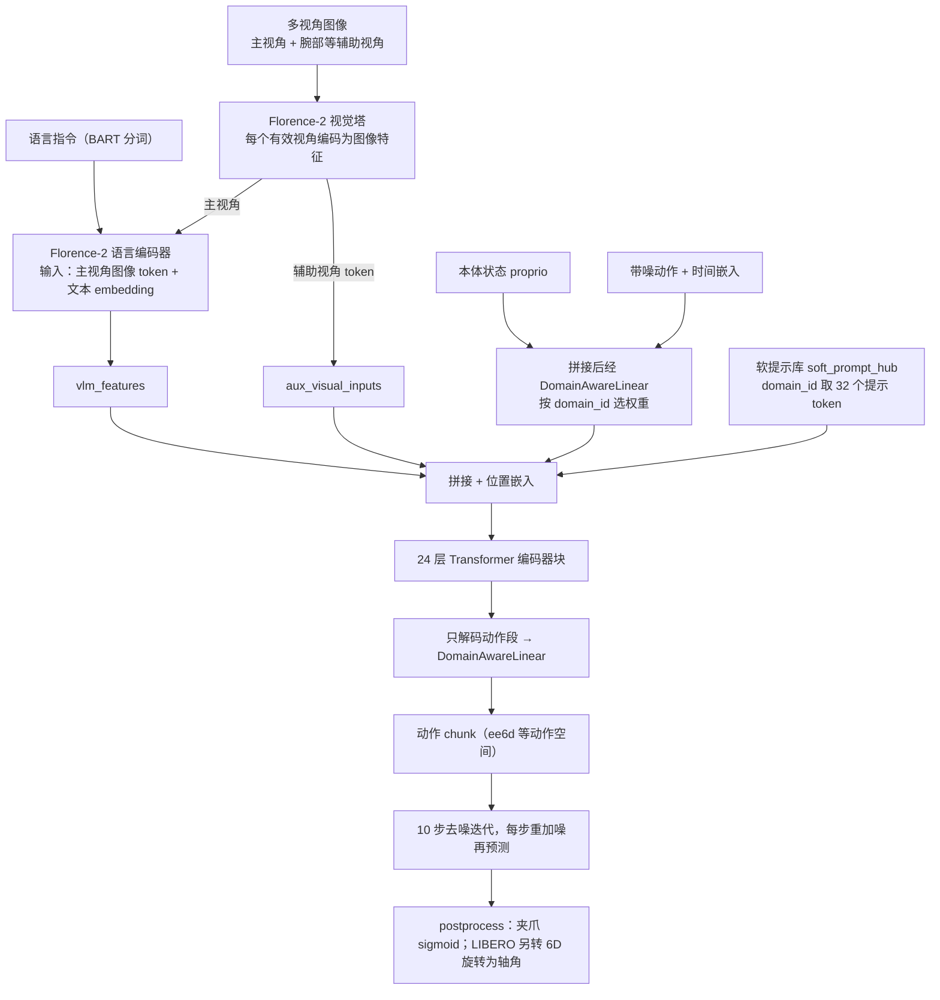
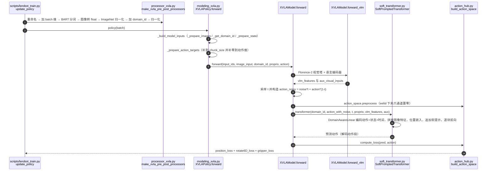
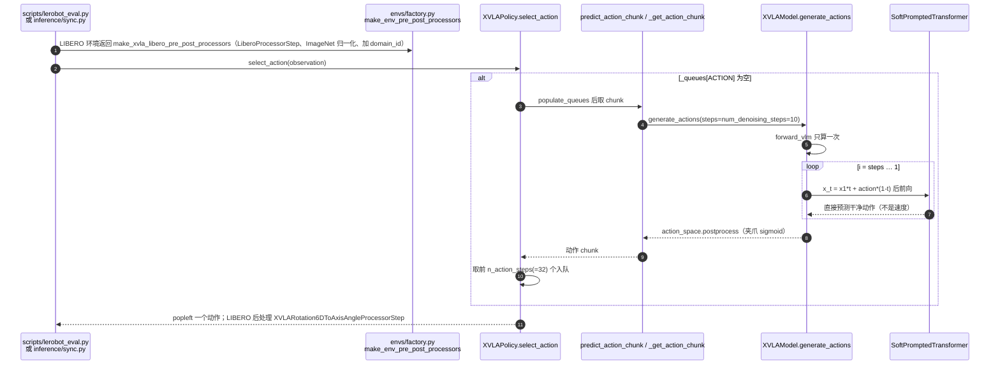

# X-VLA：软提示 Transformer 的跨本体 VLA

**X-VLA**（*X-VLA: Soft-Prompted Transformer as Scalable Cross-Embodiment Vision-Language-Action Model*，[arXiv:2510.10274](https://arxiv.org/abs/2510.10274)，2025-10-11，Zheng、Li、Wang 等，[项目页](https://thu-air-dream.github.io/X-VLA/)）。LeRobot 清单里的 **XVLA** 就是这篇论文，实现在 `src/lerobot/policies/xvla/`。本页依据 arXiv 论文正文（已读 §1、§3–§5、附录 N）与 LeRobot 固定提交 `9e5ee9859480e425a97a6836bb3fee479539beb5` 的源码和文档。

## 一句话定义

**X-VLA 给每个数据源（本体 + 相机配置 + 任务分布）配一组可学习的软提示向量，让一个纯 Transformer 编码器的 flow-matching VLA 在异质数据上稳定预训练，换新机器人时只需学一组新提示。**

## 英文缩写速查

| 缩写 | 英文全称 | 简要说明 |
|------|----------|----------|
| VLA | Vision-Language-Action | 视觉–语言–动作模型 |
| Soft Prompt | Soft Prompt | 不对应文字的可学习嵌入，按数据源索引，注入动作生成早期 |
| PEFT | Parameter-Efficient Fine-Tuning | 参数高效微调（论文用 LoRA，约 9M 可调参数） |
| EEF / 6D | End-Effector / 6D rotation | 末端位姿；用 6 维连续旋转表示，规避欧拉角、四元数的跳变 |
| DiT | Diffusion Transformer | 论文消融的对照解码器，最终被「纯 Transformer 编码器」替换 |
| MM-DiT | Multimodal Diffusion Transformer | 按模态分配独立参数的 DiT 变体，附录 D.1 对照结构 |
| HPT | Heterogeneous Pre-trained Transformers | 在观测端加按域投影层的异质预训练方案 |
| LoRA | Low-Rank Adaptation | 低秩适配，PEFT 实验所用方法 |
| ACT | Action Chunking with Transformers | 动作块 Transformer 策略，真机叠衣对照 |

## 为什么重要

- 跨本体预训练的老问题是不同机器人的动作空间、相机配置、数据分布差异大。论文比较了四类处理方式：按域的动作投影头、HPT 式投影、语言描述提示、软提示，并称软提示在异质数据上训练最稳（§3，Fig.4）。
- 把适配成本压到「一组提示」：论文称仅调约 9M 参数（约 1%）就在 LIBERO 与 Simpler-WidowX 上接近全量微调的 π0（见评测表）。
- 在 LeRobot 里是少数同时带「预训练基座 + 多个任务检查点（LIBERO、WidowX、折衣等）」的开源跨本体 VLA。

## 流程总览

图依据：论文 §4.1（编码管线）与 LeRobot `XVLAModel.forward_vlm`、`SoftPromptedTransformer.forward`、`XVLAModel.generate_actions` 的真实数据流；软提示数量 32、块数 24、去噪 10 步为 `configuration_xvla.py` 默认值。

## 核心方法

- **软提示：** 论文把每个数据源 h_i 对应一组可学习嵌入 p_i≈Φ(h_i)；Φ 不是人工模板，而是随机初始化后端到端优化。提示在动作生成的早期注入，引导骨干做本体感知。
- **编码分流（§4.1）：** 主视角 + 语言走预训练 VLM（论文用 Florence-Large）；腕部等辅助视角用共享视觉骨干单独编码，避免嘈杂的腕部画面进入语言推理流；本体状态与带噪动作、时间嵌入拼接后线性投影，与其余模态早期融合。解码端用「纯 Transformer 编码器」替换了 DiT（表 1 的消融路径）。
- **训练配方（§4.2）：** 两阶段（预训练 → 提示暖启动 → 联合适配）；软提示与 VLM 模块用更小学习率；动作统一为末端位姿 xyz + Rotate6D + 二值夹爪，位置/旋转 MSE、夹爪 BCE；用「意图抽象」把轨迹时间下采样成未来 4 秒内的 30 个锚点；样本跨域、跨轨迹打乱的平衡采样。
- **规模：** X-VLA-0.9B：hidden size 1024、24 个 Transformer 块；预训练混合含 Agibot-beta、RoboMind、Droid，共 290K episode、7 种硬件配置、5 种机械臂。

## 评测

以下数字均读自论文表 2、表 3 与 §5.2：

| 设置 | X-VLA-0.9B | 对照 |
|------|------------|------|
| Simpler VM / VA / WidowX | 80.4 / 75.7 / 95.8 | π0 58.8 / 56.8 / 27.8；GR00T-N1 45.0 / 48.4 / – |
| LIBERO Spatial / Object / Goal / Long（平均） | 98.2 / 98.6 / 97.8 / 97.6（98.1） | π0 96.8 / 98.8 / 95.8 / 85.2（94.1）；OpenVLA-OFT 平均 97.1 |
| Calvin ABC→D | 4.43 | FLOWER 4.53；UniVLA 4.41 |
| RoboTwin-2.0 Easy / Hard | 70.0 / 39.0 | π0 46.4 / 16.4 |
| VLABench | 51.1 | GR00T-N1 39.7 |
| NAVSIM PDMS | 87.3 | UniVLA 81.7 |
| PEFT（LoRA，约 9M 参数）LIBERO 四套件 | 95.4 / 96.6 / 96.0 / 84.2 | π0（3B 全量）96.8 / 98.8 / 95.8 / 85.2 |
| PEFT：Simpler-WidowX | 54.2 | π0 55.7 |
| 真机 Soft-Fold 叠衣（双臂 Agilex，1,200 条轨迹） | 接近 100% 成功率，约 33 次折叠/小时 | 微调的 π0-base 与从头训练的 ACT 吞吐不及（§5.2） |

- **口径注意：** 论文摘要之外的「LIBERO 93%、Simpler-WidowX 54%」是 PEFT（LoRA）口径（表 3 四套件平均约 93.1，按本页表中数字自行平均）；全量微调的 LIBERO 平均是 98.1，二者不要混用。LeRobot 文档称 `lerobot/xvla-libero` 达到 93% LIBERO，与哪一种口径对应文档未说明，本页未核实。
- 表 2 中各基线数字是论文自行汇总的，部分「–」表示原文未报告，不是 0。

## 与其他工作对比

- **异质性处理方式**：[π0.5](./paper-pi05-open-world-vla.md)、[GR00T N1](./paper-hrl-stack-34-gr00t_n1.md) 等常用按域的动作输出投影头，作用只在最终动作生成阶段，不处理相机配置和任务分布差异（§3）。HPT 式投影在观测处理中途插入按域投影层，易改变特征分布、破坏预训练 VLM 表征；语言提示需手写硬件描述，难以扩展。在同一异质数据混合与对齐训练配方下，软提示训练最稳定（§3、图 4）。
- **骨干结构**：以预训练验证误差比较，DiT 为 0.077、MM-DiT 为 0.140、π0 式结构为 0.056，X-VLA 为 0.041（附录 D.1、表 4）。表 1 消融中只把 DiT 换成 Transformer 编码器时，验证误差降至 0.071，但 Simpler-WidowX 适配成功率由 50.0 降到 47.9；随后加入编码分流和软提示，分别升至 64.6、73.8（表 1）。
- **仿真基准**：表 2 汇总了 [π0](./paper-pi0.md)、GR00T-N1、[OpenVLA-OFT](./paper-rcl-2502-19645-fine-tuning-vision-language-action-models-optimi.md)、SpatialVLA、MoDE 等已有模型的结果（§5.2 称与汇总的已有模型比较），未说明各基线是否在同一协议下重新运行。表中「–」表示未报告，跨行对比应以同一基准列为限。
- **参数高效适配**：表 3 用 LoRA 约 9M 可调参数（约 1%）的 X-VLA 对照 3B 参数的 π0，正文称后者为全量微调模型（LIBERO 94.2%、Simpler-WidowX 55.7%），X-VLA 为 93% 与 54%（§5.2、表 3）。附录 K 另述 PEFT 实验中的 π0 按官方 LoRA 配置微调（VLM rank 16、动作专家 rank 32），与表 3「3B 全量」的说法如何对应，原文未说明；比较时以表 3 口径为准。
- **真机叠衣**：Soft-Fold（1,200 条轨迹）上，作者微调了 π0-base、从头训练了 [ACT](./paper-act.md) 作对照，称二者吞吐都不及 X-VLA-0.9B（§5.2、附录 K）；§5.2 正文未列出对照的具体数值，真机结果汇总在图 7，本页未逐项读取图中数值。与闭源 π0-folding「相当」是作者表述，论文未给出该模型在同一设置下的实测数据（§5.2）。

## 结论

**X-VLA 说明：处理跨本体异质性不一定要复杂的模块，给每个数据源一组软提示加一个干净的 Transformer 编码器就能稳定预训练并快速适配。**

- 软提示是「数据源 ID → 可学习嵌入」，部署到新机器人需要该机器人的少量示范来学新提示（论文附录 N 也承认部署仍依赖本体专属后训练）
- 全量微调下的 LIBERO（98.1）与 PEFT 下（约 93）差距明显，选择哪种取决于算力
- 0.9B 的规模相对于通用基础模型仍小，论文自述受算力与高质量机器人数据限制
- 在 LeRobot 里使用时务必核对 `action_mode`、`domain_id` 与相机视角数，它们都是检查点专属的

## 源码运行时序图

以下依据 LeRobot 固定提交 `9e5ee98…` 的 `src/lerobot/policies/xvla/`（已通读 `modeling_xvla.py`、`soft_transformer.py`、`action_hub.py`、`processor_xvla.py`、`configuration_xvla.py`）。

### 训练（`lerobot-train --policy.path=lerobot/xvla-base`）

### 推理（`lerobot-eval` / `lerobot-rollout`）

## LeRobot 实现要点

- **入口与检查点：** `policy.type=xvla`；检查点来自 `docs/source/xvla.mdx`：`lerobot/xvla-base`（0.9B 基座）、`xvla-libero`、`xvla-widowx`、`xvla-folding`、`xvla-agibot-world`、`xvla-google-robot`；依赖 `pip install -e ".[xvla]"`。文档说 `xvla-folding` 在 2 小时连续叠衣中达到 100% 成功率，是文档自述，本次未复现。
- **默认超参（`configuration_xvla.py`）：** `chunk_size=n_action_steps=32`、`hidden_size=1024`、`depth=24`、`num_heads=16`、`len_soft_prompts=32`、`num_domains=30`、`num_denoising_steps=10`、`max_action_dim=20`、`tokenizer_name=facebook/bart-large`、`tokenizer_max_length=64`。LeRobot 的 `chunk_size=32` 与论文「30 个锚点」的关系本次未能从源码确认。
- **动作空间注册表（`action_hub.py`）：** `ee6d`（20 维，位置 MSE×500、旋转 MSE×10、夹爪 BCE）、`joint`（14）、`agibot_ee6d`、`franka_joint7`、`so101_bimanual`（模型 20 维 / 真机 12 维）、`auto`（从数据集自动推断动作维，推荐给新机器人）。微调不同动作维的数据时必须选对 `action_mode`，不能只裁剪维度。
- **推理是「预测干净动作」而不是速度场：** `generate_actions` 从噪声 x1 出发，每步令 `x_t = x1*t + action*(1-t)`，网络输出直接作为下一步的 `action`；训练损失也是对干净动作 `action` 求，而不是速度。这是读源码得到的结论，论文式 (流匹配目标) 的符号约定本次未逐式核对。
- **domain_id：** 每个检查点有专属 `domain_id`，由 `XVLAAddDomainIdProcessorStep` 写入；文档称训练默认 0，LIBERO 检查点用 3。**注意源码里该类 docstring 写默认 3，而 dataclass 字段默认是 0**（文档与字段一致，docstring 过时）。`make_xvla_pre_post_processors` 与 `make_xvla_libero_pre_post_processors` 都以无参方式构造该步骤（即字段默认 0）；LIBERO 检查点文档要求 3，实际是否由检查点随附的处理器配置覆盖，本次未核对，评测时应确认 `domain_id` 与检查点一致。
- **文档/注释瑕疵：** `XVLAConfig` 的 docstring 把 XVLA 写成 “Extended Vision-Language-Action”，与论文题名（Soft-Prompted Transformer … Cross-Embodiment VLA）不符，应以论文为准。
- **微调建议（文档）：** 不冻结 VLM、`policy.dtype=bfloat16`；官方策略是 VLM 只用基础学习率的 1/10，LeRobot 默认已实现；软提示 warm-up 学习率调度未完全复刻（文档自述）。
- **限制：** LeRobot 只提供微调与推理，没有论文 Phase I 的 290K episode 预训练管线；`xvla-base` 之外的任务检查点对相机键、视角数与 `action_mode` 都有绑定；推理需要 `transformers` 的 Florence-2 支持（`from_pretrained` 里含对旧 vendored Florence 权重的重映射 `_remap_vendored_florence_state_dict`）。

## 关联页面

- [vla](../methods/vla.md)
- [action-chunking](../methods/action-chunking.md)
- [flow-matching-embodied-policy](../concepts/flow-matching-embodied-policy.md)
- [foundation-policy](../concepts/foundation-policy.md)
- [lerobot](../entities/lerobot.md)
- [paper-pi0](../entities/paper-pi0.md)
- [paper-smolvla](../entities/paper-smolvla.md)
- [paper-gr00t-n1-5](../entities/paper-gr00t-n1-5.md)
- [paper-gvla-gripper-aware-vla](../entities/paper-gvla-gripper-aware-vla.md)：另一篇引用 X-VLA（arXiv:2510.10274）的 VLA 论文

## 参考来源

- [x_vla_arxiv_2510_10274.md](../../sources/papers/x_vla_arxiv_2510_10274.md)
- [lerobot 仓库归档](../../sources/repos/lerobot.md)：固定提交 `9e5ee98…` 的 `policies/xvla/` 与 `docs/source/xvla.mdx`
- [arXiv:2510.10274](https://arxiv.org/abs/2510.10274)
- [arXiv PDF](https://arxiv.org/pdf/2510.10274)：已通读 §1、§3、§4、§5、附录 N 与表 1–3
