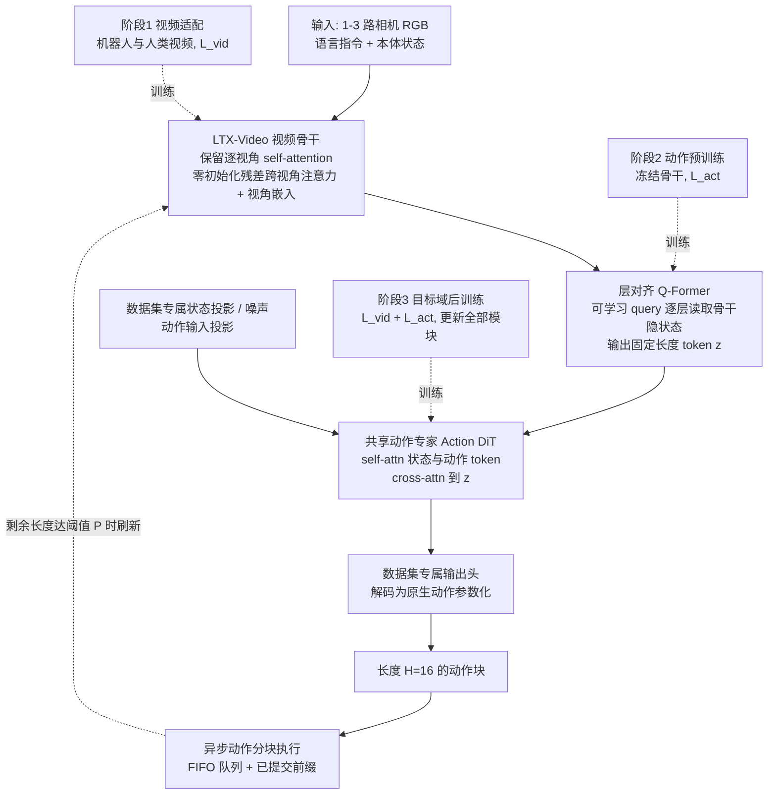

# X-World（arXiv:2610.34105）

**X-World**（*X-World: Transferring Video Priors to Variable-View Robot Control*，[arXiv:2610.34105](https://arxiv.org/abs/2610.34105)，[项目页](https://logosintelligencelab.github.io/X-World/)）来自 [具身智能小站 2026-10-28 盘点](../../sources/blogs/wechat_embodied_station_59_papers_human_video_to_robot_experience_2026-10-28.md)，属「潜在动作与世界模型」组。

## 一句话定义

**用跨视角残差注意力和固定长度查询表示连接视频骨干与共享动作专家，并支持异构动作接口。**

## 英文缩写速查

| 缩写 | 英文全称 | 简要说明 |
|------|----------|----------|
| X-World | X-World: Transferring Video Priors to Variable-View Robot Control | 本文方法 / 基准的简称 |

## 为什么重要

- 视频先验适配不同相机数量。结果同时呈现泛化优势与相机、背景、噪声扰动弱点，部署仍需逐类验证。
- 开源结论：**项目页未列 GitHub**（步骤 2.5，2026-10-28）。项目页 HTTP 200，未见 GitHub 链接或 coming soon 字样。
- 同期同组工作见 [潜在动作、免渲染事件仿真与机器人评测：具身智能小站 10-28 期 59 篇阅读坐标](../overview/embodied-station-2026-10-28-59-papers-technology-map.md)。

## 流程总览

图依据：论文 §3.1–3.4 / Fig.1、Fig.2、Table 1。

## 核心机制

| 项 | 内容 |
|----|------|
| **arXiv** | [2610.34105](https://arxiv.org/abs/2610.34105) |
| **开源** | **项目页未列 GitHub** |
| **要点** | 用跨视角残差注意力和固定长度查询表示连接视频骨干与共享动作专家，并支持异构动作接口。 |
| **文内指标** | 公众号转述：结果同时呈现泛化优势与相机、背景、噪声扰动弱点，部署仍需逐类验证。 |

## 源码运行时序图

**不适用（项目页未列 GitHub）** — 项目页 HTTP 200，未见 GitHub 链接或 coming soon 字样。 不编造运行脚本；代码公开后再补。

## 实验与评测

- 公众号转述：结果同时呈现泛化优势与相机、背景、噪声扰动弱点，部署仍需逐类验证。
- **读法：** 本页为索引级摘要，依据公众号转述的官方摘要与仓库信息整理；逐项数字与 baseline 以原文 PDF 为准。

## 与其他工作对比

- 横向索引见 [潜在动作、免渲染事件仿真与机器人评测：具身智能小站 10-28 期 59 篇阅读坐标](../overview/embodied-station-2026-10-28-59-papers-technology-map.md)；同 arXiv 不重复造页。

## 结论

**视频先验适配不同相机数量：结果同时呈现泛化优势与相机、背景、噪声扰动弱点，部署仍需逐类验证。**

1. 开源边界：**项目页未列 GitHub** — 项目页 HTTP 200，未见 GitHub 链接或 coming soon 字样。
2. 核心机制：用跨视角残差注意力和固定长度查询表示连接视频骨干与共享动作专家，并支持异构动作接口。
3. 复现与选型前核对任务协议、硬件与基准口径，勿直接横比公众号摘录数字。

## 关联页面

- [world-action-models](../concepts/world-action-models.md)
- [generative-world-models](../methods/generative-world-models.md)
- [vla](../methods/vla.md)
- [embodied-station-2026-10-28-59-papers-technology-map](../overview/embodied-station-2026-10-28-59-papers-technology-map.md)

## 参考来源

- [x_world_variable_view_video_priors_arxiv_2610_34105.md](../../sources/papers/x_world_variable_view_video_priors_arxiv_2610_34105.md)
- [wechat_embodied_station_59_papers_human_video_to_robot_experience_2026-10-28.md](../../sources/blogs/wechat_embodied_station_59_papers_human_video_to_robot_experience_2026-10-28.md)
- [arXiv:2610.34105](https://arxiv.org/abs/2610.34105)
- [arXiv PDF](https://arxiv.org/pdf/2610.34105)：已通读方法部分（实验与附录以略读为准）：§1 引言、§3.1–3.4 方法（问题与设计、变视角视频表示、共享动作专家与三阶段训练、特征提取与异步执行）、Fig.1–2、Table 1；§4 仅略读

## 推荐继续阅读

- [arXiv PDF](https://arxiv.org/pdf/2610.34105)
- [项目页](https://logosintelligencelab.github.io/X-World/)
