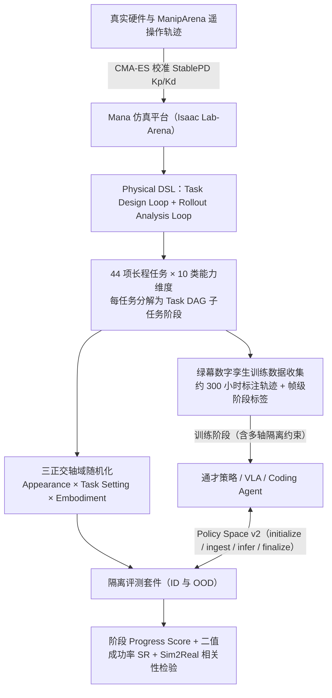
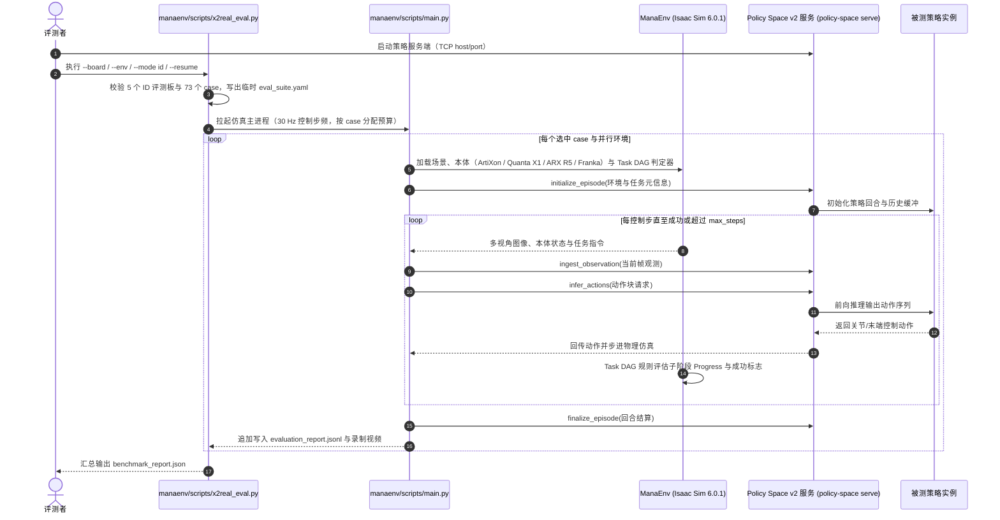

# X2Real: an eXtensive simulation benchmark for real-world generalist policies

**X2Real**（[arXiv:2609.27449v2](https://arxiv.org/abs/2609.27449)，v1 2026-09-23 / v2 2026-10-13，[项目页](https://x2robot.com/en/pages/x2real)，[GitHub v0.9.0](https://github.com/X-Square-Robot/x2real)）由 **自变量机器人（X Square Robot）** 与合作者提出，在 NVIDIA Isaac Lab-Arena 与自研 Mana 仿真平台上构建可扩展的通才操作评测基准。

## 一句话定义

**面向真实通才操作策略的可扩展仿真评测基准与运行时：以 Task DAG 定义 44 项长程任务、用三正交轴随机化隔离训测分布、用 CMA-ES 物理校准对齐真机（整体 Progress 相关 0.84），并在 X2Real v0.9.0 开源 73 项 ID 评测与 Policy Space v2 接口。**

## 英文缩写速查

| 缩写 | 英文全称 | 简要说明 |
|---|---|---|
| X2Real | eXtensive simulation benchmark for real-world generalist policies | 自变量团队提出的通才操作仿真基准与评测栈 |
| DSL | Domain-Specific Language | Mana 平台的物理任务领域专用语言 |
| DAG | Directed Acyclic Graph | Task DAG：将长程任务拆解为子任务阶段与规则进展判定 |
| ID / OOD | In-Distribution / Out-of-Distribution | 训测同分布与跨外观/任务/本体轴的分布外评测 |
| RTC | Real-Time Chunking | Policy Space 协议支持异步动作块推理与执行机制 |

## 为什么重要

现有仿真评测常面对三类失效模式：**（1）Sim2Real 保真度不足**——视觉渲染与执行器动力学偏差让仿真名次无法代表真机性能；**（2）能力覆盖窄**——短程单步任务难以评估长程操作、记忆、双臂协作与语言推理；**（3）训测边界不清**——策略在同一套仿真场景里过拟合纹理与物体布局。X2Real 直接围绕 **Faithfulness（保真）、Diversity（多样）、Fairness（公平）** 三准则重设计任务语言、随机化轴与跨进程策略服务边界。

## 核心原理

### 流程总览

图依据：`arXiv:2609.27449v2` §2–§4 与 `X-Square-Robot/x2real@7ed53b4` 运行时结构。

### 关键机制（§2–§3）

1. **Task DAG 驱动的 44 项长程任务（§2.1）：** 任务覆盖 10 个维度——Reasoning 4 类（Generalization 7、Visual Understanding 7、Language Understanding 3、Memory 5）、Manipulation 5 类（Precision Operation 5、Bimanual Collaboration 4、Tool Usage 3、Dynamic Objects 1、Mobile Operation 3）及 3 项高难 Challenge（`stack_blocks (hard)`、`press_buttons (hard)`、`hanoi_tower`）。每个任务被写成子任务有向无环图（Task DAG），既输出连续阶段进展分（Progress Score），也支持长程数据自动分段打标。
2. **三正交轴随机化与训测隔离（§2.2–§2.3）：** 在 **Appearance**（41 个房间、92 种桌面材质、89 个 HDRI）、**Task Setting**（物体、干扰物、规则、语言指令）和 **Embodiment**（夹爪、相机视角、桌面高度）三个独立轴上控制 ID 与 OOD 划分。训练侧轨迹在对齐 ManipArena 的绿幕数字孪生中收集（总计约 300 小时：Quanta X1 + ArtiXon Arm 158.1 h、Franka 16.6 h、ARX R5 15.6 h、Challenge 114.1 h），避免策略直接背诵测试房间背景。
3. **CMA-ES 物理校准（§4.1）：** 利用真机遥操作轨迹中的关节位置–时间响应，通过 CMA-ES 自动搜索并校准 Isaac Sim 中各关节的 StablePD 刚度与阻尼参数 $(K_p, K_d)$，缩小仿真与真机驱动响应偏差。
4. **Mana 平台与 Policy Space 协议（§2.4, §3）：** Physical DSL 统一约束几何、材质、关节动力学与失败诊断输出（支持 Task Design Loop 与 Rollout Analysis Loop）；Policy Space 通过独立进程通信隔离仿真环境依赖与策略模型依赖，兼容有历史状态或异步 RTC 的 VLA 策略。

## 源码运行时序图

图依据：`X-Square-Robot/x2real@7ed53b4` 源码入口 `manaenv/scripts/x2real_eval.py`、`manaenv/scripts/main.py` 与 `3rd/policy_space` 协议说明（手动示教采数另由 `manaenv/scripts/x2real_collect.py` 写入本地 HDF5）；本仓库构建期间未实际启动 GPU + Isaac Sim 6.0.1 闭环。

## 实验与评测

### Sim2Real 对齐验证（§4.1）

使用纯真机数据微调的 `Wall-OSS-0.5`，在 8 项 ManipArena 数字孪生任务上对比真机与仿真表现：
- **5 项一般操作任务：** 线性相关达到 **0.96（SR） / 0.99（Progress Score）**；
- **全部 8 项任务（含 3 项精细接触操作）：** 总体线性相关为 **0.74（SR） / 0.84（Progress Score）**；其中 `glasses` 任务真机成功率 70%，在仿真中因镜腿弹性折叠与建模边界导致 OOD 掉至 0%，拉低了总体 SR 相关性。

### 桌面端主榜（§4.2.1, Table 1，分层宏平均，%）

| 模型 | ID SR | OOD SR | ID Score | OOD Score | 备注 |
|---|---:|---:|---:|---:|---|
| **wall-oss-preview** | **53.90** | **34.26** | **67.25** | **56.63** | 全能力维度领先，OOD 仍有明显回落 |
| **$\pi_{0.5}$** | 26.12 | 16.13 | 46.19 | 37.75 | 精细操作与跨外观/本体泛化受限 |
| **DreamZero** | 4.85 | 3.45 | 34.21 | 32.12 | 完成部分早期子阶段（Score 高于 SR） |
| **Wall-OSS-0.5** | 4.08 | 3.20 | 17.85 | 14.10 | 未针对仿真资产域微调的公开基座对照 |

### Coding Agent 与其他评测（§4.2.2–§4.3, Table 2–3）

- **Coding Agent 对照（§4.2.2）：** `GPT-6-Astra`（xHigh 推理配置，每环境 10 episode）在 OOD 上取得 **SR 36.15% / Score 53.74**；在 Reasoning 子类（**SR 46.96% / Score 64.52**）高于 `wall-oss-preview`，但在 Manipulation 子类（**SR 25.33% / Score 42.96**）落后。其每次推理耗时超过 **30 秒**（需暂停仿真等待），属于非实时编程控制基线。
- **移动操作（§4.2.3）：** 3 项移动任务上，`wall-oss-preview` 的 ID / OOD SR 为 **58.33% / 5.00%**，$\pi_{0.5}$ 为 **29.17% / 0.83%**，跨外观/布局的移动操作仍接近失效。
- **Task-DAG 数据合成增益（§4.3）：** 在 `stack_blocks (hard)` 上，自动合成轨迹配合分阶段指令使策略平均堆叠 **4.40 层（最高 10 层）**，优于人工主从遥操作数据训练结果（平均 **2.05 层、最高 4 层**）。

## 工程实践

| 项 | v0.9.0 公开状态（2026-10-10，Apache-2.0） | 说明 / CLI 入口 |
|---|---|---|
| **ID 评测板（73 case）** | **已开源** | `python manaenv/scripts/x2real_eval.py --board <board>`（默认 40 episode / 4 并行 / 30 Hz）：`artixon_arm6a_tabletop`（38）、`artixon_arm6a_challenge`（10）、`quanta_x1_mobile`（3）、`arx_r5_tabletop`（12）、`franka_panda_tabletop`（10） |
| **静态诊断与续跑** | **已开源** | 支持 `--list`、`--check`、`--asset-check`、`--dry-run`、`--resume`（按 `<save-path>/<env>/evaluation_report.jsonl` 断点续跑） |
| **策略服务隔离** | **已开源** | `3rd/policy_space` 提供 `policy-space check` 与 `policy-space serve`，通过 `--server-address` / `--server-port` 连接仿真 |
| **手动示教采数** | **已开源** | `manaenv/scripts/x2real_collect.py` 支持键盘、Vuer/WebXR、WebSocket 主从臂（`masterslave`）与直接 IK/关节控制，覆盖 ArtiXon Arm-6A 与 Quanta X1，写本地 HDF5 |
| **资产与数据下载** | **分仓托管** | Hugging Face 提供静态场景/物体资产 `x-square-robot/x2real-assets` 与轨迹集 `x-square-robot/X2Real-Dataset` |
| **明确未开源模块** | **排除在公共仓外** | 见 `OPEN_SOURCE_SCOPE.md`：**OOD 评测定义（仅 `--mode id`）**、自动规划采数（CuRobo / planner）、Mimic、回放（replay）、数据清洗与 LeRobot 转换、训练脚本与私有硬件端点 |

## 局限与风险

- **物理与交互品类受限（§6）：** 目前仅覆盖刚体与铰接刚体，不含柔性体、布料、绳索与流体；未接入触觉或高维力觉传感。
- **精细接触对仿真边界高度敏感：** 如 `glasses` 镜腿折叠案例所示，哪怕经过 StablePD 校准，真机 70% 成功率在仿真中仍可能因局部接触/形变建模差异降为 0%，0.84 相关性不能外推至所有未校准物理现象。
- **v0.9.0 仅含 ID 评测入口：** 公开仓库明确排除 OOD 组合评测与自动任务/轨迹生成流水线，第三方暂时只能离线或自行扩写 OOD 测试划分。
- **跨进程推理假设暂停式协议：** 若直接对照 Coding Agent（单步 >30 s）与实时 VLA，必须标明仿真是否等待策略推理，否则闭环延迟对动态任务的惩罚会被掩盖。
- **资产与许可证核查：** 运行仿真前需单独从 HF 拉取 `x2real-assets`，并逐项核对第三方模型/资产分支许可，而非只看仓库根目录 Apache-2.0。

## 与其他工作对比

| 工作 | 共同点 | 关键区别 |
|---|---|---|
| [Isaac Lab-Arena](./isaac-lab-arena.md) | X2Real 直接构建于其上 | Arena 是通用的场景 / 本体 / 任务运行时组装与评测扩展；X2Real 是在其上定义的 44 项 Task-DAG 长程套件，并附带 CMA-ES 物理校准与仿真—真机相关性验证 |
| [LIBERO](./libero-benchmark.md) | 都以固定任务套件评测操作策略 | LIBERO 侧重终身学习与分布偏移；X2Real 把三轴训测隔离与仿真预测真机表现（8 任务 0.84 / 5 一般任务 0.99 Progress 相关）作为基准可信度的核心证据 |
| [RoboTwin-Phys](./paper-robotwin-phys.md) | 都关注物理差异如何影响策略评测 | RoboTwin-Phys 连续采样物理参数测鲁棒性；X2Real 先用 CMA-ES 校准 StablePD 贴近真机，再用三正交轴随机化与绿幕数字孪生训练隔离控制公平性 |

## 结论

**X2Real 把「仿真名次能否预测真机能力」做成可验证的基准工程——通过 Task DAG、三轴训测隔离与 CMA-ES 物理校准在一般操作上实现 0.99 的 Progress 相关性，并用 v0.9.0 释放了可独立跑通的 73-case ID 评测栈。**

1. **相关性要分任务类型读：** 整体 0.84（Progress）/ 0.74（SR）背后，5 项一般操作高达 0.99 / 0.96，而 `glasses` 等精细接触边界仍会归零，不可盲信单一相关系数。
2. **主流模型在 OOD 上仍有大幅掉点：** 即便领先的 `wall-oss-preview` 从 ID 53.90% 跌至 OOD 34.26%，移动操作 OOD 更仅 5.00%，说明当前 VLA 远未解决多轴组合泛化。
3. **Code-free 接管可直接用 `x2real_eval.py`：** 若只需客观测试自有策略的 ID 桌面/移动能力，可直接启动 `policy-space serve` 对接官方 5 个评测板与 `--resume` 断点流水线。
4. **注意 v0.9.0 的公共边界：** OOD 定义、自动规划采数与训练脚本不在公开仓内，自训数据微调需自行从 HF `X2Real-Dataset` 或 `x2real_collect.py` 组织管线。
5. **Coding Agent 对比需标明等待语义：** `GPT-6-Astra` 虽推理分数领先（46.96% OOD SR），但以 >30 s 暂停仿真等待为前提，与 30 Hz 连续控制策略不属同一时延档位。

## 关联页面

- [X2Real 项目详情](./x2real-project.md) — 工程入口、板卡组成与仓内外边界
- [Isaac Lab-Arena](./isaac-lab-arena.md) — 底层仿真运行时基座
- [Wall-OSS-0.5](./paper-wall-oss-0-5.md) / [WALL-OSS 与 wall-x](./cn-os-wall-x.md) — 本文被测的核心基线策略家族
- [Day 6 导读](../overview/humanoid-motion-intelligence-day6-engineering-deployment.md) — 原始资料导航
- [Sim2Real](../concepts/sim2real.md) / [Sim vs Real 评测落差](../concepts/sim-vs-real-eval-gap.md)
- [具身大模型评测基准选型闭环](../queries/embodied-eval-benchmark-selection-loop.md)
- [LIBERO](./libero-benchmark.md) / [RoboTwin-Phys](./paper-robotwin-phys.md) — 同类操作仿真基准对照
- [机器人操作](../tasks/manipulation.md)

## 参考来源

- [X2Real 论文原文归档（arXiv:2609.27449v2）](../../sources/papers/x2real_arxiv_2609_27449.md) — v2 HTML 全文精读（§§1–7、Table 1–3）
- [X2Real 官方仓库归档（X-Square-Robot/x2real）](../../sources/repos/x2real.md) — v0.9.0（`7ed53b4`）入口脚本与 `OPEN_SOURCE_SCOPE.md` 核查
- [X2Real 项目页归档](../../sources/sites/x2real-project.md)
- [X2Real 公开资产归档](../../sources/datasets/x2real-assets.md)
- [Day 6 工程部署导读来源](../../sources/blogs/humanoid_motion_intelligence_day6_engineering_deployment_2026_10_07.md)

## 推荐继续阅读

- 论文（arXiv:2609.27449v2）— <https://arxiv.org/abs/2609.27449>
- 官方代码仓库（v0.9.0）— <https://github.com/X-Square-Robot/x2real>
- 项目主页与榜单 — <https://x2robot.com/en/pages/x2real>
- Hugging Face 静态资产 — <https://huggingface.co/datasets/x-square-robot/x2real-assets>
- Hugging Face 轨迹数据集 — <https://huggingface.co/datasets/x-square-robot/X2Real-Dataset>
