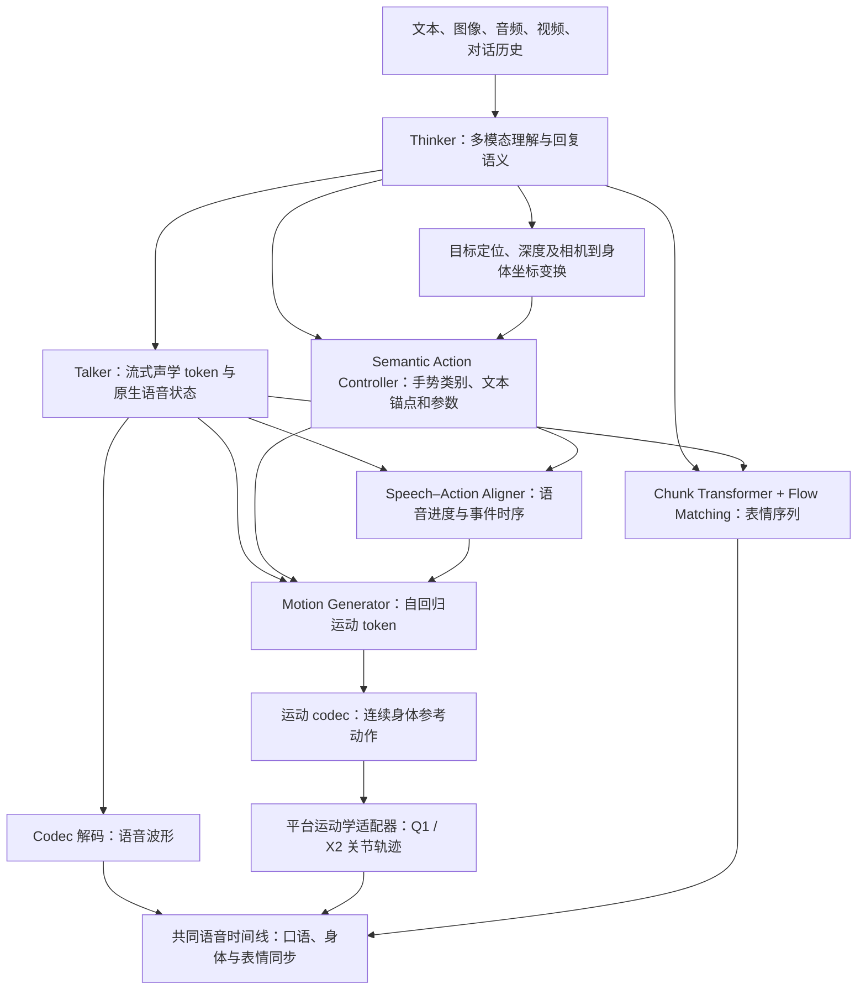

# XBot-Omni：面向具身理解与交互的全模态模型（An Omni-Modal Model for Embodied Understanding and Interaction）

**XBot-Omni**（[arXiv:2611.17160v1](https://arxiv.org/abs/2611.17160)，2026-11-12；智元机器人 X-Lab / AGIBOT X-Lab）研究如何让机器人在理解文字、视觉、音频、视频之后，不只“说对话”，还通过**与讲话内容同步的身体动作、指向手势和表情**表达意图。

## 一句话定义

**Thinker 看懂场景与交互意图，Talker 流式说话，Actor 在同一语义和语音时间线上生成手势、三维目标指向和面部表情**；核心不是通用运动控制策略，而是有场景依据的具身沟通。

## 英文缩写速查

| 缩写 | 英文全称 | 简要说明 |
|------|----------|----------|
| OLM | Omni-modal Language Model | 联合处理语言、音频、图像与视频的全模态语言模型 |
| A2G | Audio-to-Gesture | 由合成音频生成手势的传统分级路线，对场景意图利用较弱 |
| MOPD | Multi-Teacher On-Policy Distillation | 将多个 GRPO 专家知识蒸馏回共享 Thinker |
| SGPT | Spatial Grounding and Pointing Training | 用三维目标条件监督视觉锚定的指向动作 |
| FGD | Fréchet Gesture Distance | 生成与人类参考动作分布的特征距离，越低越好 |
| SQ / CT | Semantic Quality / Conditional Timing | 语义手势质量 / 对有效可判定手势子集的时序对齐率 |

## 为什么重要

- **补齐 Omni → 具身表达的缺口。** 只用音频做 A2G 手势，容易丢失“用户说的是哪个苹果”等尚未进入语音波形的场景信息。
- **原生表示直连。** Actor 直接读取 Thinker 语义隐藏状态与 Talker 自回归隐状态，不必等待语音解码后再重新编码音频。
- **从泛化节奏动作到有意义的沟通。** “在左边”要指左方；“苹果在那里”要依据图像目标与三维位置指对物体。
- **与 [Daily-Omni](./paper-daily-omni.md) 互补。** 后者量化声画时序理解；这里进一步量化表达质量、目标指向与动作时序。

## 核心信息

| 字段 | 内容 |
|------|------|
| 机构 | **智元机器人 X-Lab（AGIBOT X-Lab）** |
| 论文 | [arXiv:2611.17160v1（2026-11-12）](https://arxiv.org/html/2611.17160) |
| 输入 | 文本、图像、音频、视频、对话历史 |
| 输出 | 流式语音、身体运动、面部表情；可附带空间锚定指向 |
| 结构 | Thinker–Talker–Actor；身体分支自回归运动 token，面部分支条件 Flow Matching |
| 训练 | Thinker：SFT → GRPO 专家 → MOPD；Actor：原生状态适配 → 语义事件 → 生成历史 / 组合事件训练 → SGPT |
| 机器人演示 | PrimeBOT Q1、AGIBOT X2（论文 Fig. 1；各平台独立运动学适配器） |
| 开源状态 | **尚未发现公开可运行源码/权重**（截至 2026-11-15，官方项目页只有 “Coming Soon.”） |

## 核心原理

### Thinker–Talker–Actor 如何联动

1. **Thinker：** 以模态适配器整合音视频、图像、文字与时间戳，输出回复语义、对象指代和交互意图。
2. **Talker：** 自回归生成声学 token，经语音 codec 解码为流式语音；同时暴露语音生成中的原生隐状态。
3. **Semantic Action Controller：** 用 Thinker 隐状态和回复 token 预测“挥手、指左、指向苹果”等事件，事件包含类别、语义参数、关联文本片段和完成状态。
4. **Speech–Action Aligner：** 用 Thinker 文本表征与 Talker 语音状态估计讲话进度，将动作起点和语义对应的短语锚定。
5. **Motion Generator：** 由语音原生状态、当前语义事件与已生成动作历史自回归产生离散运动码，再解码到连续运动；面部表情由 Chunk Transformer + Flow Matching 独立生成，两支共用语音时间线。

### 流程总览

### 视觉锚定指向（SGPT）

论文 §4.4 采用“视觉定位 + 深度 + 相机内参 + 外参”的几何链，把物体位置变到 Actor 的身体坐标系：

$
\hat{\mathbf{p}}^{\mathrm{body}}=R_{\mathrm{cam}}^{\mathrm{body}}\mathcal{P}(\hat{g},\hat{D},K)+\mathbf{t}_{\mathrm{cam}}^{\mathrm{body}}
$

这个位置是**动作语义条件**，说到指称短语的时刻是**时间条件**。身体动作生成之后，还需依 Q1 / X2 的关节结构、指向轴校准和执行约束进行运动学适配；不能把生成的人体运动表征视作可直接下发的电机命令。

### 训练与数据

- 公开具身活动视频 + 私有社交、对话、同步语音动作录制；自动标注提取说话者、事件、视觉对象与时序。
- Thinker 经 SFT → GRPO 多专家 → MOPD 整合，推理时只保留一个整合 Thinker。
- Actor 身体分支先学习原生 Talker 状态与动作的对齐，再训练语义事件完成条件，最后以自身生成的动作历史增强连续性；表情分支学习条件流匹配。
- SGPT 继续训练带三维坐标的语义事件，**上游 Thinker 与 Talker 冻结**（§4.4–4.5）。

## 源码运行时序图

**不适用。** 截至 2026-11-15，[官方项目主页](https://xbot-omni.github.io/) 仅显示 “Coming Soon.”，没有可核对的训练、推理、部署代码或模型权重入口。因此无法对齐真实源码调用链，不绘制推测的运行时序图。上方 Mermaid 为**论文架构流程**，不是经过源码验证的运行时调用图。

## 工程实践

| 环节 | 需要落实的接口和验证 |
|------|----------------------|
| 输入理解 | 同步采集音视频与对话上下文；核实相机时间戳、音频时间戳及指代关系 |
| 语音/动作并行 | 记录 Talker 原生状态到 Actor 条件的等待时间，动作准备应先于或贴合目标词句 |
| 空间指向 | 相机内参、深度、相机→机器人坐标系外参、指向轴标定、逆运动学均须校准 |
| 机器人执行 | 对 Q1 / X2 等不同平台逐一验证关节限位、轨迹连续性与碰撞/人机安全约束 |
| 复现条件 | 先等待可运行代码和数据许可公开；不要把论文模块名称当作现成 Python API |
| 目标定位 | 这是一套**具身社交交互/沟通**模型，不可直接当成通用抓取或行走 VLA |

## 实验与评测

> 下表为论文 **v1 Table 2–8** 的特定协议结果，不能混作真机端到端成功率。

| 评测项 | XBot-Omni | 对照 / 限制 |
|--------|-----------|-------------|
| Daily-Omni 跨模态理解 Overall | **86.30%** | Qwen3.5-Omni-Plus 84.74%，提升 1.56 pp |
| ReTurn 五轮理解 | **84.00%** | 对照最优 70.04%；Reconfirm / Retrieve 未领先 |
| ERIBench 空间关系 | **59.17%** | 最强对照 38.18%；但 Intent Inference 85.51% 低于 91.45% |
| BEAT2 动作分布 FGD（↓） | **1.351** | EMAGE 1.389，按统一动作表示比较 |
| 手势 SQ（0–3，↑） | **1.383** | 最强对照 0.608，机器辅助匿名动作视频评分 |
| 条件动作时序 CT | **85.19%（46/54）** | 54 是 119 个有效回答中满足可评时序条件的子集；非全量成功率 |
| SGPT 空间+时序联合 STG | **0.843** | 无 SGPT 为 0.241，100 条经过筛选的开发集指向视频 |
| 系统首次动作延迟（中位数） | **527 ms** | 仅首次动作延迟，不等于完整响应/机器人安全约束的时延保证 |

## 结论

**XBot-Omni 的主要价值，是用 Thinker 语义与 Talker 原生语音状态协同驱动可解释的具身表达；实验支持特定基准下的动作语义/空间对齐收益，但不等于通用机器人任务控制已解决。**

1. **分析优势时分层。** Daily-Omni / ReTurn 检验 Thinker；FGD / SQ 检验动作自然性和语义；SGPT STG 检验指向而非抓取成功。
2. **语义与时间缺一不可。** 对物体的 3D grounding 提供“指哪里”，Speech–Action Aligner 提供“何时指”。
3. **CT 不是总体命中率。** 85.19% = 46/54 条可评分动作，不能误写成 119 条全部成功。
4. **可复现性暂受限。** 公开入口仍为 Coming Soon，缺模型/源码/私有训练数据与机器人执行栈。
5. **部署要单独验证。** 527 ms 是论文报告的首次动作中位数；各平台运动学标定、连续性及人机安全仍属工程验收。

## 与其他工作对比

| 路线 | 主要输入→输出 | 与 XBot-Omni 的差别 |
|------|--------------|--------------------|
| [Daily-Omni](./paper-daily-omni.md) | 视频+音频→多选 QA | 评测感知/对齐，不生成机器人动作 |
| Qwen Omni Thinker–Talker | 多模态输入→文字+语音 | 缺原生机器人动作分支；本文延伸 Actor |
| EMAGE / GestureHYDRA | 音频/文本→共语手势 | 依赖语音或文本驱动，较少用场景指代直接约束动作 |
| MIBURI / RoboGesture | 流式语音相关表征→动作 | 本文额外将 Thinker 的视觉/语义和显式事件条件送入 Actor |
| [统一多模态 token](../methods/unified-multimodal-tokens.md) | 多模态输入输出表示设计 | 可作为理解接口背景，但不是相同训练/执行架构 |

## 局限与风险

- **未开源可运行入口：** 项目主页目前只有占位文本；不能验证模型参数、部署延迟分布、代码或数据。
- **实验指标适用范围有限：** SQ 属机器辅助评分；CT 条件分母不同；SGPT 的 100 条是选择过的开发集片段，不是随机真机任务集合。
- **真机外推谨慎：** Fig. 1 显示 Q1 / X2 演示，但没有可直接引用的跨环境大规模机器人安全/成功率报告。
- **几何与控制前提：** 目标深度/坐标估计偏差、机器人指向轴与逆运动学误差会影响指向；共语运动生成不自动解决人机安全。
- **模型边界：** 研究重点是社交场景中的**具身表达**，不是通用移动操作、工业节拍或闭环接触控制。

## 关联页面

- [机器人视觉感知栈选型闭环](../queries/robot-perception-stack-selection-loop.md) — 对照视觉定位、深度与坐标变换到身体坐标目标的接口，分开检查感知输出和机器人执行。

- [Daily-Omni](./paper-daily-omni.md) — 同属 omni-modal；上游感知/声画推理基准
- [统一多模态 token](../methods/unified-multimodal-tokens.md) — 原生表征与模态融合的技术背景
- [多模态基础](../concepts/multimodality-basics.md) — 音频、视频、视觉等感知模态背景

## 参考来源

- [XBot-Omni 论文原文归档（arXiv:2611.17160v1）](../../sources/papers/xbot_omni_arxiv_2611_17160.md)
- [XBot-Omni 官方项目页及开源状态归档](../../sources/sites/xbot-omni-github-io.md)

## 推荐继续阅读

- [论文 HTML 全文（arXiv:2611.17160v1）](https://arxiv.org/html/2611.17160)
- [论文 PDF](https://arxiv.org/pdf/2611.17160)
- [官方项目页](https://xbot-omni.github.io/)
