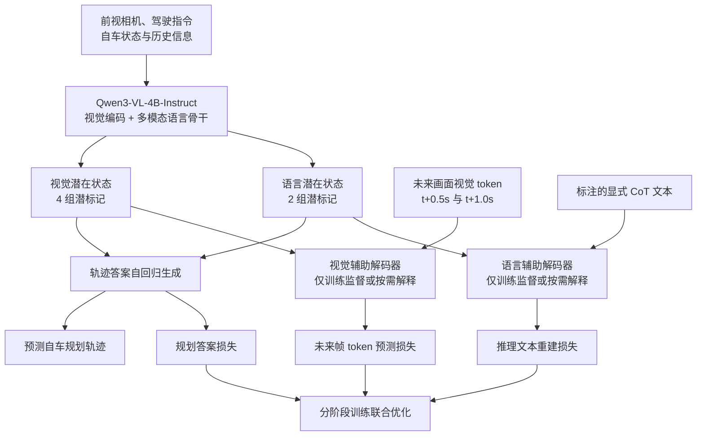
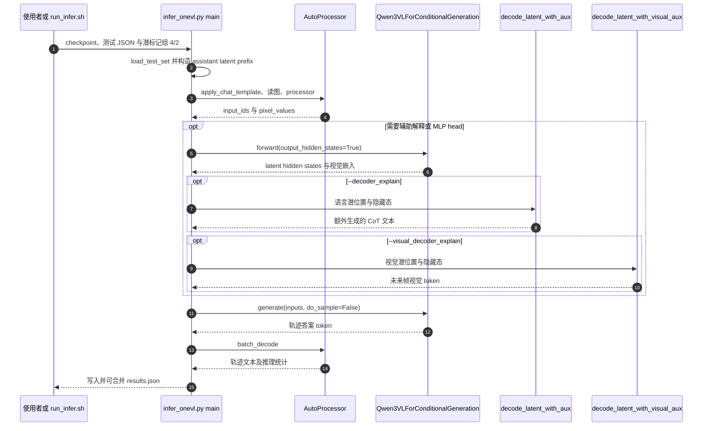

# OneVL：用视觉–语言潜推理实现一步式驾驶规划

## 一句话定义

**OneVL（One-Step Latent Reasoning and Planning with Vision-Language Explanation）** 是小米具身智能团队提出的驾驶视觉语言模型框架：用视觉/语言潜在状态替代耗时的显式文字推理链，训练时通过未来画面和推理文本双辅助监督，推理时仅保留快速潜标记 prefill 与轨迹生成。

## 英文缩写速查

| 缩写 | 英文全称 | 简要说明 |
|---|---|---|
| VLA | Vision-Language-Action | 由视觉、语言条件预测可执行动作或规划轨迹 |
| VLM | Vision-Language Model | OneVL 的 Qwen3-VL-4B-Instruct 多模态骨干 |
| CoT | Chain-of-Thought | 显式语言推理链；这里用潜状态压缩 |
| AR | Autoregressive | 按 token 自回归生成轨迹答案 |
| PDM | Predictive Driver Model | NAVSIM 使用的综合轨迹规划评分 |
| ADE | Average Displacement Error | 平均位移误差，越低越好 |
| FDE | Final Displacement Error | 末端位移误差，越低越好 |

## 为什么重要

显式 CoT 驾驶推理的自然语言 token 需要依次生成，改善可读性的同时增加轨迹规划延迟。纯潜推理虽然省时，但容易失去可解释性。OneVL 用**可恢复的双模态监督**约束潜状态，在主规划推理阶段不运行两个辅助解码器；它的贡献是把「训练时解释性」与「推理时低延迟」分离，而非让世界模型在车端每一步生成完整视频。

## 核心信息

| 项目 | 原文与官方实现 |
|---|---|
| 机构 | 小米具身智能研究团队（Xiaomi Embodied Intelligence） |
| 论文 | [arXiv:2604.18486v3](https://arxiv.org/abs/2604.18486)，NeurIPS 2026 |
| 骨干 | Qwen3-VL-4B-Instruct（含 ViT、视觉对齐与语言主干） |
| 潜位置 | 4 个视觉潜标记组、2 个语言潜标记组；分词后分别对应 35 / 20 个已有词表 token |
| 未来视觉监督 | t+0.5 秒、t+1.0 秒的 Emu3.5 视觉 tokenizer 离散编码 |
| 开放资源 | [项目主页](https://xiaomi-embodied-intelligence.github.io/OneVL/)；[推理代码](https://github.com/xiaomi-research/onevl)；[训练代码](https://github.com/GeorgeLuImmortal/OneVL_training)；[模型权重](https://huggingface.co/collections/xiaomi-research/onevl-models) |

**口径纠错：** 论文 §3.2 所述「35 个视觉 token、20 个语言 token」是**在现有词表下展开后的 token 数量**；设计上是 4/2 个潜标记组。官方 README 与 `infer_onevl.py` 的 `--num_latent_vis 4 --num_latent 2` 使用的是后一个计数，不能误当作仅有 4+2 个分词 token。

## 流程总览

图中视觉/语言辅助头在训练阶段参与损失约束，**最快推理路径只走上方潜状态→轨迹答案**。未来画面预测提供场景动态监督，不等于主模型部署时先渲染两帧再制定轨迹。

## 核心原理与分阶段训练

1. **视觉与语言潜位置：** 复用已有词表中的字符串标记而非增加新 special token。视觉潜状态携带未来场景动态信息；语言潜状态携带可恢复的 CoT 决策信息。
2. **双模态教师：** 视觉辅助解码器以未来两时刻的离散帧 token 为目标；语言辅助解码器重建人可读 CoT，结合视觉特征，避免只有轨迹监督时潜变量缺少可解释约束。
3. **Stage 0：** 主模型用答案监督 warm-up，形成可用的轨迹生成基线。
4. **Stage 1：** 冻结主干初始化并训练辅助解码器。
5. **Stage 2：** 联合优化主干与辅助解码器，轨迹 CE、语言解释损失和视觉未来帧损失共同训练；官方训练脚本权重分别为语言 1.0、视觉 0.1。
6. **在线规划：** 潜标记作为 prefill 前缀一次处理，模型随后生成轨迹 token；可选解释不改变主规划最短推理链。

## 评测与消融

以下为论文/官方 README 的**作者报告值**，均非此次独立实验；NAVSIM 是 PDM-score，而 ROADWork / Impromptu / APR1 的 ADE/FDE 口径与单位不同。

| NAVSIM 方法 | PDM-score ↑ | 延迟（秒）↓ |
|---|---:|---:|
| AR Answer（直接轨迹答案） | 87.47 | 4.49 |
| AR CoT+Answer（显式思维链） | 88.29 | 6.58 |
| **OneVL（潜在视觉+语言）** | **88.84** | **4.46** |

相对显式 CoT，OneVL 在上述评测中分数增加 **0.55**、规划延迟降低约 **32.2%**；延迟接近不生成显式推理的 AR Answer（4.49 秒）。这是受基准与硬件条件约束的指标，不能当作通用车端实时性保证。

| NAVSIM 消融 | PDM-score ↑ |
|---|---:|
| 去掉视觉辅助解码器 | 87.97 |
| 去掉语言辅助解码器 | 88.53 |
| 去掉分阶段训练 | **67.13** |
| 完整 OneVL | **88.84** |

**解释质量并非绝对更好：** OneVL 语言辅助解码 CoT 质量均分 **76.13**，低于显式 CoT 的 **78.27**。ROADWork 上 OneVL 报告 ADE **12.49 px** / FDE **28.80 px** / **4.71 秒**；相应显式 CoT 为 13.18 px / 29.98 px / 10.74 秒。作者亦报告 Impromptu 和 APR1 指标，具体见[原文归档](../../sources/papers/onevl_arxiv_2604_18486.md)。

## 结论

**OneVL 在论文的驾驶基准上实现了比显式 CoT 更高的 NAVSIM 规划分和接近直接输出的延迟，但其可读解释、训练算力及实际安全验证仍有边界。**

- **保留训练分阶段：** 去掉 staged training 导致 NAVSIM 从 88.84 降到 67.13，是最显著的消融退化。
- **明确速度测量范围：** 4.46 秒指主规划输出；启用视觉/语言解释需要额外模型计算。
- **谨慎解释 token 数：** 4/2 是潜标记组；35/20 是原有词表分词后的 token 数，配置接口使用前者。
- **按目标选指标：** 同时测 PDM-score、延迟、语言解释质量，避免仅用规划分声称解释能力全面胜出。
- **复现时区分资源：** 训练/推理代码和权重已公开；数据、Emu3.5 tokenizer、NAVSIM 独立评测环境仍需按官方说明准备。
- **安全边界：** 伪闭环或开环基准分数不等于真实道路的安全与闭环可靠性。

## 源码运行时序图

以下对应官方推理仓库 README、`run_infer.sh` 和 `infer_onevl.py` 的**真实入口**。注意：源码的可选解释路径先额外执行一次 `output_hidden_states=True` 的前向提取潜隐藏态，再调用 `model.generate` 生成轨迹；不是单次 `generate` 无成本兼得全部解释。

**训练入口：** 作者公开的 [OneVL_training](https://github.com/GeorgeLuImmortal/OneVL_training) 使用 `run_script/train/navsim/sft_distributed_stage2_vis4_txt2_bs64.sh` 调用 `swift sft --model_type qwen3_vl_latent_cot`；Stage 0/1/2 的脚本和冻结策略见[源码归档](../../sources/repos/xiaomi-onevl.md)。以上是源码静态核对，未运行 GPU 全量实验。

## 工程实践

- **运行环境：** 官方 README 要求 Python 3.10+、PyTorch、Transformers 4.57.0+；解释解码器推理推荐至少 16 GB GPU 显存。
- **最快入口：** `infer_onevl.py --model_path ... --test_set_path ... --output_path ... --num_latent_vis 4 --num_latent 2`；另提供 `run_infer.sh` 多卡按样本分片推理。
- **可选解释：** `--decoder_explain` 与 `--visual_decoder_explain`，并需要相应辅助权重；未来视觉 token 可以使用仓库 `scripts/visualize_predict_image_tokens.py` 和 Emu3.5 tokenizer 解码为图像。
- **指标复现：** ROADWork、Impromptu、APR1 可用仓库评测脚本；NAVSIM 需先转换预测输出，再接其官方评测流水线。对比性能时固定数据集版本、硬件与是否启用解释。
- **开放状态：** 项目页和仓库公开论文、推理代码、[单独的训练代码](https://github.com/GeorgeLuImmortal/OneVL_training)、权重；并非已经核验全部原始标注可直接下载。

## 局限与风险

- **训练成本：** 主模型加两个辅助解码器产生额外显存、参数维护和训练阶段复杂度；论文指出多个 4B 级模块的资源负担，可通过分阶段和分布式优化缓解，但不是免费获得解释性。
- **解释退化：** 76.13 低于显式 CoT 78.27；潜解释是否忠实反映真正轨迹决策过程仍需专门验证。
- **世界监督范围：** 目前未来场景辅助目标使用固定预测时间及受限视觉范围，不能由此推论模型拥有通用长时域物理仿真能力。
- **部署风险：** NAVSIM 等基准不能直接外推到真实道路安全、闭环控制稳定性或实时控制周期。

## 与其他工作对比

| 工作 | 主要路径 | 与 OneVL 的差异 |
|---|---|---|
| 显式 AR CoT | 先生成推理文字，再生成轨迹 | 可读但推理序列长；NAVSIM 88.29 / 6.58 秒 |
| AR Answer | 不生成显式推理直接产出轨迹 | 基准延迟 4.49 秒，但 NAVSIM 分数为 87.47 |
| [Qwen-Drive-1.0](./paper-qwen-drive-1-0.md) | 共享 VLM、BEV 感知头和 flow-matching 规划专家 | 强调显式 BEV 与专用规划头；OneVL 用双辅助监督强化潜推理并生成轨迹 token |

## 关联页面

- [PlanContext：上下文驾驶决策评测](./paper-plancontext.md) — 固定同一场景并切换导航意图，独立诊断 OneVL 等模型的执行/等待/拒绝能力；本基准 mPDMS、NCS 不与 OneVL 原文的 PDM-score 混用。
- [VLA（Vision-Language-Action）](../methods/vla.md) — 视觉语言骨干接规划输出的模型家族。
- [生成式世界模型](../methods/generative-world-models.md) — 未来视觉预测作为潜推理监督的归类边界。
- [Qwen-Drive-1.0](./paper-qwen-drive-1-0.md) — 驾驶 VLM 的另一种感知、规划架构。
- [端到端自动驾驶技术地图](../overview/e2e-autonomous-driving-top10-algorithms.md) — 与显式 CoT、生成世界模型及规划范式的比较。

## 推荐继续阅读

- [论文 HTML 全文（arXiv:2604.18486v3）](https://arxiv.org/html/2604.18486)
- [小米 OneVL 官方项目主页](https://xiaomi-embodied-intelligence.github.io/OneVL/)
- [OneVL 推理与评测 README](https://github.com/xiaomi-research/onevl)
- [官方仓库链接的训练代码](https://github.com/GeorgeLuImmortal/OneVL_training)

## 参考来源

- [论文原文全文通读归档](../../sources/papers/onevl_arxiv_2604_18486.md)：论文方法、实验、局限与附录。
- [官方项目主页核对](../../sources/sites/xiaomi-onevl.md)：代码、权重与开放状态。
- [推理与训练源码核对](../../sources/repos/xiaomi-onevl.md)：`infer_onevl.py`、`run_infer.sh`、NAVSIM 训练入口。
