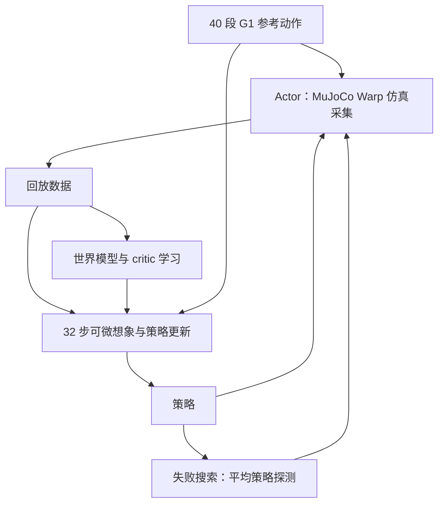
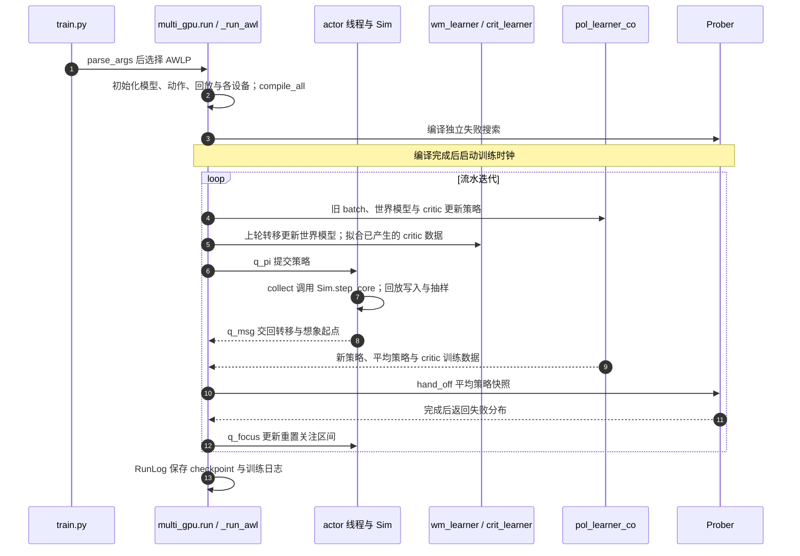

# XMimic：一分钟内学习全身动作跟踪 / Learning Whole-Body Motion Tracking in Under a Minute

## 一句话定义

**XMimic** 是 Nico Bohlinger、Jan Peters 将 BlinkMimic 世界模型训练器迁移至 JAX 的独立工作，以整段编译及多 GPU 并行缩短 Unitree G1 仿真动作跟踪的训练墙钟时间。

## 英文缩写速查

| 缩写 | 英文全称 | 简要说明 |
|---|---|---|
| WM | World Model | 预测机器人状态转移的可微模型 |
| XLA | Accelerated Linear Algebra | 编译 JAX 数值计算的编译器 |
| BPTT | Backpropagation Through Time | 沿想象轨迹传播策略梯度 |
| GPU | Graphics Processing Unit | 并行仿真和学习硬件 |

## 为什么重要

分钟级训练下，Python 调度与小 kernel 开销可能压过算力差异。本项目提供同集群基线和多卡布局，使控制工程师能分别判断反馈延迟、总算力成本与流水线陈旧性的取舍。

## 核心信息

| 项目 | 内容 |
|---|---|
| 作者 | Nico Bohlinger、Jan Peters |
| 机构 | 达姆施塔特工业大学；论文另列 RIG、DFKI、hessian.AI |
| 原文 | [作者发布的论文全文](https://github.com/nico-bohlinger/papers/blob/main/2026_xmimic.pdf)，2026，核对于 2026-11-07 |
| 代码版本 | [571715f](https://github.com/nico-bohlinger/xmimic/tree/571715f02c51654dca07b5dfa6651d0e586ca93e) |
| 身份区分 | 与北京人形的 [xMimic](./cn-os-xmimic.md) 是独立项目 |

## 核心原理与流程总览

沿用 BlinkMimic `d264658` 的算法与主预设：4096 个仿真环境每轮平均采集 2.5 步，回放数据拟合世界模型 5 次，再穿过 32 步模型内轨迹更新策略，由 critic 提供后续价值估计。周期性失败探测将重置分布集中到难片段。



单卡将 50 次迭代编译为一个 XLA 程序，并在后台保存 checkpoint；bf16 矩阵乘、循环外预计算、集中权重梯度 GEMM 和批量 Muon 更新减少小 kernel 开销。多卡 AWLP 把 actor、世界模型及 critic、策略、失败搜索分到四卡，跨迭代交换结果：由串行时间和转为接近最慢阶段耗时。这里的“GPU 不等 Python”是减少主机调度空隙的设计目标，并非所有运行条件下零等待的保证。

## 源码运行时序图



图依据 `train.py`、`multi_gpu.py` 的 `run`、`_run_awl`、`Prober`，以及 `algorithm.py` 的采集和 `fast.py` 的学习实现。GPU 程序异步排队，图中主机发起顺序不表示设备串行执行；AWLP 中 actor 使用约旧一轮策略，策略想象使用约旧两轮世界模型，critic offload 再增加价值估计延迟。单卡入口改走 `single_gpu.run`；离线评测入口为 `python -m xmimic.evaluate`。

## 实验与评测口径

作者在同一集群 H100 NVL 上报告以下均值，**所有方法均排除一次性编译时间**；不是安装、加载、编译到最终部署的端到端耗时。每方法训练 3500 轮，每 100 轮保存评测点，每段动作 4 副本。

| 方法 | GPU 数 | 运行次数 | 严格目标分钟 | 相对 BlinkMimic | GPU 分钟 |
|---|---:|---:|---:|---:|---:|
| BlinkMimic | 1 | 5 | 3.19 | 1.00× | 3.2 |
| InstantTrack v1.3 | 1 | 2 | 3.26 | 0.98× | 3.3 |
| XMimic | 1 | 8 | 2.48 | 1.29× | 2.5 |
| XMimic AWLP | 4 | 4 | 0.91（0.90–0.94） | 3.50× | 3.6 |

严格目标：归一化平均回报 ≥0.82、40 段零失败，并连续三个评测点满足。`tools/make_figures.py` 的 held×3 时间取这三个连续达标点中的**第一个点**；确认持续达标需要后续两个点评测。0.91 分钟约 54.6 秒，README 动画标注单次 checkpoint 为 54 秒。最终 3500 轮回报约 0.86，各方法相近。

## 结论

XMimic 说明小型机器人学习 kernel 的调度和流水化可显著缩短达标时间，但墙钟加速与总计算效率应分别衡量。

- 单卡复现先看 2.48 分钟、1.29×，而非四卡宣传值。
- 四卡追求迭代反馈速度，但总 GPU 分钟约 3.6，高于基线 3.2。
- 对比必须统一排除编译、连续达标和零失败定义。
- 训练集内仿真跟踪不等于真机部署、未见动作泛化或其他硬件同等性能。

## 与其他工作对比

| 项目 | 定位区别 |
|---|---|
| [BlinkMimic](./blinkmimic.md) | 算法与主预设的来源；本工作主要是系统重构，单卡公平对比约 1.29×，3.5× 使用四倍卡数。既有 BlinkMimic 页的 RTX 4090、包含编译口径不可与本表直接混算 |
| [SuperMimic](./paper-supermimic.md) | 继承可微世界模型思路，但当前论文和 README 的同机实验没有 SuperMimic 行，**“85倍”不能作为本实验已证实结论**；其基线版本、硬件和计时定义未提供 |
| [北京人形 xMimic](./cn-os-xmimic.md) | 同名独立项目：Isaac Sim 中训练 PPO 跟踪器并面向天工部署；本工作是 MuJoCo Warp + JAX 的世界模型训练加速 |

## 工程实践与局限

代码已公开且采用 MIT；仓库有训练、评测、CPU 回放、数据下载脚本及逐运行评测 CSV。LAFAN1 动作与 G1 mesh 需运行 `bash tools/download_data.sh` 另行下载并校验。LAFAN1 及其衍生 checkpoint、GIF 受 CC BY-NC-ND 4.0 非商业限制，不能套用代码 MIT。

```bash
pip install -r requirements.txt
bash tools/download_data.sh
python train.py --layout AWLP --log_dir runs/awlp
python -m xmimic.evaluate runs/awlp
```

官方环境为 Linux、CUDA 12、Python 3.11。首次编译约 2–3 分钟，缓存命中约 20 秒，均在训练时钟外。训练约束行上限从基线 500 降到 256，偶发溢出会丢额外约束；评测恢复 500。多卡会减少探测完成次数，且有参数陈旧性；不能把“相同算法超参数”理解为执行细节完全一致。优化针对 Hopper，不能据此预测 RTX 3070 的耗时。本次为论文全文、README 和相关源码静态核对，未进行 GPU 训练复现。

## 关联页面

- [BlinkMimic](./blinkmimic.md)
- [SuperMimic](./paper-supermimic.md)
- [北京人形 xMimic](./cn-os-xmimic.md)：同名项目消歧。

## 参考来源

- [论文归档](../../sources/papers/xmimic-jax.md)
- [官方源码归档](../../sources/repos/xmimic-jax.md)

## 推荐继续阅读

- [版本固定的官方 README](https://github.com/nico-bohlinger/xmimic/blob/571715f02c51654dca07b5dfa6651d0e586ca93e/README.md)
