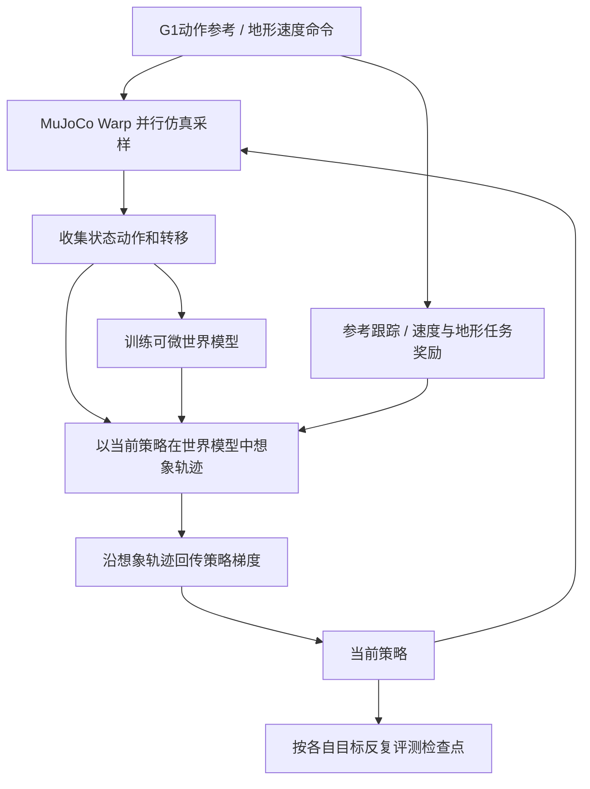
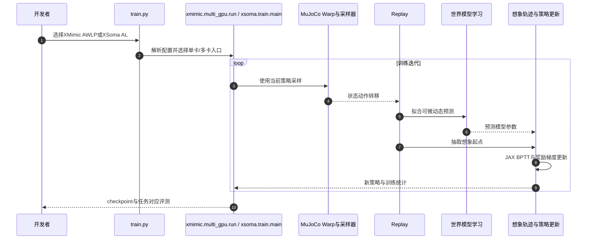

# XMimic and XSoma: Learning Humanoid Motion Tracking and Locomotion in Under a Minute / 一分钟内训练人形动作跟踪与地形行走

## 一句话定义

**XMimic & XSoma**：联合论文 XMimic 和 XSoma 以可微世界模型、JAX/XLA 编译和多卡流水化加速 G1 动作跟踪与复杂地形速度跟踪；4×H100 下分别 0.86 分钟与 0.77 分钟达规定目标（排除启动/编译）。

## 英文缩写速查

| 缩写 | 英文全称 | 简要说明 |
|---|---|---|
| JAX | JAX numerical computing | 可微与可编译的数值计算框架 |
| XLA | Accelerated Linear Algebra | JAX 编译 GPU 程序的工具链 |
| BPTT | Backpropagation Through Time | 穿过世界模型想象轨迹训练策略 |
| AWLP | Actor–World-model–Learner–Prober pipeline | XMimic 四卡流水分工 |
| SAC | Soft Actor-Critic | XSoma 使用的 Holosoma 比较基线 |

## 为什么重要

传统 RL 的策略更新常被大量环境步数和小 kernel 调度拖慢。作者将学习到的世界模型用作可微仿真动力学，并让训练和采样尽可能保持在 GPU 上，缩短达到具体跟踪指标所需墙钟时间。

## 核心原理

1. XMimic 对 LAFAN1 的 40 段参考动作进行 Unitree G1 全身跟踪；与 BlinkMimic 共享世界模型想象的策略梯度思路，使用 JAX/XLA 完整编译并将 actor、世界模型、策略学习和失败探测分流到最多四卡。
2. XSoma 复用 Holosoma 的 G1 地形速度跟踪任务、奖励、随机化与终止条件；先在真实模拟交互采集转移、拟合世界模型，再穿过约一秒预测轨迹直接反传奖励来更新策略，源码明确不使用 critic。
3. “一分钟内”仅指连续检查点达标的学习墙钟时间，不包括启动、首次编译、真实机器部署；四卡 XMimic 和 XSoma 处理的是不同任务与不同目标阈值。

## 流程总览

## 源码运行时序图

代码静态核对的真实入口如下（仅确认调用链，未执行训练）：

## 工程实践

- XMimic：python train.py --layout AWLP --log_dir runs/awlp；默认单卡入口在 train.py 内转到 xmimic.single_gpu.run，多卡转到 xmimic.multi_gpu.run，结果由 python -m xmimic.evaluate 评估。
- XSoma：python train.py --layout AL --log_dir runs/x4；其 train.py 设置 JAX runtime 后进入 xsoma.train.main，训练逻辑在 xsoma/train.py；外部 Holosoma 任务参数依照 README 对齐。
- 复现时报告实际 GPU 型号、软件栈、编译时间、达标连续性、随机种子、机器人资产与数据授权；不要直接外推到真机或 RTX 3070。

## 实验与评测

- XMimic：4×H100 NVL 上 40 段 LAFAN1 G1 参考跟踪，严格目标是归一化回报至少 0.82、40 段零失败、连续 3 个评测点保持，平均 0.86 分钟；BlinkMimic 单卡 3.19 分钟。
- XSoma：4×H100 上在 Holosoma 粗糙地形速度/角速度指标（score ≥0.95、≥0.8）连续 3 个检查点达标，平均 0.77 分钟；单卡 Holosoma FastSAC 平均 9.44 分钟。
- 训练耗时均排除启动和编译；4 GPU 更短的墙钟时间不等于使用的 GPU·分钟更省；两种任务的达标阈值不同。

## 结论

**XMimic & XSoma 的价值应以相同任务协议、训练数据与推理测时边界判断，不能仅依据宣传规模或单一成功率。**

1. XMimic 对 LAFAN1 的 40 段参考动作进行 Unitree G1 全身跟踪；与 BlinkMimic 共享世界模型想象的策略梯度思路，使用 JAX/XLA 完整编译并将 actor、世界模型、策略学习和失败探测分流到最多四卡。
2. XSoma 复用 Holosoma 的 G1 地形速度跟踪任务、奖励、随机化与终止条件；先在真实模拟交互采集转移、拟合世界模型，再穿过约一秒预测轨迹直接反传奖励来更新策略，源码明确不使用 critic。
3. XMimic：python train.py --layout AWLP --log_dir runs/awlp；默认单卡入口在 train.py 内转到 xmimic.single_gpu.run，多卡转到 xmimic.multi_gpu.run，结果由 python -m xmimic.evaluate 评估。
4. XSoma：python train.py --layout AL --log_dir runs/x4；其 train.py 设置 JAX runtime 后进入 xsoma.train.main，训练逻辑在 xsoma/train.py；外部 Holosoma 任务参数依照 README 对齐。

## 与其他工作对比

| 对照 | 关键差异 |
|---|---|
| 已有 XMimic 节点 | 早期独立论文和源码版本的知识归档；本页对应 2611.20452 联合论文并补充 XSoma 地形行走。 |
| Holosoma / FastSAC | 同一地形任务的比较基线，必须保持任务指标与计算资源可比。 |

## 局限与风险

- 全部关键成绩来自训练基准中的仿真任务，未证明真机部署的鲁棒性。
- 多卡同步、旧策略/旧世界模型流水陈旧性以及机器资源成本需要单列。
- 本论文以 XSoma 代码 URL 作为主项目入口；XMimic 已在站内有更早独立工作记录，本页不复制其独立论文主身份。

## 关联页面

- [基于模型的强化学习](../methods/model-based-rl.md)
- [强化学习](../methods/reinforcement-learning.md)
- [人形行走](../tasks/humanoid-locomotion.md)
- [早期 XMimic 独立笔记](./paper-xmimic-jax.md)
- [SuperMimic](./paper-supermimic.md)
- [人形行为模型纵深](../../roadmap/depth-bfm.md)
- [行走强化学习纵深](../../roadmap/depth-rl-locomotion.md)

## 参考来源

- [论文全文归档](../../sources/papers/xmimic-xsoma-2611-20452.md)
- [arXiv 原文 v1](https://arxiv.org/html/2611.20452v1)
- [官方代码归档](../../sources/repos/xmimic-xsoma-2611-20452.md)

## 推荐继续阅读

- [XMimic and XSoma: Learning Humanoid Motion Tracking and Locomotion in Under a Minute](https://arxiv.org/abs/2611.20452)
- [官方代码](https://github.com/nico-bohlinger/xsoma)

