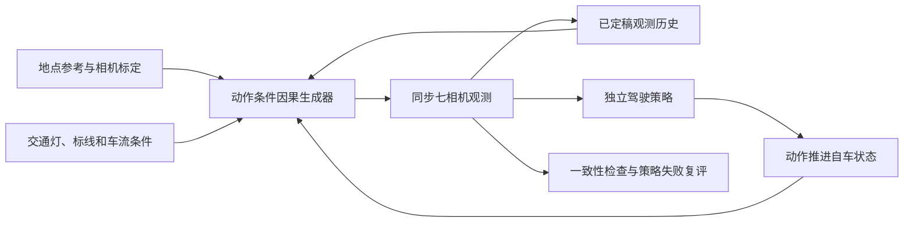

# X-World 1.6：用世界模型构建可控虚拟城市 / Building Controllable Virtual Cities with World Models

## 一句话定义

给定地点参考、自车运动和交通控制，生成同步七相机未来视频并反馈给独立驾驶策略，使同一地点可用来重放问题或测试不同决策。

## 英文缩写速查

| 缩写 | 英文全称 | 简要说明 |
| --- | --- | --- |
| ASC | Absolute Static Scene Control | 以地点参考约束静态环境 |
| 3DGS | 3D Gaussian Splatting | 渲染静态场景的参考视图 |
| CSF | Connected Self Forcing | 后训练时把未来误差反馈给历史缓存的生成过程 |
| DiT | Diffusion Transformer | 七视角联合生成的去噪骨干 |
| FDE | Final Displacement Error | 比较轨迹终点的位移差 |

## 为什么重要

固定录像不能响应策略的不同决策。可交互的生成环境能在同一地点变更自车轨迹、信号或车流，适合做失败诊断；但视觉逼真、动作遵循与复现指定失败是三套不同的验收证据。

| 项 | 内容 |
| --- | --- |
| 机构 | 小鹏（XPeng） |
| 输入 | 初始观测、自车轨迹、低维交通与地图条件、可选地点参考和相机标定 |
| 输出 | 七相机同步视频观测；集成驾驶策略与世界模型是两个组件 |

## 核心原理

1. **控制条件与地点参考分开。** GeoPE 用相机视线把条件和视频 token 连到共享坐标系；控制信号管运动、交通与路况，地点参考管覆盖区内的固定环境。点云、3DGS、参考图像分别微调，不是一个权重任意混用。参考覆盖之外仍是生成先验。
2. **从双向训练转为因果服务。** Wan2.2 初始化的双向模型经块因果适配和一致性蒸馏。CSF 在自生成轨迹上重新计算选定历史缓存的梯度，把跨块误差回传；长窗教师及更长学生滚动扩展监督。视觉与自车运动联合奖励更新的是世界模型，不是驾驶策略。
3. **闭环只提交已定稿历史。** 独立策略由相机输出生成动作或轨迹。仿真器推进自车状态，因果生成器更新当前块；临时带噪预测不写入后续历史，块完成后再写入干净缓存。

### 流程总览

## 工程实践

- **驾驶闭环与视频补全分开。** 行车记录仪环视补全保留源视频的自车运动和交通演化；更换驾驶决策的闭环则用策略产生的新动作更新环境。
- **报告端到端口径。** 四张 M810E、12 个并发会话的逐帧服务报告整节点 **1.281 obs/s**、单会话平均 **8.94 s/步**、P99 **17.82 s**。每个 obs 是七相机合计，不是单相机 FPS，也不是实时车载控制时延。推理节默认未开启 ASC。
- **源码运行时序图：不适用。** 官方公布报告、项目页和演示，未核实有 1.6 的可运行源码或检查点；上图是论文中的系统机制，不是已执行的源码路径。

## 评测

| 证据 | 报告结果 | 解释 |
| --- | --- | --- |
| 标注辅助 | 同五名标注员、150 个视频，总时间从两天到一天 | 自动预标注仍由人校正 |
| 人类偏好对照 | 非平局场景 **20/28** 一致 | 独立于自动几何一致性度量，不是驾驶结果 |
| 下游轨迹 | 均值 FDE 相对 1.0 **下降 20.9%** | 参考终点来自对真实视频的轨迹预测，不是测量真值 |
| 成对复评 | **19%** 更好、**77.4%** 相当、**3.6%** 变差 | **96.4%** 是“更好或相当”，不是绝对成功率 |

## 对比与消融

配对自动评测中，CSF 对比普通 Self Forcing 的跨视角射线残差从 **0.1813 m** 降至 **0.1686 m**。CSF 加长时域调优在九指标平均排名领先，但 1.0 重建的 PSNR、MAE 仍更好。跨视角几何和时间连续性不能替代像素重建、交通行为或闭环策略的独立评估。

## 局限与风险

- 可滚动生成超过 30 秒，不等于长期保存被遮挡场景。超出参考覆盖、长遮挡或时序不一致的控制可产生断裂或不一致。
- 厂商配对回归仅覆盖所选情形。没有公开量化道路测试，内部需求分数也不是按表 4 重算的净改善，不应视作实车安全或全国场景覆盖率。
- 它是**动作条件的环境模型**，输出观测，而非直接输出机器人的控制动作或联合动作预测。

## 结论

**把可控生成器当作独立闭环环境，价值在可重复改变条件并观察策略后果。**

- 比较版本时配对同一场景、策略、初始化和判据。
- 分开记录图像质量、条件遵从与目标行为复现；不能用更清晰的图像代替行为证据。
- 上线规划同时看聚合吞吐和单会话尾延迟，避免把离线服务性能写成实时控制能力。

## 关联页面

- [生成式世界模型](../methods/generative-world-models.md) · [基于模型的强化学习](../methods/model-based-rl.md)
- [仿真评测基础设施](../concepts/simulation-evaluation-infrastructure.md) · [世界–动作模型纵深路线](../../roadmap/depth-wam.md)

## 参考来源

- [技术报告全文核对归档](../../sources/papers/xworld_16_arxiv_2611_00596.md)

## 推荐继续阅读

- [论文 HTML（含图与附录）](https://arxiv.org/html/2611.00596v2) · [项目页](https://xworld16.github.io/) · [官方互动驾驶演示入口](https://x-world-drive.github.io/)
