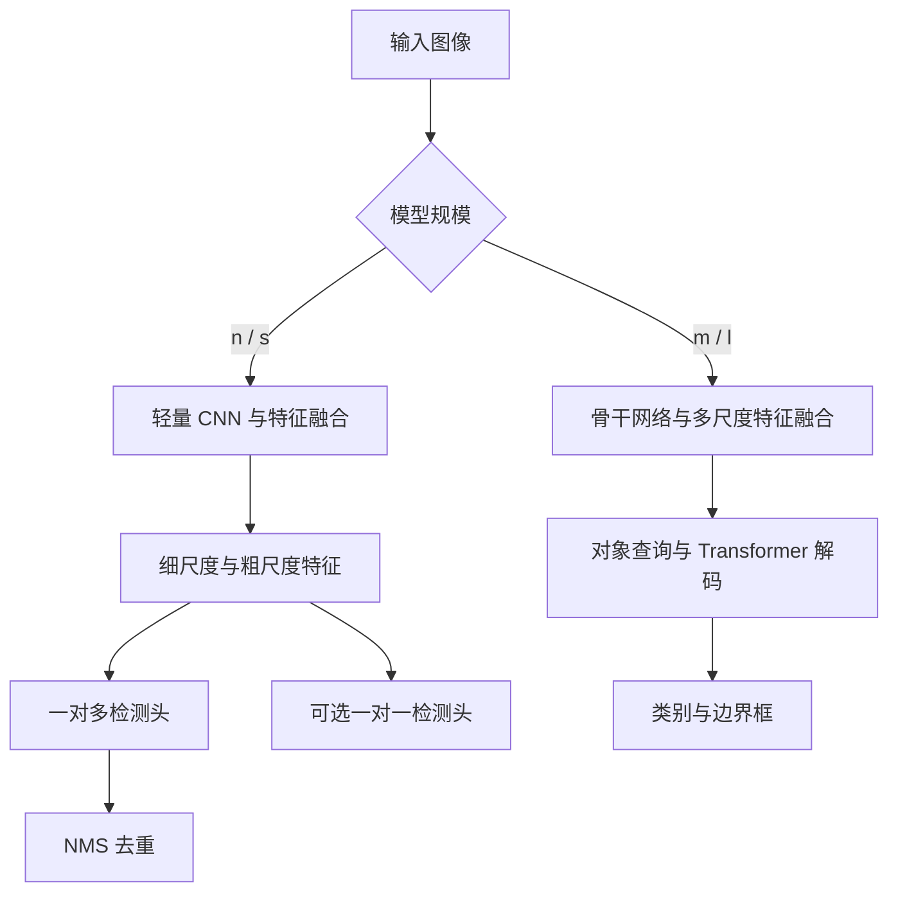

# YOLO27: An Overview of Dual-Scale Architecture and Query-Based Real-Time Computer Vision（YOLO27：双尺度架构与基于查询的实时计算机视觉综述）

## 一句话定义

YOLO27 是 Ultralytics 预告的实时视觉模型族；Ranjan Sapkota 的综述整理了其按模型规模选择检测架构的设计和初步结果。

## 英文缩写速查

| 缩写 | 英文全称 | 简要说明 |
|------|----------|----------|
| CNN | Convolutional Neural Network | 卷积神经网络 |
| NMS | Non-Maximum Suppression | 非极大值抑制，用于检测去重 |
| mAP | mean Average Precision | 平均精度均值 |
| FPN | Feature Pyramid Network | 多尺度特征金字塔 |

## 流程总览

按论文检测架构绘制，模型具体实现尚未公开。

训练阶段的前景对齐分支用于缩小密集监督与一对一预测的差距，推理时移除。论文未给出独立消融，不能仅凭模型间精度差归因。

## 核心机制

- **双尺度：** n/s 保留细尺度与粗尺度，移除中间预测层；前期高分辨率阶段增宽。论文给出的特征缩放与前景损失公式是概念性描述，并非公开实现的精确规格。
- **训练与推理：** 前景对齐只用于训练；n/s 默认一对多加 NMS，可选一对一无 NMS。m/l 通过查询解码直接预测类别和框。
- **架构版本差异：** 论文称 m 为 CNN 骨干、l 为 UltraViT；官方预览描述 m/l 均采用 UltraViT。论文将双架构限定在检测，官方预览还将实例分割和姿态列入；以各自版本为准，发布后需复核。

## 源码运行时序图

不适用：截至 2026-11-05，官方预览注明模型实现、配置和权重尚未发布；公开的通用 Ultralytics 仓库不等于 YOLO27 可运行实现。

## 实验与评测

论文 PDF 报告 COCO 640 输入下，n 至 l 为 **42.3–60.4 mAP**、**0.62–2.32 ms**；条件为 RTX PRO 6000、TensorRT 11、FP16，检测使用 NMS-free 路径。800 输入的 l 报告 61.2 mAP。结果是预览数据，作者声明未独立验证。

| 模型 | 论文 COCO mAP50:95 | 论文 GPU 时延 | 融合参数 |
|------|-------------------|--------------|----------|
| n | 42.3 | 0.62 ms | 3.0 M |
| s | 49.6 | 0.79 ms | 11.8 M |
| m | 55.8 | 1.39 ms | 22.8 M |
| l | 60.4 | 2.32 ms | 72.3 M |

论文还报告七类任务的预览结果：COCO 实例分割 l 的 mask mAP 为 47.9；Cityscapes 语义分割 l 的 mIoU 为 83.8；深度估计的 KITTI-580 δ1 并非随规模单调提高；分类表只列复杂度和时延，未报告分类准确率。不同任务使用不同数据集、分辨率和指标，数值不能直接比较。

官方页面在核对日列出的 640 输入结果为 **42.6–60.5 mAP、0.44–1.86 ms**；其 m/l 骨干描述与论文不同。两者属于不同时间的预览，具体原因未核实，不应拼接为同一组实验。

## 结论

这篇综述的价值在于梳理预告中的双架构设计，目前无法独立复现。

- 小模型默认带 NMS，复现论文评测时需显式区分推理头。
- 小目标收益与训练分支效果需要受控消融确认。
- 设备选型应在模型发布后测量目标硬件上的精度、时延与内存；GPU 模型时延不等于机器人完整感知到控制时延。
- 官方与论文预览存在差异，比较时应记录来源及版本。

## 局限与待核查

已通读论文正文；原文依据官方预览，作者未独立验证模型。规模和架构同时变化，不能仅凭家族对比证明某个模块的因果收益。实际模型与权重发布后需重新核验实现与基准。

## 关联页面

- [YOLO26](./paper-yolo26-unified-realtime-e2e-vision.md)
- [Ultralytics](./ultralytics.md)
- [RF-DETR](./rf-detr.md)
- [目标检测](../methods/object-detection.md)

## 参考来源

- [论文来源归档](../../sources/papers/yolo27-alphaxiv-overview.md)
- [Ultralytics YOLO27 官方预览](https://docs.ultralytics.com/models/yolo27/)

## 推荐继续阅读

- [论文 PDF](https://www.alphaxiv.org/abs/2609.yolo27-dual-scale-query-based-vision.pdf)
