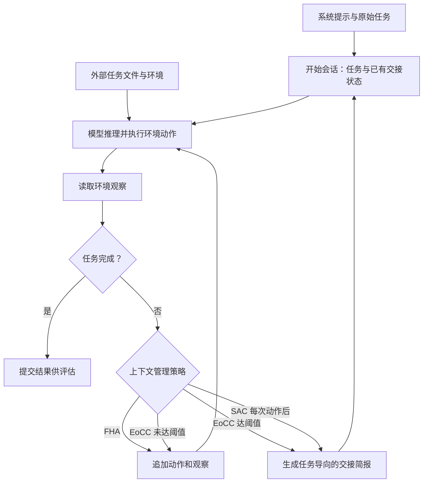

# You don't need long context / 你并不需要长上下文

## 一句话定义

通过把长程 Agent 的历史转为任务导向的交接状态，并让模型按需读取外部资料，可以在所测试的许多任务中维持接近全历史模式的准确率，同时显著减小活动上下文。

## 英文缩写速查

| 缩写 | 英文全称 | 简要说明 |
|---|---|---|
| FHA | Full-History Accumulation | 全历史累积基线 |
| EoCC | End-of-Conversation Compaction | 达阈值后压缩并重开会话 |
| SAC | Single-Action Compaction | 单次环境动作后更新状态并重开会话；此处不是 Soft Actor-Critic |
| SSSM | Semantic State Space Model | 作者提出的自然语言语义状态模型 |
| KV | Key-Value | 注意力缓存 |
| LLM | Large Language Model | 负责推理、工具调用与状态整理 |
| SWE | Software Engineering | 软件工程评测任务 |

## 核心信息

| 属性 | 原文证据 |
|---|---|
| 论文 | [arXiv:2611.05306v1](https://arxiv.org/abs/2611.05306)，2026-11-03，31 页技术报告 |
| 作者 | Peter Belcak、Saurav Muralidharan 等 12 人 |
| 机构 | 英伟达研究院（NVIDIA Research） |
| 全文 | [HTML](https://arxiv.org/html/2611.05306v1) / [PDF](https://arxiv.org/pdf/2611.05306v1) |
| 官方入口 | [DLER](https://nv-dler.github.io/) / [LFI](https://research.nvidia.com/labs/lpr/lfi/) |
| 代码 | 未核实到论文专属实验实现；附录 G 有提示词结构，引用 mini-swe-agent v2.4 |
| 证据范围 | 正文 §1–6、附录 A–G；作者报告结果，未独立复现 |

## 为什么重要

长程任务的步骤数量和外部资料规模并不直接决定模型单轮所需的 token 数。对 coding agent、机器人研发工具链与上层任务规划，限制活动上下文可能节省推理资源，但必须保存可回查的真实状态；这不等于机器人底层实时控制器应使用 LLM。

## 核心原理

- **FHA：** 同一对话追加动作和观察，直到完成任务。
- **EoCC：** 当历史越过压缩阈值，调用模型生成有界交接简报，重新以系统提示、任务与简报初始化会话。16K/12K 指总上下文上限/触发阈值，而非摘要长度。
- **SAC：** 每个会话仅执行一个环境动作，观察结果并更新语义状态，再进入下一会话。环境文件持续存在，模型对话不是完整持久存储。
- **选择性读取：** 长输入保留在文件系统，通过 Bash 检索与有界窗口读取（附录 E），用 EoCC 作超预算后备。
- **SSSM（§5.1）：** 作者建议后训练模型消费自然语言状态、推理、行动、观察和更新状态。与神经 SSM 的内部状态不同，这是可读的语言状态。尚非独立训练模型的实证成果。

## 流程总览

以下依据 §2.4、Fig. 3 与 §5 整理三种运行机制。外部完整历史回查是 §3.1 提出的补救方向，不应误称 SAC 已在全部实验中启用此功能。

## 实验与评测

表 2：准确率（%）与 SAC 单个会话峰值上下文（K tokens）。

| 模型 / 基准 | FHA | 最佳 EoCC | SAC | SAC 峰值中位数 / 最大值 |
|---|---:|---:|---:|---:|
| Opus 4.5 / SWE-bench Verified | 70.0 | 74.8 | 70.2 | 8 / 16 |
| Opus 4.5 / Terminal-Bench 2.1 | 47.2 | 52.8 | 51.8 | 9 / 19 |
| GPT 5.6 Sol / SWE-bench Verified | 84.4 | 88.8 | 82.4 | 7 / 15 |
| GPT 5.6 Sol / Terminal-Bench 2.1 | 87.6 | 88.8 | 84.3 | 8 / 37 |

- H100 解码吞吐：256K 降至 16K，三种模型分别获得约 3.6、5.6、7 倍吞吐（Fig. 4）。固定硬件、已缓存前缀、每请求生成 1024 tokens，不含完整任务端到端延迟。
- 长输入（表 15）：RULER mean recall，Opus 62.5→95.7%，GPT 65.5→96.4%；两者压缩次数中位数均为零，不能把收益全部归因于压缩。
- 反例（附录 D 表 9）：量化 Qwen 3 Coder Next 在 SWE-bench Verified 的 16K/12K 设置准确率 53.0→3.6%。
- 成本（附录 B）：以三种开权重模型的相对解码成本平均近似值 0.20，构造闭权重模型的估计优化价格；实际 API 标价、缓存命中和重算开销可能不同。

## 结论

论文支持针对任务维护短活动上下文，而不是完全否定长上下文的价值。

- 首先区分输入资料规模和当前推理所需状态。
- 以 EoCC 阈值做实验变量，同时监控任务成功率、峰值及累计 token。
- 交接时保存原始目标、已证实事实、变更、失败记录、后续计划和验证结果。
- 需要精确历史时读取外部原始记录，不把有损简报作为唯一事实来源。
- 按模型和任务校准预算；SAC 是有额外状态更新代价的极端策略。
- 对机器人规划的迁移属于工程假设，须单独测量安全、实时性和任务成功率。

## 源码运行时序图

**不适用：** 原文附录 G 公开基础 harness 和压缩提示词结构，但截至 2026-11-24 官方 DLER 条目未列论文专属代码，未核实可运行的 EoCC/SAC 实验入口。上图是论文机制图，不是源码调用 trace。

## 工程实践

建议在 Agent 上层采用可审计的外部任务日志和有界状态，并对比完整历史、阈值压缩与单动作压缩。对机器人研发，状态可以包含仿真结果、失败原因、代码版本和验收条件；实际设备状态仍应来自实时观测与安全控制模块，不用语言摘要替代。此为本知识库的工程映射，未获论文真机实验证实。

## 局限与风险

- 压缩会丢失细节；多次递归压缩可能放大错误。
- 预算过紧可能使模型没有足够空间完成有效操作。
- 估计优化服务成本和实际账单有别；不能将 7 倍单 token 吞吐外推为整个 agent 加速。
- SAC 实验仅覆盖两个软件工程/终端基准，未评估全部类型任务。
- SSSM 是概念与研究提议，未证明对所有任务的充分性。
- 未发现论文专属可运行代码；复现实验仍缺具体修改和环境配置。

## 关联页面

- [Agent 记忆与 dreaming](../concepts/agent-memory-and-dreaming.md) — 区分同一任务的状态交接与跨任务持久记忆。
- [Agentic Coding 软件工程基础](../concepts/agentic-coding-software-fundamentals.md) — harness、环境与验收条件。
- [AI Agent 评测](../concepts/ai-agent-evaluation.md) — 任务成功率与评测设计。
- [MAPE](./paper-mape-agent-memory-program-evolution.md) — 比较跨会话记忆的程序进化，而非本论文的活动上下文预算。

## 参考来源

- [arXiv v1 原文归档](../../sources/papers/you_dont_need_long_context_arxiv_2611_05306.md)
- [NVIDIA 官方研究入口核对](../../sources/sites/nvidia-you-dont-need-long-context.md)

## 推荐继续阅读

- [论文 HTML 全文及附录](https://arxiv.org/html/2611.05306v1)
- [NVIDIA DLER](https://nv-dler.github.io/)
