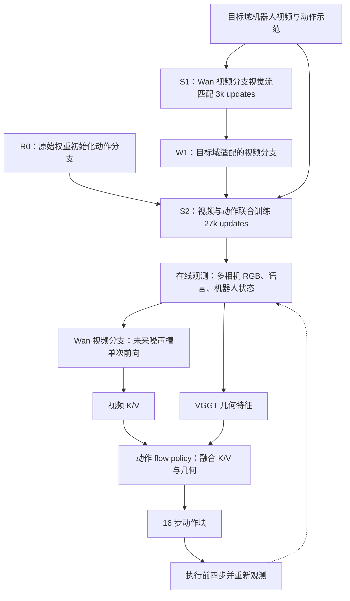
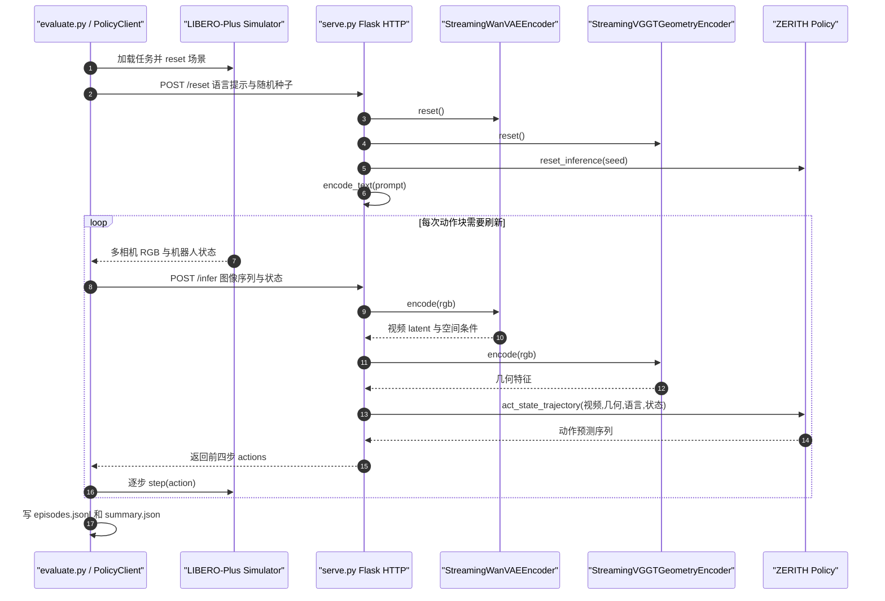

# ZERITH 2.5：从视频预测先验到机器人策略可学习性 | From Predictive Power to Policy Learnability

**ZERITH 2.5**（*From Predictive Power to Policy Learnability*，[arXiv:2611.23746](https://arxiv.org/abs/2611.23746)，[研究主页](https://zerith-25-review.kindpetal17.chatgpt.site/)，[官方源码](https://github.com/ZERITH-ZLab/ZERITH-V2.5)）是 **Zerith Robotics（ZERITH Z-Lab）** 发布的视频–动作机器人操作模型。论文不是单纯报告视频生成得更好，而是系统分析：目标域视频预测训练在何种监督和训练顺序下，能真正帮助动作策略学习。

## 一句话定义

**在相同机器人示范与总更新预算下，先给视频预测分支做目标域的宽噪声视觉适配，再让动作分支持续读取其 K/V 预测表征，比直接把未经适配的视频基座与动作策略端到端联训更容易学会操作。**

## 英文缩写速查

| 缩写 | 英文全称 | 简要说明 |
|---|---|---|
| WAM | World–Action Model | 将世界预测知识与机器人动作策略耦合的模型 |
| VAM | Video–Action Model | ZERITH 的视频分支和动作分支协同建模方式 |
| DiT | Diffusion Transformer | 视频 Wan2.2 骨干及动作生成中采用的 Transformer 结构 |
| K/V | Key / Value | 视频/几何分支供动作注意力读取的特征 |
| VGGT | Visual Geometry Grounded Transformer | 在当前图像上提供几何特征的编码器 |
| S1/S2 | Stage 1 / Stage 2 | 视觉适配阶段与联合视频–动作策略学习阶段 |
| OOD | Out-of-Distribution | 机器人视觉/场景超出训练分布时的变化 |

## 为什么重要

- **会预测不等于会控制：** 视觉生成指标无法直接代替动作闭环成功率。ZERITH 用有控制变量的训练预算比较，定位视频先验进入策略的有效路径。
- **训练顺序是可实验变量：** S1 并未额外增加总训练步数；与直接联训相比，视觉预适配让 S2 更容易学习控制。
- **迁移的不是简单初始化：** 更换 W0/W1 视频权重与 R0/R1 动作权重的实验表明，适配后视频分支本身的持续参与尤其重要。
- **有工程可检查的入口：** 开源代码提供 LIBERO/Plus/MetaWorld 的准备、训练、导出、HTTP 服务及评测；但 HF 权重授权、GPU 和 H1 真机安全条件须另行核查。

## 核心信息

| 维度 | 论文/仓库报告 |
|---|---|
| **机构** | Zerith Robotics（ZERITH Z-Lab） |
| **主论文** | [arXiv:2611.23746](https://arxiv.org/abs/2611.23746)（2026-11-18，预印本） |
| **基座** | Wan2.2-TI2V-5B 视频分支（30 个 blocks）；10-block 动作 flow policy；约 6.774B 可训练参数 |
| **输入** | 最多三相机多视角 RGB、语言指令、机器人本体状态及 VGGT 几何特征 |
| **动作** | 每次预测 16 步动作块；官方仿真服务返回前 4 步供闭环执行 |
| **S1/S2** | S1 视频流匹配视觉适配 3,000 updates；S2 联合视频–动作学习 27,000 updates |
| **对照预算** | Direct：直接联训 30,000 updates，机器人示范与总更新数受控 |
| **开源边界** | [代码 Apache-2.0](https://github.com/ZERITH-ZLab/ZERITH-V2.5)；自有权重 CC BY-NC 4.0 且 HF 需授权；自采预训练数据非全量公开 |

## 核心原理（方法）

### 视觉预测如何进入动作

视频分支用 Wan2.2 视频生成模型的 DiT，在未来 latent 噪声槽上执行一次特征前向。动作流匹配分支不是等待视频完整生成，而是从选定的视频层取 **K/V**，并读取 VGGT 的几何信息和本身动作特征，通过同一注意力 softmax 进行融合。部署时使用未来噪声槽特征，**不必将其解码成 RGB 未来帧**。

这个设计要分开三件事：① S1 学目标域视频动态；② S2 在联合视频损失与动作损失中学习策略；③ 部署使用视频分支的中间特征，不等同在线显式渲染未来视频后再规划。

### S1 与 S2 的训练细节

- **S1：** 用目标域机器人视频做约 3k updates 的视频 flow matching。当前视觉潜变量为条件；未来四个槽位的噪声在宽范围采样（包含少量干净目标），而非只在推理的纯噪声起点训练。
- **S2：** 用适配视频分支 W1 + 独立动作初始化 R0 联合训练 27k updates，继续保留视觉预测损失；S2 早期关闭 action→video 梯度，之后在 5%–10% 区间线性开启，避免初始策略误差直接扰乱视觉表征。
- **Direct：** 在同示范、同总 30k 更新预算下，完全跳过 S1 直接联合训练。与 Staged 之间的差别是优化顺序和监督分布，不是简单「额外多训练了 3k 步」。

### 流程总览

**读图提示：** S1 不读取动作标签来监督动作策略，S2 才做联合训练；训练期视觉预测目标与推理期动作策略读取视频特征应分开理解。

## 源码运行时序图

依据[官方源码归档](../../sources/repos/zerith-v25.md)核读的 `simulation/zerith_sim/posttrain/__main__.py`、`serve.py` 和 `evaluate.py`，以下是 **LIBERO-Plus 已发布 checkpoint 的仿真闭环**，不是论文内部 S1/S2 训练反向传播时序。官方 README 对应 `posttrain serve` 和 `posttrain eval` 两个 CLI。

实现中 `/infer` 还执行状态格式转换、合法动作范围裁剪；服务端在 `/health` 检查 benchmark。静态代码阅读已完成，**未运行 GPU 推理或真实 H1 安全控制**。

## 工程实践

| 步骤 | 核对与建议 |
|---|---|
| 资产准备 | 从[官方 README](https://github.com/ZERITH-ZLab/ZERITH-V2.5) 的 Quick Start 安装环境并运行 `scripts/download_libero_plus_assets.sh`；HF 权重仓要求已授权账户 |
| 推理环境 | FP32 策略文件约 27 GB；README 建议 **80 GB GPU** 加上视觉/语言编码器，消费级 8GB GPU 不适用完整默认配置 |
| 运行服务 | 在 `simulation/` 下使用 `python -m zerith_sim.posttrain serve --artifact assets/policies/libero-plus --base-instructions assets/libero-instructions.json ... --port 8000` |
| 评测客户端 | 另一环境 `python -m zerith_sim.posttrain eval --bench libero-plus --suite libero_spatial --task-ids 0 30 60 --episodes 1 --server http://127.0.0.1:8000 --output results/libero-plus-quickstart` |
| 后训练 | `posttrain prepare → train → export → serve → eval`；`train` 由入口生成配置后通过 `torch.distributed.run` 启动 |
| 复现边界 | 3 个任务各一集只是 smoke test；论文完整基准分数须跑全套评测协议，记录 seed、任务、权重版本与成功定义 |
| 真机部署 | H1 checkpoint 为 mid-training backbone，另需官方 `docs/deployment.md` 中的经过验证的 bundle、SDK/IK 及安全测试 |

## 实验与评测

### 受控研究（不能与完整版总成绩混用）

| 对照（LIBERO-Plus） | 论文结果与口径 |
|---|---|
| **Staged vs Direct（图 b，单次 run）** | **56.70% vs 37.54%**，均为 30k 总 updates |
| **S1 泛化：三种几何条件、三种子** | 在对应设置下分阶段训练提高 **17.55–19.16 个百分点**；不要和单次 run 拼成同一统计样本 |
| **权重迁移（图 c，单次 run）** | W0/R0 **37.54**；W0/R1 **33.60**；W1/R0 **57.21**；W1/R1 **56.70** |
| **S1 噪声监督** | 宽噪声适配 **56.70**，仅在纯噪声端点适配 **35.90**；适配目标形状有影响 |
| **梯度保留（图 d）** | Action→video **96.0%**，视觉损失 **2.9%**，video-model 梯度 **4.8%**；参数位移 **1.675%**，是机制诊断而非泛化证明 |

### 完整系统报告成绩

| 场景 | 成功率/口径 |
|---|---|
| LIBERO | **98.95%** |
| LIBERO-Plus | **93.70%** |
| MetaWorld MT50 | **92.3%**（注意报告所列部分基线使用不同聚合口径） |
| H1 pick and place | **97/100=97%** |
| H1 bin lining | **8/20=40%** |
| H1 bimanual assembly | **2/20=10%** |
| H1 SKU sorting | 仅定性演示，**不报告统计成功率** |

完整系统使用约 **10,000 h** 机器人数据，包括约 **6,000 h** H1 自采和约 **4,000 h** 公共语料。实验的直接/分阶段训练曲线属于可学习性研究条件，**不是** 完整大规模预训练模型 LIBERO-Plus 的 93.70%。

## 结论

**ZERITH 2.5 的关键贡献是把视频先验的「域适配顺序和监督目标」确立为动作策略学习的可控变量，而不是仅靠更大的视频骨干或复制适配权重到动作头。**

1. **严格匹配训练预算**：Direct 30k 与 S1 3k+S2 27k 对齐后再谈预适配收益，单次 37.54→56.70 与三种子提升范围分开引用。
2. **保留适配后的 W1 视频分支**：W1/R0 得 57.21，而 W0/R1 只有 33.60；不能把视频适配当成一次性初始化动作头。
3. **关注噪声监督覆盖**：部署只使用纯噪声槽，不意味着 S1 只训纯噪声端点就够。
4. **测量完整闭环而非生成视频质量**：K/V 特征供动作策略读取，官方服务给四步动作；要另测端到端时延和成功率。
5. **看清真机任务难度差异**：Pick-and-place 97% 与 bin lining 40%、bimanual assembly 10% 并存；不宜只引用仿真平均。
6. **区分可复现和可部署**：开放仿真代码并不等于权重免授权、GPU 成本低或 H1 真机开箱即用。

## 与其他工作对比

| 方向 | ZERITH 2.5 的区分点 |
|---|---|
| [OpenWAM](./paper-openwam.md) | OpenWAM 研究模块化 Joint WAM、跨域数据配方与多架构对照；ZERITH 聚焦固定预算下视频目标域预适配对策略学习的作用 |
| [GlanceWAM](./paper-glancewam.md) | GlanceWAM 把稀疏未来前瞻异步移出动作关键路径；ZERITH 推理不生成未来 RGB，动作读取视频中间 K/V |
| [Generative World Models](../methods/generative-world-models.md) | 未来预测监督的价值需要通过下游动作成功率和权重迁移实验确认 |
| [VLA](../methods/vla.md) | 与 π₀/π₀.₅ 等策略对照时，必须核对训练语料、任务设置、模型是否同一评测协议 |

## 局限与风险

- **预训练资源与论文控制条件不同：** 完整模型依赖约 10,000h 数据，包含 6,000h 自采；这是不同于 30k updates 消融的另一训练设置。不能仅凭报告声称全量数据公开或易于复现。
- **缺少一致的跨论文比较协议：** MT50 不同模型有汇总方式差异；部分基线训练配方也不同。对外比较应列清协议而不是只排名次。
- **消融统计范围有限：** 主 S1 对照在三个几何条件上采用三种子，部分权重迁移、噪声和梯度诊断是单次 run；结论尚不能无条件推广到所有视频模型和任务。
- **权重/计算限制：** HF 权重需要授权访问，官方建议 80 GB GPU 推理；CC BY-NC 权重不附商用许可，不能按 Apache-2.0 代码许可自动授权生产环境。
- **真机部署安全：** H1 权重不是经现场安全验收的动作执行包；其 SDK、IK、执行控制频率、避碰与失败恢复需独立验证。
- **源码核验说明：** 已读实际 CLI、服务端和仿真评测入口；未执行 GPU 复现实验，不把作者自报结果写成本仓库测得结果。

## 关联页面

- [World Action Models](../concepts/world-action-models.md) — WAM 推理边界与分支分类
- [Generative World Models](../methods/generative-world-models.md) — 视频生成骨干与预测目标
- [Vision-Language-Action](../methods/vla.md) — 动作生成策略对照
- [Robot Manipulation](../tasks/manipulation.md) — 双臂操作、柔性物体与任务完成指标
- [OpenWAM](./paper-openwam.md) — Joint WAM 预训练工程框架
- [GlanceWAM](./paper-glancewam.md) — 运行时视觉想象的另一种控制架构
- [WAM 纵深路线 Stage 3](../../roadmap/depth-wam.md) — 联合模型阶段

## 参考来源

- [论文一手归档：arXiv:2611.23746](../../sources/papers/zerith_v25_arxiv_2611_23746.md)
- [官方研究主页与资源开放核查](../../sources/sites/zerith-v25.md)
- [官方代码运行路径与许可归档](../../sources/repos/zerith-v25.md)

## 推荐继续阅读

- [论文 HTML（含正文与附录）](https://arxiv.org/html/2611.23746v1)
- [ZERITH 2.5 研究演示与技术报告](https://zerith-25-review.kindpetal17.chatgpt.site/)
- [代码仓与中英双语 README](https://github.com/ZERITH-ZLab/ZERITH-V2.5)
- [LIBERO-Plus 官方复现指南](https://github.com/ZERITH-ZLab/ZERITH-V2.5/blob/main/docs/simulation/libero-plus.md)
