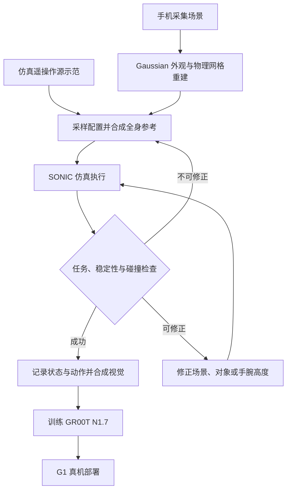

# Zero-HLM：无需真机示范的人形移动操作

## 一句话定义

Zero-HLM 从手机场景采集和少量仿真遥操作示范出发，通过场景重建、运动与环境协同修正，生成可执行的全身操作数据，训练后零样本部署到 G1。

## 英文缩写速查

| 缩写 | 英文全称 | 简要说明 |
|------|----------|----------|
| HLM | Humanoid Loco-Manipulation | 人形机器人移动操作 |
| VLA | Vision-Language-Action | 输入视觉和语言并预测动作的策略 |
| IK | Inverse Kinematics | 逆运动学，用于求解手臂关节目标 |
| PD | Proportional-Derivative | 比例微分低层控制 |

## 核心信息

| 项 | 内容 |
|----|------|
| 机构 | 北京理工大学、清华大学、Delta Intelligence、北京通用人工智能研究院通用人工智能国家重点实验室 |
| 论文 | [arXiv:2610.35075v1](https://arxiv.org/html/2610.35075v1)，2026-10-26 |
| 机器人 | Unitree G1；SONIC 全身控制器 |
| 范围 | 不用真机操作示范训练；真实场景扫描、相机标定和真机评测仍需现实数据 |

## 流程总览

## 核心机制

1. **场景重建：** 手机图像生成 Gaussian 表示；智能体使用 Blender 和 IsaacLab 构建可编辑物理网格，并通过匹配视角迭代对齐外观与几何。
2. **示范扩增：** 每个任务采集 15 条成功的仿真遥操作源轨迹。采样新场景后，选择附近源示范，对交互轨迹做目标坐标变换与手臂 IK；行走段由 A* 和 SONIC 规划。
3. **执行闭环：** SONIC 编码参考运动为 64 维 latent，解码器结合本体感觉历史输出关节目标；另外执行两个手部命令。跟踪误差可触发机器人位姿引导的场景平面修正、对象平面修正或抓取时手腕高度修正，再次执行；跌倒等不可恢复失败重新采样。
4. **策略训练：** 用成功执行的状态回放生成第一人称视觉，将 Gaussian 背景与仿真机器人、物体合成；以图像、本体状态和指令预测动作块，部署时 latent 经 SONIC 解码，手部命令独立执行。

## 源码运行时序图

**暂不适用：** 2026-10-29 项目页访问失败，无法核实官方实现入口；代码及数据开放状态待核实。

## 实验与评测

- 论文在香蕉取放、下蹲搬运帽子、双手搬篮并用脚关柜门三项长程任务中生成 4,800 条成功轨迹。
- Base 真机对照：每任务评测 20 次。每任务 800 条仿真示范训练的 GR00T N1.7 平均完整任务成功率为 **66.7%**；100 条真机示范为 **46.7%**。同为每任务 100 条时，仿真示范为 **43.3%**。因此 800 对 100 的结果同时改变了数据来源和数量。
- 扩展配置中，扩展仿真训练的策略与 Base 真机数据策略分别在 100 次试验中成功 69 次和 23 次；包含起点、桌面位置及对象与目标变化，不代表所有场景均能泛化。
- 场景修正消融、仿真与真实视觉混训实验均支持进一步检查执行偏差和视觉域差异；论文指出混合训练未必超过纯仿真训练。

## 结论

Zero-HLM 展示了以物理验证和执行反馈扩增仿真示范并迁移到真机的可行路径。

1. 对照数据量和配置覆盖不同，不能仅将性能差距归因于数据来源。
2. 生成和部署共用 SONIC 接口，迁移到其他控制器需要重新验证。
3. 真实场景扫描和相机标定仍有成本，不能理解为完全不使用现实信息。
4. 项目页及代码开放状态待核实；复现前应先确认数据、模型和实现可用性。

## 关联页面

- [移动操作](../tasks/loco-manipulation.md)
- [Isaac GR00T](./isaac-gr00t.md)
- [SONIC 运动跟踪](../methods/sonic-motion-tracking.md)

## 参考来源

- [论文归档](../../sources/papers/zero_hlm_arxiv_2610_35075.md)
- [项目页归档](../../sources/sites/zero-hlm.md)

## 推荐继续阅读

- [论文全文](https://arxiv.org/html/2610.35075v1)
- [项目页](https://young-bit.github.io/zero-hlm/)
