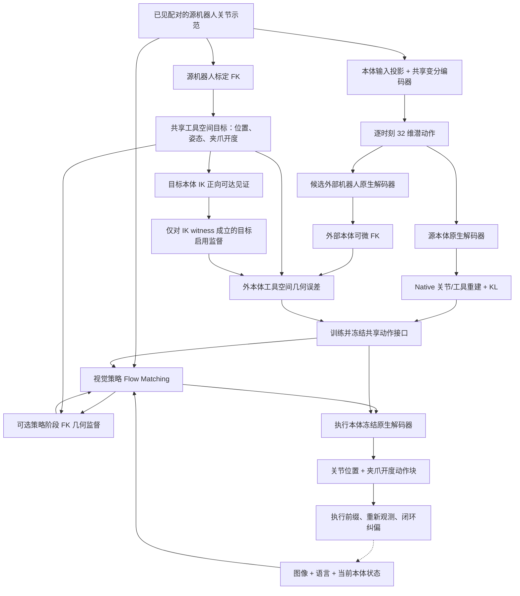

# 具身操作的零样本组合泛化 | Zero-Shot Compositional Generalization for Embodied Manipulation

**论文：** [arXiv:2611.22797v1](https://arxiv.org/abs/2611.22797v1)，Baicheng Li、Wenkang Qin 等，2026-11-17 预印本。本文讨论的是机器人与任务的**缺失配对**，而不是将未训练过的机器人或全新技能零样本引入系统。

## 一句话定义

利用每个本体已标定的**正向运动学**把源示范动作投影到统一工具空间，并用可达性证据训练异构机器人的原生动作解码器及视觉策略，从而让训练期未出现过的**已知机器人 × 已知操作技能组合**变得可执行。

## 英文缩写速查

| 缩写 | 英文全称 | 简要说明 |
|---|---|---|
| FK | Forward Kinematics | 从关节配置计算末端工具位姿，构造跨本体一致的几何监督 |
| IK | Inverse Kinematics | 为外部本体检验目标工具位姿是否存在满足限位的可行关节解 |
| TCP | Tool Center Point | 标定工具中心，跨机器人对齐位置、姿态与夹爪开度 |
| EEF | End Effector | 末端执行器；Direct EEF + IK 是论文的直接工具空间预测对照 |
| VLA | Vision–Language–Action | 从视觉、指令、本体状态映射为可执行动作的策略范式 |

## 为什么重要

- **数据覆盖成本：** 多本体采集很难覆盖所有机器人–技能组合。本文不额外采集缺失配对的目标机器人示范，而是用已有源示范与目标本体几何补充跨接口监督。
- **动作语义对齐：** 不同机器人的关节维数、运动学链和安装坐标不同；padding 只解决张量尺寸，不保证工具运动一致。
- **几何与学习分工：** FK/IK 提供动作在物理任务空间的对应关系，视觉语言策略仍学习何时接近、抓取、移动、释放并依靠闭环完成任务。

## 核心信息

| 项目 | 原文事实 |
|---|---|
| 机构 | 北京大学；地瓜机器人（D-Robotics）；电子科技大学深圳高等研究院；香港中文大学香港具身智能实验室 |
| 论文版本 | [arXiv:2611.22797v1](https://arxiv.org/html/2611.22797v1)，2026-11-17 |
| 问题设定 | 训练期间机器人和技能分别见过，但特定机器人–技能边在接口/策略训练中均缺席 |
| 例示机器人 | Franka Panda、UR5、Piper（图 1） |
| 共享动作 | 每时刻 32 维变分潜在表示；动作 chunk 为一串逐时刻共享动作 |
| 几何目标 | 共享任务坐标系下的 TCP 位置、姿态与归一化夹爪开度 |
| 评测环境 | RoboTwin、ManiSkill3 Push；π₀.₅、OpenWAM、FastWAM |
| 原生输出 | 执行本体的绝对关节位置目标 + 夹爪开度 |
| 开源核对 | 2026-11-20：官方 arXiv 及主文没有列出作者的可执行项目仓库；源码开放状态待核实 |

## 核心原理

### 1. 缺失边而非新本体

训练示范连接机器人集合与任务集合；测试集合中的每个机器人、每个任务都在其他组合中出现过，但对应机器人–任务配对不出现在接口或视觉策略训练数据里。FK 所需的运动学、安装变换、关节限位与工具标定均已知。因此不应把结果宣传成“任意新机器人零样本迁移”。

### 2. 从原生关节动作到可共享工具目标

对机器人 b 的机械臂 a，工具位姿由**任务坐标系安装变换 × 本体 FK × 末端工具标定**给出。源机器人示范关节命令定义出目标工具位置、旋转和夹爪开度；其他机器人用各自的 FK 将原生解码输出映射到同一任务坐标系。

共享变分编码器 E 把源机器人关节命令编码到潜变量 z，本体解码器 D_b 将 z 还原为各自的原生关节命令。源本体以关节重建、工具位姿重建、KL 正则保持 native 配置结构；外部本体则以其解码动作在 FK 下的工具误差接受监督。外部监督有**IK 可行性 mask**：仅当数值 IK 实际找到满足关节限位、位姿容差的解时才使用该目标，避免拿不可实现目标硬训。

**为何要两种损失：** 只重建各本体自身动作时，对不同机器人的 latent 坐标做不同 signed permutation 仍可能保持重建与先验损失不变，但跨本体解码语义会改变。几何监督将这个含混的语义锚定到真实末端效果；native 重建仍保留冗余自由度下的已演示构型偏好。

### 3. 冻结接口后学习视觉策略

动作接口预训练后冻结编码器和全部机器人解码器。视觉–语言策略从图像、语言、当前关节状态预测共享动作块；训练目标是示范动作的共享后验均值经 TRAIN 数据拟合的归一化。部署时经反归一化、目标机器人 D_b 解码，执行动作块前缀后重新观测。

Full 额外在策略阶段把 flow predictor 的**clean action 估计**送入冻结解码器和可微 FK，以**同一源示范**计算源本体和可行外部本体的工具空间损失，梯度返回视觉策略。它没有在训练中注入缺失组合的目标机器人专家轨迹。

## 流程总览

图中 LCROSS 只在训练阶段生效，推理阶段无需在线 IK；与 Direct EEF + IK 基线不同。可达性 witness 仅判定目标末端位姿有合规关节解，**不保证连续轨迹无碰撞或真实接触成功**。

## 源码运行时序图

**不适用（截至 2026-11-20）**：论文及官方 arXiv 页面没有提供可核实的训练/推理仓库、脚本入口或部署命令。不能仅凭正文方法图编造源码模块运行时序。当前 Mermaid 图严格表示论文给出的**算法监督流**，不是已检查的源码调用关系；若官方实现后续发布，应查验入口后补充 sequenceDiagram。

## 工程实践

| 复现实验环节 | 必须核实 / 注意事项 |
|---|---|
| 本体运动学与标定 | 每个机械臂的 FK、安装到共享任务坐标系变换、法兰到 TCP 的标定及关节限位必须匹配；左右臂分别处理 |
| 可达性筛选 | 用正向 IK witness 筛选可监督的 source → foreign 目标。数值求解失败只能标为未见证，不能当成不可达定理 |
| 编码与解码 | 每本体独立原生动作映射 + 共享 32D latent；源动作 native 重建配合跨本体工具损失，避免只做 native AE |
| 策略学习 | 冻结接口，通过 flow matching 训练动作 chunk；可选在 clean action 估计上加入 FK loss |
| 基线 | Native joints / Direct EEF + IK / Source / Cross / Full；保持视觉条件、演示暴露及接口容量的控制变量 |
| 复现实验缺口 | 原文中的详细超参、IK solver 与 fallback 参见 supplementary implementation details，但当前未核实独立附件及官方源码；此处不杜撰参数和命令 |

## 实验与评测

**表 1：任务平均 Held-out 成功率（%，各任务 1,000 episodes）；下表没有合并 Seen 组。**

| 模拟器 / 策略骨干 | Native joints | Ours Full | 提升（pp） |
|---|---:|---:|---:|
| RoboTwin / π₀.₅ | 17.0 | 33.6 | +16.6 |
| RoboTwin / OpenWAM | 34.8 | 46.5 | +11.7 |
| RoboTwin / FastWAM | 9.7 | 29.8 | +20.1 |
| ManiSkill3 Push / π₀.₅ | 3.1 | 35.9 | +32.8 |
| ManiSkill3 Push / OpenWAM | 11.6 | 43.5 | +31.9 |
| ManiSkill3 Push / FastWAM | 5.4 | 28.6 | +23.2 |

**表 2：控制变量对照中的 Held-out 成功率（%，与表 1 按论文原有口径分别解读）。**

| 条件 | OpenWAM | FastWAM |
|---|---:|---:|
| Direct EEF + IK | 41.5 | 25.2 |
| Source（仅 native） | 33.4 | 17.7 |
| Cross（外本体 FK） | 42.9 | 26.3 |
| Full（Cross + policy FK） | 46.5 | 29.8 |

- Cross 相比 Source：**+9.5 / +8.6 pp**；Full 相比 Cross：再增加 **+3.6 / +3.5 pp**，均为表 2 Held-out 数据。
- 另一个独立的 3-run 配对面板记录 Cross 对 Source **19 / 16 / 11 pp**，均值 15.3 pp；不要与表 2 的单组均值混用。
- 可行目标的 foreign TCP 误差：Source **302.13 mm**，Cross **4.37 mm**，是动作几何诊断而不是最终任务成功率。
- 配对 observation-to-command 时延基准：Cross 相对 Direct EEF + IK 获得 **1.71× 中位模型侧加速**（包含视觉编码、flow 推理、原生指令生成），不能当作伺服闭环速度。
- Seen 组不一定每种条件都最高；表 2 的 Cross 在 Seen 成功率上略高于 Full，迁移增益与源任务保持性需要共同检查。

## 结论

这篇论文的价值是为“已知本体 × 已知技能”的**未见组合**提供可微、带可达性筛选的**物理动作对齐约束**，并以受控实验区分接口训练与策略训练各自的几何监督增益。

1. 设计跨本体共享动作时，先做**源/目标 TCP 坐标标定一致性**，而不只把不同关节向量补齐为等长。
2. 联训接口应同时保留**native joint reconstruction** 和 **foreign FK pose loss**；二者分别稳定配置先验与跨本体物理语义。
3. 必须对跨本体目标使用**正向 IK 可达 witness mask**，并记录失败率、求解容差和采样分布。
4. 验证须区分**外本体工具误差**、**缺失配对闭环任务成功率**和**seen 任务保持性**。
5. 真机复用前仍需单独处理**碰撞、动态约束、冗余构型连续性与接触误差**；论文仿真结果不足以替代安全验收。

## 与其他工作对比

- **对比 Native Joints 原生关节基线（Table 1）：** 在 RoboTwin 与 ManiSkill3 Push 评测中，分别基于 [π₀.₅](./paper-pi05-open-world-vla.md)、[OpenWAM](./paper-openwam-composable-world-action-models.md) 与 [FastWAM](./paper-fast-wam.md) 训练的原生关节策略在未见「已知本体 × 已知技能」组合上成功率仅 **9.7%–34.8%**（RoboTwin）与 **3.1%–11.6%**（ManiSkill3）；本文 Full 方案将其提升至 **29.8%–46.5%** 与 **28.6%–43.5%**（+11.7 至 +32.8 个百分点），同时保持 Seen 组合性能不退化。
- **对比 Direct EEF + IK 与接口/策略阶段消融（Table 2）：** 仅做源本体自重建的 Source（Held-out：OpenWAM 33.4% / FastWAM 17.7%）在加入外本体可微 FK 监督后（Cross）升至 **42.9% / 26.3%**，外本体 TCP 误差从 302.13 mm 降至 4.37 mm；叠加策略阶段 FK 的 Full 进一步达到 **46.5% / 29.8%**，超过直接预测末端位姿并调用在线数值求解的 **Direct EEF + IK**（41.5% / 25.2%）5.0 / 4.6 个百分点，且模型侧指令生成中位时延快 **1.71×**。
- **与 [Open X-Embodiment](./paper-open-x-embodiment.md) / [Octo](./paper-octo.md) 跨本体路线定位区分：** Open-X 与 Octo 依赖多本体数据汇总及共享/可插拔动作头，而本文利用标定 FK 与正向 IK witness 在**无需目标组合示范**的条件下对齐原生解码器，前提是每台机器人与每项技能各自在训练集中已出现且运动学标定准确。

## 局限与风险

- 零样本的“新”只指机器人–技能配对；每个机器人和每项技能必须在训练集中各自出现过，且系统必须具备已知几何标定。
- IK witness 对位置、姿态、关节限位给出正向可行见证，不等于真实抓取/插拔可行，也没有证明所有可达位姿都能被数值求解器发现。
- 论文使用 RoboTwin 和 ManiSkill3 仿真，缺少本文主文中的真机任务成功率；不同骨干的 Seen/Held 组与训练协议应分别读表。
- 官方代码、权重、训练细节和独立附录的公开状态尚待核实；当前节点只复述论文可核查的训练路径，不主张已完成复现。

## 关联页面

- [跨本体迁移知识链](../overview/hub-cross-embodiment.md)：把本工作置于几何锚点、隐动作和共享骨干的不同对齐路径中。
- [模仿学习](../methods/imitation-learning.md)：理解示范重建监督与闭环行为克隆。
- [VLA](../methods/vla.md)：理解视觉语言策略与机器人原生动作接口的解耦。
- [Manipulation](../tasks/manipulation.md)：任务空间、接触、动作块执行与评测。
- [Open X-Embodiment](./paper-open-x-embodiment.md) · [Octo](./paper-octo.md)：对比数据聚合与多机器人动作接口适配。
- [跨本体纵深路线 Stage 1](../../roadmap/depth-cross-embodiment.md)：统一动作/状态接口的物理对应案例。

## 参考来源

- [论文完整原文核对归档](../../sources/papers/zero_shot_compositional_generalization_arxiv_2611_22797.md)
- [论文 arXiv:2611.22797v1](https://arxiv.org/abs/2611.22797v1)
- [官方 HTML 全文](https://arxiv.org/html/2611.22797v1)

## 推荐继续阅读

- [Open X-Embodiment: Robotic Learning Datasets and RT-X Models](https://arxiv.org/abs/2310.08864)：对照跨本体数据聚合与原生关节动作语义问题。
- [Octo: An Open-Source Generalist Robot Policy](https://arxiv.org/abs/2405.12213)：对照共享策略中可适配的本体输入/动作头。
