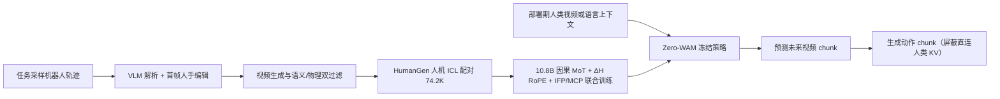
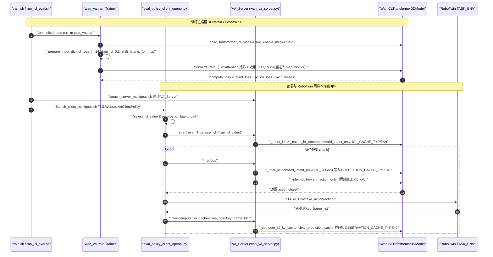

# Zero-WAM

**Zero-WAM: In-Context World-Action Modeling from Human Videos for Open-Ended Task Generalization**（[arXiv:2608.26103](https://arxiv.org/abs/2608.26103)，[项目页](https://robbyant-research.github.io/Zero-WAM/)，[GitHub](https://github.com/robbyant-research/Zero-WAM)）由蚂蚁灵波科技（Robbyant）、香港科技大学（广州）与香港科技大学联合提出（Jiaming Zhou、Qihang Zhang、Gangwei Xu、Yinghao Xu、Junwei Liang 等），利用大规模合成人机配对数据与未来块预测反捷径目标，实现纯零梯度的人类视频上下文跨任务泛化。

## 一句话定义

**把人类操作视频直接当作因果世界-动作模型的上下文任务规格：部署期不更新任何模型权重，即可零样本执行预训练未见的操作任务。**

## 英文缩写速查

| 缩写 | 英文全称 | 简要说明 |
|------|----------|----------|
| WAM | World-Action Model | 联合预测未来视频潜变量与可执行机器人动作 |
| ICL | In-Context Learning | 部署期权重冻结，由人类视频或语言上下文指定新任务 |
| IFP / MCP | In-context Future chunk Prediction | 抑制背景与先验捷径的跨度 `s=2` 未来帧辅助预测损失（代码模块名为 MCP） |
| HumanGen | Human-robot ICL Generation | 机器人轨迹自动转为语义对齐人类视频的 4 步生成管线 |
| MoT | Mixture-of-Transformers | Wan-2.2-TI2V-5B 扩展成的 30 层双流视频-动作融合主干（10.8B） |

## 为什么重要

- **结构化接口主线样本：** 纳入 [具身智能小站 9 篇盘点](../../sources/blogs/wechat_embodied_station_wam_vla_cross_embodiment_9_papers_2026-08-28.md)——把高维人类演示视频转化为跨本体一致的因果条件输入，在单模型内兼容语言指令与人类视频双提示模式。
- **已开源可运行闭环（2026-11-19 再核）：** 官方仓 `robbyant-research/Zero-WAM`（Apache-2.0）已正式公开训练入口（`wan_va/`、`script/train.sh`）、WebSocket 服务与 RoboTwin 评测脚本，并在 Hugging Face 发布预训练、RoboTwin 后训练权重与部分 `HumanGen` 潜变量数据集。
- **揭示 WAM-ICL 捷径陷阱：** 对照证明若缺少中间层未来块预测（IFP）隔离视觉静态捷径，直接拼接人类视频上下文反而会拖累未见任务表现（28.55% 低于仅文本 39.44%）。

## 核心信息

| 项 | 内容 |
|----|------|
| **机构** | 蚂蚁灵波科技（Robbyant）；香港科技大学（广州）；香港科技大学 |
| **出处** | arXiv:2608.26103v2（2026-08-27） |
| **模型架构** | 基于 Wan-2.2-TI2V-5B 改造的 30 层因果 MoT（`d_v = d_a = 3072`，合计 10.8B 参数） |
| **数据规模** | HumanGen **74.2K** 人机配对 / **8.6K** 任务（外部公开 41,188 + 自建 30,247 + RoboTwin 2,500 + 真机 Franka 252）+ Task-diverse VA（>6K 任务，约 400K 轨迹/epoch） |
| **仿真与真机** | RoboTwin 2.0 7 个任务级留出测试；双臂 Franka 3 项真机未见测试 |
| **开源状态** | **已开源（2026-11-19 实核）**：Apache-2.0 代码仓 + HF `zero-wam-pretrain` / `zero-wam-posttrain-robotwin` 权重 + `HumanGen` 公开子集潜变量（in-house/real 子集与数据合成脚本未开放） |

## 核心原理

### 1. 因果 MoT 联合分解与高度轴 RoPE 偏移

Zero-WAM 在一个双向+因果混合的 30 层 Mixture-of-Transformers（视频专家与动作专家各 `3072` 维）中联合建模未来观察与动作：

- **上下文排布与空间隔离：** 将人类示范视频 `h` 的潜变量置于上下文最前端（推理时在视频流内做双向自注意并缓存为 `ICL_CACHE_TYPE`），并对其施加 **高度轴 RoPE 位置偏移** `ΔH > H_mv`（论文 §4.1 记 `ΔH=32`，开源 `zerowam_train_config.py` 默认 `icl_rope_h=24`），防止模型把人类视频与机器人当前画面的绝对像素坐标混为一谈。
- **动作解耦防泄漏：** 从开源 `ICLAttentionBackend.build_self_mask` 可见，动作流 query 在预测与交互时只关注机器人预测/观测历史缓存与目标文本，**屏蔽对人类视频 KV 缓存的直接注意**，强制人类任务意图经由视频未来预测分支传递至动作头。

### 2. IFP / MCP 反捷径训练与随机上下文丢弃

为避免模型绕开人类视频、单靠机器人首帧布局与惯性猜动作，训练期引入跨度 `s=2` 的 **In-context Future chunk Prediction（IFP，代码模块名为 MCP）**：

- 抽取视频主干第 `[3, 11, 19, 29]` 个中间层特征（共 4 层），拼接并投影（`Pfuse`）后接入 `K=4` 个轻量级单块 Transformer（`G_k`），在 **不直接读取人类视频 `h`** 的前提下预测相隔 2 个 chunk 的未来机器人潜变量，配合训练期损失权重 `[0.5, 0.25, 0.15, 0.1]`（论文 §4.1 写作 `[0.5, 0.25, 0.15, 0.15]`）以及 `drop_icl=0.1`、`droptext_target=0.4` 迫使中间表征忠实抽取人类视频传达的任务意图。

### 3. HumanGen 四步合成引擎

从五份公开机器人数据（AgiBot 6,660、InternData-A1 12,515、OXE 9,290、RoboCOIN 6,513、RoboMIND 6,210）与自建/仿真轨迹出发：由 VLM 解析任务语义与物体变化 → 图像编辑模型将首帧机械臂替换为人类手部/人体 → 生成配对视频描述并交由视频生成模型（Wan 2.7 / Kling AI 3.0）渲染人类操作视频 → 再经 VLM 语义一致性与物理合理性双门控过滤，以 **1:5**（预训练 VA:HumanGen，15,360 GPUh）和 **2:10:3**（RoboTwin 后训练 VA:HumanGen:RoboTwin，64 GPU × 4,000 步）联合训练。

### 流程总览

## 实验与评测

| 基准 / 设定 | Zero-WAM 要点 | 基线与消融对照 |
|-------------|---------------|----------------|
| **RoboTwin 2.0（7 个未见任务 × 3 种子 × 100 次）** | 平均 **46.95 ± 0.72%**（Place empty cup 84.87%、Move stapler to pad 69.14%、Open microwave 59.00%、Stamp seal 47.00%、Place bread in basket 35.00%、Place object on scale 24.67%、Stack blocks three 9.00%） | LingBot-VA **17.45 ± 1.40%**；WAN-Action **10.98 ± 1.07%**（+29.50 pp） |
| **真机双臂 Franka（30 次，零样本无真机微调）** | 物体放入容器 **53.3%**、三物体顺序操作 **33.3%**、双桌腿插入 **16.7%** | LingBot-VA 分别 **43.3% / 10.0% / 0.0%** |
| **核心组件消融（RoboTwin 7 任务均值）** | 完整模型 **46.95%** vs 无预训练（仅 RoboTwin 43 任务微调）**36.36%** vs 屏蔽人类视频（仅语言）**39.44%** vs 去掉 IFP/MCP **28.55%** | 去掉 IFP 后加入人类视频（28.55%）大幅差于不加视频（39.44%），直接证实捷径抑制的必要性 |

> **评测协议说明：** 论文 Footnote 1 与仓库 `INSTALL.md` 均明确对两个未见任务的原始判断放宽标准，并对全部方法一致生效：`move_stapler_pad` 放开垫内偏航角约束；`stamp_seal` 将平面位置误差容限由 `1 cm` 调整为 `3 cm`。

## 与其他工作对比

| 对比轴 | Zero-WAM | [LAWA](./paper-lawa.md) | [Skild S1](./skild-s1.md) | [HOST](./paper-host-one-shot-human-video.md) |
|--------|----------|-------------------------|---------------------------|----------------------------------------------|
| 未来预测分支 | 10.8B 因果像素视频-动作（MoT） | 紧凑 latent action | 隐式策略，不强调像素展开 | 进度流形 + 自接地未来帧 |
| 任务上下文输入 | 语言 **或** 人类视频（带 `ΔH` RoPE 偏移） | 语言指令为主 | 单条任务视频 | 单条真人视频 |
| 开源状态 | **代码 + 预训练/RoboTwin 权重 + 公开子集数据已开** | 待发布 | 确认未开源 | 代码 + 权重已开 |

- 相对纯语言 VLA：把难以文字精准表达的多阶段顺序、空间交互轨迹直接交由人类视频上下文传达。
- 相对 [DreamWAM](./paper-dreamwam.md) 等在线规划世界动作模型：Zero-WAM 主打无需测试时规划搜索与参数更新的 **单策略零样本任务适应**。

## 结论

**跨任务泛化的瓶颈常常在于上下文任务规格是否能穿透模型的静态先验，而 Zero-WAM 用开源的 10.8B 因果 MoT 与实证消融证明：只有同时具备高任务多样性人机配对（HumanGen）与反捷径未来预测约束（IFP/MCP），人类视频提示才能真正激活零样本迁移。**

1. 人类视频相比简短文本能更准确指定物体角色、操作顺序与双臂协同关系，但前提是训练时必须压制只看机器人起始画面猜动作的惯性。
2. **IFP / MCP 辅助目标不可省略**：去掉 IFP 后模型虽然接收人类视频输入，在 7 个未见 RoboTwin 任务上的均值反而从 `39.44%`（纯文本）跌至 `28.55%`。
3. 开源仓库与论文配置存在值得留意的超参微调（如代码默认 `icl_rope_h=24`、`mcp_loss_weights=[0.5, 0.25, 0.15, 0.1]` vs 论文正文的 `32` 与 `[0.5, 0.25, 0.15, 0.15]`），复现时需以仓库脚本与释放权重为准。
4. `zero-wam-posttrain-robotwin` 依赖了闭源自建及完整预训练混合配方；仅用 Hugging Face 公开的 RoboTwin + 5 份外部 `HumanGen` 潜变量复训所得模型会与官网释放权重存在分布差异（README 已显式声明）。
5. 虽然平均成绩相对基线领先显著，但长程高精度任务（如 `Stack blocks three` **9.00%**、真机双桌腿插入 **16.7%**）表明开环世界-动作上下文在精细接触纠偏上仍有明显上限。

## 源码运行时序图

以下时序严格对齐开源仓库 [`robbyant-research/Zero-WAM`](https://github.com/robbyant-research/Zero-WAM) 的训练入口（`script/train.sh` -> `wan_va/train.py`）与 RoboTwin 评测服务环（`evaluation/robotwin/run_icl_eval.sh` -> `eval_policy_client_openpi.py` / `wan_va/wan_va_server.py` / `wan_va/modules/icl_model.py`）：

## 工程实践

| 项 | 内容 |
|----|------|
| **依赖环境** | Python 3.10 + PyTorch 2.9.0 + CUDA 12.6 + LeRobot 0.3.3；RoboTwin 2.0 需锁定 commit `2eeec322` 并按 `INSTALL.md` 替换两份任务评判文件 |
| **训练与数据混合** | `NGPU=8 DATASETS="robotwin:1.0,agibot:1.0,..." bash script/train.sh --init-worker 1`；强制校验剔除 7 个留出任务（剩余恰好 43 个训练任务） |
| **评测参数** | `ICL_CFG=5 TARGET_TEXT_CFG=-1 SEED=0 TEST_NUM=100 bash evaluation/robotwin/run_icl_eval.sh`；人类示范路径由 `robotwin_icl_human_videos.py` 映射至预计算潜变量 |
| **ICL 机制定位** | 部署期权重冻结、KV cache 复用人类示范、动作头间接读取世界模型预测表征；对照 [机器人 ICL 概念页](../concepts/robot-in-context-learning.md) |

## 局限与风险

- **100% 合成人类视频驱动训练：** `HumanGen` 通过图生视频商业/闭源工具管线合成人类视角演示，训练数据本身存在真实人体物理交互与生成伪影偏移，且生成流水线脚本与自建/真机数据集未随仓放出。
- **精细接触与长程堆叠仍脆弱：** 7 个留出任务均值虽达 `46.95%`，但 `Stack blocks three` 仅 `9.00%`、真机双桌腿插入仅 `16.7%`（30 次样本有限），尚未解决接触失败后的闭环恢复。
- **跨环境与协议敏感：** RoboTwin 未测未见场景外观切换（如新房间布局/极端光照）；`move_stapler_pad` 与 `stamp_seal` 相比上游标准有一定容差放宽，跨论文援引数字须注明该前提。
- **命名规范：** 机构标准中文名称为 **蚂蚁灵波科技（Robbyant）**，勿简写歧义名称。

## 与其他页面的关联

- [World Action Models](../concepts/world-action-models.md)
- [机器人 In-Context Learning](../concepts/robot-in-context-learning.md)
- [VLA](../methods/vla.md)
- [生成式世界模型（Generative World Models）](../methods/generative-world-models.md)
- [Manipulation](../tasks/manipulation.md)
- [双臂操作（Bimanual Manipulation）](../tasks/bimanual-manipulation.md)
- [LAWA](./paper-lawa.md)
- [S1（Skild）](./skild-s1.md)
- [HOST](./paper-host-one-shot-human-video.md)
- [四路线对比（WAM-TTT / RoboTTT / StellaVLA / Zero-WAM）](../comparisons/wam-ttt-robottt-stellavla-zero-wam-embodied-icl.md)
- [WAM / VLA / 跨本体 9 篇技术地图](../overview/wam-vla-cross-embodiment-9-papers-technology-map.md)

## 参考来源

- [zero_wam_arxiv_2608_26103.md](../../sources/papers/zero_wam_arxiv_2608_26103.md)
- [zero-wam 项目页](../../sources/sites/zero-wam.md)
- [zero-wam 仓库（Apache-2.0 实核）](../../sources/repos/zero-wam.md)
- [具身智能小站 9 篇盘点](../../sources/blogs/wechat_embodied_station_wam_vla_cross_embodiment_9_papers_2026-08-28.md)
- [每日智能四篇 ICL 纵横向解读（2026-08-31）](../../sources/blogs/wechat_meiri_zhineng_embodied_icl_four_papers_2026-08-31.md)

## 推荐继续阅读

- [arXiv:2608.26103](https://arxiv.org/abs/2608.26103)
- [Zero-WAM 项目页](https://robbyant-research.github.io/Zero-WAM/)
- [官方开源仓库（GitHub）](https://github.com/robbyant-research/Zero-WAM)
- [Hugging Face 模型与 HumanGen 数据集](https://huggingface.co/datasets/robbyant-research/HumanGen)
