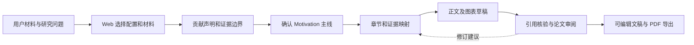
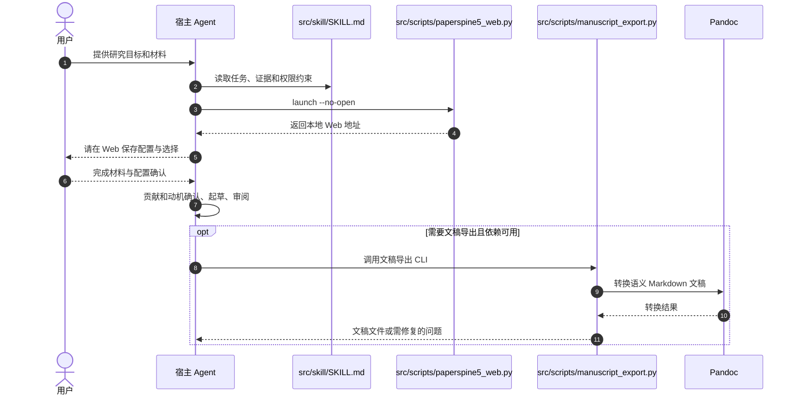

# PaperSpine5（贡献优先的学术论文生产）

## 一句话定义

**PaperSpine5** 是本地优先、证据约束的论文构建及审阅工作流；核心原则是先确认研究能辩护的 **Contribution 与 Claim Boundary**，再让 Motivation、各章节、图表和引用为这个主张提供支撑，而不是先把文字“润色漂亮”。

## 英文缩写速查

| 缩写 | 英文全称 | 简要说明 |
|---|---|---|
| AI | Artificial Intelligence | 配合研究者实施论文工作流的 Agent |
| UI | User Interface | 保存论文任务配置、材料与选择的本地 Web 界面 |
| PDF | Portable Document Format | 支持的最终只读交付格式 |
| CLI | Command-Line Interface | `paperspine5_web.py` 等脚本的命令行入口 |

## 为什么重要

导师反馈“贡献不清楚”常是论证与证据组织问题，而不是语法问题。官方 Contribution-First 指南将 **一条主要贡献 + 证据要求 + 缺证据 + 主张边界** 分开核对，防止写作掩盖方法与实验的缺口。

## 核心原理

- **Contribution-First：** 区分一条可检验主贡献、贡献类型、审稿人获得的价值；列出研究缺口、已知先例、设计回应和需要/已有/缺失的证据。
- **Motivation 受贡献约束：** 解释为什么研究重要，却不能替代“本论文究竟证明了什么”；随后通过 Introduction–Results–Discussion 形成可回指的逻辑链。
- **同一任务持续修订：** 当前 V5 `src/skill/SKILL.md` 以任务 ID、材料绑定、Web 保存的配置与人类选择为边界，保留同任务的修订历史，不因 launcher 失败擅自换任务。
- **交付：** 官方 README 声明可生成图文稿、核验引用并输出 Word/LaTeX/PDF；这些是仓库功能描述，不是已经独立完成的质量验收。

## 流程总览

图据官方 README、`src/skill/SKILL.md` 及 Contribution/Motivation 指南。当前 V5 文档允许复用已保存的有效选择，**不等于每次都要重新生成旧版 `confirmed_contribution.md` 文件**。

## 源码运行时序图

以下仅示意已查看的 **官方入口与工具契约**，不是全部内部调度已验证的调用栈。

`paperspine5_web.py` 定义 `launch` 与 `host` 命令，`manuscript_export.py` 实现 Pandoc 导出；其余内部状态转换尚未通读，不声称经过实机完整运行。

## 工程实践

- 使用上游非 Fork 仓库 `WUBING2023/PaperSpine`，固定核查版本 `42312b8d9c76`，当前 README 是 **PaperSpine5 Alpha**。
- 将作者材料、真实实验指标、可信参考文献放入论文任务；严格区分证据已具备与尚待实验。
- 优先确认 `Main contribution statement`、`Evidence required/available/missing`，再定动机与章节；把任何改变科学含义的候选文字交还作者确认。
- 导出涉及 `Pandoc >=3`，生成 PDF 还需 LaTeX 引擎，需在实际环境检查。

## 局限与风险

项目仍为 Alpha；17 步协议、所有导出路径与交付质量尚未端到端验证。自动修改和 Web 操作依赖用户确认的任务绑定及授权；语言流畅不等于研究贡献成立。**尚未通读全部主 Skill 与运行实现，故本次为 draft。**

## 关联页面

- [Supervisor-Skills](supervisor-skills.md)：侧重科研判断清单与导师方法论。
- [nature-polishing](nature-polishing.md)：已有稿件的语言与主张边界修订。
- [ARIS](aris-auto-research-in-sleep.md)：实际实验迭代和交叉评审。
- [AI Auto-Research](../concepts/ai-auto-research.md)：研究自动化生命周期。

## 参考来源

- [PaperSpine5 原仓库归档](../../sources/repos/paperspine.md)
- [WUBING2023/PaperSpine（上游）](https://github.com/WUBING2023/PaperSpine)

## 推荐继续阅读

- [Contribution-First 规则](https://github.com/WUBING2023/PaperSpine/blob/42312b8d9c76/src/skill/references/contribution.md)
- [PaperSpine5 官方产品页](https://wubing2023.github.io/PaperSpine/v5/)
