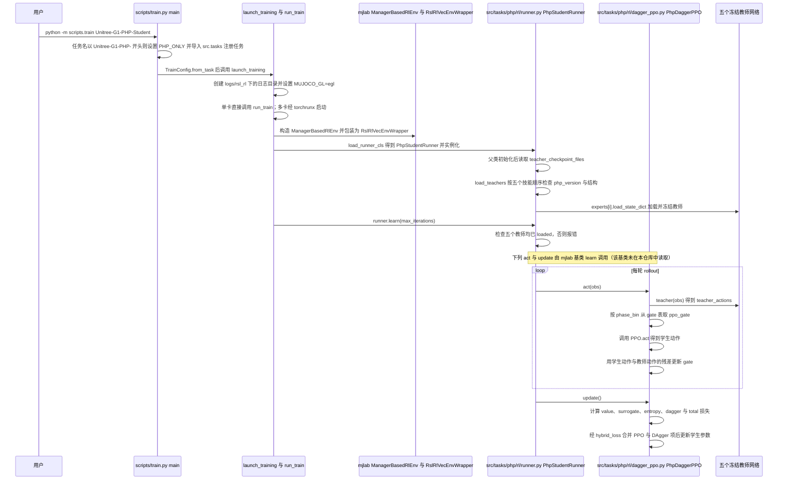

# Parkour MJLab：G1 / Go2 跑酷强化学习代码库

**一句话定义：** [Parkour MJLab](https://github.com/yhx1203/parkour_mjlab) 是基于 MJLab 的公开强化学习代码库，提供 Unitree G1 的 PHP teacher/student 训练与 MuJoCo Sim2Sim，同时包含 Go2 PIE、AMP + Parkour 和 G1 Stair 等任务；其中 PHP 部分是社区实现，不是原论文作者发布的官方代码。

## 英文缩写速查

| 缩写 | 英文全称 | 简要说明 |
|---|---|---|
| PHP | Perceptive Humanoid Parkour | 代码库中对人形 G1 进行感知跑酷训练的 teacher/student 任务 |
| RL | Reinforcement Learning | 通过环境交互优化策略的训练范式 |
| ONNX | Open Neural Network Exchange | README 中用于导出 student policy 的模型格式 |
| SDK2 | Unitree SDK 2 | G1 Stair Sim2Sim 示例使用的宇树接口 |

## 代码库包含什么

| 机器人 / 任务 | README 中的能力 | 读法 |
|---|---|---|
| Unitree G1 · PHP | 训练五类 teacher、蒸馏 student、回放与导出 ONNX | 基于 PHP 官方开放的训练动作数据重新实现训练与仿真入口 |
| Unitree Go2 · PIE | 训练、回放、深度可视化与 MuJoCo Sim2Sim | 与 G1 PHP 是同一仓库内的另一组任务 |
| G1 · AMP + Parkour | MuJoCo Sim2Sim 与手柄切换 | README 提供部署/仿真入口 |
| G1 · Stair | SDK2 与 MuJoCo Sim2Sim | README 提供仿真服务器与控制器的双进程启动示例 |

## PHP 的训练与回放入口

README 将 PHP 训练拆成两级：先分别训练 locomotion、low-step、high-step、low-climb、high-climb 五个 teacher，再把五个 teacher checkpoint 传给 student 进行蒸馏。student 可按 `--php-skill` 选择技能回放；仓库还提供 ONNX 导出和基于 MuJoCo 的三障碍场景 Sim2Sim。

README 中的迭代次数和 `model_23000.pt` 文件名来自示例命令，不代表这些参数是论文复现实验的标准配置，也不能单独证明 checkpoint 已发布。训练动作数据需从 [PHP 官方 release](https://github.com/amazon-far/php_parkour/releases/tag/training-motion-examples-v1) 获取。

## 开源状态与复现边界

- 仓库代码可在 GitHub 查看，但未声明许可证；在许可条款明确前，不应假定代码可自由再分发或用于商业用途。
- 用户提供的截图中，作者评论说训练模型已上传；截图没有给出下载链接。核查时仓库 Releases 为空，因此权重的下载方式与具体版本尚未确认。
- README 描述的是训练、回放和 Sim2Sim 的命令入口。本次只核对了仓库页面与 README，未安装环境、运行训练或验证真机部署。
- 五类 teacher 和 student 所需的模型、配置、动作数据需按 README 分别准备；不能把“有训练入口”理解为完整预训练资产已随代码发布。

## 与 PHP 官方项目的关系

此仓库致谢并引用 [Amazon FAR 的 PHP 官方实现](https://github.com/amazon-far/php_parkour)，并复用官方发布的训练动作数据，但其训练和 MuJoCo Sim2Sim 入口由此仓库独立提供。因此本节点描述的是一个覆盖多个任务的 MJLab 代码库；论文方法和官方实现仍以 [PHP 主实体](./paper-hrl-stack-22-perceptive_humanoid_parkour.md) 为准。

## 源码运行时序图

入口：`python -m scripts.train Unitree-G1-PHP-Student --agent.teacher-checkpoint-files=...`（PHP 学生蒸馏训练；教师训练、回放、MuJoCo Sim2Sim 入口未画，分别为 `scripts.train Unitree-G1-PHP-<技能>-Teacher`、`scripts.play`、`deploy.php.sim2sim.run_mujoco`）

图依据：yhx1203/parkour_mjlab@0e2cb60，读过 README.md、scripts/train.py、scripts/play.py、src/tasks/php/config/g1/__init__.py、src/tasks/php/rl/runner.py（部分）、src/tasks/php/rl/dagger_ppo.py（部分）、deploy/php/sim2sim/run_mujoco.py（部分）、deploy/php/sim2sim/policy_runtime.py（函数清单）、deploy/php/sim2sim/export_student_onnx.py（函数清单）、scripts/play_php.py（函数清单）。mjlab 基类 learn、env.step 与 update 的内部调用链未在本仓库读取，图中仅画到本仓库覆盖的调用。

## 参考来源

- [Parkour MJLab 仓库归档](../../sources/repos/parkour_mjlab.md)
- [Parkour MJLab README](https://github.com/yhx1203/parkour_mjlab/blob/main/README.md)
- [PHP 论文与官方实现归档](../../sources/repos/php_parkour.md)
- [PHP 官方 training motion release](https://github.com/amazon-far/php_parkour/releases/tag/training-motion-examples-v1)
- 用户提供的截图（含仓库作者关于训练权重的评论；未提供原帖 URL）
- 源码核对（2026-11-02）：yhx1203/parkour_mjlab@0e2cb60，读过 README.md、scripts/train.py、scripts/play.py、src/tasks/php/config/g1/__init__.py、src/tasks/php/rl/runner.py、src/tasks/php/rl/dagger_ppo.py、deploy/php/sim2sim/run_mujoco.py；时序图依据以上文件，未运行代码。

## 推荐继续阅读

- [PHP 论文与方法分析](./paper-hrl-stack-22-perceptive_humanoid_parkour.md)
- [PHP 官方仓库](https://github.com/amazon-far/php_parkour)
- [MJLab](https://github.com/mujocolab/mjlab)
