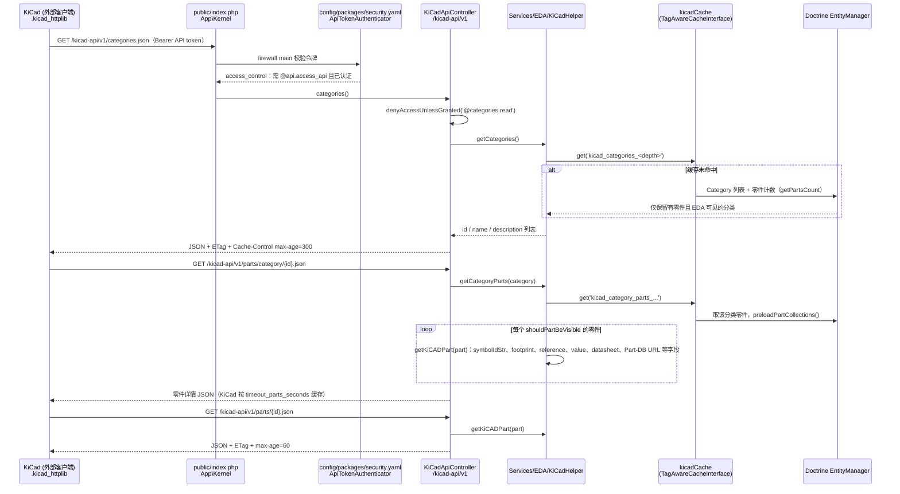

# Part-DB（电子元件库存管理）

## 一句话定义

**Part-DB** 是部署在服务器、通过浏览器访问的开源电子元件库存管理系统。

## 英文缩写速查

| 缩写 | 英文全称 | 简要说明 |
|------|----------|----------|
| BOM | Bill of Materials | 产品或项目所需的物料清单 |
| PCB | Printed Circuit Board | 印刷电路板，设计与装配需要元件和物料清单 |
| API | Application Programming Interface | 供外部应用或脚本访问数据的接口 |
| EDA | Electronic Design Automation | 电子设计自动化，KiCad 属于该类工具 |

## 为什么重要

机器人驱动板、电源板和传感器板需要追踪多种器件。Part-DB 将元件资料、库存数量及位置放在同一系统，便于实验室查找物料、盘点库存和准备板卡装配。

## 核心功能与工作流

- **建档与查找**：记录分类、封装、制造商、参数、价格及数据手册；可按参数搜索。
- **库存与位置**：元件可关联多个存放位置；支持条码生成和扫描、库存变更日志。
- **项目与 BOM**：导入 KiCad 物料清单，关联项目所需元件，查看可装配数量并从库存领料。
- **协作与集成**：支持用户和权限、数据导入导出及 API；官方提供 [KiCad 集成](https://docs.part-db.de/usage/eda_integration.html)。

## 工程实践与局限

官方提供 Docker 部署路径，也支持自行配置 Web 服务器；数据库可选 SQLite、MySQL 或 PostgreSQL。部署前按官方文档选择数据库并配置用户权限，库存准确性仍依赖实际入库、领用和盘点。

服务端源码以 AGPL-3.0-or-later 许可公开。Part-DB 管理物料和库存，电路设计与 PCB 布局可与 [KiCad](./kicad.md) 配合；器件设计约束和板级验证仍需在设计流程中完成。

## 源码运行时序图

入口：Web 请求经 `public/index.php`（`App\Kernel`，Symfony）进入应用；下图取其 KiCad HTTP 库路径——KiCad 客户端按 `docs/usage/eda_integration.md` 配置的 `.kicad_httplib`（`root_url` 指向 `.../kicad-api/`）发起请求。

图依据：Part-DB/Part-DB-server@462d36c，读过 `public/index.php`、`config/packages/security.yaml`、`src/Controller/KiCadApiController.php`、`src/Services/EDA/KiCadHelper.php`、`docs/usage/eda_integration.md`。

## 关联页面

- [KiCad](./kicad.md) — PCB 设计及 BOM 的关联工具。
- [atopile](./atopile.md) — 电子设计语言与工具链。
- [Humanoid Hardware 101 · 能源与计算电子](../overview/humanoid-hardware-101-power-compute-electronics.md) — 机器人板级硬件背景。

## 参考来源

- [Part-DB 官方仓库归档](../../sources/repos/part-db.md)
- 源码核对（2026-11-02）：Part-DB/Part-DB-server@462d36c，读过 `public/index.php`、`config/packages/security.yaml`、`src/Controller/KiCadApiController.php`、`src/Services/EDA/KiCadHelper.php`、`docs/usage/eda_integration.md`；时序图依据以上文件，未运行代码。

## 推荐继续阅读

- [Part-DB 官方文档](https://docs.part-db.de/)
- [官方安装指南](https://docs.part-db.de/installation/)
