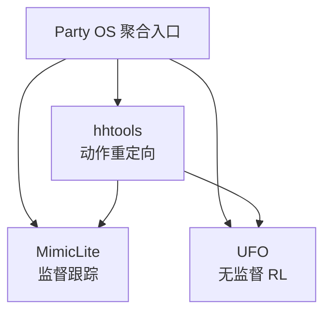

# Party OS（RoboParty 人形研发底座）

**Party OS** 是 [RoboParty](./roboparty.md) 旗下 [RoboParty Lab](https://lab.roboparty.com) 对外沉淀的 **开放研发基础设施**，目标是把人形机器人研发中最耗时、最分散、最难复现的底层能力做成可复用模块，让开发者把时间花在真正前沿的问题上，而非反复从零搭建基建。

## 一句话定义

Party OS 是 RoboParty Lab 的人形机器人研发项目聚合与路线图：以动作数据、重定向、监督/无监督运动控制为基础，逐层连接感知交互、全身操作与 Agent 能力；它不是一个可直接安装的通用操作系统。

## 英文缩写速查

| 缩写 | 英文全称 | 简要说明 |
|------|----------|----------|
| Party OS | Party Operating System | RoboParty Lab 研发底座聚合层（非传统 OS） |
| Sim2Real | Simulation to Real | 仿真策略迁移真机 |
| BFM | Behavior Foundation Model | 可复用、可 prompt 的身体运控基座 |
| RL | Reinforcement Learning | 通过与环境交互最大化长期回报来学习策略的范式 |
| URDF | Unified Robot Description Format | 统一机器人描述格式 |

## 为什么重要

1. **显式解决「idea 输在基建」**：本体、数据、动作处理、训练框架、真机部署、复现与影响力往往消耗年轻研究者大部分时间。
2. **从单机到 infra 的演进**：在 [Roboto Origin](./roboto-origin.md)「开源一台人形」之后，RoboParty 进一步走向 **建设开源人形机器人基础设施**。
3. **首批三段工具链已落地**：动作准备（hhtools）→ 监督跟踪（MimicLite）→ 无监督控制（UFO），并预留跨 codebase 部署层。

## 核心原理与结构

Party OS 首批开源子模块可理解为「三段流水线 + 一个聚合入口」：

| 模块 | 职责 | 详情页 |
|------|------|--------|
| [human-humanoid-tools](./human-humanoid-tools.md) | Human→Humanoid / R2R 动作重定向、数据质检与可视化 | 约 30s 级 retarget；Any Motion / Any URDF |
| [MimicLite](./mimiclite.md) | 监督学习通用运动跟踪训练与部署 infra | any4hdmi + mjhub；跨 SONIC/BFM-Zero/TWIST2 等部署 |
| [UFO](./roboparty-ufo.md) | 无监督 RL 控制全栈框架 | MJLab backend；BFM-Zero / [TeCH](./paper-tech-humanoid-control.md)；真机遥操 |
| **Party_OS 仓库** | 聚合入口与路线图 | [GitHub](https://github.com/Roboparty/Party_OS) |

### 2026-10-21 README 子项目表（核查于 2026-10-27）

`Roboparty/Party_OS` 最近提交 2026-10-21「Add P-BFM to Party OS roadmap」，README 按 Roadmap v3 把子项目从底层到上层列为下表（数据生成仍标「即将开源」）：

| 层级 | 模块 | 仓库 / 本库节点 |
|------|------|------|
| Know-how 文档 | 《人形机器人运动控制 Know-how》 | 飞书文档，见[来源归档](../../sources/sites/roboparty_motion_control_knowhow.md) |
| 底层运控 Infra | 数据生成（generate） | 即将开源，无仓库 |
| 底层运控 Infra | 重定向（hhtools） | [human-humanoid-tools](./human-humanoid-tools.md) |
| 底层运控 Infra | 监督学习（MimicLite） | [MimicLite](./mimiclite.md) |
| 底层运控 Infra | 无监督学习（UFO） | [UFO](./roboparty-ufo.md) |
| 全身操作 Infra | JEPA World Model | [INTACT](./paper-intact.md)（`Roboparty/INTACT-JEPA`） |
| 交互感知 Infra | 交互基础模型（I-BFM） | [I-BFM](./paper-i-bfm.md)（`Roboparty/I-BFM-Code`） |
| 交互感知 Infra | 感知行为基础模型（P-BFM） | [P-BFM](./paper-p-bfm.md)（`Roboparty/P-BFM`） |

README 许可为 GPL-3.0，并声明各子项目保留各自许可（UFO、P-BFM、I-BFM 代码为 CC BY-NC 4.0，见各节点页）。

上图为首批三段工具链；其后新增的 INTACT / I-BFM / P-BFM 见上表。

## Lab 四方向路线图（规划）

| 方向 | 英文 | 重点 |
|------|------|------|
| 通用基础运动 | Humanoid Locomotion | 数据 infra、Sim2Real/Real2Sim、BFM 通用运动模型 |
| 感知交互 | Humanoid Perceptive Interaction | 行走/奔跑/跳跃/攀爬；HSI、HOI |
| 全身操作 | Humanoid Whole-Body Manipulation | BFM 运控基座 + 可 scale 的 VLA / World Model |
| 智能体 | Agentic Humanoid | Agent + Skills 低成本高智能 |

## 源码运行时序图

**不适用**：`Roboparty/Party_OS`（`main` 分支）定位为聚合索引与路线图仓库，经核查仅包含 `README.md` / `README_zh.md`、`docs/mimiclite-vs-partymimic*.md`、`assets/` 图表资源以及维护路线图与 Star 徽章的辅助脚本（`scripts/build_roadmap.py`、`scripts/update_stars.py`），不含机器人数据生成、训练、推理或真机控制的可运行代码。实际可运行的训练、重定向与部署入口分别维护在独立子仓库与对应实体页中（如 [human-humanoid-tools](./human-humanoid-tools.md)、[MimicLite](./mimiclite.md)、[PartyMimic](./partymimic.md)、[UFO](./roboparty-ufo.md)、[I-BFM](./paper-i-bfm.md)、[P-BFM](./paper-p-bfm.md)）。

## 工程实践

**官方 README 复核（2026-11-21）：** 除首批 hhtools / MimicLite / UFO，当前项目表还列有 [PartyMimic](./partymimic.md)（监督运动跟踪）、[I-BFM](./paper-i-bfm.md)、[P-BFM](./paper-p-bfm.md)、[INTACT](./paper-intact.md) 与 [SADL](./paper-sadl-2611-21596.md)；数据生成 `generate` 仍标 Coming soon。它们是分别维护的项目，**不能把聚合索引当作可直接运行的单一软件栈**。完整项目表见[官方 README](https://github.com/Roboparty/Party_OS)；本次通读范围记于[来源归档](../../sources/repos/party_os.md)。

- **入口：** [lab.roboparty.com](https://lab.roboparty.com) 与 [Party_OS](https://github.com/Roboparty/Party_OS) 仓库。
- **选型建议：**
  - 上游动作/数据准备优先 [hhtools](./human-humanoid-tools.md)；
  - 监督跟踪与 **外部策略统一部署** 优先 [MimicLite](./mimiclite.md)；
  - 无监督 RL / BFM-Zero 类研究优先 [UFO](./roboparty-ufo.md)。
- **与学术栈对照：** 跟踪能力对标 [SONIC](./nvidia-sonic.md) 生态；无监督线对标 [BFM-Zero](./paper-bfm-zero.md)；训练 backend 与 [mjlab](./mjlab.md) 同层。

## 局限与风险

- **快速演进：** 2026-07 首批发布，API 与文档可能频繁变更。
- **性能数字：** 文内 GPU-hours、训练时长为自述，须以仓库复现为准。
- **路线图 ≠ 已交付：** 2026-10-27 核查时 README 中数据生成仍待发布，VLA / Agentic Humanoid 是规划；交互感知层的 I-BFM、P-BFM 已有公开仓库；世界模型已有 [INTACT](./paper-intact.md)入口，上游已发布实现，但 RoboParty fork 仍为研究预览，不能据此推定全身操作系统已交付。
- **知识入口：** README 直接列出[运动控制 Know-How 飞书文档](https://roboparty.feishu.cn/wiki/GvUxwKVeNiGa7kku6vEcvqfKn87)，本次重试已读取目录与部分正文，未确认新增章节；见[来源归档](../../sources/sites/roboparty_motion_control_knowhow.md)；完整研发文档与阅读坐标见[现有技术地图](../overview/roboparty-lab-party-os-technology-map.md)。

## 关联页面

- [RoboParty Lab / Party OS 技术地图](../overview/roboparty-lab-party-os-technology-map.md)
- [MimicLite](./mimiclite.md)
- [UFO（Roboparty）](./roboparty-ufo.md)
- [human-humanoid-tools](./human-humanoid-tools.md)
- [I-BFM](./paper-i-bfm.md) / [P-BFM](./paper-p-bfm.md)
- [Roboto Origin](./roboto-origin.md)
- [Motion Retargeting](../concepts/motion-retargeting.md)

- [强化学习](../methods/reinforcement-learning.md)：用于理解基于奖励的策略学习。
- [GMR 动作重定向](../methods/motion-retargeting-gmr.md)：对照跨本体运动映射。

## 参考来源

- [运动控制 Know-How 目录与部分正文核查](../../sources/sites/roboparty_motion_control_knowhow.md)

- [party_os.md](../../sources/repos/party_os.md)
- [lab_roboparty_com.md](../../sources/sites/lab_roboparty_com.md)
- [roboparty_com.md](../../sources/sites/roboparty_com.md)
- [Roboparty/Party_OS README（2026-11-21 复核）](https://github.com/Roboparty/Party_OS)
- [wechat_roboparty_lab_party_os_3_tools.md](../../sources/blogs/wechat_roboparty_lab_party_os_3_tools.md)

## 推荐继续阅读

- [Party OS GitHub](https://github.com/Roboparty/Party_OS)
- [RoboParty Lab 官网](https://lab.roboparty.com)
- [BFM 41 篇技术地图](../overview/bfm-41-papers-technology-map.md)
