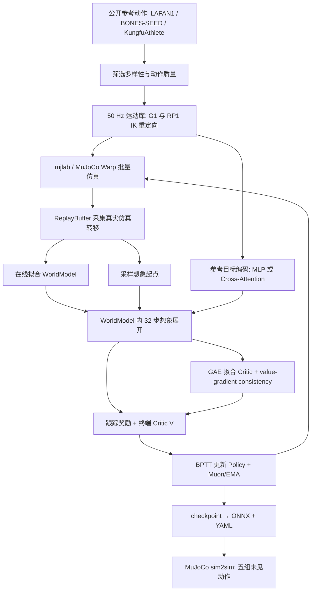
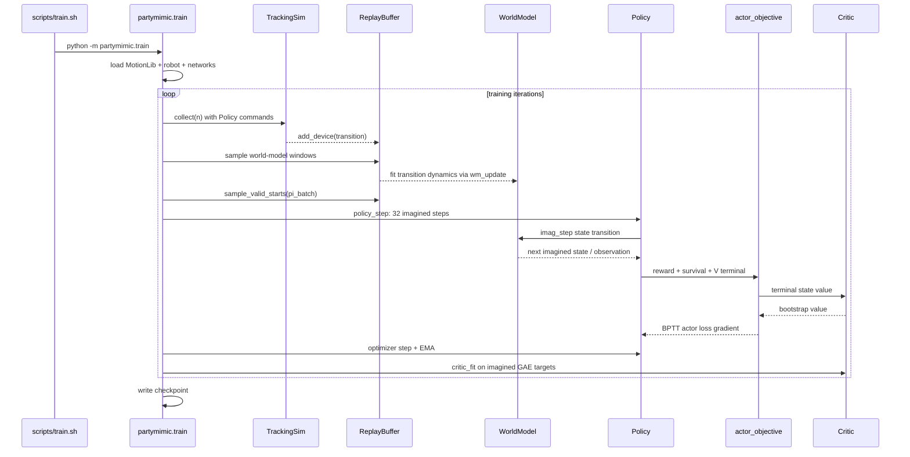

# PartyMimic — 单卡分钟级人形全身运动跟踪 / General Humanoid Motion Tracking in Minutes

## 一句话定义

**PartyMimic** 是 RoboParty Lab 在 SuperMimic / BlinkMimic 技术线上发展的可微世界模型全身动作跟踪方法：从多来源动作库训练一份人形策略，通过 32 步想象展开的梯度反传优化跟踪表现，并开放完整训练、数据处理、导出及评测入口。官方报告 **1× RTX 4090 约 26 分钟训练 41 小时动作库**（默认 MLP，12k iterations），这是项目方测量而非独立复现。

## 英文缩写速查

| 缩写 | 英文全称 | 简要说明 |
|---|---|---|
| WM | World Model | 从仿真状态转移拟合、持续在线更新的动力学预测模型 |
| BPTT | Backpropagation Through Time | 对 32 步可微想象轨迹反向传播策略梯度 |
| MLP | Multi-Layer Perceptron | 默认目标参考编码器，可在 24 GB 4090 运行 |
| EMA | Exponential Moving Average | 对策略参数滑动平均稳定训练 |
| IK | Inverse Kinematics | 使用 G1 到 RP1 的机器人间参考动作重定向 |
| ONNX | Open Neural Network Exchange | 模型导出并交由外部 sim2real 评测器执行 |

## 为什么重要

- **算力门槛：** 官方在相同的 10,731 clips / 41 h 多来源库上，默认 MLP 用单张 4090 训练 12,000 iter 约 26 分钟，G1/RP1 测得峰值显存分别 22.6/23.4 GB；attention 约 41/42 分钟且通常超出 24 GB。
- **明确的泛化设置：** 在 Loco（80）、Mani（48）、Dance（40）、Ground（60）和 Extreme（308）五个未见动作集评测；Extreme 按源视频划分，降低同源片段泄漏。
- **接口可复用：** `joint` 使用根部运动与关节参考；`sparse5` 使用骨盆及头、两腕、两踝共六组参考姿态，不依赖特定机器人关节编号，方便跨人体/机器人输入。
- **配方与负结果公开：** 既公布有效优化，也展示 SuperMimic 多因素消融的无明显作用和失败设置。

## 核心原理

### 1. 数据—训练—评测流程总览



模型从 `TrackingSim` 中采集状态转移，`WorldModel` 拟合动力学（包含对控制的可微依赖）。`Policy` 通过网络预测关节控制参考，`objective.actor_objective` 组合 32 步跟踪奖励、存活项与终端 Critic 价值；反向传播通过未来观测反馈链路回到策略。Critic 依据想象轨迹的 GAE 目标及可选值梯度一致性损失拟合。重要区别是**策略不是仅用一次模型前向预测优化，也不冻结世界模型**。

### 2. 训练配方与超参

| 机制 | 官方默认 / 开关 | 项目页消融（去掉该项后） |
|---|---|---|
| Muon 优化策略与 WM | `--pi_opt muon --wm_opt muon` | G1 Loco/Mani 误差 +10.7 mm |
| 缩窄跟踪奖励核 | `--std_scale 0.35` | +6.5 mm |
| 想象时域 | `--horizon 32` | 改 16 步：+5.9 mm |
| 参考动作残差 | `--pi_ref_skip` | +5.6 mm |
| 策略滑动平均 | `--pi_ema 0.995` | +3.4 mm |
| 值梯度一致性 | `--v_gcons 0.5` | +1.0 mm |
| 多样性均衡重置 | `--div_k 24` | Ground +6–19 mm |

> 消融数字来自项目页较早的 **9,173 clips** 版本（G1 Loc/Man 口径）；不能与最终 10,731 clips 测试表直接视作同一次实验。

### 3. MLP、Attention 与稀疏姿态

- **MLP（默认）：** 编码多帧参考目标，训练时间/显存开销低；G1 五类平均误差 45.1 mm。
- **Cross-attention：** 由观测历史查询未来目标，G1 五类平均误差下降到 43.5 mm；G1 训练约 41 分钟，24 GB 需 `--pi_batch 1024` 等折中设置。
- **`sparse5`：** 参考包含 pelvis + head + 两个 wrist + 两个 ankle **六组身体姿态**；使用当前机器人正向运动学得到关键点误差，预拟合并冻结 `kp2q` 用于参考动作 skip，辅助头预测参考关节角。RP1 MLP 五类平均误差 48.7 mm（完整关节参考 47.8 mm）。
- 命名里的 “5” 表示骨盆之外的五个部位，不是仅五个输入位置，也不等价于仅 5 个关节角。

## 实验与评测

评测：官方在 2 seeds、12k iterations 条件下使用 EGalahad sim2real leaderboard 的 MuJoCo sim2sim 评测（ONNX 导出后，从每个 clip 起始帧播放）。误差为局部身体位置误差（mm，越低越好）；完成率另计。SONIC 和 MimicLite 使用各自发布权重，**并非本轮同卡重训**。

| 机器人 / 方法 | G1 或 RP1 Mani 误差 | 五组平均误差 | 训练时间 |
|---|---:|---:|---:|
| G1 PartyMimic MLP | **20.5 mm** | 45.1 mm | 26 min |
| G1 PartyMimic Attention | 21.1 mm | **43.5 mm** | 41 min |
| G1 BlinkMimic | 30.9 mm | 59.9 mm | 59 min |
| G1 SuperMimic（按论文超参重训） | 34.3 mm | 67.9 mm | 52 min |
| RP1 PartyMimic MLP | **16.5 mm** | 47.8 mm | 26 min |
| RP1 PartyMimic Attention | **16.1 mm** | **44.6 mm** | 42 min |
| RP1 PartyMimic sparse5 MLP | 19.1 mm | 48.7 mm | 29 min |

**LAFAN-40 单独指标：** 3–5 分钟是同一批 40 条 LAFAN1 **训练兼评测**样本的 return/零失败学习速度测试；单卡返回 ≥0.82 首次用 2.45 分钟，连续三次评测无失败需 5.17 分钟（加 warm start 5.57 分钟）。不能直接解释成 41 小时多类别 zero-shot 泛化仅用 3–5 分钟。

### SuperMimic 消融最有用的结论

- 多步时域梯度或在线 WM 拟合不可轻易省略：仅保留单步模型梯度得分约 0.002；1000 次迭代后冻结世界模型得分约 0.004（基线 0.686±0.048）。
- 没有终端 Critic 约 0.428，H=8 约 0.430；过短时域让策略过度依赖不精确的值梯度。
- 取消后续观测对状态的反馈梯度得分约 0.517；对闭环控制尤其不利。
- 关闭自碰撞在部分训练评估上更好，但切换 leaderboard 碰撞模型后 40 条 LAFAN1 里有 33 条跌倒：必须匹配部署评测的碰撞条件。
- 单项消融包含噪声和多个单 seed 变体，不应把“趋势”当作显著性结论。

## 工程实践

```bash
git clone https://github.com/Roboparty/PartyMimic.git
cd PartyMimic
uv sync
tools/download_data.sh
tools/data/build_library.sh g1
bash scripts/train.sh logs/g1_s0 --robot g1mj --motion_dir data/motions/g1_mix --seed 0
# 可选: --ref_enc xattn 或 --interface sparse5
# 导出:
mkdir -p deploy
uv run python tools/export_deploy_onnx.py checkpoints/g1_mlp.pt deploy/g1_mlp.onnx
# sim2sim 需额外安装 EGalahad/sim2real、应用 tools/sim2real.patch 并提供其目录
```

- **软件 / 资源：** 官方说明 Linux x86_64、CUDA 12.8、`uv`；完整 41 h 动作库依赖 BONES-SEED（需接受 gated 数据授权）。`--num_envs 4096`、`--hist 10`、`--goal_frames 10`、`--horizon 32` 为训练入口默认值。
- **RP1：** 运行 `tools/data/build_library.sh rp1` 需 human-humanoid-tools（官方固定提交），用机器人间 IK 转成 RP1 28 DoF 运动库。
- **模型导出：** `tools/export_deploy_onnx.py` 构建不同接口的 ONNX 与部署 YAML，稀疏输入的 ONNX 参数包含 `ref_kp`；随后通过外部 `EGalahad/sim2real` 测试。
- **两卡流水线：** `--pipeline` 使 cuda:0 收集与拟合 WM，cuda:1 处理上一轮数据/模型的策略和 critic 更新，通过 pinned-memory 异步传送；不同于默认单卡训练。

## 源码运行时序图

以下依据官方 `scripts/train.sh`、`train.py` 中 `collect` / `wm_update` / `policy_step` / `critic_fit`、`objective.py` 及 `scripts/eval.sh` 绘制；展示默认单卡顺序，未把可选两卡流水线误写为默认路径。



## 结论

**选型总判：PartyMimic 证明在项目方统一的多源未见动作评测协议里，可微模型 BPTT 加工程配方能在单卡内提高全身跟踪效果，但不能把所有速度和跨基线结果都解读成严格同协议独立复现。**

1. 24 GB 单卡优先默认 MLP；追求极限误差且显存允许再尝试 attention。
2. 想接人类动作、VR 追踪或跨机器人命令，可用 `sparse5`；会增加 `kp2q` 等准备步骤。
3. 保持 WM 在线拟合、32 步闭环梯度、策略 EMA/参考 skip，先匹配部署端碰撞模型再调奖励。
4. 对 Ground/Extreme 的性能同时查看误差和完成率，并检查单目动作的滑脚与执行器速度上限。
5. 比较训练耗时时区分 41 h 跨源训练与 LAFAN-40 同集速度基准，以及同卡重训和官方现成策略。

## 局限与风险

- **数据授权：** 仓库代码 MIT 不代表数据或衍生 checkpoint 全部 MIT：LAFAN1 CC BY-NC-ND，MotionDecode 非商业条款，BONES-SEED 另需授权。
- **非独立复现：** 本次静态核查项目页、README 和关键源代码；未执行 4090 训练、ONNX 推理或真机实验，所有性能指标均明确为官方结果。
- **真实运动极限：** Extreme 最快 1/3 动作的 G1 身体误差约 77 mm（最慢组 22 mm），单目参考脚底滑动可达约 0.98 m/s，快速摆动可能超出执行器能力。
- **sim2real 边界：** 仓库给出 G1/RP1 仿真与外部部署导出路径；不能从 sim2sim 数值单独证明实机鲁棒性。
- **结果比较：** SONIC/MimicLite 官方权重与本仓重训基线训练资源/数据不相同；Project 页对 “best” 的说法仅在列出的对比方法与协议内成立。

## 关联页面

- [MimicLite：RoboParty 另一套跟踪基础设施](./mimiclite.md)
- [BlinkMimic：快速模仿训练前序实现](./blinkmimic.md)
- [XMimic：JAX 快速训练对照](./cn-os-xmimic.md)
- [Party OS / RoboParty Lab](./party-os.md)
- [动作重定向 / Motion Retargeting](../concepts/motion-retargeting.md)
- [Sim2Real](../concepts/sim2real.md)

## 参考来源

- [PartyMimic 项目页原文归档](../../sources/sites/partymimic.md)
- [PartyMimic 官方源码与 README 归档](../../sources/repos/partymimic.md)
- [官方项目主页（全文实验表、SuperMimic 消融）](https://roboparty.github.io/PartyMimic/)
- [官方 GitHub / README / 源码](https://github.com/Roboparty/PartyMimic)

## 推荐继续阅读

- [完整项目页与消融表](https://roboparty.github.io/PartyMimic/#ablation)
- [SuperMimic 原论文 arXiv:2610.28480](https://arxiv.org/abs/2610.28480)
- [PartyMimic GitHub](https://github.com/Roboparty/PartyMimic)

