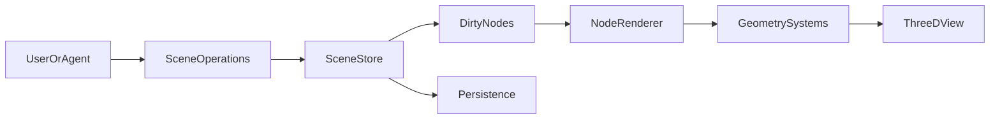
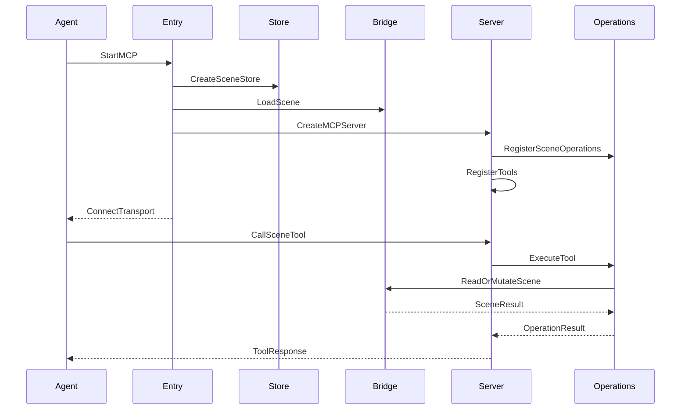

# Pascal Editor｜开源三维建筑编辑器（3D Building Editor）

## 一句话定义

**Pascal Editor**（pascalorg/editor）是面向建筑/工程/施工运维（AECO）的本地优先浏览器 3D 建模系统，可由用户直接编辑 Site、Building、Level、Wall 等语义节点，也可由 AI Agent 经 MCP 读写同一场景。

## 英文缩写速查

| 缩写 | 英文全称 | 简要说明 |
|---|---|---|
| AECO | Architecture, Engineering, Construction and Operations | 建筑工程、建设和运维应用范围 |
| MCP | Model Context Protocol | AI 代理读写建筑场景的工具协议 |
| R3F | React Three Fiber | React 与 Three.js 的三维渲染桥梁 |
| IFC | Industry Foundation Classes | 通过 converter 导入建筑信息模型 |
| BIM | Building Information Modeling | 带构件语义的建筑模型工作方式 |
| CSG | Constructive Solid Geometry | 墙与洞口的几何布尔操作 |

## 为什么重要

机器人在房间或工厂里移动与操作，需要房间、楼层、门洞和结构关系明确的可编辑场景。与 [Blueprint3D](./blueprint3d-ashnomad.md) 的图像→粗 OBJ 输出不同，Pascal 的 Site→Building→Level→Element 场景图保存了建筑元素身份和参数，便于后续人或 Agent 迭代。

## 核心原理

- **数据：** `packages/core` 以 Zustand 存储扁平节点字典 `Record<id, Node>`；节点含 `id/type/parentId`，层级以父子引用表达，保存 IndexedDB 并提供 undo/redo。
- **视图：** `packages/viewer` 用 R3F/Three.js 渲染；`packages/editor` 提供画墙、物件和选择工具；`packages/nodes` 注册构件定义与渲染。
- **增量几何：** 调用 `useScene.updateNode` 标 dirty；`NodeRenderer` 注册 `Object3D`；useFrame 系统从 sceneRegistry 找到对象，按节点参数重算几何后清标志。
- **代理接口：** `@pascal-app/mcp` 以 `SceneBridge` + 操作层注册 tools/resources/prompts；本地 CLI 管理进程、存储和 MCP 连接。官方另提供 IFC converter。

## 流程总览

说明：图中的 IndexedDB（浏览器 scene store）与 SQLite（CLI/MCP 本地项目库）是不同持久化边界，**不是** 单次更新同时写两个数据库。

## 源码运行时序图

该图选择官方 `pascal-mcp` 本地入口（`packages/mcp/src/bin/pascal-mcp.ts`、`server.ts`），并按官方 MCP 文档概括 tools 调用；不是未经检验的浏览器渲染时序。

## 工程实践

| 场景 | 入口与注意事项 |
|---|---|
| 本机启动 | `npx @pascal-app/cli editor`；CLI 下载、校验匹配版本的 Web runtime，后台启动浏览器 editor 和认证的 MCP |
| 连接 Codex | 安装 CLI 后 `pascal mcp setup codex`；MCP stdio 连接使用 `pascal mcp connect` |
| 本地文件 | CLI 项目保存在 `~/.pascal/data/pascal.db`，可离线连接本地 MCP（启动浏览器 runtime 首次需获取程序包） |
| 源码开发 | `bun install && bun dev`（Turborepo、Next.js 及 packages/*） |
| IFC 导入 | `@pascal-app/ifc-converter` 转换为 Pascal nodes；无法映射参数的构件保留为可选导入网格 |
| 仿真交接 | 长度单位 m，右手坐标 X/Z 水平、Y 向上；进入 ROS/MuJoCo/Isaac 前转换坐标、碰撞、材料和刚体动力学 |

## 局限与风险

- 本地 CLI 和托管 `/api/mcp` 是**不同工作区与权限**；后者涉及账号、鉴权及部分功能额度。
- 官网 `Pascal Next` 演示并不代表那些功能已经在当前开源发布版本里。
- 外观几何与 BIM 构件不能直接替代精确的机器人碰撞体/惯性模型；MCP 编辑需复核尺寸与朝向。
- 单一 local CLI service 的 active scene 状态可能被并行代理共享，官方要求独立并发工作使用不同 `PASCAL_HOME` 和进程。
- 开源仓库按 MIT 发布；托管服务的条款需独立核查。

## 关联页面

- [Blueprint3D](./blueprint3d-ashnomad.md) — 以图像语义分割自动生成粗建筑 mesh 的对照方案。
- [MengTo/Skills](./mengto-skills.md) — Agent Skills 的通用工作流生态，Pascal 另有自己的专用 agent skill。
- [FreeCAD MCP](./freecad-mcp.md) — 桌面机械 CAD 的代理接口，工作对象不同。
- [Infinigen](./infinigen.md) — 程序化场景生产。
- [MCP](../concepts/model-context-protocol.md) — 通用代理调用接口。

## 参考来源

- [Pascal Editor 源码与架构归档](../../sources/repos/pascalorg-editor.md)
- [Pascal 官方产品文档核查](../../sources/sites/pascal-editor-docs.md)

## 推荐继续阅读

- [Pascal 官方文档：本地启动](https://editor.pascal.app/docs/developers/local-editor)
- [Pascal 官方文档：MCP](https://editor.pascal.app/docs/developers/mcp)
- [架构文档原文](https://github.com/pascalorg/editor/blob/78aaf93277e2392909560481e3c311f1cb765cfd/docs/architecture.md)
