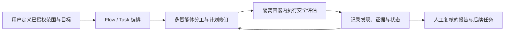

# PentAGI（VXControl）

## 一句话定义

**PentAGI**（Penetration Testing Artificial General Intelligence）是面向安全工程师与研究者的自托管多智能体安全评估平台：用户给出评估目标，系统分解工作、协调专职 agents、在 Docker 工作容器中运行工具并汇总发现；它是授权测试的自动化助手，不是目标授权或结论正确性的替代品。

## 英文缩写速查

| 缩写 | 英文全称 | 简要说明 |
|------|----------|----------|
| AGI | Artificial General Intelligence | PentAGI 名称中的缩写；不表示系统已达到通用人工智能 |
| LLM | Large Language Model | agent 计划、分析与工具编排所用的可配置模型提供方 |
| API | Application Programming Interface | 项目提供 REST / GraphQL 自动化接口 |
| EULA | End User License Agreement | 官方最终用户许可协议，规定授权安全测试与用户责任 |
| Docker | Docker | 将工具执行放在容器中隔离的主要部署技术 |

## 核心架构

PentAGI 围绕持久化的 **Flow → Task → Subtask → Action** 组织一次安全评估。主协调器管理流程生命周期，Generator 生成子任务计划，Refiner 根据执行结果调整计划，Searcher / Pentester 等专职 agent 提供分析与工具执行，Reporter 汇总输出。任务、动作、产物和可检索记忆被保存，后续流程可利用既有经验；可选知识图谱进一步表示主机、服务与发现之间的关系。

官方仓库采用 Go 后端与 React/TypeScript 前端；Docker Compose 提供自托管部署路径。模型提供方可由部署者配置，PostgreSQL/pgvector 用于任务和向量记忆存储，知识图谱与观测组件可选启用。实际组件、能力和外部依赖会随版本变化，部署前应以仓库当前 README 与配置文档为准。

## 对机器人研发的关联

PentAGI 并不负责机器人感知、运动规划或实时控制；它与机器人栈的交点在研发和运维侧的网络/软件安全评估，例如 Web 管理台、遥操作 API、训练集群外围服务或 OTA 门户。与[软件安全基础](../concepts/software-security-basics.md)中的身份、授权、密钥和供应链控制配合，它可作为经审批的评估工具位；不得接入或扫描生产机器人网络而没有明确授权、停机/回滚方案和风险审查。

## 开源与可复现状态

- **代码：** 官方 GitHub 仓库公开，代码标注 MIT；仓库含后端、前端、部署配置与文档。
- **项目页：** [pentagi.com](https://pentagi.com/) 可访问，但本次未能提取页面正文；项目功能与源码关系以官方仓库为依据。
- **数据/权重：** 未发现作为资源发布的专用评测数据集或模型权重；项目通过用户配置的模型提供方工作。
- **商业/外部服务边界：** README 提及企业扩展及外部 LLM、搜索与云服务；不要把 MIT 源码等同于所有服务免费、离线可用或条款一致。EULA 与代码许可证并列，使用和分发时需自行审阅适用文本。

## 安全、法律与部署边界

- **仅限授权范围。** EULA 要求对目标资产拥有明确许可；扫描范围、时间窗、允许动作、联系人和停止条件应在运行前由资产所有者书面确认。
- **沙箱是防线之一，不是安全证明。** 官方 Docker 文档描述容器、网络与资源隔离，但实际暴露面还取决于 daemon/socket 访问、网络模式、容器能力、卷挂载、镜像来源和部署主机配置。将工作容器标为“隔离”不代表运行环境可承受任意不可信 agent 决策。
- **外部模型会引入数据治理问题。** 目标细节、主机信息、日志和发现可能进入所配置的第三方 LLM 或搜索服务；应先做数据分级、脱敏与供应商审查，优先使用符合组织政策的私有部署。
- **人工复核不可省略。** agent 输出可能遗漏、误判或产生超出预期的动作；报告中的每项发现均需安全人员验证，执行中应保留观察、审批和停止能力。
- **高风险环境禁用未验证试跑。** 官方 EULA 对关键基础设施、应急系统和生产环境作出特别警示；先用隔离靶场验证版本、策略和网络边界。

## 与相邻工具的区分

| 项目 | 主要对象 | 典型输出/用途 |
|------|----------|----------------|
| PentAGI | 已授权的网络/系统安全评估目标 | 自动化多阶段测试与人工复核报告 |
| [Codex Security](./codex-security.md) | 代码仓库与软件项目 | AppSec 扫描、发现验证、修复辅助与 CI 结果 |
| [OWASP MAS](./owasp-mas.md) | 移动应用安全标准与测试指南 | MASVS 控制、MASWE 弱点分类、MASTG 测试基准 |

## 关联页面

- [软件安全基础](../concepts/software-security-basics.md) — 身份、授权、密钥和供应链控制。
- [容器编排与 CI/CD](../concepts/container-orchestration-cicd.md) — 自托管服务和隔离运行环境。
- [Codex Security](./codex-security.md) — 面向源代码/AppSec 的相邻 agent 工具，目标面与 PentAGI 不同。
- [OWASP MAS](./owasp-mas.md) — 机器人 companion app 的移动安全标准与指南。

## 参考来源

- [PentAGI 官方仓库归档](../../sources/repos/pentagi.md)
- [PentAGI 官方项目页归档](../../sources/sites/pentagi.md)

## 推荐继续阅读

- [官方 README](https://github.com/vxcontrol/pentagi/blob/main/README.md)
- [Flow 执行架构](https://github.com/vxcontrol/pentagi/blob/main/backend/docs/flow_execution.md)
- [Docker 隔离与执行文档](https://github.com/vxcontrol/pentagi/blob/main/backend/docs/docker.md)
- [PentAGI EULA](https://github.com/vxcontrol/pentagi/blob/main/EULA.md)
