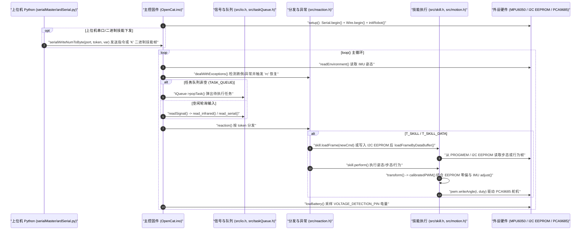

# Petoi Bittle / OpenCat

## 一句话定义

**Petoi Bittle** 是掌上尺寸的商业机器人狗，运行开源 **OpenCat** 框架，仓库 [PetoiCamp/OpenCat-Quadruped-Robot](https://github.com/PetoiCamp/OpenCat-Quadruped-Robot)。

## 英文缩写速查

| 缩写 | 英文全称 | 简要说明 |
|------|----------|----------|
| ESP32 | Espressif ESP32 | 常见低成本 Wi-Fi/蓝牙 MCU |
| IDE | Integrated Development Environment | 集成开发环境 |
| DoF | Degrees of Freedom | 自由度 |
| OpenCat | Petoi OpenCat framework | Petoi 开源四足软件框架 |

## 为什么重要

- 软件生态成熟，是「开源软件 + 商业硬件」类四足的代表，和全开源硬件项目形成对照。
- 在微信文章《想进入机器人领域吗？学习这18个开源项目就够了》中排第 **7** 位。

## 核心要点（据文章）

- 硬件为成品套件（BiBoard + ESP32）；软件框架在 GitHub 完全开源，支持 Arduino IDE、Python 和图形化编程。
- Bittle X 等版本有 9 个舵机关节，可完成行走、后空翻、自平衡等 35+ 动作。
- 文章称 OpenCat 是 GitHub 上星标最高的四足框架之一，被大量学校和研究者使用；**硬件本身不是开源 DIY 设计**。

## 工程实践

- 学习重点放在 OpenCat 软件框架；需要改机械结构时不能指望官方图纸。
- 以上规格与许可证均出自文章叙述，**未逐项核对官方仓库**；动手前请以官方 README/BOM 为准。

## 机制与架构图

## 源码运行时序图

以上调用链依据 `PetoiCamp/OpenCat-Quadruped-Robot`（`main` 分支，面向 NyBoard/ATmega328P）中的 `OpenCat.ino`、`src/io.h`、`src/reaction.h`、`src/skill.h`、`src/motion.h`、`src/taskQueue.h` 与 `serialMaster/ardSerial.py` 整理；现行 BiBoard/ESP32 平台代码位于 [OpenCatESP32](https://github.com/PetoiCamp/OpenCatEsp32-Quadruped-Robot)。

## 局限与风险

- 本页仅基于一篇第三方公众号文章，规格数字可能随版本变化。
- 仓库迁移、分叉和许可证以官方当前状态为准。

## 关联页面

- [quadruped-robot](./quadruped-robot.md)
- [stanford-doggo-and-pupper](./stanford-doggo-and-pupper.md)
- [mini-pupper](./mini-pupper.md)
- [机器人开源项目 18 例（微信 GitHubStore）索引](../overview/robot-open-source-wechat-githubstore-18-projects.md)

## 推荐继续阅读

- [OpenCat 仓库](https://github.com/PetoiCamp/OpenCat-Quadruped-Robot)

## 参考来源

- [wechat_githubstore_18_open_source_robot_projects.md](../../sources/blogs/wechat_githubstore_18_open_source_robot_projects.md)
