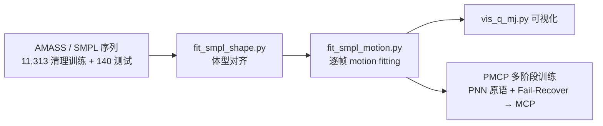
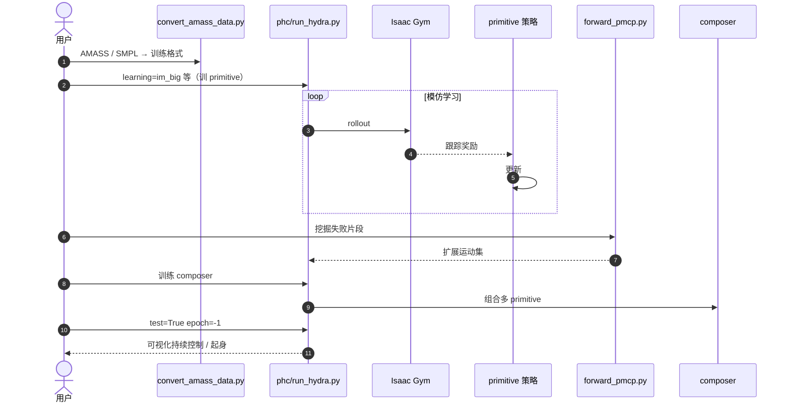

---


type: entity
tags: [repo, motion-retargeting, humanoid, physics-based-control, smpl, nvidia, paper, bfm, behavior-foundation-model, awesome-bfm-papers, berkeley]
status: complete
updated: 2026-11-21
code: https://github.com/ZhengyiLuo/PHC
venue: "2023 · ICCV"
arxiv: "2305.06456"
summary: "PHC（ZhengyiLuo/PHC，ICCV 2023，arXiv:2305.06456）：面向模拟人体的永续全身控制器；以渐进乘性控制策略（PMCP）+ 失败状态恢复实现 AMASS 11,313 条动作 98.9% 跟踪与无外部残差力起身。"
related:
  - ../overview/humanoid-motion-cerebellum-technology-map.md
  - ../overview/motion-cerebellum-category-02-motion-imitation.md
  - ../overview/bfm-41-papers-technology-map.md
  - ../overview/bfm-category-02-goal-conditioned-learning.md
  - ../concepts/motion-retargeting.md
  - ../methods/motion-retargeting-gmr.md
  - ../methods/dart-control.md
  - ./paper-molingo.md
  - ./zhengyi-luo.md
  - ./protomotions.md
sources:
  - ../../sources/repos/phc.md
  - ../../sources/papers/bfm_awesome_phc_arxiv_2305_06456.md
  - ../../sources/papers/bfm_awesome_41_catalog.md
  - ../../sources/blogs/wechat_embodied_ai_lab_bfm_41_papers_survey.md
  - ../../sources/papers/motion_cerebellum_64_catalog.md
  - ../../sources/blogs/wechat_embodied_ai_lab_humanoid_motion_cerebellum_survey.md
original:
  - ../../sources/papers/bfm_awesome_phc_arxiv_2305_06456.md
  - ../../sources/repos/phc.md
---

# PHC（Perpetual Humanoid Control）

**PHC**（<https://github.com/ZhengyiLuo/PHC>，ICCV 2023，[arXiv:2305.06456v3](https://arxiv.org/abs/2305.06456)）是 [Zhengyi Luo](./zhengyi-luo.md) 团队提出的 **永续物理人形控制器**：在不借助任何外部残差力（RFC）的条件下，于 Isaac Gym 中学得可长期跟踪 11,313 条清理后 AMASS 动作、并在跌倒或遭遇噪声视频姿态估计（如 HybrIK / MeTRAbs）后自动恢复的模拟人体策略；仓库同时提供 **SMPL/AMASS → 自定义人形（如 Unitree G1 / H1）** 的 shape/motion fitting 工具链（`docs/retargeting.md`）与 Isaac Lab 推理入口（`scripts/eval_in_isaaclab.py`）。

## 一句话定义

**通过渐进挖掘难序列并冻结旧原语（PMCP）再由乘性控制组合器（MCP）门控混合，在不引入外部残差力（no-RFC）下让单个模拟人形控制器兼具万级动作高精度跟踪与跌倒自主恢复能力。**

## 英文缩写速查

| 缩写 | 英文全称 | 简要说明 |
|------|----------|----------|
| PHC | Perpetual Humanoid Control | 无外部残差力的长期稳定物理人形控制器 |
| PMCP | Progressive Multiplicative Control Policy | 逐轮挖掘失败样本扩容原语网络（PNN）并保留旧能力的训练架构 |
| MCP | Multiplicative Control Policy | 用高斯分布乘积融合多个运动原语动作分布的组合控制器 |
| PNN | Progressive Neural Networks | 冻结前序原语权重并加横向连接防灾难性遗忘的网络扩展结构 |
| RET | Reference Error Termination | 跟踪超阈值提前终止以过滤无效 rollout 样本的机制 |
| SMPL | Skinned Multi-Person Linear Model | 重定向源人体参数化模型 |
| AMASS | Archive of Motion Capture as Surface Shapes | 清理后含 11,313 训练 / 140 测试动作的大规模动捕库 |

## 为什么重要

- **万级动作无外力稳定模仿：** 早期 UHC 依赖非物理的 Residual Force Control（RFC）托住角色；PHC 去掉 RFC 后在 AMASS-Train* 11,313 条序列达 **98.9%** 成功率、AMASS-Test* 达 **96.4%**、`Ours-kp` 达 **97.1%**（衍生 `PHC+` 达 **100%**）。
- **容错与连续交互：** 将「简单行走片段上的跌倒起身恢复（fail-state recovery）」作为新原语接在 PNN 末尾，使控制器在面对语言生成/视频估计噪声摔倒后无需环境 reset 即可重新接管（H36M 失败恢复率 **95.0% / 98.8%**）。
- **重定向 + 控制一体：** 通过 YAML 配置 `joint_matches`、`smpl_pose_modifier`、`extend_config` 把 SMPL 拟合到新 URDF 人形（文档含 Unitree H1 / G1）；[OmniRetarget](./paper-hrl-stack-03-omniretarget.md) 与 GMR 常将其作基线。

## 核心原理

### 1）PMCP + PNN + Fail-State Recovery

- **难例挖掘飞轮（PMCP）：** 先在完整数据上训原语 0；达到平台期后由 `forward_pmcp.py` 筛选未学会序列生成下一批训练集，扩增新原语列并用 PNN 横向连接旧列，旧列参数冻结防遗忘。
- **失败恢复原语：** 最后一个原语在简单 locomotion 数据上以高跌倒初态与重置逻辑训练起身/接回目标轨迹；组合器 **MCP**（composer）将 4 个原语按权重加权乘性混合，模型体积 **28.8 MB**，渲染推理 **~32 FPS**（无渲染 **~50 FPS**）。
- **关键消融（论文 Table 3，H36M-Test-Video*）：** 无 RET/MCP 的单模型成功率 **51.2%** → 加 RET 提至 **59.4%** → MCP 提至 **66.2%** → PMCP+PNN 提至 **86.9%** → 加入 Fail-Recover 最终达 **88.7%**（vs UHC w/o RFC 仅 **18.1%**）。

### 2）重定向与控制子流程



典型重定向命令（以 `unitree_g1_fitting` 为例）：

```bash
python scripts/data_process/fit_smpl_shape.py robot=unitree_g1_fitting
python scripts/data_process/fit_smpl_motion.py robot=unitree_g1_fitting +amass_root=/path/to/amass
```

## 实验与评测

| 基准 | 方法 | 成功率 ↑ | 说明 |
|------|------|----------|------|
| AMASS-Train*（11,313 条） | **PHC** / **PHC-kp** | **98.9%** / **98.7%** | G-MPJPE 37.5 / 40.7 mm；后续 `PHC+` 达 **100%**（26.6 mm） |
| AMASS-Test*（140 条） | **PHC** / **PHC-kp** | **96.4%** / **97.1%** | 未见动作泛化（论文 Table 1） |
| H36M-Test-Video* | **PHC（Ours）** / MeTRAbs-kp | **88.7%** / **91.9%** | vs UHC w/o RFC **18.1%**（论文 Table 2） |
| Fail-State Recovery | **PHC**（AMASS-Test*） | **95.0%**（11s）/ **98.8%**（20s） | 无外部残差力自主起身继续跟踪（论文 Table 4） |

## 与 GMR / ProtoMotions 的分工

| 工具 | 侧重 |
|------|------|
| [GMR](../methods/motion-retargeting-gmr.md) | 实时几何 IK，多输入格式，CPU 友好 |
| **PHC** | SMPL 拟合 + 物理模仿闭环，适合离线大规模库 |
| [ProtoMotions](./protomotions.md) | 多后端并行训练；PHC 提供 AMASS 预处理参考 |

## 源码运行时序图

官方实现 [ZhengyiLuo/PHC](https://github.com/ZhengyiLuo/PHC)（README.MD）：数据 `convert_amass_data.py`；训练 `phc/run_hydra.py`（如 `robot=unitree_g1`）；PMCP 挖掘 `scripts/pmcp/forward_pmcp.py`；`test=True` 评测可视化。一次完整运行如下：



- **PMCP 是数据飞轮**：失败案例回灌后再训，而不是只加长单次 PPO；仓库另提供单原语简化流程（`auto_pmcp_soft` 标志）及 Isaac Lab 推理入口（`scripts/eval_in_isaaclab.py`）。
- **Hydra 配置**决定机器人与任务；G1 / H1 等 embodiment 用对应 `robot=` / `env=`。

## 工程实践

| 项 | 建议与仓库说明 |
|----|----------------|
| 快速评测 vs 完整训练 | 可用 README 提供命令直接加载 `phc_comp_3` / `phc_kp_mcp_iccv` 验证；完整 PNN/PMCP 训练需手动轮次执行 `forward_pmcp.py` 并修改 `env.training_prim` |
| 单原语替代方案 | 若无需跌倒起身能力，可用 `auto_pmcp_soft` 或 `PHC-Prim` 单原语实现更高平地跟踪精度，省去 MCP/PNN 管理成本 |
| 坐标系对齐 | 默认 SMPL 经 `up_right_start` 修改为朝向 `+x`、重力 `-z`；自备数据时须用 `convert_data_smpl.py` 并确认 `SMPLSim` 地面高度无穿模 |
| 真机与新框架 | 后续 PULSE / MaskedMimic / ProtoMotions 生态表明：单体大容量或统一蒸馏往往比多专家 MoE/MCP 更易扩展到真机控制 |

## 结论

**PHC 首次用纯物理仿真（无 RFC 外力）证明单一人形控制器能够掌握超万条动捕序列并在跌倒后自主恢复，是后续 PULSE、MaskedMimic 与 ProtoMotions 等通用策略栈的关键前置基石。**

1. **PMCP + Fail-Recover 是核心增益来源** — Table 3 显示四项叠加把噪声视频跟踪成功率从 51.2% 拉升到 **88.7%**，去掉失败恢复原语即跌落且难以接续跟踪。
2. **去 RFC 的现实意义** — 不靠骨盆虚拟外力后，学出的动力学与倒地起身才具备迁移到物理控制器的可能。
3. **MoE 扩容的代价** — 需要分阶段人工筛选难例与训练 composer，这也催生了 MaskedMimic（单体统一网络）及 ProtoMotions 的演进。
4. **重定向副产物** — `fit_smpl_shape.py` / `fit_smpl_motion.py` 成为 G1/H1 等真机工作最常对照的无硬约束优化重定向基线。

## 局限与风险

- **多阶段工程繁琐：** 官方 README 明确指出完整 PNN+MCP 训练流程未全自动化，需人工监控平台期并修改 `training_prim` 逐列推进。
- **地形与交互缺口：** 主要围绕平地 + SMPL 虚拟角色设计（未含感知地形高度图或手脚接触规划；且真机侧重借助扩展 G1/H1 配置或交由后续 ProtoMotions 落地）。
- **无约束重定向缺陷：** 梯度拟合未加碰撞与接触硬约束，部分片段需过滤（论文从 AMASS 筛除带椅/梯交互的 11,313 条）才可稳定跟踪。
- **依赖较老环境：** 原仓库主力栈绑定 Python 3.8 + Isaac Gym（已新增 `eval_in_isaaclab.py` 推理兼容）。

## 关联页面

- [Motion Retargeting](../concepts/motion-retargeting.md)
- [GMR](../methods/motion-retargeting-gmr.md)
- [DART（DartControl）](../methods/dart-control.md) — 项目页演示 DART 运动学输出 + PHC 跟踪以减轻穿模/滑步
- [MoLingo](./paper-molingo.md) — 人体 T2M 生成后经重定向 + PHC 策略在 G1 上跟踪（跟踪管线代码待发布）
- [GRIP](./paper-grip.md) — 人体 MoCap 中 DynamicsNet 奖励参考 PHC（AMP + imitation + energy；共同作者 Zhengyi Luo）
- [ProtoMotions](./protomotions.md)
- [Zhengyi Luo](./zhengyi-luo.md)
- [phc](./phc.md)

## 参考来源

- [PHC 仓库归档](../../sources/repos/phc.md)
- [BFM awesome PHC 论文摘录](../../sources/papers/bfm_awesome_phc_arxiv_2305_06456.md)
- 论文：<https://arxiv.org/abs/2305.06456>

## 推荐继续阅读

- [机器人论文阅读笔记：BFM-Zero](https://imchong.github.io/Robot_Learning_Paper_Notebooks/papers/04_Loco-Manipulation_and_WBC/BFM-Zero__A_Promptable_Behavioral_Foundation_Model_for_Humanoid_Control/BFM-Zero__A_Promptable_Behavioral_Foundation_Model_for_Humanoid_Control.html)
- [机器人论文阅读笔记：PHC](https://imchong.github.io/Robot_Learning_Paper_Notebooks/papers/01_Foundational_RL/PHC_Perpetual_Humanoid_Control/PHC_Perpetual_Humanoid_Control.html)
- 重定向文档：<https://github.com/ZhengyiLuo/PHC/blob/master/docs/retargeting.md>
- 项目页：<https://www.zhengyiluo.com/PHC-Site/>
