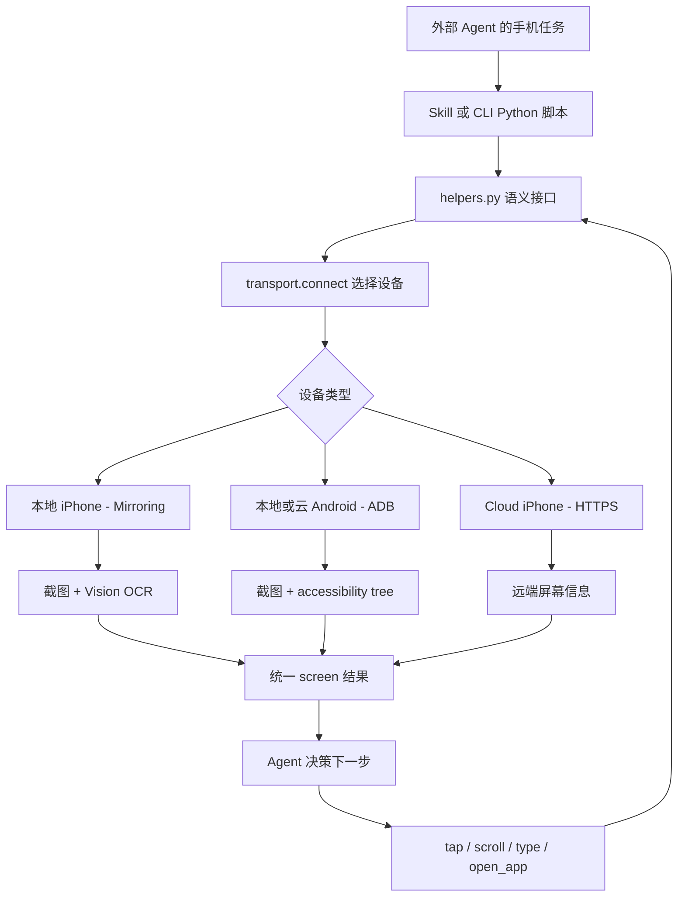
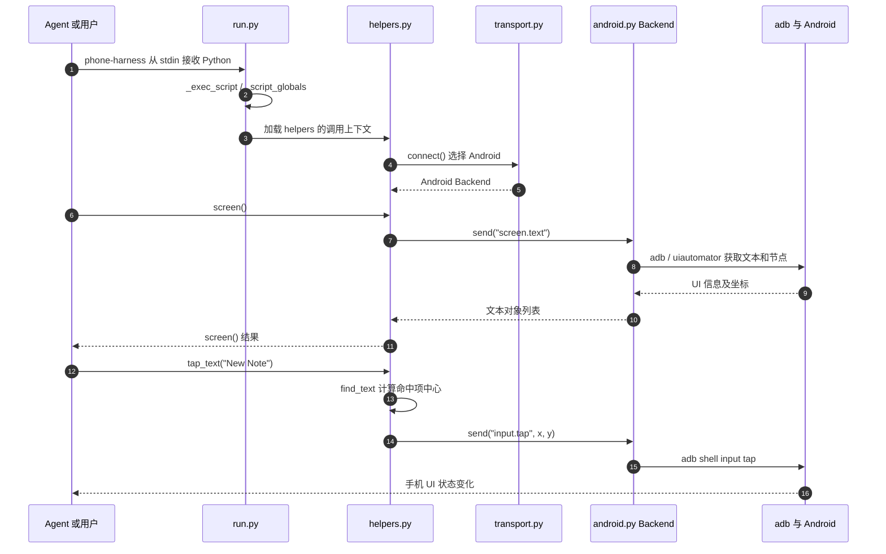

# Phone Harness — 让 AI Agent 操作 iPhone 与 Android / Agent-Driven Phone Control

## 一句话定义

**Phone Harness** 是 [phone-harness/phone-harness](https://github.com/phone-harness/phone-harness) 的 MIT 开源手机交互 CLI/Skill：由外部 Agent 调用统一的屏幕读取、点击、滑动、输入等 helpers，将操作转交给本地 iPhone / Android 或 Phone Harness Cloud 的对应后端。

## 英文缩写速查

| 缩写 | 英文全称 | 简要说明 |
| --- | --- | --- |
| CLI | Command-Line Interface | Agent 可执行的命令行入口 `phone-harness` |
| ADB | Android Debug Bridge | Android 侧截图、输入与设备连接机制 |
| OCR | Optical Character Recognition | iPhone 镜像屏幕中文字识别 |
| MCP | Model Context Protocol | Cloud 手机可用的模型工具接入协议 |
| UI | User Interface | Agent 实际操作的手机应用图形界面 |

## 为什么重要

- **Agent Computer Use 的移动端执行面：** 无需为每个手机 App 编写私有 API 包装，就能基于可见 UI 完成跨应用操作；与 [CLI-Anything](cli-anything.md) 的「给软件生成结构化命令」形成不同路径。
- **统一上层调用、保留设备差异：** `helpers.py` 的 `screen()`、`tap_text()`、`type_text()` 共用 `send(op)` 接口；`transport.py` 明确用 `Unsupported` 暴露不支持的能力，不盲目模拟平台不存在的操作。
- **对机器人研究的参考定位：** 可借鉴“感知 → 动作 → 再观测”的应用层 Agent 工具循环，以及多设备测试与人机交互脚手架；**不提供机器人关节控制、安全闭环或 ROS 2 硬实时能力**。

## 核心原理

| 层 | 机制 / 具体源码 |
| --- | --- |
| Agent 接入 | 外部 Claude Code/Codex/Hermes/OpenClaw 等通过 Skill、stdin Python 脚本或官方 Cloud MCP 驱动 |
| CLI 入口 | `pyproject.toml` 的 console script 指向 `phone_harness.run:main`；`run.py` 中 `_exec_script()` 载入 helpers 并运行输入脚本 |
| 设备无关语义层 | `helpers.py` 的 `send()` / `screen()` / `tap()` → `transport.Backend.send()`，如 `screen.text`、`input.tap` |
| 本地 iPhone | macOS iPhone Mirroring 截屏 → Apple Vision OCR → 点击、键盘与拖动等系统输入 |
| 本地 Android | ADB `screencap` / `uiautomator dump` 读取；ADB input 执行点击、输入、导航 |
| 云 Android | `cloud start` 管理租用会话，再通过 ADB 接入托管设备 |
| 云 iPhone | 官方 Cloud 会话后，以 HTTPS 远程控制操作；本地不要求 macOS |

### 项目流程总览

以下基于官方 README、`helpers.py`、`transport.py` 与 `cloud.py`，分支代表不同设备后端，**不是一个请求同时调用全部后端**。

图中 Agent 决策是调用方的编排职责，不代表 Phone Harness 内置 VLM 或自主任务规划模型。

## 源码运行时序图

以下**仅刻画已核对源码的 Android 本地路径**；iPhone / Cloud 采用其他后端，不假设其内部调用链相同。

源码定位：[`run.py`](https://github.com/phone-harness/phone-harness/blob/main/src/phone_harness/run.py)、[`helpers.py`](https://github.com/phone-harness/phone-harness/blob/main/src/phone_harness/helpers.py)、[`transport.py`](https://github.com/phone-harness/phone-harness/blob/main/src/phone_harness/transport.py)、[`android.py`](https://github.com/phone-harness/phone-harness/blob/main/src/phone_harness/android.py)。未执行 Android 设备实测。

## 工程实践

| 场景 | 建议 / 官方做法 |
| --- | --- |
| 安装 | 官方推荐 `uv tool install --python 3.12 --upgrade --force phone-harness`；包元数据要求 Python `>=3.10` |
| 本地 iPhone | macOS 15+、iOS 18+、iPhone Mirroring 配对和 Accessibility / Screen Recording 权限 |
| 本地 Android | 安装 adb，启用 USB 或无线调试；`phone-harness config set platform android`，`phone-harness doctor android` |
| Skill 接入 | `phone-harness skill` 输出可注册给 Agent 的 SKILL 文本 |
| Cloud 接入 | 登录后 `phone-harness cloud ls`、`cloud start`、`cloud stop` 管理会话；托管服务另计费 |
| 官方 MCP | `https://mcp.phone-harness.com/mcp`；README 明确目前只支持云 Android 和云 iPhone |
| 代理 UI 回归测试 | 每个动作后复读 UI / 截图验证状态，避免仅凭坐标推测成功；这是工程建议，并非官方 benchmark 结果 |

## 局限与风险

- **交互限制：** 不支持多指和相机 / Face ID 流程；DRM 视频可能全黑；无文字图标需要视觉模型配合，OCR 无法代替完整视觉理解。
- **设备状态：** 解锁 iPhone 可能暂停镜像；Android PIN 锁屏可要求用户介入；设备连接与权限配置仍需用户完成。
- **能力边界：** ADB tree 与 iPhone OCR 信息完整性不同，跨平台语义一致不意味着所有 App 操作稳定。
- **开源边界：** 已公开 MIT CLI/Skill/设备后端；云手机托管、服务部署及账户能力为官网提供的商业服务，不对云服务后端开放程度作未核实的断言。
- **安全：** 手机可能含消息、支付、令牌与 2FA，执行高风险 UI 操作应实施人工批准、最小权限及凭证保护。项目未提供可替代机器人安全控制器的证据。
- **复现状态：** 已检查官方原文和关键代码，尚未接入真机、录制交互回放或评测成功率。

## 关联页面

- [CLI-Anything](cli-anything.md) — agent-native 结构化命令方案，对照本项目的手机 UI 交互。
- [Hermes Agent](hermes-agent.md) — 可消费外部工具 / Skill 的代理宿主（Phone Harness 官方有 Hermes 集成路径）。
- [OpenClaw](openclaw.md) — 具有官方插件集成的代理宿主。
- [Agent Reach](agent-reach.md) — 外网访问与检索工具，与手机端交互互补。
- [Model Context Protocol](../concepts/model-context-protocol.md) — Cloud MCP 的宿主协议层。
- [Coding Agent 验证闭环](../methods/coding-agent-verification-loops.md) — 手机 UI 自动化可作为 Agent 端到端行为验证的执行面；该方法页提供证据链与验收闭环，不代表 Phone Harness 自带验证器。
- [Teleoperation（遥操作）](../tasks/teleoperation.md) — 对照手机远程 UI 操作与机器人本体遥操作；两者都涉及远端动作与反馈，但执行对象、实时性和安全约束不同。

## 参考来源

- [官方仓库源归档](../../sources/repos/phone-harness.md)
- [官方站点与开发文档归档](../../sources/sites/phone-harness.md)
- [GitHub README](https://github.com/phone-harness/phone-harness/blob/main/README.md)
- [官网文档 Overview](https://phone-harness.com/docs/introduction)

## 推荐继续阅读

- [官方安装指南](https://github.com/phone-harness/phone-harness/blob/main/install.md)
- [Android 配对与设置](https://github.com/phone-harness/phone-harness/blob/main/setup/android.md)
- [官方 Skill 定义](https://github.com/phone-harness/phone-harness/blob/main/SKILL.md)
