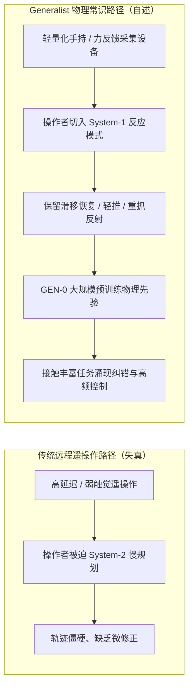

# Physical Commonsense（Generalist 产业观点）

**The Dark Matter of Robotics: Physical Commonsense**（Andy Zeng & Generalist Team，[2026-01-29](https://generalistai.com/blog/physical-commonsense)）主张：真正决定 manipulation 成败的是 **不可见的物理常识** —— 轻推、滑移恢复、抓取微调等 **System-1 闭环反应**，而非慢速逐步规划。

## 一句话定义

**Physical commonsense 是机器人里像「暗物质」一样的能力：很少被单独标注，却承载大部分有效物理交互。**

## 英文缩写速查

| 缩写 | 英文全称 | 简要说明 |
|------|----------|----------|
| Teleop | Teleoperation | 远程示教；延迟与接口影响数据质量 |
| GEN-0 | Generalist Embodied Model 0 | Generalist 具身基础模型产品线 |
| IL | Imitation Learning | 模仿学习依赖示范分布 |
| VLA | Vision-Language-Action | 语言条件策略；不自动含物理常识 |
| UMI | Universal Manipulation Interface | 手持 ergonomic 采集接口范例 |

## 为什么重要

- **Light-O1 引言对照：** [Light-O1 blog ref [3]](https://www.lightorigins.com/en/blog/light-o1) 与 **人类视频 / ergonomic 采集** 并列，解释 **为何 internet human video** 是机器人专项数据的 complement。
- **数据战争核心：** 与 [GEN-1 Thousand Hands](./generalist-gen1-thousand-hands.md)、[Dyna-2](./dyna-2.md) 同属 **「堆真实交互数据」** 叙事。

## 核心原理

1. **Tacit knowledge 与 Moravec 悖论：** 引用 Polanyi（1966）隐性知识与 Moravec（1988）悖论——人类通过身体闭环演化出的感知–运动直觉难以用语言命题表达；互联网文本和图像缺乏本体感觉、干预与物理后果，只产出语义常识（如 PaLM-E / Code as Policies 式高层规划），不产生接触物理直觉。
2. **Teleop 失真：** 高延迟、低力反馈与不自然接口会迫使操作者退回 System-2 逐步规划（“先把一根手指放这里……”），导致采集轨迹僵硬缓慢；事后人工倍速无法匹配真实物理动力学（物体不会两倍速下落）。
3. **Ergonomic 采集保留反射：** Generalist 使用平衡感更好、带力反馈的轻量化手持设备，让操作者几分钟后停止刻意“思考”而转为直觉反应（编织、削土豆、微缩画涂装），在数据中保留微修正（micro-corrections）与实时恢复。
4. **涌现恢复与高层推理交融：** 基于 GEN-0 预训练加后训练的端到端模型可出现超出后训练分布的细节动作（滑落垫圈二次轻推卡入槽位、翻转盒盖并拍平压实、另一只指头补救折盒、把盒装物从箱壁推开留出抓取空隙），并将反应式控制与序列推理（如 one-shot 乐高复制）融合在同一模型中。

## 工程实践

| 项 | 实践要点 |
|----|----------|
| **采集设备选型** | 评估遥操作与手持设备时，优先关注 **系统延迟、力/触觉反馈与人体工学负担**，检查操作员是否能在数分钟内进入连续无停顿反应节奏 |
| **反倍速原则** | 不要将慢速僵硬遥操作轨迹通过简单时间抽帧/倍速当作高速示范训练，避免观测动力学与重力/惯性响应失配 |
| **评测视角** | 除静态成功率外，单独构造滑移、壁面贴边、可变形盒舌对位等需微修正的扰动测试，区分“脚本回放”与“物理常识恢复” |
| **源码运行时序图** | **不适用**（产业观点博文，无公开代码、权重或采集设备硬件图纸） |

## 局限与风险

- **证据等级：** 属于公司观点博文（Idea 栏目），非同行评审论文，无受控量化消融表或基准对比分数。
- **设备与模型黑箱：** 轻量化手持力反馈设备的机械结构、传感器参数、GEN-0 架构与训练数据配方均未开源，外部团队无法直接复现其“涌现恢复”。
- **外推边界：** “互联网文本/图像无法提供物理常识”是对纯文本/静态图像而言，不等价于否定第一人称人类视频或仿真触觉在跨具身预训练中的互补作用。

## 结论

**产业层面对「还要不要堆机器人 teleop」的回答：要，但必须是能保留 physical commonsense 的采集形态，否则 scale 的是错误分布。**

1. 博文 **非 arXiv 定理** — 作 **数据哲学** 与 Light-O1 / GEN 线互链，不作硬 benchmark。
2. **与 Light-O1 人类视频路线共鸣** — 都强调 **human action 分布** 的信息量。
3. **边界：** Generalist **闭源**；具体 emergent 行为需独立第三方验证。
4. 读 [GEN-1](./generalist-gen1-thousand-hands.md) 看 **multi-end-effector scale**；读本文看 **为何 scale 的方式重要**。

## 关联页面

- [Generalist AI（公司入口）](./generalist-ai-robotics.md)
- [GEN-0：随物理交互规模化的具身基础模型](./generalist-gen0.md)
- [GEN-1 千手：跨末端执行器泛化](./generalist-gen1-thousand-hands.md)
- [Light-O1](./light-o1.md)
- [Embodied Scaling Laws](../concepts/embodied-scaling-laws.md)

## 参考来源

- [The Dark Matter of Robotics: Physical Commonsense（来源归档）](../../sources/blogs/generalist_physical_commonsense_2026.md)
- 原文：<https://generalistai.com/blog/physical-commonsense>

## 推荐继续阅读

- [The Dark Matter of Robotics: Physical Commonsense（原文）](https://generalistai.com/blog/physical-commonsense)
- [GEN-0: Embodied Foundation Models That Scale with Physical Interaction](https://generalistai.com/blog/gen-0)
- [Towards Machines with a Thousand Hands](https://generalistai.com/blog/towards-machines-with-a-thousand-hands)
