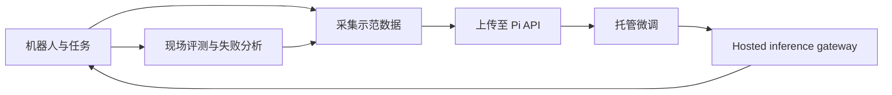

# Physical Intelligence Pi API beta

## 一句话定义

Pi API 是 Physical Intelligence 面向机器人开发者开放 beta 的托管服务：上传机器人数据，在云端基础设施上微调策略，再通过 hosted gateway 为机器人提供模型推理。

## 英文缩写速查

| 缩写 | 英文全称 | 简要说明 |
|------|----------|----------|
| API | Application Programming Interface | 应用调用服务的接口；公开公告未提供具体 endpoint / schema |
| VLA | Vision-Language-Action | Pi API 面向适配的机器人策略模型类别 |
| GPU | Graphics Processing Unit | 托管微调和模型推理所需的计算资源 |
| SFT | Supervised Fine-Tuning | 一类监督微调方法；官方公告没有说明 Pi API 的具体训练配方 |

## 为什么重要

机器人团队适配 VLA 往往要同时处理数据转换、GPU 训练、模型部署和机器人侧推理服务。Pi API 将训练基础设施和 hosted inference 封装成同一工作流，让开发者可以围绕真机失败迭代数据和策略；这使得 Physical Intelligence 的基础模型从可下载代码与权重，扩展为托管式开发服务。

## 核心原理

官方公开的操作闭环是：收集示范、训练策略、在机器人上评测，再依据失败确定下一轮采集内容。API 承担数据上传、托管微调与推理服务，机器人团队仍需准备本体数据、任务定义和现场评测。

公告将 π₀、π₀.₅ 作为通用机器人基础模型的背景示例，但没有列出 beta 当前可选模型的完整版本清单，也未说明服务端请求格式或控制频率。

## 工程实践

官方公告列出的典型循环是“上传数据 → 微调 → 真机测试 → 依据失败补采数据”。申请页要求申请者描述机器人 embodiment、示范数据小时数、仿真数据计划、任务成功标准，以及希望在云端、本地还是两者运行推理。

| 工程项 | 公开信息 |
|---|---|
| 训练 | 在 Physical Intelligence 管理的算力和基础设施上微调 |
| 推理 | 通过托管 gateway 访问微调模型；多数早期展示案例使用云端推理 |
| 适配流程 | 采集示范、训练、真机评测、按失败补充数据后再迭代 |
| Beta 状态 | 申请制、小批次接入 |
| 本体适配 | 官方展示跨行业、不同机器人硬件的早期合作案例；实际效果仍须在目标机器人上验证 |

## 局限与风险

- 截至 2026-10-14，公开页面没有 API reference、endpoint / schema、SDK、价格、配额或 SLA；正式开发前需通过 beta 接入确认这些接口条件。
- 官方称一些云端部署遇到网络连接挑战。机器人侧应把网络可用性、推理时延和安全停机作为部署验证项；公告没有给出延迟保证或离线行为定义。
- API 服务端实现没有公开代码链接。官方 [openpi](https://github.com/Physical-Intelligence/openpi) 仓库可用于自行运行模型，但不等于 Pi API 的 SDK 或服务端源码。
- 早期案例属于合作方展示，公告没有统一的成功率、延迟或跨本体基准；应将其视为部署可行性示例，而不是可横向比较的性能报告。

## 关联页面

- [The Physical Intelligence Layer](./pi-physical-intelligence-layer.md)
- [π₀ 论文实体](./paper-pi0.md)
- [π₀.₅ 论文实体](./paper-pi05-open-world-vla.md)
- [π₀ 策略方法](../methods/π0-policy.md)
- [π₀.₇ 策略方法](../methods/pi07-policy.md)

## 参考来源

- [Physical Intelligence 官方 API beta 公告](../../sources/sites/physical-intelligence-pi-api-beta.md)
- [Physical Intelligence 官方 openpi 仓库](../../sources/repos/openpi.md)

## 推荐继续阅读

- [Pi API beta 申请页](https://www.pi.website/waitlist)
- [官方 API beta 公告](https://www.pi.website/blog/api-beta)
- [官方 openpi 仓库](https://github.com/Physical-Intelligence/openpi)

