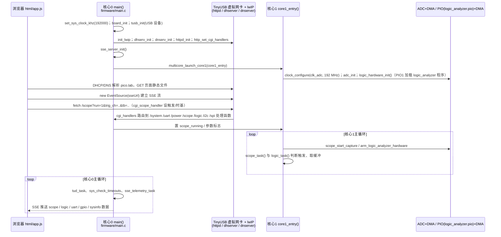

# Pico.Lab

**Pico.Lab** 是面向嵌入式板卡 bring-up 的开源多功能工具，集成示波、逻辑分析、总线通信和浏览器界面；专用板还提供电源控制及电流监测。

## 英文缩写速查

| 缩写 | 英文全称 | 简要说明 |
|------|----------|----------|
| ADC | Analog-to-Digital Converter | 模拟信号采样 |
| UART | Universal Asynchronous Receiver-Transmitter | 异步串口通信 |
| I2C | Inter-Integrated Circuit | 两线串行总线 |
| SPI | Serial Peripheral Interface | 同步串行外设总线 |
| DMA | Direct Memory Access | 不由 CPU 逐次搬运采样数据 |

## 为什么重要

机器人传感器板或控制板 bring-up 时，可在一个浏览器界面查看模拟波形、数字时序和串口通信；普通 Pico 可作为低门槛试用入口。

## 核心原理

固件通过 TinyUSB 枚举虚拟网卡，由 lwIP 提供 DHCP、DNS 和 HTTP；浏览器访问设备提供的本地界面。README 称界面约 200 KB，核心 0 处理网络与 USB，核心 1 负责采样和数字捕获。

| 功能 | 官方说明 |
|------|----------|
| 示波器 | 4 通道；ADC 时钟超频至 192 MHz，标称约 400 kHz 带宽；支持触发与单次采集 |
| 逻辑分析 | 8 通道，最高 100 MS/s；支持 UART、I2C、SPI 解码 |
| 总线与 GPIO | UART 终端、I2C/SPI 主机、GPIO 和 PWM；支持慢速数据记录及 CSV 导出 |
| 电源 | 专用 Pico.Lab 板提供 5 V、3.3 V 和 1–5 V 可调电源及电压、电流曲线 |

192 MHz 是 README 给出的 ADC 时钟参数，不应理解为每通道 192 MS/s，也不代表示波器带宽。

## 工程实践

1. 按 RP2040 或 RP2350 板型选择对应 UF2，按住 BOOTSEL 连接 USB，将固件拖入设备卷。
2. 连接后访问 `http://pico.lab`；本地域名不可用时使用 `http://192.168.7.1`。
3. 对传感器调试可先用逻辑分析仪检查 UART 波特率或 I2C 时序，再结合模拟波形观察电源和信号；接线前核对板卡输入电压范围。

## 局限与风险

- **板卡差异**：标准 Pico / Pico 2 支持固件，但电源控制与电流监测仅在专用板上可用；专用板的缓冲、保护和电压范围不应直接套用于普通 Pico。
- **测量能力**：400 kHz 为作者标称示波带宽；100 MS/s 是逻辑分析最高采样率，两者不是相同指标。作者明确提醒其性能低于专业仪器。
- **开放状态**：官方仓库公开固件、PCB 和 CAD，仓库标注 GPL-3.0；实际使用前应核对各组件许可及目标硬件规格。

## 源码运行时序图

入口：设备上电后固件 `firmware/main.c` 的 `main()`（由 `.uf2` 烧录，或按 README 用 `mkdir build && cd build` 后 CMake 构建）；用户在浏览器打开 `http://pico.lab`（或 `http://192.168.7.1`）。

图依据：CoretechR/PicoLab@5eb5e11，读过 README.md、firmware/main.c（main、core1_entry 起始与循环片段、cgi_handlers 表、cgi_scope_handler 开头、sse_telemetry_task）、firmware/html/app.js（fetch / EventSource 调用处）；core1_entry 中间段（约 1000–1060 行）、各 cgi 处理函数内部与 PCB/电源控制部分未读，DMA、触发等细节只标注到函数名级别。

## 关联页面

- [UART 与串行通信](../concepts/uart-serial-communication.md)
- [Wokwi](./wokwi.md) — 用于固件和电路仿真；Pico.Lab 用于实物信号观察。

## 参考来源

- [官方源码归档](../../sources/repos/picolab.md)
- [Hackaday 项目页归档](../../sources/sites/picolab.md)
- 源码核对（2026-11-02）：CoretechR/PicoLab@5eb5e11，读过 README.md、firmware/main.c（main / core1_entry / cgi 表 / SSE 部分）、firmware/html/app.js（网络调用处）；时序图依据以上文件，未运行代码。

## 推荐继续阅读

- [Pico.Lab 官方 README](https://github.com/CoretechR/PicoLab#readme)
