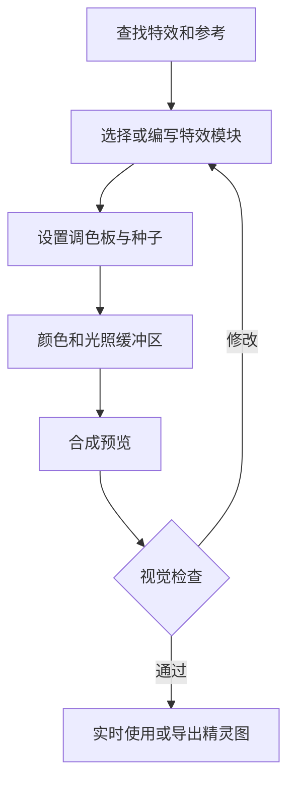
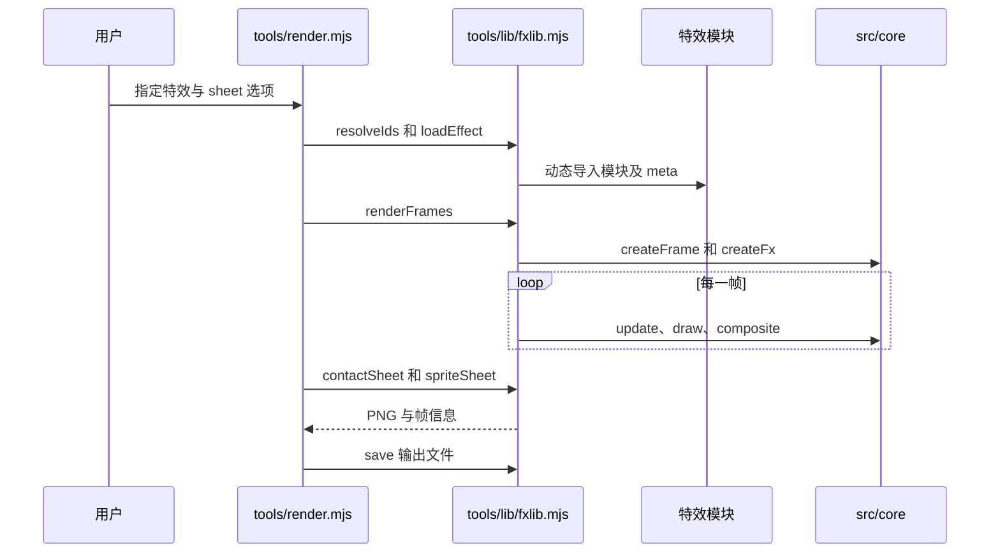

# pixelfx：代码驱动的像素特效库（Pixel Art Effects as Code）

pixelfx 将像素特效写成可参数化的 JavaScript，并配套画廊、导出工具和 Claude Code skill。本文核对 [a841596](https://github.com/patch-gg/pixelfx/tree/a84159688af3ca37a4be05a0d422b94451b2e24e) 的 README、创作文档、skill 及渲染入口。

## 英文缩写速查

| 缩写 | 英文全称 | 简要说明 |
|---|---|---|
| VFX | Visual Effects | 像素视觉特效 |
| FPS | Frames Per Second | 渲染或播放帧率 |
| PNG | Portable Network Graphics | 精灵图输出格式 |
| JSON | JavaScript Object Notation | 精灵图帧和播放元数据 |

## 核心机制

- 该版本包含 244 个特效，包括火焰、爆炸、天气及 12 个组合动作。每个特效是独立模块；调色板、种子、镜像等参数可复用。
- 纯函数特效由时间直接计算画面；模拟特效维护粒子等状态，以 120 Hz 或更细步长推进。颜色与加性光照分缓冲区合成。
- 带角色的特效可携带 `act` 时间数据：预备、释放、命中停顿及恢复。可在内置角色上播放，也可读取时间信息驱动自己的角色。
- skill 的方法是先查找已有特效，再参考、起草、渲染观察、反复修改并检查；视觉质量仍需人工判断。

## 流程总览

## 源码运行时序图

以 `node tools/render.mjs ice/frost-nova --sheet` 为例，依据 `tools/render.mjs` 和 `tools/lib/fxlib.mjs`：

`renderFrames` 将背景预览与透明特效分别合成；`--sheet` 生成透明 PNG 和 Aseprite 风格 JSON。`--gif` / `--mp4` 预览需要 ffmpeg。

## 工程实践与局限

- 浏览器 JavaScript 项目可直接使用 `createFx`；其他引擎可导入精灵图和 JSON，注意帧率、锚点及最近邻采样。
- 导出的精灵图将光照烘焙为颜色和透明度；亮背景下效果可能不同，需要重新配色或使用深色图层。
- 已公开代码、特效和 skill；画廊字体许可与代码不同，使用前查看 [NOTICE](https://github.com/patch-gg/pixelfx/blob/a84159688af3ca37a4be05a0d422b94451b2e24e/NOTICE.md)。该项目面向游戏视觉资产，不能直接作为机器人仿真物理模型。

## 关联页面

- [frontend-design skill](anthropic-frontend-design-skill.md)：编码代理的视觉设计工作流。
- [find-skills](find-skills-skill.md)：发现和安装代理技能。

## 参考来源

- [源码及阅读范围](../../sources/repos/pixelfx.md)
- [官方画廊核查](../../sources/sites/pixelfx-gallery.md)

## 推荐继续阅读

- [官方创作文档](https://github.com/patch-gg/pixelfx/blob/a84159688af3ca37a4be05a0d422b94451b2e24e/docs/AUTHORING.md)
