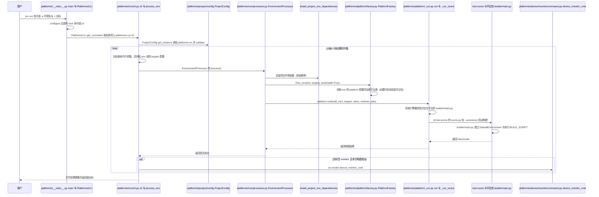

# PlatformIO Core

**PlatformIO Core** 是 PlatformIO 生态的命令行核心：以 `platformio.ini` 描述嵌入式项目环境，并用 `pio` CLI 管理相关开发平台、工具链、库依赖、固件构建及测试。

## 英文缩写速查

| 缩写 | 英文全称 | 简要说明 |
|------|----------|----------|
| CLI | Command-Line Interface | 通过命令行初始化、构建和测试嵌入式项目 |
| MCU | Microcontroller Unit | 机器人控制板和传感器节点常用的微控制器 |
| IDE | Integrated Development Environment | 可集成 PlatformIO Core 的桌面开发环境 |
| CI | Continuous Integration | 在持续集成流程中重复执行固件构建或测试 |
| LDF | Library Dependency Finder | PlatformIO 用于查找项目库依赖的组件 |

## 为什么重要

- **统一多板卡固件项目**：机器人电机驱动板、传感器节点和通信模块可能采用不同 MCU、框架与工具链；在项目配置中显式声明环境，可减少个人机器上的隐式差异。
- **将重复步骤纳入自动化**：同一组 `pio` 命令可从本地终端、IDE 或 CI 调用，适合固件构建、测试和团队协作。
- **位于机器人控制栈的固件开发层**：它负责构建与依赖管理；关节控制算法、总线时序、实时调度和安全策略仍由应用及硬件平台实现。

## 核心原理

### 配置驱动的项目环境

`platformio.ini` 可为一个项目声明一个或多个环境，典型字段包含开发平台、板卡、框架与库依赖。CLI 根据所选环境解析并安装构建所需的软件包，再调用对应工具链执行目标任务。官方命令包括：

| 命令 | 作用 |
|------|------|
| `pio project init` | 初始化 PlatformIO 项目配置和常见目录 |
| `pio run` | 构建配置文件中声明的环境，也可处理上传等目标 |
| `pio test` | 执行 PlatformIO 单元测试工作流 |
| `pio device monitor` | 打开串口监视器，查看设备日志 |

### 在嵌入式工具链中的位置

| 环节 | PlatformIO Core 覆盖 | 机器人固件示例 |
|------|-----------------------|----------------|
| 项目配置 | 环境、板卡、框架、构建选项 | ESP32/STM32 控制板固件 |
| 依赖管理 | 平台、工具链、库及依赖查找 | 编码器、IMU、通信协议库 |
| 构建与上传 | 调用目标平台工具链处理固件 | 编译并向开发板烧录控制程序 |
| 测试与观测 | 单元测试、串口监视等入口 | 主机侧逻辑测试、板上日志观察 |

## 工程实践

1. 先确认开发板、MCU、厂商 SDK 和框架均在官方平台清单中，再创建项目环境。
2. 将板卡、框架、依赖版本和构建选项提交到仓库；对关键生产构建，固定依赖版本并保留 CI 日志。
3. 先用 `pio run` 验证编译，再根据目标平台配置烧录和串口监视；用 `pio test` 覆盖可在主机或目标板运行的逻辑测试。
4. 对机器人关节或底层总线固件，补充真板测试，测量控制频率、通信丢包、延迟、启动行为和异常保护；编译通过并不代表实时性能已验证。
5. 若用 [Wokwi](./wokwi.md) 做无硬件外设测试，区分仿真通过与真实硬件验收；工具链配置可复用，外设模型和时序保真度仍需评估。

**开源状态：** 官方 Core 代码仓库公开，许可证为 Apache-2.0。PlatformIO IDE 将 Core 集成在 IDE 工作流中；单独使用命令行时，可按官方 CLI 安装文档配置。

## 局限与风险

- **不是机器人控制框架**：PlatformIO 不提供关节控制器、实时执行器或机器人动力学仿真。
- **编译成功不等于真机安全**：时序、外设电气特性、实时性、热设计和失效保护仍需在目标硬件上验证。
- **支持能力取决于具体平台包**：板卡、框架、调试器和上传器需逐项核对官方开发平台及工具包支持。
- **依赖可复现性需要主动管理**：记录平台、库及工具链版本，避免依赖默认最新版本导致历史构建漂移。

## 源码运行时序图

入口：`pio run`（在含 `platformio.ini` 的项目目录执行；`pio test`、`pio device monitor` 的入口未画）

图依据：platformio/platformio-core@d8c2135，读过 setup.py（entry_points，部分）、platformio/__main__.py、platformio/cli.py（部分）、platformio/run/cli.py（部分）、platformio/run/processor.py（部分）、platformio/platform/_run.py（部分）、platformio/platform/factory.py（部分）、platformio/platform/base.py（部分）、platformio/device/monitor/command.py（部分）、platformio/builder/main.py（部分）。未运行代码。

## 关联页面

- [Wokwi](./wokwi.md) — 无硬件时验证 MCU 与外围电路交互的仿真环境
- [SimpleFOC](./simplefoc.md) — Arduino/ESP32/STM32 上的开源电机控制库
- [Tinkercad](./tinkercad.md) — 面向入门教学的 Arduino/micro:bit 浏览器电路仿真
- [电机驱动器底软通信协议总览](../overview/motor-drive-firmware-bus-protocols.md) — 机器人驱动板与上层控制之间的协议和接口背景

## 参考来源

- [PlatformIO Core 来源归档](../../sources/repos/platformio-core.md)
- [PlatformIO Core 官方文档](https://docs.platformio.org/en/latest/core/)
- [PlatformIO Core 源码仓库](https://github.com/platformio/platformio-core)
- 源码核对（2026-11-02）：platformio/platformio-core@d8c2135，读过 setup.py、platformio/__main__.py、platformio/cli.py、platformio/run/cli.py、platformio/run/processor.py、platformio/platform/_run.py、platformio/platform/factory.py、platformio/platform/base.py、platformio/device/monitor/command.py、platformio/builder/main.py；时序图依据以上文件，未运行代码。

## 推荐继续阅读

- [PlatformIO Core (CLI)](https://docs.platformio.org/en/latest/core/index.html)
- [pio project init](https://docs.platformio.org/en/latest/core/userguide/project/cmd_init.html)
- [pio run](https://docs.platformio.org/en/latest/core/userguide/cmd_run.html)
- [pio test](https://docs.platformio.org/en/latest/core/userguide/cmd_test.html)
