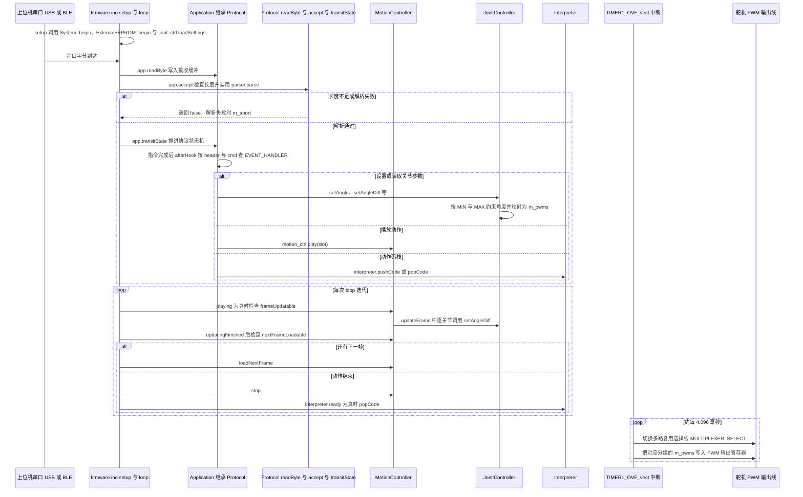

# PLEN2

**PLEN2**（[GitHub](https://github.com/plenprojectcompany/PLEN2)）是 [GitHubStore《19 款能自己造的开源人形机器人》](https://mp.weixin.qq.com/s/UUwUAcKdVrlo-N60Oar3Xg) 的第 6 项，文章标价 套件约 $499。

## 一句话定义

**PLEN2 是日本 PLEN Project 的可打印开源人形机器人，仓库含固件（arduino/firmware）与 STL 文件，README 自称「The world's first printable open-source humanoid」。**

## 英文缩写速查

| 缩写 | 英文全称 | 简要说明 |
|------|----------|----------|
| STL | Stereolithography file | 3D 打印常用网格文件格式 |

## 为什么重要

- 属于文章按成本从低到高排列的「能自己造」清单；横向对比见 [能自己造的开源人形机器人 19 款：按成本与形态排序的阅读坐标](../overview/open-source-buildable-humanoids-19-technology-map.md)。
- 价格为文章标价（套件约 $499），入库日未核实。

## 核心信息

| 项 | 内容 |
|----|------|
| **链接** | [GitHub](https://github.com/plenprojectcompany/PLEN2) |
| **许可（核查）** | 仓库根目录未见 LICENSE 文件 |
| **最近提交** | 2018-12-10 |

## 文章说法核对

- **文章：** 文章称它是较早的完整可打印开源人形方案之一，提供完整 STL、固件和动作库，社区有换用 MG90S 舵机的改装版。
- **README / 核查：** README 的上手流程：下载仓库 → 购买控制板与舵机 → 安装固件（/arduino/firmware/）→ 打印并装配 /stl/ 下 STL → 配置关节零位。
- **差异与保留：** 「世界首个可打印开源人形」是 README 自述，未独立核实；文章的「动作库」「MG90S 改装」未在已读段落核对；仓库最近提交 2018-12-10，且未见 LICENSE 文件，复用前需确认许可。

## 源码运行时序图

入口：Arduino 固件 `arduino/firmware/firmware.ino` 的 `setup()` 与 `loop()`（烧录到控制板运行，不是 PC 命令行程序；`ENSOUL_PLEN2` 默认为 false，因此不画 Soul 自主动作分支）

图依据：plenprojectcompany/PLEN2@48d46cf，读过 README.md、arduino/firmware/firmware.ino（全文）、arduino/firmware/Protocol.cpp（部分）、arduino/firmware/MotionController.cpp（部分）、arduino/firmware/JointController.cpp（部分，含 ISR 与 setAngle）、arduino/firmware/Soul.cpp（部分）。未编译、未刷写、未上电运行。

## 关联页面

- [humanoid-robot](../entities/humanoid-robot.md)
- [open-source-humanoid-hardware](../entities/open-source-humanoid-hardware.md)
- [open-source-buildable-humanoids-19-technology-map](../overview/open-source-buildable-humanoids-19-technology-map.md)

## 参考来源

- [plen2.md](../../sources/repos/plen2.md)
- [wechat_githubstore_19_buildable_open_source_humanoids_2026-11-02.md](../../sources/blogs/wechat_githubstore_19_buildable_open_source_humanoids_2026-11-02.md)
- [原文（微信公众号）](https://mp.weixin.qq.com/s/UUwUAcKdVrlo-N60Oar3Xg)
- 源码核对（2026-11-02）：plenprojectcompany/PLEN2@48d46cf，读过 README.md、arduino/firmware/firmware.ino、arduino/firmware/Protocol.cpp、arduino/firmware/MotionController.cpp、arduino/firmware/JointController.cpp、arduino/firmware/Soul.cpp；时序图依据以上文件，未运行代码。
