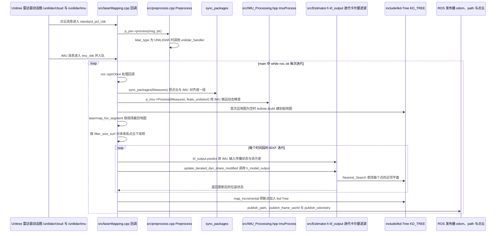

# point_lio_unilidar

**point_lio_unilidar** 把学术界 **Point-LIO**（稳健高带宽 LiDAR-Inertial Odometry）接到宇树 **L1 / L2** 雷达产品。

## 一句话定义

官方维护的 UniLidar + Point-LIO 组合——在振动与剧烈运动下仍追求准确高频里程计与可靠建图。

## 英文缩写速查

| 缩写 | 英文全称 | 简要说明 |
|------|----------|----------|
| LIO | LiDAR-Inertial Odometry | 激光惯性里程计 |
| LiDAR | Light Detection and Ranging | L1/L2 传感器 |
| IMU | Inertial Measurement Unit | 惯性量测 |
| SLAM | Simultaneous Localization and Mapping | 定位建图总称 |
| ROS | Robot Operating System | 推荐 Noetic |
| FOV | Field of View | L1/L2 约 360°×90° |

## 为什么重要

- 给 Unitree 移动平台一条**可复现的开源 LIO 基线**，而不是只卖硬件。
- Point-LIO 论文强调高带宽与抗剧烈运动，契合足式/轮足颠簸场景。
- 与 [`unilidar-sdk2`](./unilidar-sdk2.md) 形成「驱动 → 算法」闭环。

## 核心原理

上游算法来自 HKU MARS Lab [Point-LIO](https://github.com/hku-mars/Point-LIO)。本仓负责 Unitree 雷达驱动对接、话题与参数。L1/L2 共性：大视场、非重复扫描、低成本、适低速移动机器人。

## 工程实践

1. Ubuntu **20.04** + ROS **Noetic**（上游劝阻 18.04 及更旧）。
2. 安装 `ros-$DISTRO-pcl-conversions`、`libeigen3-dev`。
3. 先用 UniLidar SDK 确认点云/IMU 正常，再启动本仓 LIO。
4. 参考仓库视频 demo（L1/L2）核对室外/室内表现预期。

## 局限与风险

- 低速平台假设：高速或极端运动需重调参数。
- ROS1 Noetic 栈与实验室 ROS2 主线并存时，注意桥接成本。
- 建图质量强烈依赖外参与时间同步，需按 SDK 坐标定义校准。
- **运动时重影/墙面变厚**：优先查时间同步、逐点时间戳、去畸变、外参与 IMU 初始化，再谈叠加 SAM 语义；见 [GO2 三维语义建图 Query](../queries/go2-3d-semantic-mapping-sam-pipeline.md)。

## 源码运行时序图

入口：`roslaunch point_lio_unilidar mapping_unilidar_l1.launch`（ROS1 节点 `pointlio_mapping`，节点名 `laserMapping`；L2 使用 `mapping_unilidar_l2.launch`，默认 `use_imu_as_input=0`）

图依据：unitreerobotics/point_lio_unilidar@18ed597，读过 launch/mapping_unilidar_l1.launch、CMakeLists.txt（target 段）、config/unilidar_l1.yaml（部分）、src/laserMapping.cpp（main、sync_packages、imu_cbk、map_incremental、publish 段）、src/preprocess.cpp（process 分派，unilidar_handler 仅见位置）、src/Estimator.cpp（Nearest_Search 所在函数）。未编译、未在 ROS 中运行。

## 关联页面

- [UniLidar SDK](./unilidar-sdk2.md)
- [autonomy_stack_go2](./autonomy-stack-go2.md)
- [Locomotion](../tasks/locomotion.md)
- [Unitree](./unitree.md)
- [GO2 三维语义建图与 SAM 流水线](../queries/go2-3d-semantic-mapping-sam-pipeline.md)

## 参考来源

- [sources/repos/point_lio_unilidar.md](../../sources/repos/point_lio_unilidar.md)
- [sources/repos/autonomy_stack_go2.md](../../sources/repos/autonomy_stack_go2.md) — CMU GO2 几何自主导航栈中的 Point-LIO 用法
- Point-LIO 论文：<https://onlinelibrary.wiley.com/doi/epdf/10.1002/aisy.202200459>
- 上游：<https://github.com/unitreerobotics/point_lio_unilidar>
- 源码核对（2026-11-02）：unitreerobotics/point_lio_unilidar@18ed597，读过 launch/mapping_unilidar_l1.launch、CMakeLists.txt、config/unilidar_l1.yaml、src/laserMapping.cpp、src/preprocess.cpp、src/Estimator.cpp；时序图依据以上文件，未运行代码。

## 推荐继续阅读

- Point-LIO 官方仓：<https://github.com/hku-mars/Point-LIO>
- CMU `autonomy_stack_go2`：<https://github.com/jizhang-cmu/autonomy_stack_go2>

