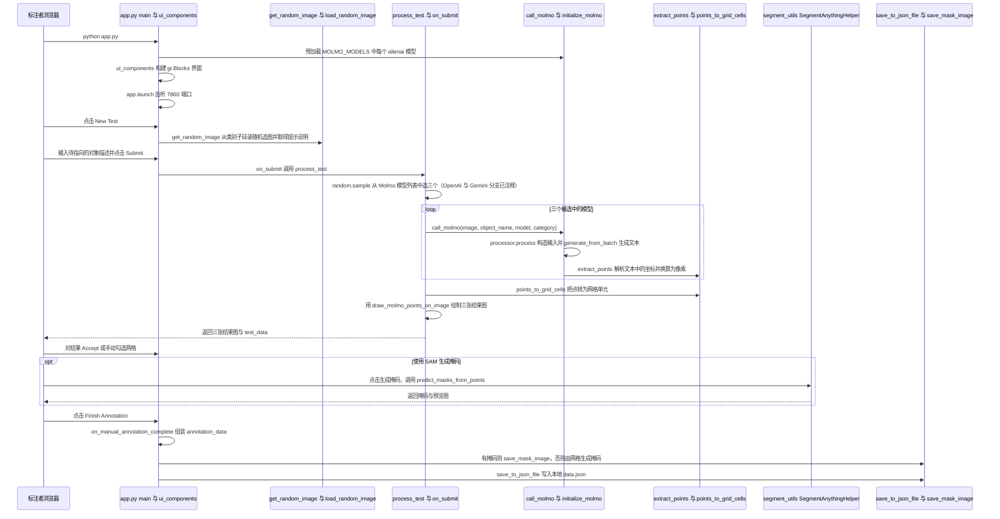

# PointArena

**PointArena**（[arXiv:2505.09990](https://arxiv.org/abs/2505.09990)，[项目页](https://pointarena.github.io/)，[代码](https://github.com/pointarena/pointarena)）是 **University of Washington** 与 **Ai2** 提出的 **语言引导 pointing** 评测：把 multimodal grounding 落到「能否在图像上指出语言所指」这一可审计接口。

## 一句话定义

**PointArena 用 pointing 当探针——测的不是 VQA 答对率，而是语言是否在像素级落地。**

## 英文缩写速查

| 缩写 | 英文全称 | 简要说明 |
|------|----------|----------|
| MLLM | Multimodal Large Language Model | 多模态大语言模型 |
| VQA | Visual Question Answering | 视觉问答 |
| ER | Embodied Reasoning | 具身推理；与 LightNav-ER Point-Bench 同族能力 |
| Ai2 | Allen Institute for AI | 共同作者机构 |

## 为什么重要

- **Pointing 是机器人接口：** 导航/操作常需「指哪里抓/走」；PointArena 给 MLLM 统一竞技场。
- **与 ER 评测互补：** [Point-Bench](./er-point-bench.md) 在 LightNav-ER 套件内测点定位；PointArena 面向更广 MLLM grounding 横评。
- **开源可复现：** `pointarena/pointarena` 发布评测代码与 leaderboard 基础设施。

## 核心信息

| 项 | 内容 |
|----|------|
| **类型** | benchmark / leaderboard |
| **机构** | UW + Ai2 |
| **开源** | **已开源** [pointarena/pointarena](https://github.com/pointarena/pointarena) |

## 结论

**PointArena 把「语言→像素/点」单独拉成 benchmark，适合筛 VLM 是否具备可部署的空间 grounding。**

- pointing 是比 bbox/VQA 更细粒度的 grounding 探针
- 与 RoboPoint affordance keypoint、RoboRefer 空间指代形成「点→区域→指代推理」谱系
- 开源仓库支持 leaderboard 式横评
- 读分时应区分 2D 图像 pointing 与 3D/度量指代（见 RoboRefer）

## 源码运行时序图

入口：`python app.py`（Gradio 标注与评测界面，默认 `0.0.0.0:7860` 并以 `share=True` 启动；`model_evaluator.py`、`molmo_evaluator.py`、`batch_annotate.py` 等批处理入口未画）

图依据：pointarena/pointarena@16dab31，读过 README.md（Installation 与 Usage 命令段）、app.py（入口、ui_components 的按钮绑定、process_test、call_molmo、on_submit、on_manual_annotation_complete、save_to_json_file 等关键段）。未运行代码，未加载 Molmo 权重。

## 关联页面

- [Point-Bench（LightNav-ER）](./er-point-bench.md)
- [RoboPoint](./paper-robopoint.md)
- [RoboRefer](./paper-roborefer.md)
- [空间推理 benchmark 地图](../overview/spatial-reasoning-benchmarks-technology-map.md)
- [具身大模型评测基准选型闭环](../queries/embodied-eval-benchmark-selection-loop.md) — 本页归其 ① 认知评测层：pointing 精度评测，指点正确 ≠ 下游抓取成功

## 参考来源

- [pointarena_arxiv_2505_09990.md](../../sources/papers/pointarena_arxiv_2505_09990.md)
- [pointarena.md](../../sources/sites/pointarena.md)
- [pointarena-pointarena.md](../../sources/repos/pointarena-pointarena.md)
- 源码核对（2026-11-02）：pointarena/pointarena@16dab31，读过 README.md、app.py；时序图依据以上文件，未运行代码。

## 推荐继续阅读

- [PointArena 项目页](https://pointarena.github.io/)
- [arXiv:2505.09990](https://arxiv.org/abs/2505.09990)
