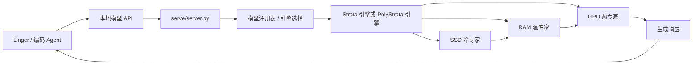
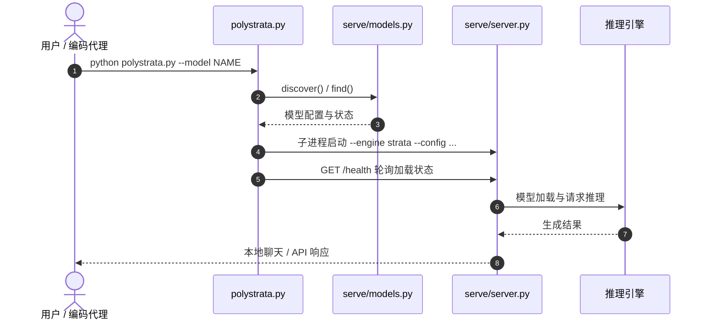

# PolyStrata：分层专家缓存的本地 MoE 推理框架

项目源码：[simplexai-labs/PolyStrata](https://github.com/simplexai-labs/PolyStrata)。它不是完整 Personal Agent；官方明确在部分模型上使用 [Niko1221/Strata](niko-strata-local-inference.md) 原有引擎。

## 一句话定义

通过 MoE 专家按使用热度跨 GPU 显存、系统 RAM 与 SSD 的分级加载，为桌面模型与编码代理提供本地推理服务。
## 英文缩写速查

| 缩写 | 英文全称 | 简要说明 |
|---|---|---|
| MoE | Mixture of Experts | 只激活部分专家网络的模型架构 |
| GPU | Graphics Processing Unit | 缓存热专家并执行运算 |
| RAM | Random Access Memory | 系统内存，保存温专家或离卡参数 |
| API | Application Programming Interface | 应用/Agent 调用推理服务的接口 |

## 为什么重要

MoE 模型的总权重可显著大于单张消费级显卡显存。PolyStrata 尝试将低频专家放在 RAM/SSD，从而让编码 Agent 在本机使用更大的模型；这解决的是推理存储层级问题，而不是 Agent 记忆或任务规划。

## 核心机制

- **热/温/冷专家**：常用专家优先放入显存，其余驻留 RAM/SSD 并按使用行为调度；硬件可承载的模型总参数量不等于实时显存。
- **双引擎边界**：README 明确 Qwen3.8-Flash-Next 走 Strata 项目的引擎，其余若干受支持模型走 PolyStrata 自身实现。
- **应用分工**：PolyStrata 提供模型服务；Linger 上层负责 Agent 编排、记忆、权限与电脑操作。
- **证据边界**：官方速度截图是指定设备与模型组合，不代表统一性能保证。

## 流程总览

## 源码运行时序图

已核对 `polystrata.py`、`serve/models.py`、`serve/server.py` 入口目录及参数：

`polystrata.py` 也能连接已运行的服务并执行模型切换；上图是**尚未运行本地服务时**的入口分支，不代表所有参数路径。

## 工程实践

- 使用官方 `polystrata.py --list-models` 核验已安装模型；按 README 的安装步骤准备权重及服务。
- 本地聊天或基准测试可通过 `polystrata.py --model <name>` 与 `polystrata.py benchmark --model <name>` 触发。源码会先探测本地服务状态，没有可用服务时才启动新进程。
- 测试需同时记录显存占用、RAM、SSD IO、首次加载延迟与稳定 token/s；保持模型版本、量化格式与上下文长度一致，避免单凭标称总参数量判断性能。

## 局限与选型

本机资源足以存放模型，不等于有足够内存带宽达到宣传吞吐。需确认 SSD IO、显存、量化、模型许可证及每秒 token 实测。多引擎适配仍有模型支持边界，不能无条件替代通用推理后端。

## 关联页面

- [Coding Agent 验证闭环](../methods/coding-agent-verification-loops.md) — 本地大模型产生代码后仍需独立执行测试，吞吐高不等于任务通过率高。
- [Claude Code 动态工作流](../methods/claude-code-dynamic-workflows.md) — PolyStrata 是可供工作流调用的模型服务，不承担多 Agent 编排。
- [Strata（Niko）推理引擎](niko-strata-local-inference.md) — 复用关系。
- [Linger（SimplexAI）](linger-simplexai.md) — 上层任务编排、电脑执行和记忆系统。
- [Agent 记忆与 dreaming](../concepts/agent-memory-and-dreaming.md) — 推理与持久知识系统的边界。

## 参考来源

- [官方 README 和启动脚本归档](../../sources/repos/simplexai-labs-polystrata.md)

## 推荐继续阅读

- [PolyStrata 官方源码](https://github.com/simplexai-labs/PolyStrata) · [Linger 个人代理](https://github.com/simplexai-labs/linger)。
