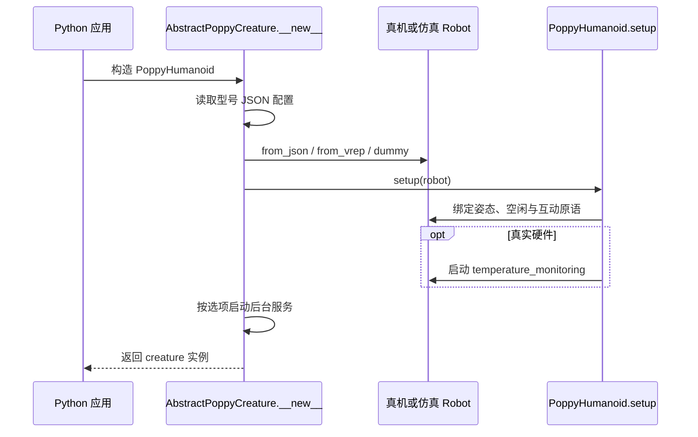

# Poppy 开源机器人平台

## 一句话定义

**Poppy** 是由 **法国 Inria** 相关社区推动的 **开源 3D 打印机器人** 家族：包含 **Poppy Humanoid**、**Poppy Torso**、**Ergo Jr** 等模块；门户在 **[poppy-project.org](https://www.poppy-project.org/en/)**，手册在 **[docs.poppy-project.org](https://docs.poppy-project.org/en/)**，源码在 **[poppy-project](https://github.com/poppy-project)**。

## 英文缩写速查

| 缩写 | 英文全称 | 简要说明 |
|------|----------|----------|
| STL | Stereolithography (3D model file) | 3D 打印常用的三角网格模型文件格式 |
| BOM | Bill of Materials | 装配所需物料清单 |
| LFS | Large File Storage | 官方 CAD 仓库使用的大文件版本存储 |

## 为什么重要

- **教育 / 创客基线**：以 **Dynamixel 舵机 + Python** 为主轴，适合作为 **机器人学课程硬件锚点**。
- **软硬件一体**：硬件 STL 与软件栈同源分发，便于 **课堂复现**。

## 开源入口（策展摘录）

| 类型 | 链接 |
|------|------|
| 官网 | [poppy-project.org](https://www.poppy-project.org/en/) |
| 文档 | [docs.poppy-project.org](https://docs.poppy-project.org/en/) |
| GitHub 组织 | [github.com/poppy-project](https://github.com/poppy-project) |

## 许可与 CAD 获取

[Poppy Humanoid 官方 README 复核](../../sources/repos/open-robot-hardware-entry-review-2026-11-15.md)区分 **硬件 CC BY-SA 4.0** 与 **软件 GPLv3**，不能合写为单一许可。SolidWorks 等 CAD 使用 Git LFS，应取 Release 文件或正确拉取 LFS 对象，普通网页下载可能只得到指针；安装示例不等于已验证所有 Python、板卡与舵机组合。

## 核心原理

Poppy 将可打印本体、舵机与配置驱动的软件分层。以 Humanoid 为例，pypot 的 creature 工厂读 JSON 配置，选择真机或仿真后端，再由 `PoppyHumanoid.setup` 绑定姿态、互动和监控原语；Torso 与 Ergo Jr 各有自己的形态与配置。

## 源码运行时序图

## 工程实践

先选具体型号和 BOM，获取正确 CAD/LFS 对象，再核对舵机、控制板、JSON 配置和软件版本。先用 dummy/仿真检查调用路径，再单独验证真实电机与读数；仿真初始化成功不能证明实物装配和零位正确。本页运行路径依据[官方源码通读](../../sources/repos/poppy-humanoid-runtime-reading-2026-11-15.md)，没有执行硬件动作。

## 局限与风险

- Humanoid 的启动文档含历史镜像与 V-REP 流程，不能据此保证当前 Python/操作系统组合开箱兼容。
- `TemperatureMonitor` 默认发声音和打印告警；并未提供整机自动停机保证。`LimitTorque` 虽绑定但默认启动被注释。
- 打印件、舵机及装配误差影响本体表现；教育平台的开放资料不等于现代动态人形控制能力已经具备。

## 关联页面

- [人形机器人](./humanoid-robot.md)
- [模仿学习](../methods/imitation-learning.md)
- [机器人开源宝库（微信策展第02期）索引](../overview/robot-open-source-wechat-issue02-curator.md)
- [Robot Software System Integration · 机器人软件系统集成](../methods/robot-software-integration.md)：了解 Poppy 通过 pypot 配置驱动分层连接舵机硬件、仿真后端与上层 Python 服务的软件集成模式。

## 推荐继续阅读

- Poppy 文档中 **Getting started / Assembly**（以当前站点版本为准）

## 参考来源

- [官方技术文档与运行入口通读](../../sources/repos/poppy-humanoid-runtime-reading-2026-11-15.md)。

- [官方硬件文档与入口复核](../../sources/repos/open-robot-hardware-entry-review-2026-11-15.md)

- [wechat_jixie_robot_open_source_treasury_issue02_10_robots.md](../../sources/blogs/wechat_jixie_robot_open_source_treasury_issue02_10_robots.md)
- [wechat_githubstore_18_open_source_robot_projects.md](../../sources/blogs/wechat_githubstore_18_open_source_robot_projects.md)（GitHubStore 18 个开源项目清单收录；索引见 [机器人开源项目 18 例](../overview/robot-open-source-wechat-githubstore-18-projects.md)）
