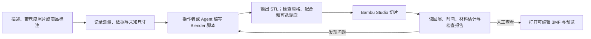
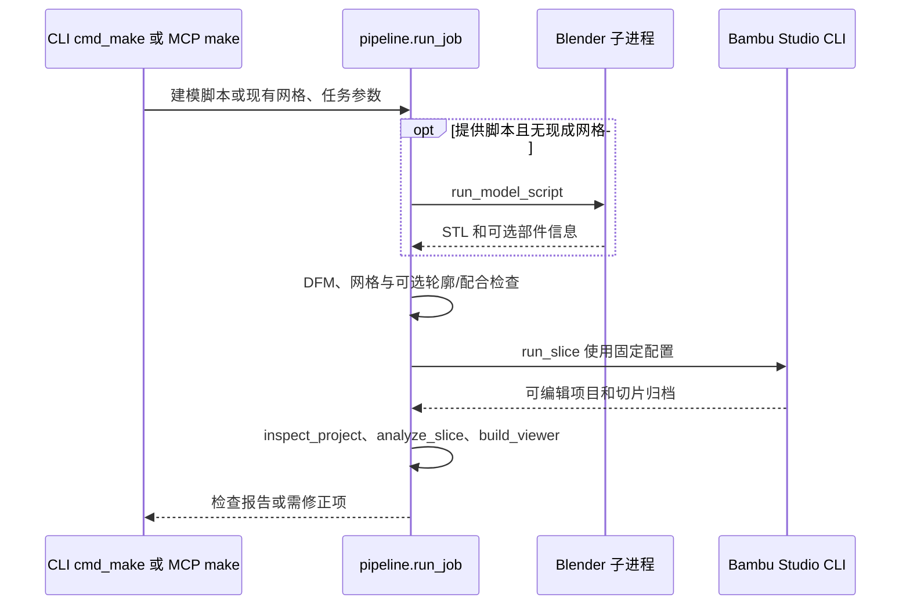

# print3d v0.1.0: Local Modeling-to-Slicing Workflow | 本地建模与切片验证流程

## 一句话定义

print3d 是面向 Bambu Lab X2D（0.4 mm 喷嘴）的本地 CLI 和 Agent 工具：它执行现成或由 Agent 编写的 Blender 建模脚本，检查网格及可选的照片轮廓，调用 Bambu Studio 切片，再交付**人工复核**的工程文件。

## 英文缩写速查

| 缩写 | 英文全称 | 简要说明 |
|---|---|---|
| DFM | Design for Manufacturing | 面向制造的检查 |
| MCP | Model Context Protocol | Agent 调用工具的接口 |
| IoU | Intersection over Union | 此处比较投影轮廓的交并比 |
| 3MF | 3D Manufacturing Format | 三维制造项目或切片结果容器 |

## 为什么重要

对于外壳、旋钮、线缆固定件等机器人样件，生成网格只解决第一步。照片尺度可追溯、悬垂或配合可检查、切片与预估可读，才便于决定是否值得打样。

## 核心机制

参考照的二维比例并不能确定看不到的孔径或厚度；用 `spec.json` 区分量得、用户给定或假设的尺寸。商品 URL 仅记录，工具本身不抓取页面。轮廓 IoU 检查投影相似度，不等同于材料性能或配合精度。

## 源码运行时序

这里画的是实际切片路径。仅 `check` 无需切片，`--dry-run` 不运行切片器，但不是禁止写文件或执行脚本的沙盒。

## 工程实践

- 需要 Blender 4.2+、Bambu Studio 和 uv。标签固定的目标是 X2D、0.4 mm 喷嘴、0.20 mm 标准配置和 PLA Basic。其他设备/材料的效果需要另行验证。
- 审查时用 `slice/<slug>.3mf` 打开 Studio；同目录的 `.gcode.3mf` 用于读取已切片结果，不能当 Prepare 页的编辑项目。没有自动把任务发送给打印机。
- 照片复刻应记录尺标、拍摄视角和未知量；装配件先做配合样片测量打印机实际留隙，再决定模型参数。
- Blender 脚本以本机账户权限运行。先审阅脚本，再在受控环境执行；`setup --dry-run` 可先查看 Agent 配置改动。网页预览首次打开可能从 CDN 加载 three.js。

## 局限与风险

几何和切片检查不能确认刚度、疲劳寿命或真实装配。上游木夹基准的轮廓重合约 90%、切片估计 49 分钟/7.2 g，并不保证长细打印件不倾倒、也没有复刻金属弹簧。承载、扭矩传递与安全相关零件需单独验证。

## 关联页面

- [文本到 CAD](../concepts/text-to-cad.md)：对照生成 B-rep 与复核制造网格的区别。
- [CAD Skills](./cad-skills.md)：STEP/参数化建模交付的邻近方案。
- [Coding Agent 验证闭环](../methods/coding-agent-verification-loops.md)：复用检查证据驱动修补。
- [Agent 驱动的混沌压测闭环](../methods/agent-driven-chaos-testing-loop.md)：对照发现问题、修正、复验的模式，而非同类打印工具。

## 参考来源

- [v0.1.0 版本与源码归档](../../sources/repos/mfranzon-print3d.md)

## 推荐继续阅读

- [官方发布说明](https://github.com/mfranzon/print3d/releases/tag/v0.1.0)
- [固定版本 README 与操作示例](https://github.com/mfranzon/print3d/blob/v0.1.0/README.md)
