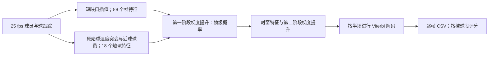
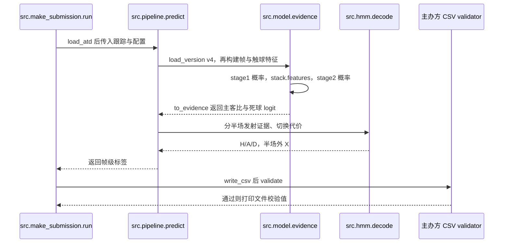

# 404 Possession Not Found: Frame-Level Ball Possession | 足球控球权的帧级标注

## 一句话定义

404 Possession Not Found 是 More than a Hack 2027 第一阶段的参赛方案：在不重训比赛视频检测器的情况下，从主办方提供的球员与球跟踪数据推断每个时刻的主队控球、客队控球或死球。

## 英文缩写速查

| 缩写 | 英文全称 | 简要说明 |
|---|---|---|
| ATD | Automatic Tracking Data | 主办方生成的自动跟踪 |
| GBDT | Gradient-Boosted Decision Trees | 两阶段分类的核心 |
| HMM | Hidden Markov Model | 用帧证据和状态切换代价定义路径 |
| IoU | Intersection over Union | 时间交并比；用于控球段匹配 |

## 为什么重要

主办方报告战术机位**被评分帧中约 41% 缺球**。只找离球最近的球员会在这些时刻失效；仅提升逐帧分类也可能因短暂抖动把一次完整球权切成好几段。这个例子把缺失观测下的分类证据和时间连贯性作为两个独立问题。

| 机构 | 独立参赛队 404 Possession Not Found；赛事由 Metrica Sports、Barça Innovation Hub 与 Mobile World Capital Barcelona 组织 |
|---|---|

## 核心机制与组件结构

- **跟踪 → 证据：** 对短球缺口插值，长缺口保留缺失线索；89 个帧特征覆盖双方队形、运动、与球的相对关系和局部时窗，再加入 18 个基于原始球轨迹的触球特征。触球线索不直接等于取得控制。
- **两级分类：** 第一层给 H/A/D 概率，第二层聚合其邻近帧概率及特征，使用过去和未来信息。推断对主客互换两次打分，交换标签后平均，不让主客身份天然加分。
- **有代价的状态切换：** 将概率转成发射分数，按半场跑三状态 Viterbi。发布参数为主客切换代价 9、活球与死球切换代价 48。短暂争抢未构成控制时不轻易变更标签；死球隔开控球段。半场外写 X，并不在场内用 X 跳过困难样本。

## 流程总览

## 工程实践

用整场而不是随机帧留出验证，避免重叠时间窗泄漏；同时跟踪逐帧 macroF1 和控球段 spellF1。后者把同一队连续 H 或 A 的片段当一个对象，以时间 IoU 0.3/0.4/0.5/0.6/0.7 一对一匹配，各阈值 F1 再平均。不要用公开比赛五分钟标签调参，也不能期待这条含未来帧和整半场解码的流程原样用于实时机器人控制。

## 源码运行时序图

按公开固定提交 `ead83bb` 的默认 v4 路径，权重已拟合，不在提交生成时训练。CLI 即使读取自动事件提示，模型分支只使用自动跟踪；Smart Tagging 规则分支不在此图。

## 实验与评测

| 口径 | 结果 | 边界 |
|---|---|---|
| 10 场外部比赛、合成降质、五折按整场留出 | v3 0.608 → v4 **0.667 spellF1**；macroF1 0.888 → 0.911 | 每折训练另 8 场；同折比较 4 个候选，非无偏独立确认 |
| 少于 5 秒的控球段恢复 | 27.8% → 36.2% | 同一外部验证；错误直接主/客切换同时增加 8.6% |
| 赛后参赛队自述 | 0.553；官方基线 0.2433 | 另一个比赛口径，未复核正式榜单，不是上表外部 0.667 |

## 与其他工作对比

相较于主办方的最近球员加平滑基线，该方案纳入缺球时仍可用的队形证据，并显式约束片段边界。外部验证的 v3 与 v4 对比则同时更换了训练数据和触球特征，不能把 0.059 的总差额归给单一组件。主办方 0.2433 是比赛数据上的基线，也不拿它直接与外部 0.667 做倍数换算。

## 局限与风险

- 长时间遮挡、虚假球点和身份碎片并非简单随机丢失；模拟降质与比赛真实误差不同，少数比赛上的平均也不证明跨联赛稳定性。
- 合成输入的 7 项解码测试通过只验证解码性质；未拿授权输入跑整场，也未复现权重训练或隐藏榜单。队伍代码公开可读，未见明确开源许可证；比赛数据另有条款。

## 结论

可借用的是**有观测时提取证据、缺观测时保留不确定性、再按目标片段指标做解码与验证**。移植到机器人足球，先把第三人称整场输入换成实际可获观测，再另验在线时延与因果解码。

## 关联页面

- [自动标注流水线](../methods/auto-labeling-pipelines.md)：弱观测到下游标签。
- [人形机器人足球](../tasks/humanoid-soccer.md)：仅作离线分析对照，不提供控制策略。
- [状态估计](../concepts/state-estimation.md)：观测证据与时间连续性。

## 参考来源

- [参赛报告、固定源码与主办方评分归档](../../sources/repos/404-possession-not-found.md)

## 推荐继续阅读

- [参赛技术报告](https://github.com/rodrifdezz/404-Possession-Not-Found/blob/ead83bb0c9d9e1ee844a6aab5fa9ddcfb0937fb5/docs/TECHNICAL.md)
- [主办方评分协议](https://github.com/metrica-sports/more-than-a-hack-2027/blob/main/EVALUATION.md)
