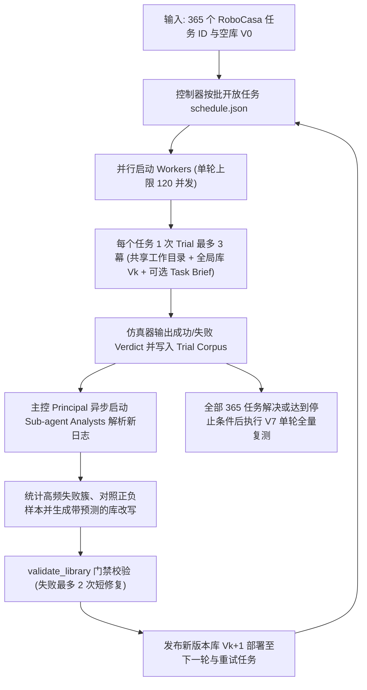

# Physical RSI on RoboCasa

## 一句话定义

STACX Lab 提出的一种面向技能的递归自改进（Physical RSI）具身智能体框架：保持底层控制器与基座模型权重冻结，通过独立的主控自改进技能异步总结并行试验日志，持续重写并门禁验证 Markdown 领域技能与 `rc` Python 控制函数库，在 493 幕内累计解决全部 365 个 RoboCasa 厨房任务。

## 英文缩写速查

| 缩写 | 英文全称 | 简要说明 |
|---|---|---|
| RSI | Recursive Self-Improvement | 递归自改进；系统从自身运行记录中持续改写执行技能与辅助函数 |
| IK | Inverse Kinematics | 逆运动学；`rc.ik` 通过多种子回退将末端目标位姿解算为机械臂关节角 |
| TCP | Tool Center Point | 工具中心点；如 Franka Panda 夹爪末端控制坐标系 |
| DOF | Degree of Freedom | 自由度；机械臂、移动底盘或厨房铰接部件的运动轴数 |
| LLM | Large Language Model | 大语言模型；本项目中工作智能体与主控分析器均基于 `Claude Opus 5.5` |
| API | Application Programming Interface | 应用程序接口；本项目以 Python 代码作为统一技能调用接口 |

## 为什么重要

在机器人操作与家务长程任务中，通用大模型常因缺少特定平台运动学常识、视觉深度盲区（如透明容器或冰箱门储物格）以及重复调试底层脚手架而消耗大量时间与交互轮次；而端到端微调模型权重又面临成本高、迭代慢的问题。Physical RSI 证明了一条不改写模型权重、而将试错经验编译为可验证代码库与可复用技能文档的路径：借鉴操作系统微内核与冯·诺依曼通用构造器思想，将“自改进器”本身定义为可被改写的技能之一，从而避免“谁来改进改进器”的无限递归，使通用编码智能体在复杂仿真厨房基准上实现快速、可回滚的能力积累。

## 核心信息

| 字段 | 内容或状态 |
|---|---|
| 作者 | Rushi Qiang, Huijie Tang, Chenxiao Gao, Yizhou Zhao, Changhao Li, Na Li, Bo Dai |
| 机构 | STACX Lab（Georgia Tech CSE；Bo Dai 兼任 Google DeepMind；Na Li 隶属 Harvard SEAS） |
| 发表时间 | 2026 年 10 月（配套架构文章《Who Improves the Improver?》；项目页统计 run `S365best`） |
| 论文链接 | [Physical RSI on RoboCasa 项目页](https://stacx-lab.github.io/physical-rsi/)；[配套架构文《Who Improves the Improver?》](https://stacx-lab.github.io/blog/who-improves-the-improver/) |
| 项目与代码 | [项目页](https://stacx-lab.github.io/physical-rsi/)；底层通用机器人编码框架 [Kinex](https://kinex-agent.org/) 另行发布 |
| 清单分类 | `harness.skills`（来源条目：`project_physical_rsi_robocasa`） |
| 开源状态 | 未开源完整运行仓库（项目页仅提供交互式结果与最终 `V7` 的 70 个 `rc` 辅助函数静态代码展示，未公布控制循环与蒸馏主控源码） |

## 核心原理

1. **“一切皆技能”的微内核架构（阻断无限递归）**
   配套文章《Who Improves the Improver?》将智能体拆分为两层：
   - **固定核心（Primitive Agent / Controller）：** 仅保留不可改写的极简主循环（读取观测 → 调用模型 → 执行返回 → 记录仿真器判定），不包含厨房、机器人或任务知识。核心不变保证了即使技能改写出错，系统仍可运行并回滚版本。
   - **可改写技能层（Skills）：** 包括任务技能、上下文管理、技能加载与**自改进技能（Self-improving Skill）**本身。由于自改进器也是技能之一，它既能改写领域技能与控制代码，也能改写自身的分析/编码提示，从而以类似冯·诺依曼“固定构造器 + 可改写蓝图”的结构切断无限递归，无需向上叠加更高层监控智能体。
2. **代码作为统一技能接口与三态转换**
   - 所有技能均暴露统一 Python 调用接口，但底层可以是三类实现之一：**书面指令（Markdown 技能文档）**、**固定代码（`rc` Python 确定性函数）**或**子智能体（Subagents）**。
   - 初期未知边界条件多、需模型临场推理的能力以 Markdown 文档承载；一旦在多轮试验中沉淀为稳定模式，主控便将其提升（lift）为确定性 Python 函数写入 `rc` 包以降低延迟与失败率；当调用方依赖同一接口名时，底层形态切换对调用方透明。
3. **三层经验共享作用域与并行双循环**
   系统在运行时将经验划分为三个作用域：
   - **单次试验工作目录（Working Directory，episode → episode）：** 同一任务在单轮内最多执行 `3` 幕（同一固定初始场景），工作智能体自写脚本、辅助函数与备忘录（`## For the library`）在同任务后续幕之间保留。
   - **任务简报（Task Brief，trial → trial）：** 对本轮仍失败的未解决任务，主控生成含已知可行子步骤与 `Step-k` 变体的定向简报，供下一库版本重试使用。
   - **全局技能库 `Vk`（Global Library，task → task）：** 所有任务共享 `rc` 包、Markdown 领域技能及不超过 `15` 行的通用 brief。
   运行时控制器将**工作智能体试验（Workers）**与**主控蒸馏（Principal）**作为独立进程并行启动，主控不必等待所有工作智能体结束即可基于已入库记录启动蒸馏分析。
4. **基于证据统计与预测裁决的蒸馏机制**
   主控会话执行五步固定协议：
   - **子智能体逐幕解析：** 为每项产生新幕的任务派发独立子智能体分析员，将原始轨迹压缩为结构化单行记录。
   - **先验假设核查：** 将协议与现有库中的假设逐条对照真实运行记录（`Givens`）。
   - **按失败频次排序与可证伪预测：** 统计导致试验终止的失败簇，仅针对最高频原因修改技能或函数；每条修改必须绑定一条编号预测，并在下一轮新数据上被裁决为 `KEPT`、`REFUTED`、`NOT MET` 或 `VOID`。
   - **跨正负样本对比与单幕试验：** 修改前对比同类子目标成功与失败记录；未经验证的新改动先在单幕试行，有效后再纳入全局库。
   - **构建门禁（`validate_library`）：** 发布 `Vk+1` 前自动校验清单格式、技能结构与代码可编译性，若不通过最多触发 2 次短修复，否则保留 `Vk`。

## 流程总览

## 源码运行时序图

**不适用**（核查结果：截至 2026-11-27，官方项目页与 STACX Lab Projects 页面仅公开交互式结果展示及最终 `V7` 库中 70 个 `rc` 辅助函数的静态片段源码，未公布完整可运行的控制循环、主控蒸馏器与 RoboCasa 仿真评测仓库）。

## 实验与评测

以下数据全部核自项目页 `https://stacx-lab.github.io/physical-rsi/` 内嵌 `D` 数据集（Run ID：`S365best`）：

1. **实验配置与总体求解结果（无模型权重训练）**
   - **测试基准与机器人：** RoboCasa 全部 `365` 个厨房任务（`65` 个原子任务 + `300` 个复合任务），仿真机器人为移动底盘（Omron）+ Franka Panda 机械臂。
   - **基础模型与算力耗时：** 工作智能体与主控均采用 `Claude Opus 5.5`；单机运行总耗时 `95,531.6` 秒（约 `26.5` 小时，页面取整显示 `27 hours`），全程无模型训练。
   - **在线累计结果：** 在 `385` 次试验、共 `493` 幕（平均 `1.35` 幕/任务）内解决全部 `365 / 365` 个任务；其中 `305` 项在首次遭遇的第 1 幕即解决，`347` 项在首次试验（≤ 3 幕）内解决，其余 `18` 项在后续版本重试中解决。

2. **迭代演进轮次明细（`V0` → `V7`）**

| 版本 | 蒸馏耗时 / 子智能体数 | 新开任务数（原子） | 新任务解决（首幕） | 重试任务→解决 | 本轮总幕数（分/幕） | `rc` 函数数 / 代码行数 | 领域技能数 / 行数 | 预测裁决（保留/推翻/未达标/作废） |
|---|---|---|---|---|---|---|---|---|
| `V0`（Batch 1） | — / 0 | 10（1） | 10（9） | 0 → 0 | 11（14.3） | 0 / 0 | 0 / 0 | — |
| `V1`（Batch 2） | 57 min / 13 | 20（19） | 19（18） | 0 → 0 | 23（16.9） | 40 / 982 | 4 / 307 | 首轮提出 9 条预测 |
| `V2`（Batch 3） | 96 min / 26 | 40（33） | 40（39） | 1 → 1 | 42（16.0） | 47 / 1,260 | 5 / 502 | KEPT 5 / REFUTED 3 / NOT MET 1 |
| `V3`（Batch 4） | 132 min / 25 | 80（12） | 75（68） | 0 → 0 | 99（23.1） | 55 / 1,536 | 5 / 803 | KEPT 6 / NOT MET 2 / VOID 1 |
| `V4`（Batch 5） | 70 min / 39 | 160（0） | 149（123） | 5 → 5 | 223（27.7） | 57 / 1,681 | 6 / 1,234 | KEPT 4 / NOT MET 2 / REFUTED 1 |
| `V5`（Batch 6） | 124 min / 48 | 55（0） | 54（48） | 11 → 10 | 88（25.0） | 62 / 1,966 | 6 / 1,399 | KEPT 5 / REFUTED 2 / NOT MET 3 |
| `V6`（重测） | 135 min / 40 | 0（0） | 0（0） | 2 → 1 | 5（37.6） | 69 / 2,276 | 6 / 1,387 | KEPT 6 / NOT MET 1 |
| `V7`（重测） | 72 min / 8 | 0（0） | 0（0） | 1 → 1 | 2（34.6） | 70 / 2,321 | 6 / 1,411 | KEPT 4 / REFUTED 1 / NOT MET 2 |

3. **最终库 `V7` vs 空库 `V0` 单轮对照评测（相同 365 场景，每任务 1 次试验 / ≤ 3 幕）**

| 评测配置 | 首幕解决数 / 成功率 | 单次试验内解决数（≤ 3 幕）/ 成功率 | 总消耗幕数（幕/任务） |
|---|---|---|---|
| `V0`（空技能与函数库基线） | `252 / 365`（`69%`） | `325 / 365`（`89%`） | `545`（`1.49`） |
| `V7`（最终演化技能与函数库） | `309 / 365`（`85%`） | `354 / 365`（`97%`） | `444`（`1.22`） |

   - `V7` 复测明细：第 1 幕解决 `309` 项、第 2 幕解决 `33` 项、第 3 幕解决 `12` 项，仍有 `11` 项未在单次试验内通过（主要集中在窄间隙冰箱/冷冻室放置、多物体摆盘等任务，如 `task11-261-countertop-cleanup`、`task11-160-load-fridge-by-type`、`task11-185-maximize-freezer-space` 等）。

4. **最终 `V7` 知识库构成与调用统计**
   - **6 个领域 Markdown 技能（`1,411` 行）：** `robocasa-basics`（231 行）、`robocasa-pick-place`（243 行）、`robocasa-doors`（236 行）、`robocasa-controls`（224 行）、`robocasa-navigate`（242 行）、`robocasa-appliances`（235 行）。
   - **70 个 `rc` Python 函数（`2,321` 行，封装于 `2,338` 行的 `rc-code` 技能中）：** 按功能分为 `frames and rotations`（13）、`perception`（10）、`offline planning`（9）、`state, budget, reporting`（8）、`arm motion`（8）、`gripper, pick and place`（8）、`contact and pushing`（7）、`base and odometry`（7）。来源构成：`V1` 初始创建 `40` 个、由工作智能体定义同名提升 `20` 个、主控直接编写 `7` 个、工作智能体定义异名重命名提升 `3` 个。
   - **实际调用覆盖：** 在使用 `rc` 的 `375` 次试验中共产生 `114,281` 次函数调用，实际调用了 `70` 个函数中的 `61` 个（高频调用包括 `capture` 14,030 次、`state` 13,060 次、`move_tcp` 12,378 次、`cloud` 9,033 次、`ik` 8,354 次）。

## 与其他工作对比

- **对比空库基线 `V0`：** `V7` 在相同 365 个场景上将首幕成功率从 `69%`（252/365）提升至 `85%`（309/365），单次试验成功率从 `89%`（325/365）提升至 `97%`（354/365），并将总交互幕数由 `545` 压缩至 `444`。
- **对比 Gödel Machine 与 Darwin Gödel Machine（DGM）：** 两者将程序视为整体，分别依赖形式化可证性或外部基准分数来防止改写破坏自身；Physical RSI 采用冯·诺依曼构造器/蓝图拆分，通过冻结极简循环核心在结构上隔离风险，且允许技能层内的自改进器自由重构而不会弄瘫控制循环。
- **对比开源编码智能体 Pi 与 Kinex：** Pi 虽具备极简循环与 `SKILL.md`/TypeScript 扩展机制，但上下文压缩与技能检索写死在核心内、指令与代码调用路径不统一，且缺乏自动跨运行蒸馏技能；Kinex 基于 Pi 增加了人工触发的 `reflect` 技能，而 Physical RSI 补齐了自动异步主控、统一代码接口、预测裁决与门禁发布闭环。
- **对比传统 VLA / RL 策略训练：** 传统方法将技能内化到神经网络权重中，训练周期长且失败原因难以审计；Physical RSI 冻结基础模型权重，将经验沉淀为可读可审计的 Markdown 规范与结构化几何/控制原语（架构文章亦指出二者可分别作为“快内环”与“慢外环”协同）。

## 结论

**一句话总判：Physical RSI 在 RoboCasa 365 基准上验证了一条不训练模型参数、仅靠异步演化技能文档与 Python 控制原语即可持续提升具身操作成功率的技术路线，并给出了避免自改进无限递归的工程化微内核范式。**

1. **采用“极简固定循环 + 全外置技能”隔离风险：** 将领域知识、上下文裁剪、技能检索与自改进器全部移出核心，配合 `validate_library` 编译与结构门禁，确保局部改写失败可快速发现与回滚。
2. **用统一代码接口承接“指令 → 函数 → 子智能体”演化：** 先用 Markdown 覆盖高不确定性步骤，再把高频稳定流程提升为 `rc` 确定性函数，兼顾灵活性与执行速度。
3. **坚持“基于失败计数排序 + 可证伪预测裁决”：** 拒绝拍脑袋堆砌提示词，要求每项库变更针对最高频终止原因并接受下一轮新数据的 `KEPT`/`REFUTED` 检验，避免无效规则膨胀。
4. **工程落地需同步关注窄间隙与深度盲区边界：** 即便在 `V7` 版本，单轮复测仍有 `11 / 365` 项未过，集中于透明/反光部件与仅约 1–3 cm 裕量的冰箱层架插放，实际部署需结合视觉触觉或更精细碰撞几何约束。

## 工程实践

- **非阻塞并发调度：** 控制器同时运行工作容器（最多 120 并发）与异步主控，使主控可以在部分批次已完成的日志上提前分析、精简和重写库文件，避免嵌套调用导致的串行等待。
- **确定性保护写进控制原语：** 演进日志显示，大量早期失败来自几何估算偏差、抓滑与自碰撞（如打开/关闭双开门时碰合另一扇门、透明表面缺深度）；主控通过为 `rc.ik` 增加多种子回退、为 `rc.move_tcp`/`rc.rotate_about` 增加位置到达与手指滑移检测（输出结构化 `RC {...}` JSON），把常见物理失败从“长提示词警告”转化为“机器可读的运行时错误码”。
- **控制核心简报体积：** 主控将全局简报严格压缩至 `15` 行左右，并利用 `schedule.json` 动态调整任务批次顺序，避免过长系统提示挤占工作智能体上下文。

## 局限与风险

1. **未实现模型权重更新外环：** 架构文章明确提出“内环改技能 + 外环训模型”双环设想，但 RoboCasa 365 实验全程冻结基础模型权重（`Claude Opus 5.5`），长期泛化与视觉-控制端到端提速仍受限于基座模型能力。
2. **代码库膨胀与可维护性挑战：** 作者在架构文章 §6.5 坦承，持续自我重写可能使技能间依赖日趋复杂，尽管要求代码显式调用与合并删重，目前仍需人工审查主控产出的变更，尚未实现全自动可读性保证。
3. **物理窄裕量与部分开源局限：** `V7` 复测仍有 `11` 个任务失败（`3%`），对深度传感盲区（如透明保鲜盒前板、冰箱门储物格）与厘米级窄间隙操作仍较脆弱；此外该项目尚未开源完整控制框架与蒸馏器源码，外部团队复现目前只能依据页面展示的架构规范与 `rc` 函数片段重新搭建（或结合开源的 [Kinex](https://kinex-agent.org/) 自行扩展）。

## 关联页面

- [Agentic Robots 综述](paper-towards-agentic-robots-survey.md)
- [全量项目节点清单](../overview/awesome-agentic-robots-node-index.md)
- [VLA 方法背景](../methods/vla.md)
- [Robot Agent Harness · 机器人智能体执行框架](../methods/robot-agent-harness.md)
- [Agent Skill Packaging · 智能体技能封装](../methods/agent-skill-packaging.md)
- [Coding Agent Verification Loops · 编码智能体验证闭环](../methods/coding-agent-verification-loops.md)
- [Agentic Manipulation Policies · 智能体化操作策略](../methods/agentic-manipulation-policies.md)
- [Manipulation · 机器人操作](../tasks/manipulation.md)
- [Loco-Manipulation · 移动操作](../tasks/loco-manipulation.md)

## 推荐继续阅读

- [Physical RSI on RoboCasa 官方交互式项目页](https://stacx-lab.github.io/physical-rsi/)
- [Who Improves the Improver?（STACX Lab 架构深度长文）](https://stacx-lab.github.io/blog/who-improves-the-improver/)
- [Kinex：基于 Pi 构建的通用具身编码智能体框架](https://kinex-agent.org/)

## 参考来源

- [Physical RSI on RoboCasa 原文核对归档](../../sources/papers/project-agentic-project-physical-rsi-robocasa.md)
- [官方 Awesome 快照归档](../../sources/repos/awesome-agentic-robots-survey-index.md)
- [Physical RSI on RoboCasa 官方项目页](https://stacx-lab.github.io/physical-rsi/)
- [Who Improves the Improver? 架构专文](https://stacx-lab.github.io/blog/who-improves-the-improver/)
