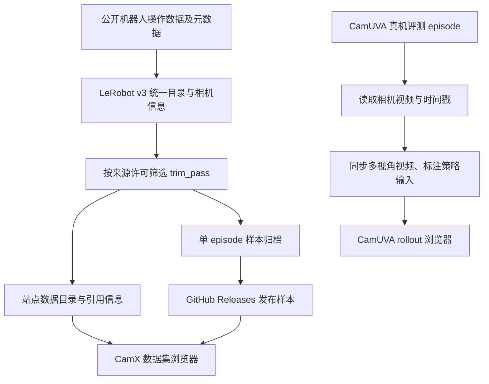
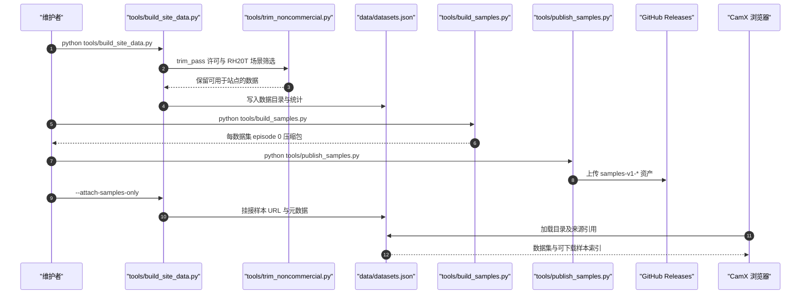

# CamX / CamUVA：17K 小时跨本体机器人操作数据与策略评测

## 一句话定义

**CamX（跨本体机器人操作数据集）**将不同机械臂、双臂、移动操作和手持采集的数据汇集为带相机信息的 LeRobot v3 数据目录；**CamUVA**是配套策略评测视频库。两个站点来自同一匿名研究主页，但**数据集网站源码不等于策略训练代码**。

## 英文缩写速查

| 缩写 | 英文全称 | 简要说明 |
|---|---|---|
| CamX | CamX（项目专名，官方未给出展开式） | 跨本体操作数据集及浏览站 |
| CamUVA | CamUVA（策略专名，官方未给出展开式） | 与 CamX 关联的策略评测展示 |
| URDF | Unified Robot Description Format | 示例视频可使用机器人夹爪几何进行相机投影 |
| VLA | Vision-Language-Action | 跨本体机器人策略的一类相关研究路线 |
| RGB | Red, Green, Blue | 样本与视频中的彩色图像流 |

## 为什么重要

不同公开操作数据的机器人形态、采样率、相机外参、任务语句和许可条件不一致，直接混合会引入不可复现的数据偏差。CamX 的价值在于统一组织跨数据源样本、保留许可和引用、展示相机—末端执行器几何关系；CamUVA 提供可查的真机 rollout 记录供定性审视，但不能取代完整训练代码或统计表复核。

## 核心信息与版本边界

| 维度 | 一手资料核对结论 |
|---|---|
| 主页 | [CamX / CamUVA](https://camx-anonymous.github.io/)；两个独立入口为 [CamX Dataset](https://camx-anonymous.github.io/camx-dataset/) 和 [CamUVA Rollouts](https://camx-anonymous.github.io/camuva-rollouts/) |
| CamX 当前站点口径 | 2026-10-30 的 data/pending.json：**65 个来源、20 种平台、2,900 个数据集、1,794,319 episodes、17,102.6 h**；这是经过许可筛选后的站点总量，**非已完整开放供下载的训练数据量** |
| 原论文附录口径 | 同一 JSON 备注称原附录仍计入非商业来源：70 个来源、24 个平台类别、4,469 个数据集、2,450,988 episodes、25,850.7 h；**这两组数字不可混作同一数据版本** |
| 开放状态 | CamX 站点、数据索引、样本打包/发布工具及公开的单 episode 样本；页面明确注明 **Full dataset upon official release**，不代表已发布完整数据 |
| CamUVA 开放状态 | 评测视频、metadata 与视频同步/脱敏生成工具；未核实到 CamUVA 的完整策略训练、权重或通用推理实现 |
| 研究归属 | 站点和两个仓库标识为匿名审稿版本；**不依据相似标题推定作者、机构、arXiv 编号或与其他 20K 小时研究同一性** |

## 核心原理

1. **源数据统一与选择**：以公开机器人操作数据为输入，在 CamX 的统一 LeRobot v3 目录下维护 episode、视频、任务文本、平台及相机元数据；站点通过按形态、平台、数据源分组的目录筛选。
2. **逐来源许可检查**：tools/trim_noncommercial.py 与 tools/build_site_data.py 对网站数据执行一致的许可裁剪；README 明确排除多个 CC BY-NC-SA 来源，并只统计 RH20T-C 的授权场景。原论文的聚合统计与网站可用子集因此不同。
3. **图像与几何质量审阅**：公开站点为样本展示原始视频与夹爪几何投影的对照，适用时使用 URDF/CAD；缺少内外参或几何的样本标注为 raw-only，不能把示意替身当原始机器人 CAD。
4. **数据样本交付**：每个可下载数据集以单一 episode 的 LeRobot v3 归档提供样本。用户在站点按所选数据源查看 license / BibTeX 并复制下载命令；全量训练数据不在此发布。
5. **CamUVA rollout 审阅**：另一官方仓库将每个测试 episode 的多相机流按时间戳同步到同一视频，明确标注哪些镜头是策略输入，哪些仅供第三方观察；记录的 success/failure 是发布方标签。

## 流程总览

以下依据两个官方 README、CamX 构建脚本与 CamUVA 展示代码整理；未把尚未核验的 CamUVA 策略训练内部模块画成既定事实。

## 实验与评测

CamUVA 站点源码将研究展示划分为 **in-distribution embodiment** 与 **cross-embodiment** 两种设置：前者以杯子排列、毛巾折叠、餐具入架、盒子摆放等任务对照专用策略；后者以倒水、翻杯、杯子入盒、香蕉入锅等任务观察在不同夹爪和相机配置上的迁移。其浏览器明确展示一个 CamUVA checkpoint，并用逐 episode 的成功/失败标签计算展示成功率。

**证据边界：**上述为官方展示页面的实验组织与数据字段，未重新独立运行策略、未核对原论文的完整对照与置信区间；演示视频不构成第三方复现实验。

## 结论

**CamX 的可复用价值主要在数据发现、相机几何审阅与来源许可管理；CamUVA 策略本体的可复现性仍需原论文和训练实现补证。**

1. 引用数据规模时说明是经过许可筛选的 17.1K h 站点版本，还是包含非商业来源的 25.85K h 附录版本。
2. 单 episode 样本只用于格式、时间轴、标定和输入接口预检，不能直接当作已开放完整训练集。
3. 对齐跨本体数据时检查各平台的相机内外参、动作语义、时间同步与任务文字，避免只看视频。
4. CamUVA 视频中第三视角通常不输入策略；不要把回放画面中的全部镜头假定为模型观测。
5. 代码复现先走公开的数据管理和视频打包入口；策略训练及权重需等待正式可核验材料。

## 源码运行时序图

已按公开 README 与相关脚本入口核对**数据发布流程**；这不是 CamUVA 模型的训练/推理调用链。

CamUVA 对应的是 tools/build_videos.py：读取原始 rollout、相机时间戳和 episode metadata，使用 ffmpeg 编码生成 videos/、posters/ 与 videos.json；index.html 再按任务/平台/策略展示。该流程**仅发布回放数据，不提供策略网络训练入口**。

## 工程实践

| 目的 | 官方入口 | 校验重点 |
|---|---|---|
| 了解样本可用性 | [CamX Dataset](https://camx-anonymous.github.io/camx-dataset/) | 浏览来源、许可、任务数量，选择可下载的单 episode |
| 本地构建目录（有原始数据前提） | python3 tools/build_site_data.py | 需要匹配数据目录与可选辅助元信息；并非空仓一键重建全量数据 |
| 构建与发布样本 | tools/build_samples.py → tools/publish_samples.py → --attach-samples-only | 发布 GitHub Releases 资产需维护者权限；站点样本链接需可访问 |
| 研究夹爪投影 | 原始/投影视频对照及样本的相机标定字段 | 对 raw-only、stand-in、局部坐标系分别标注不可判定之处 |
| 评测观察 | [CamUVA Rollouts](https://camx-anonymous.github.io/camuva-rollouts/) | 使用官方标注而非猜测性能；区分观测相机与外部摄像机 |

## 局限与风险

- **原论文全文与必要附录未获得并通读**：站点/仓库含对“论文表格”的说明，当前资料不足以确认论文方法全貌、训练配方、消融或主要结论。保持 draft。
- **完整训练数据并未被官网宣布全部开放**：网站声明 full dataset upon official release，样本不等同完整数据。
- **CamUVA 策略代码未核实**：当前可读到 rollout 网站和视频生成脚本，不能据此宣称 CamUVA checkpoint、训练/部署代码已发布。
- **统计口径不同**：原附录列表含非商业来源，而公开数据浏览器经过许可筛选；数据集还保留各自的许可与引用要求。
- **验证有限**：没有实地运行数据处理脚本、下载全部 release 资产、执行策略测试或独立重算成功率。

## 与其他工作对比

| 对比点 | CamX / CamUVA | [Open X-Embodiment](./paper-open-x-embodiment.md) |
|---|---|---|
| 侧重点 | 数据集浏览、相机几何与样本质量审阅，以及配套跨本体 rollout 展示 | 跨机构机器人数据整合与 RT-X 迁移训练研究 |
| 本次可核验资源 | 匿名项目页、数据目录与维护脚本、单 episode 样本、评测视频网站 | 论文与官方开放仓库（详见关联节点） |
| 复现风险 | 完整训练数据、论文全文与 CamUVA 策略实现待核验 | 以其独立论文/代码许可和实验协议为准 |

## 关联页面

- [Open X-Embodiment：跨本体训练数据与 RT-X](./paper-open-x-embodiment.md)
- [机器人操作任务 Manipulation](../tasks/manipulation.md)
- [Vision-Language-Action](../methods/vla.md)

## 参考来源

- [研究原文核验状态](../../sources/papers/camx-17k-open-source-robot-data.md)
- [CamX / CamUVA 官方入口核验](../../sources/sites/camx-anonymous-github-io.md)
- [CamX 数据站与样本打包源码](../../sources/repos/camx-dataset-site.md)
- [CamUVA Rollouts 网站与同步源码](../../sources/repos/camuva-rollouts.md)

## 推荐继续阅读

- [CamX 官方数据集浏览页](https://camx-anonymous.github.io/camx-dataset/)
- [CamUVA 官方 Rollouts](https://camx-anonymous.github.io/camuva-rollouts/)
- [CamX GitHub 源码与技术 README](https://github.com/camx-anonymous/camx-anonymous.github.io)
- [CamUVA GitHub 源码与技术 README](https://github.com/camx-anonymous/camuva-rollouts)
