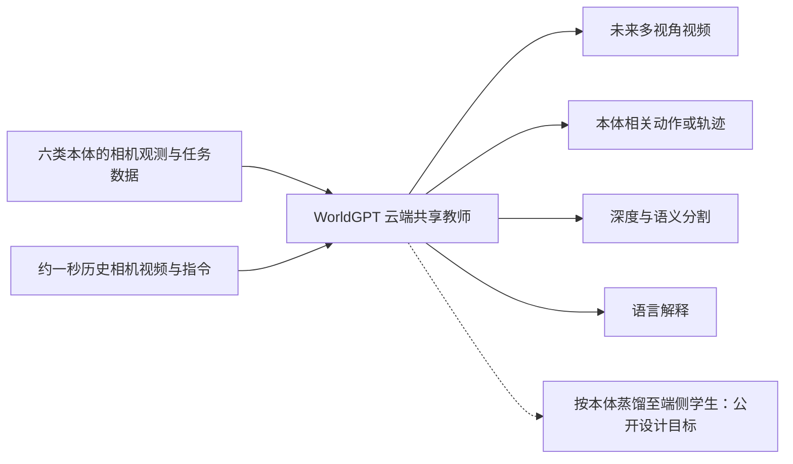

# WorldGPT: One World Action Model for Everything That Moves | 小鹏 WorldGPT：跨六类本体的世界动作模型

## 一句话定义

小鹏 WorldGPT 用约一秒的历史相机视频和指令，在同一套模型权重下给出未来画面、本体动作、视觉感知与语言推理；小鹏将它定位为可向不同本体的端侧模型蒸馏的云端教师。

## 英文缩写速查

| 缩写 | 英文全称 | 简要说明 |
|---|---|---|
| WAM | World Action Model | 世界动作模型；同时讨论未来场景与动作输出 |
| WOD-E2E | Waymo Open Dataset for End-to-End Driving | 项目页列举的端到端驾驶评测 |
| ADE | Average Displacement Error | 轨迹平均位移误差，越低越好 |
| MT50 | Multi-Task 50 | Meta-World 的 50 项单臂操作评测 |

## 为什么重要

它把跨本体共享的问题放在视觉层，而非假设驾驶转角、飞行轨迹与机械臂动作可以投进同一个控制接口。工程上应分别问两件事：共有视觉经验是否让目标本体学得更好？蒸馏后的学生在真实闭环中是否保留这种增益？

## 核心机制与组件结构

| 条目 | 公开范围 |
|---|---|
| 机构 | 小鹏（XPeng），XPeng PWM Team |
| 本体 | 汽车、船、无人机、单臂、双臂、人形 |
| 条件 | 约一秒的单/多相机历史画面及指令；部分驾驶示例有额外路线或地图条件 |
| 输出 | 未来多视角视频、按本体定义的动作/轨迹、深度与分割、语言解释 |
| 部署思路 | 云端共享教师，按本体蒸馏为较小的端侧学生；学生验证数据尚未披露 |

## 流程总览

图仅表示官方披露的输入、输出和教师层；它不假定视频与动作的解码顺序、联合损失或控制频率。

## 评测与演示

以下为[项目页](https://worldgpt-1.github.io/#benchmarks)截至 **2026-11-12** 的快照，不是当前实时排名，也不是本仓库实测。小鹏自报四个领域共 12 项第一（含并列）。

| 评测 | WorldGPT | 口径 |
|---|---:|---|
| WOD-E2E | RFS 8.3132 | 官方榜单测试集；3 s / 5 s 的 ADE 分别为 1.0769 / 2.4059 |
| Meta-World MT50 | 95.2 | 按 Evo-1 协议汇总，四个难度组等权 |
| LIBERO-Pro 2.0 | 静态 73.3 / 运行时 80.1 / 综合 76.5 | 使用官方训练数据；综合覆盖 167 个评测单元，与原版 LIBERO-Pro 分开读 |
| BLINK | 相对深度 95.97 / 空间关系 93.01 | 验证集上的两个子任务；不等于操作成功率 |
| WorldOlympiad | 总分 0.683，并列 | 0.890 是物理子项而非总分；视频评测不等于真机闭环 |

32 个网页样例从记录画面起步，把后续生成结果和真实录像并排展示。改指令系列可直观看到未来受条件影响，但汽车示例的航点、路线提示或图像输入也随版本变化，不能据此估计纯语言干预的因果增益。

## 与其他工作对比

- **同表指标：** 项目页的 LIBERO-Pro 2.0 表里，WorldGPT 综合 76.5 高于 [LingBot-VA](./paper-sa-2601-21998-lingbot-va-causal-video-action-world-model-for-g.md) 的 75.0；仅看运行时扰动则为 80.1 对 81.8，排序反转。这个对比只能说明该快照下两类扰动的取舍，不能证明统一视觉共训更强，训练数据没有受控。
- **训练范围：** [Dyna-2](./dyna-2.md) 把人类第一视角视频预训练与机器人后训练分开，并报告按数据规模改变的结果；WorldGPT 项目页强调多种本体共训后由教师迁移给学生。两者证据与目标本体不同，不能将 Dyna-2 的数据缩放证据外推成 WorldGPT 的跨本体迁移收益。

## 工程实践

若把云端教师接入端侧评测，建议先固定相机标定、动作坐标系、时域与控制频率，再在同一目标本体上对照「单本体训练」「多本体教师」「蒸馏学生」，分别记录闭环任务成功率、约束违规与观测到动作的延迟。这是复现实验建议，不是项目方已公开的部署配方。

## 局限与风险

- 网页没有给出按本体消融、训练数据比例、动作接口定义或同算力的单本体对照；同权重展示六类动作不等于已测到正迁移，也不能据此判断属于具体哪一种 WAM 计算图。
- 暂未见端侧学生规模、闭环延迟和控制频率；驾驶、操作和生成的榜单不能合起来当作船、无人机和人形的闭环验证。
- 截至核对日期，技术报告仍待发布，官方入口未给可下载的模型代码、权重或自有训练数据。**源码运行时序图不适用**：可访问的网页代码只负责展示，不能代表模型执行链。
- 注意同名：2024 年 [WorldGPT: Empowering LLM as Multimodal World Model](https://arxiv.org/abs/2404.18202) 是独立研究，不是小鹏实现。

## 结论

这是一个跨本体共训和教师蒸馏的公开案例，现阶段适合看条件与输出如何设计，还不能当作可复现、可部署的端侧方案。后续优先核对跨本体数据消融、按本体的学生闭环指标和实测延迟。

## 关联页面

- [世界动作模型](../concepts/world-action-models.md)：区分外显输出与计算图分类。
- [生成式世界模型](../methods/generative-world-models.md)：理解多视角未来视频预测，区分视觉可用性和控制可用性。
- [视觉–语言–动作模型（VLA）](../methods/vla.md)：对照从相机观测与语言到动作的策略接口，以及 WAM 额外输出的未来观测。
- [Dyna-2](./dyna-2.md)：人类第一视角预训练和人到机缩放证据。
- [WAM 纵深路线](../../roadmap/depth-wam.md)：Stage 5 的共训与评测入口。

## 推荐继续阅读

- [XPENG 官方发布稿](https://www.xpeng.com/pressroom/news/01a20bcf44b3a1e838d68a02a2110153)：模型定位与公开声明。
- [LIBERO-Pro 2.0 评测论文](https://arxiv.org/abs/2610.24587)：区分静态与运行时扰动及汇总口径。

## 参考来源

- [WorldGPT 官方项目页与官方发布归档](../../sources/sites/xpeng-worldgpt.md)
