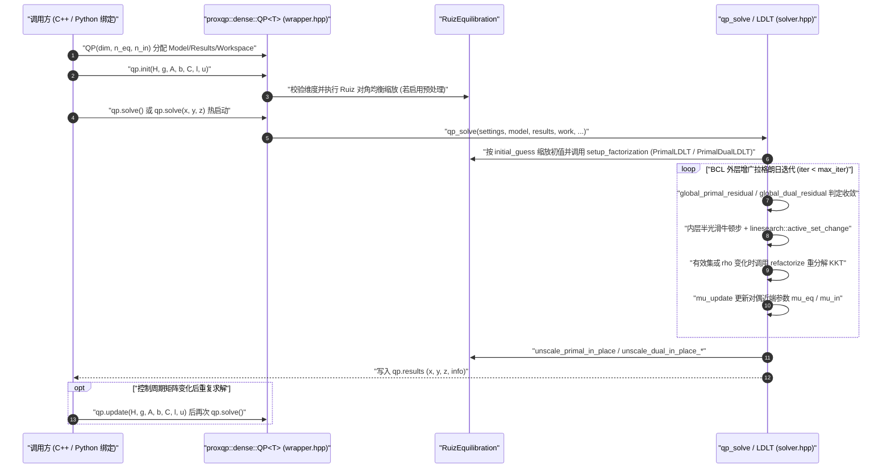

# ProxSuite

[ProxSuite](https://github.com/Simple-Robotics/proxsuite) 收录于具身智能研究室 [开源项目主表](https://github.com/RealXiaoze/humanoid-motion-intelligence/blob/main/%E8%AE%BA%E6%96%87%E4%B8%8E%E9%A1%B9%E7%9B%AE/%E5%BC%80%E6%BA%90%E9%A1%B9%E7%9B%AE%E4%B8%BB%E8%A1%A8.md) 的「工程与实机部署」分组，是本库为该入口建立的独立详情节点。

## 一句话定义

提供面向稠密和稀疏二次规划、锥规划的近端求解器，并针对重复求解和机器人实时控制优化接口；可作为全身控制或轨迹优化中需要低延迟热启动的数值组件。

## 英文缩写速查

| 缩写 | 英文全称 | 简要说明 |
|------|----------|----------|
| Sim2Real | Simulation to Real | 仿真到真机部署主线 |
| RL | Reinforcement Learning | 训练与评测常用框架 |
| API | Application Programming Interface | 仿真/中间件编程接口 |
| SDK | Software Development Kit | 真机与工具链开发套件 |

## 为什么重要

- **主表工程定位清晰**：该条目被放在「工程与实机部署」下，说明它服务的是这条人形运动智能问题链上的具体环节，而不是泛泛的链接收藏。
- **可对照开源边界**：主表已概括其可复现范围（训练/推理/部署或仅方法页）；选型时应先读本页「开源状态」，再回官方 README / 项目页核对许可证与平台支持。
- **便于知识库交叉引用**：独立节点让路线图、对比页与 ingest 日志可以稳定链接，避免只在策展列表里「点名」却无法下钻。

## 核心原理

### 在技术路线中的位置

| 字段 | 内容 |
|------|------|
| 主表分组 | 工程与实机部署 |
| 官方入口 | https://github.com/Simple-Robotics/proxsuite |
| 开源状态（据主表） | 已开源（以官方仓库 README 为准） |

主表给出的技术定位可压缩为：

> 提供面向稠密和稀疏二次规划、锥规划的近端求解器，并针对重复求解和机器人实时控制优化接口；可作为全身控制或轨迹优化中需要低延迟热启动的数值组件。

阅读时建议抓住三点：**(1) 输入是什么数据或观测；(2) 输出是参考轨迹、策略、数据还是中间件能力；(3) 公开材料能否支撑训练/部署复现。**

### 流程直觉（对照主表叙事）

具体模块边界以官方文档为准；本页不替代 README。

## 源码运行时序图

以下时序对照 `Simple-Robotics/proxsuite`（`devel` 分支）中 [examples/python/overview-simple.py](https://github.com/Simple-Robotics/proxsuite/blob/devel/examples/python/overview-simple.py)、[include/proxsuite/proxqp/dense/wrapper.hpp](https://github.com/Simple-Robotics/proxsuite/blob/devel/include/proxsuite/proxqp/dense/wrapper.hpp) 与 [include/proxsuite/proxqp/dense/solver.hpp](https://github.com/Simple-Robotics/proxsuite/blob/devel/include/proxsuite/proxqp/dense/solver.hpp)，展示 Dense ProxQP 从建模初始化到重复热启动求解的运行路径：

> **源码映射说明**：外部调用接口 `QP::init`、`QP::update`、`QP::solve` 定义于 `include/proxsuite/proxqp/dense/wrapper.hpp`（Python 最小示例见 `examples/python/overview-simple.py`）；核心 `qp_solve`、`refactorize` 与 `mu_update` 实现位于 `include/proxsuite/proxqp/dense/solver.hpp`。

## 工程实践

1. **先核入口类型**：若是 GitHub/Gitee 仓库，从 README 的安装、训练与部署章节入手；若是项目页/论文，先确认是否已挂代码或权重。
2. **对齐本体与接口**：人形项目需核对关节顺序、控制频率、观测契约与仿真后端（Isaac / MuJoCo 等）是否与本机栈一致。
3. **按主表定位做消融**：主表强调的可分拆实验切口（例如只换重定向约束、只换部署层）应优先验证，避免一上来全链路重训。
4. **记录开源边界**：若仅有权重、Sim2Sim 或说明文档，不要假设训练管线可复现。

| 检查项 | 建议 |
|--------|------|
| 许可与星标时效 | 以官方仓库页面为准 |
| 支持机器人 / 仿真 | 读 assets 与 task 配置 |
| 真机入口 | 查找 SDK、ROS、ONNX/JIT 导出说明 |

## 局限与风险

- **主表是策展摘要**：细节、指标与许可以一手来源为准；本页只做知识库节点与导航。
- **开源状态可能变化**：标为待发布的项目后续可能放码；已开源仓库也可能拆分或迁移路径。
- **不要与同名论文页混淆**：若本库另有 `paper-*` 深读页，以论文页承载方法细节，本实体页侧重工程入口与选型。

## 关联页面

- [sim2real](../concepts/sim2real.md)
- [isaac-lab](../entities/isaac-lab.md)
- [Humanoid Motion Intelligence](./humanoid-motion-intelligence.md)
- [开源主表覆盖索引](../queries/hmi-opensource-projects-coverage.md)
- [Model Predictive Control (MPC，模型预测控制)](../methods/model-predictive-control.md) — 重复 QP 子问题与热启动是实时 MPC 可关注的数值环节；求解器不替代控制建模。
- [Trajectory Optimization（轨迹优化）](../methods/trajectory-optimization.md) — 作为优化子问题的候选求解组件，需按问题结构与约束形式核对适用性。

## 参考来源

- [ProxSuite 来源归档](../../sources/repos/proxsuite.md)
- [Humanoid Motion Intelligence 仓库归档](../../sources/repos/humanoid-motion-intelligence.md)
- [开源项目主表（上游）](https://github.com/RealXiaoze/humanoid-motion-intelligence/blob/main/%E8%AE%BA%E6%96%87%E4%B8%8E%E9%A1%B9%E7%9B%AE/%E5%BC%80%E6%BA%90%E9%A1%B9%E7%9B%AE%E4%B8%BB%E8%A1%A8.md)

## 推荐继续阅读

- [官方入口](https://github.com/Simple-Robotics/proxsuite)
- [Humanoid Motion Intelligence 知识库实体页](./humanoid-motion-intelligence.md)
