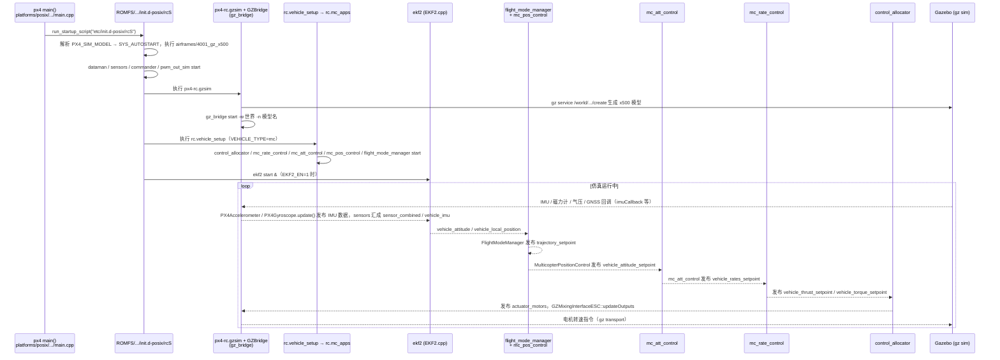

---

type: entity
tags: [repo, autopilot, px4, mavlink, uav, multirotor, open-source, linux-foundation]
status: complete
updated: 2026-09-16
related:
  - ../overview/multirotor-simulation-planning-control-stack.md
  - ../concepts/sim2real.md
  - ../concepts/can-bus-protocol.md
  - ./airsim.md
  - ./mavsdk.md
  - ./ardupilot.md
  - ./ego-planner-swarm.md
  - ./xtdrone.md
  - ./crazyflie-firmware.md
  - ./betaflight.md
  - ./project-quiver.md
sources:
  - ../../sources/repos/px4_autopilot.md
  - ../../sources/sites/cia_dronecan_uavcan.md
summary: "PX4 是 Dronecode 生态的开源自动驾驶仪：多机型飞控固件、EKF 估计、任务/Offboard 模式、SITL 与 MAVLink，常与 QGroundControl、MAVSDK、Gazebo/AirSim 仿真组合。"
---

# PX4 Autopilot

**PX4**（[PX4/PX4-Autopilot](https://github.com/PX4/PX4-Autopilot)）是面向多旋翼、固定翼、VTOL 等的 **开源飞控固件**，通过 **MAVLink** 与地面站、伴机、仿真器通信，是民用与研究无人机领域最常见的基础栈之一。

## 英文缩写速查

| 缩写 | 英文全称 | 简要说明 |
|------|----------|----------|
| Sim2Real | Simulation to Real | 把仿真中学到的策略迁移落地真机的工程主线 |
| ROS 2 | Robot Operating System 2 | 机器人系统集成与通信的常用中间件 |
| IMU | Inertial Measurement Unit | 惯性测量单元，提供加速度与角速度 |

## 为什么重要

- **分层清晰**：机载闭环（估计 + 控制）与伴机规划（ROS / MAVSDK）解耦，便于 Sim2Real 与算法迭代。
- **生态完整**：QGroundControl 校准、**SITL** 软件在环、ROS2 `px4_ros_com`、大量硬件支持包。
- 与仓库 [多旋翼栈总览](../overview/multirotor-simulation-planning-control-stack.md) 中 XTDrone、EGO-Planner、AirSim 等均为 **执行层锚点**。

## 核心结构/机制

| 组件 | 说明 |
|------|------|
| **uORB** | 机载发布/订阅总线，模块间解耦 |
| **EKF2** | 多传感器融合（IMU、GPS、视觉、光流等） |
| **MC/FW 控制器** | 多旋翼姿态/速率/位置；固定翼横向/纵向 |
| **Navigator** | 任务、返航、降落状态机 |
| **MAVLink** | 地面站、Offboard 设定点、参数读写 |
| **SITL** | 无硬件在 PC 上跑完整飞控栈 |

**Offboard 模式**：伴机以一定频率发送位置/速度/姿态设定点，PX4 内环跟踪——与 [EGO-Planner](https://github.com/ZJU-FAST-Lab/ego-planner-swarm) 等规划器对接的标准方式。

外设 **ESC、GPS** 等可走 [DroneCAN](../../sources/sites/cia_dronecan_uavcan.md)（见 [电机协议总览](../overview/motor-drive-firmware-bus-protocols.md) 中 DroneCAN 行）。

## 常见误区或局限

- **误区：装好 PX4 就等于完成自主导航** — 仍需定位、规划、避障与安全监管；飞控只保证 **可飞行的低层跟踪**。
- **误区：SITL 与真机参数一致** — 需重新校准传感器、推力模型与延迟；Sim2Real 见 [Sim2Real](../concepts/sim2real.md)。
- **局限：微四轴** — 27g 级 [Crazyflie Firmware](./crazyflie-firmware.md) 不走 PX4，选型勿混淆。

## 源码运行时序图

入口：`make px4_sitl gz_x500`（`src/modules/simulation/gz_bridge/CMakeLists.txt` 生成的 `gz_x500` 目标，以 `PX4_SIM_MODEL=gz_x500` 启动 `px4` 可执行文件；以下为多旋翼 + Gazebo SITL 路径）

图依据：PX4/PX4-Autopilot@2ade646，读过 `platforms/posix/src/px4/common/main.cpp`、`ROMFS/px4fmu_common/init.d-posix/{rcS,px4-rc.simulator,px4-rc.gzsim,airframes/4001_gz_x500}`、`ROMFS/px4fmu_common/init.d/{rc.vehicle_setup,rc.mc_apps}`、`src/modules/simulation/gz_bridge/{CMakeLists.txt,GZBridge.cpp,GZBridge.hpp,GZMixingInterfaceESC.cpp}`、`src/modules/{ekf2/EKF2,flight_mode_manager/FlightModeManager,mc_pos_control/MulticopterPositionControl,mc_att_control/mc_att_control_main,mc_rate_control/MulticopterRateControl,control_allocator/ControlAllocator}.{hpp,cpp}`（uORB 订阅/发布关系取自上述文件）。

## 参考来源

- [sources/repos/px4_autopilot.md](../../sources/repos/px4_autopilot.md)
- [sources/sites/cia_dronecan_uavcan.md](../../sources/sites/cia_dronecan_uavcan.md)
- [PX4/PX4-Autopilot](https://github.com/PX4/PX4-Autopilot)
- 源码核对（2026-11-02）：PX4/PX4-Autopilot@2ade646，读过 `platforms/posix/src/px4/common/main.cpp`、`ROMFS/px4fmu_common/init.d-posix/` 下 rcS/px4-rc.simulator/px4-rc.gzsim/airframes/4001_gz_x500、`ROMFS/px4fmu_common/init.d/` 下 rc.vehicle_setup/rc.mc_apps、`src/modules/simulation/gz_bridge/` 与 ekf2/flight_mode_manager/mc_pos_control/mc_att_control/mc_rate_control/control_allocator 的主要源文件；时序图依据以上文件，未运行代码。

## 关联页面

- [多旋翼仿真—规划—飞控栈总览](../overview/multirotor-simulation-planning-control-stack.md)
- [PlotJuggler](./plotjuggler.md) — 打开 **ULog** 对比估计器、执行器与控制环时序
- [AirSim](./airsim.md)
- [MAVSDK](./mavsdk.md)
- [XTDrone](./xtdrone.md)
- [EGO-Planner Swarm](./ego-planner-swarm.md)
- [Betaflight](./betaflight.md) — FPV 手飞飞控对照
- [Project Quiver](./project-quiver.md) — 25 kg **ArduPilot** 开源机架对照（不是 PX4 分叉）
- [Sim2Real](../concepts/sim2real.md)

## 推荐继续阅读

- [PX4 User Guide — Flying](https://docs.px4.io/main/en/flying/)
- [MAVSDK Offboard](https://mavsdk.mavlink.io/main/en/cpp/guide/offboard.html)
- [ArduPilot](./ardupilot.md) — 独立飞控栈对照
