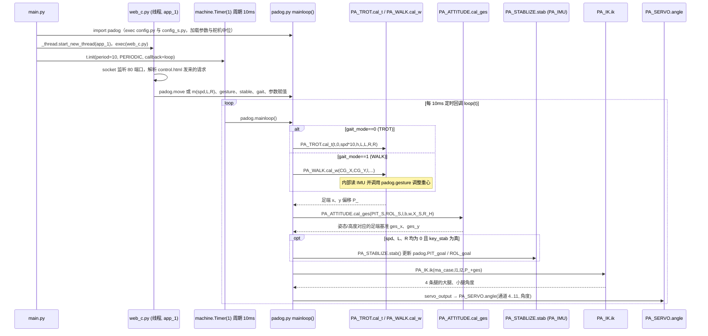

# 菠萝狗 Py-Apple Dog

**菠萝狗 Py-Apple Dog**（[GitHub](https://github.com/ToanTech/py-apple-quadruped-robot)）来自 [古月居转载的四足机器人开源项目综述](https://mp.weixin.qq.com/s/pRGoPm41qYCNyHPWR6Dl6A)，属「其他」组。

## 一句话定义

**菠萝狗（Py-Apple Dog）是低成本、可 DIY 的大型全套四足机器人软硬件开源项目，主站聚合四个子项目：Dynamics 控制软件、Controller 万能控制器、Structure 机械结构、BLDC 无刷四足。**

## 英文缩写速查

| 缩写 | 英文全称 | 简要说明 |
|------|----------|----------|
| BLDC | Brushless DC Motor | 无刷直流电机 |

## 为什么重要

- 综述把它放在「其他」这条技术路线下，作为可读源码的参照项目；横向对比见 [四足机器人开源项目技术地图：从极简运动学到研究级硬件（36 个 GitHub 项目）](../overview/quadruped-open-source-projects-technology-map.md)。
- 文中星标：1224（文章表述，入库日未复核）。

## 核心信息

| 项 | 内容 |
|----|------|
| **仓库** | [ToanTech/py-apple-quadruped-robot](https://github.com/ToanTech/py-apple-quadruped-robot) |
| **最近提交** | 2022-04-11 |
| **可达性** | `git ls-remote` 可达（2026-11-01） |
| **文章归类** | 其他 |

## 文章说法核对

- **文章：** 文章仅在附录清单列出（1224 星）。
- **README / 核查：** README 列出四个子项目（py-apple-dynamics、py-apple-controller、py-apple-structure、py-apple-bldc-quadruped-robot）及性能 / 遥控 / 平衡 / 二次开发 / AI 功能表。
- **差异与保留：** 本节点只对应「主站」仓库；四个子项目未单独建节点（文章未点名）。最近提交 2022-04-11。

## 源码运行时序图

本仓库为聚合主站，可运行代码仅为 `Py Apple Dynamics V6.8/` 下的 MicroPython 程序（ESP32）；`Py-Apple Controller V4.0`、`二代菠萝（Structure V10.0）` 目录为 PCB、文档、结构件，无运行时代码。

入口：先烧录 `micropython.bin`，再烧录 `V6.8 源代码/` 下文件（`用前读我.md`）；上电后 MicroPython 运行 `main.py`，默认 `run_mode=0`（网页遥控）。

图依据：py-apple-quadruped-robot@d2bb34f，`README.md`、`Py Apple Dynamics V6.8/.../用前读我.md`、`V6.8 源代码/` 下 `main.py`、`padog.py`、`web_c.py`、`PA_STABLIZE.py`、`PA_SERVO.py`（头部）、`PA_IK.py`（头部）、`PA_WALK.py`（头部）；`PA_TROT.py`、`PA_ATTITUDE.py`、`PA_IMU.py` 内部实现未读，仅按 `padog.py` 中的调用画出。`run_mode=1/2/3`（OpenMV 串口模式）未画。

## 关联页面

- [quadruped-robot](../entities/quadruped-robot.md)
- [locomotion](../tasks/locomotion.md)
- [quadruped-open-source-projects-technology-map](../overview/quadruped-open-source-projects-technology-map.md)

## 参考来源

- [py_apple_quadruped.md](../../sources/repos/py_apple_quadruped.md)
- [wechat_guyueju_quadruped_opensource_deep_dive_2026-11-01.md](../../sources/blogs/wechat_guyueju_quadruped_opensource_deep_dive_2026-11-01.md)
- [原文（微信公众号）](https://mp.weixin.qq.com/s/pRGoPm41qYCNyHPWR6Dl6A)
- 源码核对（2026-11-02）：ToanTech/py-apple-quadruped-robot@d2bb34f，读过 README.md、Py Apple Dynamics V6.8 下的 用前读我.md、main.py、padog.py、web_c.py、PA_STABLIZE.py，以及 PA_SERVO.py、PA_IK.py、PA_WALK.py 的开头部分；时序图依据以上文件，未运行代码。
