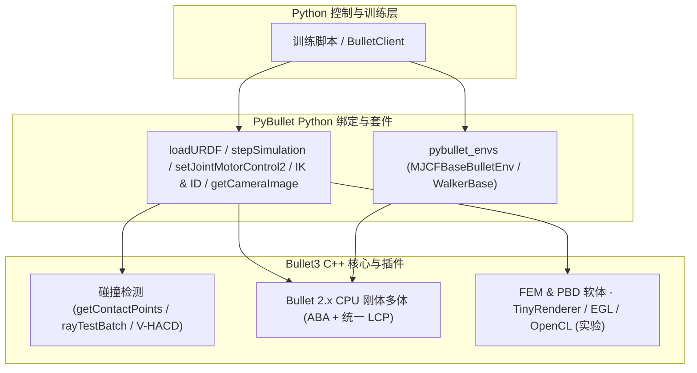
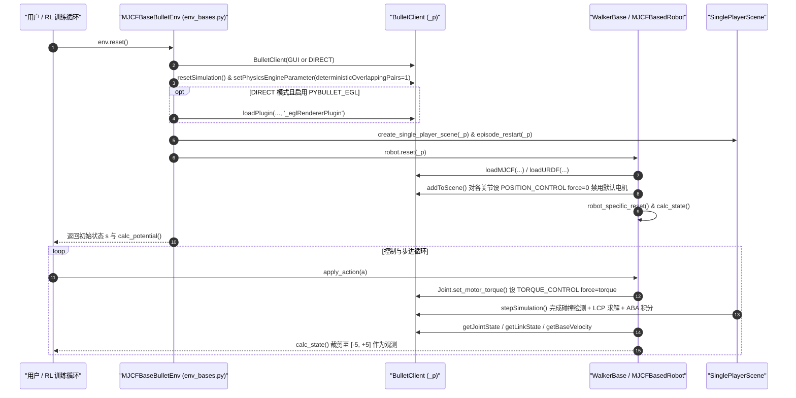

# PyBullet

**PyBullet** 把 **[Bullet3](https://github.com/bulletphysics/bullet3)** C++ 物理 SDK 封装为 **Python API**（`pip install pybullet`），是机器人 RL 领域最常见的 **轻量级入门仿真器** 之一：几分钟内即可加载 URDF/SDF/MJCF、设置重力、在循环里读状态、写电机指令。官方主页与案例索引见 [pybullet.org](https://pybullet.org/wordpress/)。

## 一句话定义

用 Python 客户端–服务器 API 直接以 `loadURDF` + `stepSimulation` 跑通 **状态–动作–奖励–物理转移** 闭环，兼具正逆动力学、逆运动学、软体耦合与内置视觉渲染，而不必先搭 ROS 或 GPU 仿真农场。

## 英文缩写速查

| 缩写 | 英文全称 | 简要说明 |
|------|----------|----------|
| URDF | Unified Robot Description Format | PyBullet 默认机器人描述文件格式（亦支持 SDF 与 MJCF） |
| RL | Reinforcement Learning | 强化学习；PyBullet 随包提供 `pybullet_envs` 与 `pybullet_data` |
| PD | Proportional–Derivative | `POSITION_CONTROL` / `VELOCITY_CONTROL` / `PD_CONTROL` 底层位置–速度控制模式 |
| GUI | Graphical User Interface | `p.connect(p.GUI)` 启动本地 OpenGL 调试窗口 |
| LCP | Linear Complementarity Problem | Bullet 刚体、多体与可变形体共用的统一接触互补约束求解器 |
| FEM / PBD | Finite Element Method / Position-Based Dynamics | `loadSoftBody` 支持的两类可变形体物理仿真方法 |
| ABA / RNEA / CRBA | Articulated Body / Recursive Newton-Euler / Composite Rigid Body Algorithm | Bullet 底层线性时间正动力学与 PyBullet 逆动力学、质量矩阵接口所基于的经典算法 |

## 为什么重要

- **教学与最小闭环：** 在进入 Isaac Lab 或 MuJoCo 大规模训练前，可用 KUKA 臂定点、倒立摆等 **几十行脚本** 把 MDP 五元组与仿真步进对齐（见 [具身 RL 最小闭环](../concepts/embodied-rl-minimal-closed-loop.md)）。
- **轻量科研与历史生态：** [motion_imitation](./motion-imitation-quadruped.md)（四足模仿动物，RSS 2020）、`MinitaurBulletEnv-v0`（RSS 2018 四足 Sim2Real 基准）、[gym-pybullet-drones](./gym-pybullet-drones.md)（四旋翼 RL）、早期 DeepMimic 复现与 [Habitat-Sim](./habitat-sim.md) Bullet 集成（`withbullet`）均依托 PyBullet。
- **开箱即用无强硬件依赖：** 官方提供预编译 manylinux wheel，可在无独显环境或 Colab 上用 `DIRECT` + `ER_TINYRENDERER` 运行物理与视觉闭环，降低算法原型与 [Imitation Learning](../methods/imitation-learning.md) / [PPO](../methods/ppo.md) / [SAC](../methods/sac.md) 消融门槛。

## 核心原理

### 客户端–服务器架构与 Bullet3 分层

官方 Quickstart 将 PyBullet 设计为**客户端–服务器**通信：Python 客户端向物理服务器发送指令并接收观测/状态。内置同进程模式包括 `DIRECT`（无 GUI，适合无头服务器）和 `GUI`（OpenGL 窗口），亦可通过 `SHARED_MEMORY`、`UDP` 或 `TCP` 连接独立或远程物理服务器；通过 `pybullet_utils.bullet_client.BulletClient` 可在单进程内隔离多个独立物理世界。默认物理后端为运行在 CPU 上的 **Bullet 2.x**，多体树正动力学采用 Articulated Body Algorithm（ABA），刚体、降维坐标多体与可变形体由统一 LCP 约束求解器处理。

### 核心 API 能力矩阵（Quickstart 全文核对）

| 能力模块 | 核心函数与机制 | 关键工程细节 |
|---------|---------------|--------------|
| 模型与场景管理 | `loadURDF`、`loadSDF`、`loadMJCF`、`createCollisionShape` / `createMultiBody` | 支持内存/磁盘状态快照 `saveState`、`saveBullet`、`restoreState` 与导出 `saveWorld` |
| 步进与物理配置 | `stepSimulation`、`performCollisionDetection`、`setRealTimeSimulation` | 默认时间步 `1/240 s`；默认关实时步进保持确定性；`setPhysicsEngineParameter` 可设 `deterministicOverlappingPairs=1` 与 ERP |
| 电机与约束控制 | `setJointMotorControl2` / `Array`、`createConstraint`、`enableJointForceTorqueSensor` | 支持 `POSITION_CONTROL`、`VELOCITY_CONTROL`、`TORQUE_CONTROL`、`PD_CONTROL` 与实验性 `STABLE_PD_CONTROL` |
| 状态与动力学查询 | `getLinkState`、`getJointState`、`getBasePositionAndOrientation`、`getDynamicsInfo` / `changeDynamics` | 位姿采用四元数 `[x, y, z, w]`；`getLinkState` 返回质心位置；`changeDynamics` 可调整默认线/角阻尼与速度钳制 |
| 软体与视觉 | `loadSoftBody`、`getCameraImage` | `loadSoftBody` 支持 FEM / PBD；`getCameraImage` 返回 RGBA、深度与分割掩码，可选 CPU `ER_TINYRENDERER` 或 GPU OpenGL / `eglRendererPlugin` |
| 碰撞与解析动力学 | `getContactPoints`、`getClosestPoints`、`rayTestBatch`、`calculateInverseKinematics(2)`、`calculateInverseDynamics`、`calculateJacobian`、`calculateMassMatrix` | IK 支持 DLS 与 SDLS 及零空间姿态；ID 基于 RNEA、质量矩阵基于 CRBA |

## 源码运行时序图

以下时序图依据 `pybullet_envs` 核心基类源码（`env_bases.py`、`robot_bases.py`、`robot_locomotors.py`）与 Quickstart 步进规范梳理，展示了 `MJCFBaseBulletEnv` + `WalkerBase` 如何绕开默认电机陷阱并把力矩指令送入 Bullet 步进：

关键源码锚点：`MJCFBaseBulletEnv.reset()` 位于 `pybullet_envs/env_bases.py`，`XmlBasedRobot.addToScene()` 与 `Joint.set_torque()` 位于 `pybullet_envs/robot_bases.py`，`WalkerBase.apply_action()` 与 `WalkerBase.calc_state()` 位于 `pybullet_envs/robot_locomotors.py`；底层的单步驱动入口 `stepSimulation()` 规范见官方 Quickstart 手册（未单独通读未提供的上层具体任务子类文件如 `gym_locomotion_envs.py`）。

## 工程实践

1. **力矩控制前必须关闭默认电机：** 每个旋转/平移关节加载时默认启用隐式速度电机（目标速度 0、最大力矩非零），做 `TORQUE_CONTROL` 前必须先调用 `setJointMotorControl2(..., VELOCITY_CONTROL, force=0)`（或 `pybullet_envs` `addToScene` 中用 `force=0` 的方式清零默认力矩），且 `TORQUE_CONTROL` 仅在显式 `stepSimulation()` 下生效。官方 FAQ 推荐先从位置或速度控制起步验证模型，再切换至力矩控制。
2. **时间步长与子步对齐：** 默认 `1/240 s`；若外层策略按 60 Hz 决策，每控制周期需执行 4 次 `stepSimulation()`（或调用 `setTimeStep` / `frame_skip` 对齐）以保持与默认积分设置兼容的数值稳定性。
3. **清理默认阻尼与速度钳制：** PyBullet 对连杆默认施加非零线/角阻尼，并将刚体/关节速度钳制在 `100`；系统辨识或高速刚体验证需通过 `changeDynamics(..., linearDamping=0, angularDamping=0)` 显式清除。
4. **正确解读 `getLinkState` 位姿：** 该接口默认返回**连杆质心（CoM）**的世界位置和四元数，若要换算回 URDF 连杆原点坐标，必须结合返回值附带的局部惯性偏移字段做逆变换。
5. **无头视觉渲染路径选择：** `DIRECT` 模式下可用纯 CPU `ER_TINYRENDERER` 调用 `getCameraImage`；若需 GPU 加速离屏渲染，可在 Linux 设置 `PYBULLET_EGL=1` 加载 `eglRendererPlugin` 后切换 `ER_BULLET_HARDWARE_OPENGL`。
6. **内置 `pybullet_envs` 兼容边界：** `pip install pybullet` 自带的 Ant、Humanoid、Minitaur 与 DeepMimic 重实现基于早期 Gym 接口（`reset()` 单返回值、`step()` 4 元组），部分 DeepMimic 示例脚本依赖 TensorFlow 1.x，现代 PyTorch / Gymnasium 工程需包一层接口适配器。

## 局限与风险

| 场景 | PyBullet | 更常见替代方案 |
|------|----------|---------------|
| RL 入门、机械臂定点 / 抓取教学 | ✅ 轻量足够 | — |
| 四旋翼多机仿真基准 | ✅ [gym-pybullet-drones](./gym-pybullet-drones.md) | Flightmare / Isaac |
| 万级环境并行人形 PPO 训练 | ⚠️ CPU 单进程扩展性有限 | [Isaac Lab](./isaac-gym-isaac-lab.md) |
| 足式 / 灵巧操作高保真接触与系统辨识 | ⚠️ 默认 Bullet 2.x 统一 LCP 接触求解器，且存在默认阻尼与旧版接口适配负担 | [MuJoCo](./mujoco.md)（配系统辨识） |
| 可微物理 / 端到端梯度回传 | ❌ 默认引擎不可微 | MuJoCo MJX / 可微仿真栈 |

来自官方文档与仓库 README 的附加风险点：

- Bullet 3.x 的 OpenCL GPU 管线长期处于实验状态（需独立高端显卡且不支持 OpenCL CPU 设备），机器人界常规调用仍运行在 CPU Bullet 2.x 上。
- 官方 `bulletphysics/bullet3` GitHub 仓库的 Issues 区因支持请求过多已关闭，历史文档与 Kuka 等示例环境可能年久失修，排障需查阅源码与 PyBullet 论坛。

## 与其他页面的关联

- [具身 RL 最小闭环](../concepts/embodied-rl-minimal-closed-loop.md) — KUKA 臂最小闭环与 MDP 要素对照
- [motion_imitation](./motion-imitation-quadruped.md) — Google Research 四足 PyBullet 模仿学习基准
- [gym-pybullet-drones](./gym-pybullet-drones.md) — 基于 PyBullet 的四旋翼 Gymnasium 环境
- [Reinforcement Learning](../methods/reinforcement-learning.md) · [PPO](../methods/ppo.md) · [SAC](../methods/sac.md) · [Imitation Learning](../methods/imitation-learning.md)
- [Locomotion](../tasks/locomotion.md) · [Manipulation](../tasks/manipulation.md)
- [MuJoCo](./mujoco.md) · [Isaac Gym / Isaac Lab](./isaac-gym-isaac-lab.md) · [MuJoCo vs Isaac Sim](../comparisons/mujoco-vs-isaac-sim.md)
- [接触互补形式化](../formalizations/contact-complementarity.md) · [Sim2Real](../concepts/sim2real.md)
- [iGibson](./igibson.md) · [Habitat-Sim](./habitat-sim.md) · [仿真平台十年技术地图](../overview/sim-platforms-decade-technology-map.md)
- [AwesomeSim2Real](./awesome-sim2real.md) · [AwesomeSim2Real 技术地图](../overview/lc-awesome-sim2real-technology-map.md)

## 参考来源

- [PyBullet Quickstart Guide（官方 API 文档与 `pybullet_envs` 基类源码通读）](../../sources/sites/pybullet-quickstart-guide.md) — Quickstart 4629 行全文与 `env_bases.py` / `robot_bases.py` / `robot_locomotors.py` 核对
- [Bullet3 Physics SDK](../../sources/repos/bullet3.md) — 官方 C++ 仓库、`examples/pybullet` 与构建说明
- [PyBullet 官方网站](../../sources/sites/pybullet-org.md) — 案例索引、Colab 与论坛入口
- [深蓝具身智能：跑通具身控制最小闭环](../../sources/blogs/wechat_shenlan_rl_embodied_minimal_closed_loop.md) — KUKA 教学案例
- [habitat-sim](../../sources/repos/habitat-sim.md) · [wechat_shenlan_sim_platforms_top8_decade](../../sources/blogs/wechat_shenlan_sim_platforms_top8_decade.md)
- [AwesomeSim2Real PyBullet 条目](../../sources/papers/lc_awesome_sim2real_noarxiv_099_pybullet-real-time-physics-simulation.md) · [AwesomeSim2Real 目录](../../sources/papers/lc_awesome_sim2real_catalog.md) · [AwesomeSim2Real 仓库](../../sources/repos/awesome-sim2real.md)

## 推荐继续阅读

- [PyBullet Quickstart Guide 原文](https://docs.google.com/document/d/10sXEhzFRSnvFcl3XxNGhnD4N2SedqwdAvK3dsihxVUA/edit) — 客户端连接、关节控制模式与碰撞/IK 完整参考
- [bulletphysics/bullet3 GitHub 仓库](https://github.com/bulletphysics/bullet3) — `examples/pybullet` 源码与 `pybullet_envs` 实现
- [PyBullet 官方主页与 Colab 示例](https://pybullet.org/wordpress/) — 官方研究案例与论坛入口
- [motion_imitation 项目页](https://github.com/google-research/motion_imitation) — 四足动物动作模仿开源实现
- [AwesomeSim2Real 仓库](https://github.com/LongchaoDa/AwesomeSim2Real)
